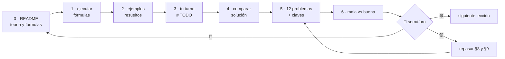

# Cómo estudiar este repo

🏠 [Volver al inicio](README.md) · ➡️ [Empezar: Lección 00](lecciones/00-que-es-ejecutar-un-programa/)

> Lectura de 5 minutos. Te dice **por dónde empezar**, **en qué orden** abrir cada archivo y
> **cuándo** puedes pasar a la siguiente lección.

---

## 1. El orden general

1. **Fase 0** — las 18 lecciones de [`lecciones/`](lecciones/README.md), de la **00 a la 17**, en orden.
2. **Fase 1** — los 13 capítulos de [`fase-1/capitulos/`](fase-1/capitulos/README.md), del **1 al 13**, en orden.

Cada lección dice arriba **"Orden de estudio: N de 18"** y **"Antes necesitas: …"**. Si
algo de "Antes necesitas" no lo dominas, vuelve a esa lección primero.

## 2. Qué hay dentro de cada lección (y en qué orden se abre)

Los archivos están **numerados en el orden en que se estudian**:

| Paso | Archivo | Para qué sirve |
|:-:|---|---|
| **0** | `README.md` | **Empieza aquí.** Es el *formulario*: teoría, tablas de fórmulas, propiedades, errores frecuentes, ejemplos resueltos, problemas y claves. |
| **1** | `paso1_formulas.py` | Todas las fórmulas de las tablas, **ejecutables**. Lo corres y comparas cada línea con la tabla. |
| **2** | `paso2_ejemplos_resueltos.py` | Los ejemplos resueltos del README, paso a paso. |
| **3** | `paso3_tu_turno.py` | **Te toca a ti:** completas los huecos `# TODO`. |
| **4** | `paso4_tu_turno_solucion.py` | La solución de referencia, para comparar con la tuya. |
| **5** | `paso5_solucionario/` | Las soluciones de los 12 problemas (básico, intermedio y avanzado). **Ábrelo después de intentarlos.** |
| **6** | `paso6_ejercicios/` | Refuerzo: cada ejercicio con una solución **mala** (funciona pero tiene un defecto) y una **buena**. |
| 🧪 | `test_paso3_tu_turno.py` | *(desde la Lección 08)* el test que tu `paso3` debe pasar. Empieza en **rojo** y lo pones en **verde**. |

> **¿Por qué `paso1_...` y no `1_...`?** En Python, un archivo cuyo nombre empieza con un
> número **no se puede importar**. Desde la Lección 08, pytest necesita importarlos.

## 3. El ciclo de una lección


**Cómo leerlo:** se avanza del README al paso 6 y al final se evalúa con el semáforo. En
🟢 pasas a la siguiente. En 🟡 repasas los errores frecuentes y los ejemplos, y reintentas
los problemas. En 🔴 vuelves a empezar la lección.

## 4. El semáforo 🚦 (cuándo pasar a la siguiente)

| Indicador | Criterio |
|:-:|---|
| 🟢 **Sigue** | tu `paso3` da la salida esperada (o sus tests en verde) **y** aciertas **≥ 9 de 12** problemas **y** respondes las preguntas de recuerdo sin mirar |
| 🟡 **Repasa** | aciertas **6 a 8** problemas |
| 🔴 **Repite** | aciertas **menos de 6** |

## 5. Cómo ejecutar los archivos

Siempre desde la carpeta raíz del repo:
```bash
uv sync                                                              # solo la primera vez
uv run python lecciones/05-listas-y-diccionarios/paso1_formulas.py  # ejecutar un paso
uv run pytest lecciones/08-modulos-y-pytest -q                       # tests (desde la 08)
```
> ⚠️ Corre pytest **una lección a la vez** (como arriba), nunca `uv run pytest lecciones/`.
> Desde la 08 todas las lecciones tienen un `test_paso3_tu_turno.py` y un `paso3_tu_turno.py`
> con el **mismo nombre**, y pytest se confunde si los junta. Además, hasta que completes tus
> `# TODO`, esos tests salen en **rojo a propósito**.
Para ver qué cambia entre tu versión y la solución, o entre la mala y la buena:
```bash
git diff --no-index lecciones/05-listas-y-diccionarios/paso3_tu_turno.py lecciones/05-listas-y-diccionarios/paso4_tu_turno_solucion.py
```

## 6. Cómo marcar tu avance

En [`progreso/fase-0-python.md`](progreso/fase-0-python.md), sección **"Mi avance (lo marcas
tú)"**, cambias ⬜ por ✅ y anotas el color del semáforo. Luego haces commit:
```bash
git add progreso/fase-0-python.md
git commit -m "avance: lección 05 en verde"
```
> Esas marcas **no se ponen con un clic** al ver el archivo en GitHub: se editan. A cambio,
> cada lección terminada queda registrada en tu historial de Git.

## 7. Si te trabas

1. Vuelve a la **tabla de fórmulas** (§5/§6 del README): cada `# TODO` dice qué fórmula usar.
2. Lee los **errores frecuentes** (§8): casi siempre el error que ves está ahí, con su mensaje.
3. Repite el **ejemplo resuelto** más parecido (§9) línea por línea.
4. Solo después, mira la solución (`paso4` o `paso5_solucionario`).

---

🏠 [Volver al inicio](README.md) · ➡️ [Empezar: Lección 00](lecciones/00-que-es-ejecutar-un-programa/)
