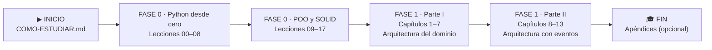

# Aprendiendo DDD con Python y FastAPI

Aprendizaje guiado **desde cero en Python** hasta los patrones de arquitectura
(DDD, TDD, arquitectura dirigida por eventos) del libro
*Architecture Patterns with Python* de Harry Percival y Bob Gregory
([Cosmic Python](https://www.cosmicpython.com/)), adaptando los ejemplos de
**Flask a FastAPI**.

---

## ▶ EMPIEZA AQUÍ

1. Lee **[Cómo estudiar este repo](COMO-ESTUDIAR.md)** (5 min): qué hay en cada lección y en qué orden se abre.
2. Abre la **[Lección 00 · ¿Qué es ejecutar un programa?](lecciones/00-que-es-ejecutar-un-programa/)** y sigue su **Ruta de estudio** numerada.
3. Al terminar cada lección, mira su **semáforo 🚦** y marca tu avance en **[progreso/](progreso/)**.
4. Sigue el orden del **[índice de lecciones](lecciones/README.md)** y luego el de los **[capítulos del libro](fase-1/capitulos/README.md)**.

## 🗺️ Mapa de ruta


**Cómo leerlo:** se avanza de izquierda a derecha y **no conviene saltar etapas**. La
Fase 0 enseña el Python que el libro da por sabido; la Fase 1 sigue el libro capítulo a
capítulo, construyendo un único proyecto (*allocation*: asignar pedidos a lotes de stock).

| Etapa | Qué aprendes | Dónde | Tiempo aprox. |
|---|---|---|:-:|
| **Fase 0 · Python** | ejecutar, variables, if, bucles, funciones, listas/dicts, clases, excepciones, módulos, pytest | [`lecciones/00–08`](lecciones/README.md) | ≈ 17 h |
| **Fase 0 · POO y SOLID** | encapsulación, herencia, polimorfismo, abstracción, SRP, OCP, LSP, ISP, DIP | [`lecciones/09–17`](lecciones/README.md) | ≈ 16 h |
| **Fase 1 · Parte I** | modelo de dominio, Repository, Service Layer + FastAPI, Unit of Work, Aggregates | [`fase-1/capitulos/01–07`](fase-1/capitulos/README.md) | — |
| **Fase 1 · Parte II** | eventos, message bus, comandos, microservicios, CQRS, inyección de dependencias | [`fase-1/capitulos/08–13`](fase-1/capitulos/README.md) | — |

---

## 📂 Cómo está organizado

```
aprendiendo-ddd-con-python-y-fastapi/
├── README.md               ← estás aquí (EMPIEZA AQUÍ + mapa de ruta)
├── COMO-ESTUDIAR.md        ← cómo usar cada lección, paso a paso
├── METODOLOGIA.md          ← las reglas del aprendizaje
├── CLAUDE.md               ← instrucciones para el asistente
├── lecciones/              ← FASE 0: 18 lecciones (00–17), cada una un "formulario"
│   ├── README.md           ←   índice en orden, con requisitos y tiempos
│   └── NN-nombre/          ←   README (paso 0) + paso1…paso6
├── fase-1/
│   └── capitulos/          ← FASE 1: los 13 capítulos del libro
│       ├── README.md       ←   índice de capítulos
│       └── NN-nombre/      ←   README (clase) + proyecto/ + ejercicios/
├── progreso/               ← checklist de avance (lo marcas tú)
├── despliegue/             ← opcional: sitio de estudio local y API del proyecto
└── docs/
    └── fuente/             ← el libro: .md citable, .pdf e imágenes de figuras
```

## 🧪 Comandos básicos

```bash
uv sync                                                        # instala el entorno (una vez)
uv run python lecciones/05-listas-y-diccionarios/paso1_formulas.py   # ejecutar un archivo
uv run pytest lecciones/08-modulos-y-pytest -q                 # tests de una lección (desde la 08)
uv run pytest fase-1/capitulos/01-domain-modeling/proyecto/ -q # tests de un capítulo
```
> Los tests se corren **por lección o por capítulo**, nunca todos juntos (hay archivos
> con el mismo nombre en distintas carpetas, a propósito).

**Opcional:** estudiar en un **sitio web local** (menú, buscador, diagramas dibujados) o
probar la **API del proyecto** con `/docs` → ver [`despliegue/README.md`](despliegue/README.md).

## Metodología

El detalle completo está en [`METODOLOGIA.md`](METODOLOGIA.md). En resumen:
primero Python, luego arquitectura; cada patrón se introduce **cuando el
proyecto empieza a doler**, siempre justificado y **citando la fuente**, con
pasos numerados, árbol de archivos, diagramas Mermaid, dependencias con `uv` y
FastAPI en lugar de Flask.

## Herramientas

- **Python 3.12** (exacto, fijado en `.python-version`)
- [**uv**](https://docs.astral.sh/uv/) para entorno y dependencias
- **FastAPI** para la capa web
- **pytest** para las pruebas
- **SQLAlchemy** para la persistencia (Fase 1)

## Licencia de la fuente

El contenido del libro se usa bajo licencia **Creative Commons CC BY-NC-ND**
(ver `METODOLOGIA.md`). Atribución a Harry Percival y Bob Gregory, O'Reilly 2020.
