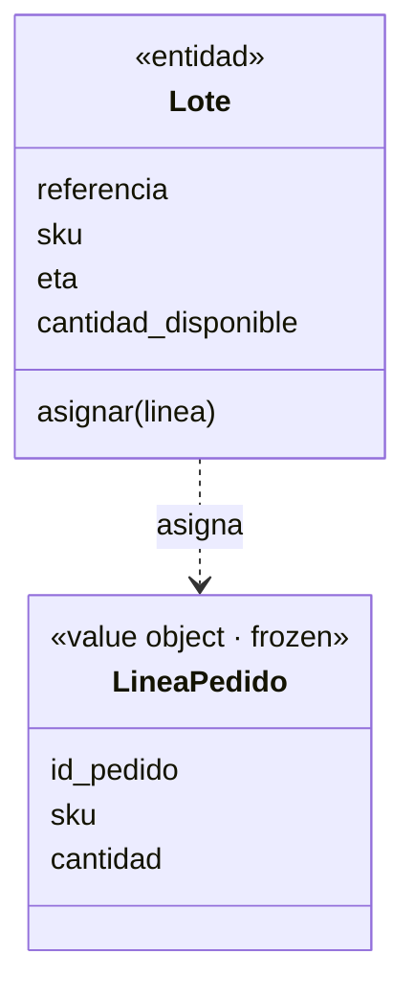

# Capítulo 1 — Domain Modeling

> Fase 1 · el libro. El **código** vive en [`../../proyecto/`](../../proyecto/)
> (un único proyecto que crece). Aquí está **la clase**.

Avanza en micro-pasos. Cada paso sigue la estructura 0–9.

---

## Micro-paso 1 — El primer test (TDD) y el modelo mínimo

### 0. 🧭 La pregunta
> *"El negocio vende muebles. Me piden asignar una línea de pedido a un lote de stock
> y que la cantidad disponible del lote baje. ¿Cómo lo modelo y cómo sé que funciona,
> sin tocar aún base de datos ni web?"*

### 1. Objetivo
Escribir el primer test (test primero, §3.3) y el modelo de dominio mínimo: un
*value object* y una entidad.

### 2. Cita de la fuente
> *"batch = Batch("batch-001", "SMALL-TABLE", qty=20, eta=date.today()); line =
> OrderLine('order-ref', "SMALL-TABLE", 2); batch.allocate(line); assert
> batch.available_quantity == 18"* — Cap. 1, *Unit Testing Domain Models*
>
> *"the names of the classes and variables... are taken from the business jargon."* — íd.

### 3. El dolor / necesidad
No hay nada aún; en vez de adivinar, se escribe primero la prueba que describe el
comportamiento deseado, en el idioma del negocio.

### 4. Explicación paso a paso (TDD: rojo → verde)
1. Escribo el test en `proyecto/test_modelo.py`.
2. Lo corro sin implementar → `ModuleNotFoundError` (🔴 rojo).
3. Escribo `proyecto/modelo.py`:
   - `LineaPedido` = *value object* (`@dataclass(frozen=True)`, inmutable, solo datos).
   - `Lote` = *entidad* (identidad por `referencia`; estado `cantidad_disponible` que cambia).
4. Lo corro → `1 passed` (🟢 verde).

> Traducción (§3.8): el libro usa inglés (`Batch`, `OrderLine`, `allocate`); nosotros
> los mismos conceptos en español (`Lote`, `LineaPedido`, `asignar`), citando el original.

### 5. Diagrama (Mermaid)

`LineaPedido` es inmutable (solo datos). `Lote` tiene identidad y un estado que cambia
al `asignar`. Es una versión simplificada de la Figura 1-3.

### 6. Árbol de archivos
```
proyecto/
├── modelo.py          # LineaPedido (value object) + Lote (entidad)
└── test_modelo.py     # el primer test
```

### 7. Tu turno
Asignar dos líneas distintas al mismo lote y verificar que la cantidad baja las dos veces.

### 8. Comprobación
```bash
uv run pytest proyecto/ -q      # 1 passed
```

### 9. Preguntas de recuerdo
1. ¿Diferencia entre `LineaPedido` (value object) y `Lote` (entidad)?
2. ¿Qué es el ciclo rojo → verde de TDD?
3. ¿Por qué los nombres vienen del lenguaje del negocio?
