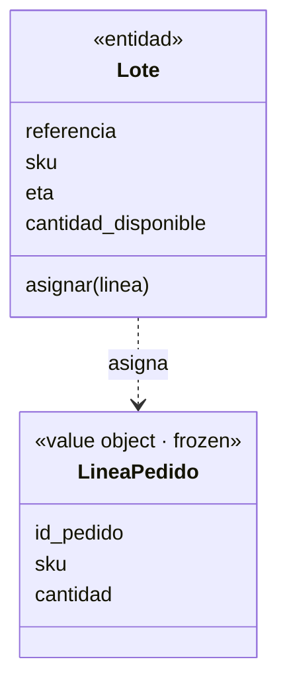
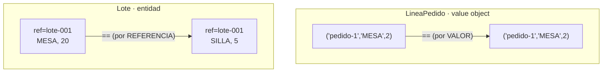
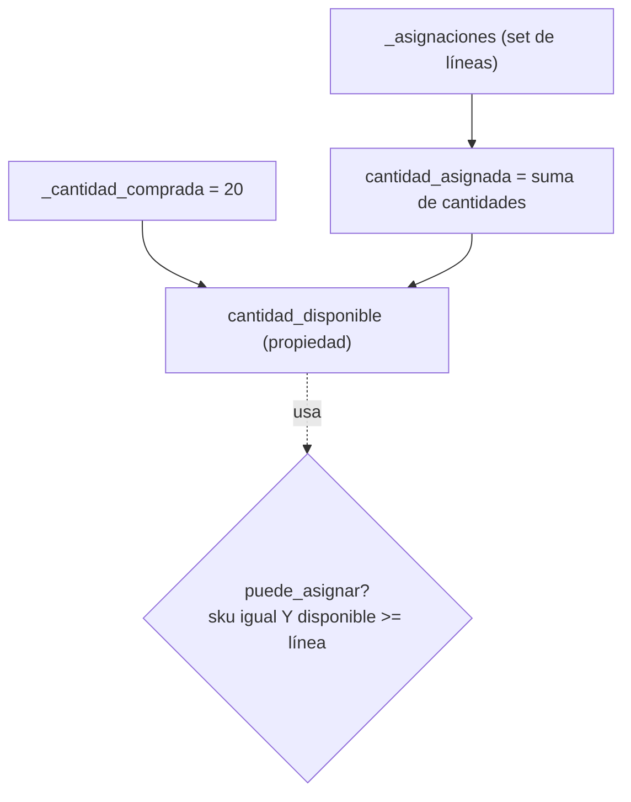

# Capítulo 1 — Domain Modeling

> Fase 1 · el libro. El **código** vive en [`../../proyecto/`](../../proyecto/)
> (un único proyecto que crece). Aquí está **la clase**.

Avanza en micro-pasos. Cada paso sigue la estructura 0–9.

---

## Micro-paso 1 — El primer test (TDD) y el modelo mínimo

### 0. 🧭 La pregunta
> *"El negocio vende muebles. Me piden asignar una línea de pedido a un lote de stock
> y que la cantidad disponible del lote baje. ¿Cómo lo modelo y cómo sé que funciona,
> sin tocar aún base de datos ni web?"*

### 1. Objetivo
Escribir el primer test (test primero, §3.3) y el modelo de dominio mínimo: un
*value object* y una entidad.

### 2. Cita de la fuente
> *"batch = Batch("batch-001", "SMALL-TABLE", qty=20, eta=date.today()); line =
> OrderLine('order-ref', "SMALL-TABLE", 2); batch.allocate(line); assert
> batch.available_quantity == 18"* — Cap. 1, *Unit Testing Domain Models*
>
> *"the names of the classes and variables... are taken from the business jargon."* — íd.

### 3. El dolor / necesidad
No hay nada aún; en vez de adivinar, se escribe primero la prueba que describe el
comportamiento deseado, en el idioma del negocio.

### 4. Explicación paso a paso (TDD: rojo → verde)
1. Escribo el test en `proyecto/test_modelo.py`.
2. Lo corro sin implementar → `ModuleNotFoundError` (🔴 rojo).
3. Escribo `proyecto/modelo.py`:
   - `LineaPedido` = *value object* (`@dataclass(frozen=True)`, inmutable, solo datos).
   - `Lote` = *entidad* (identidad por `referencia`; estado `cantidad_disponible` que cambia).
4. Lo corro → `1 passed` (🟢 verde).

> Traducción (§3.8): el libro usa inglés (`Batch`, `OrderLine`, `allocate`); nosotros
> los mismos conceptos en español (`Lote`, `LineaPedido`, `asignar`), citando el original.

### 5. Diagrama (Mermaid)

`LineaPedido` es inmutable (solo datos). `Lote` tiene identidad y un estado que cambia
al `asignar`. Es una versión simplificada de la Figura 1-3.

### 6. Árbol de archivos
```
proyecto/
├── modelo.py          # LineaPedido (value object) + Lote (entidad)
└── test_modelo.py     # el primer test
```

### 7. Tu turno
Asignar dos líneas distintas al mismo lote y verificar que la cantidad baja las dos veces.

### 8. Comprobación
```bash
uv run pytest fase-1/proyecto/ -q      # 1 passed
```

### 9. Preguntas de recuerdo
1. ¿Diferencia entre `LineaPedido` (value object) y `Lote` (entidad)?
2. ¿Qué es el ciclo rojo → verde de TDD?
3. ¿Por qué los nombres vienen del lenguaje del negocio?

---

## Micro-paso 2 — Value objects vs. entidades (igualdad)

### 0. 🧭 La pregunta
> *"¿Dos `LineaPedido` con los mismos datos son 'la misma'? ¿Y dos lotes con la misma
> referencia pero distinto stock?"*

### 1. Objetivo
Distinguir igualdad por **valor** (value object) e igualdad por **identidad** (entidad).

### 2. Cita de la fuente
> *"A value object is any domain object that is uniquely identified by the data it holds."*
> *"We use the term entity to describe a domain object that has long-lived identity...
> still recognizably the same thing. Batches... are entities."* — Cap. 1.

### 3. El dolor / necesidad
Por defecto Python compara por objeto en memoria; el negocio compara líneas por sus
datos y lotes por su referencia.

### 4. Explicación paso a paso (TDD)
1. El test de igualdad de `LineaPedido` pasa gratis (`@dataclass(frozen=True)`).
2. El test de igualdad de `Lote` falla (🔴): Python no sabe que la referencia manda.
3. Implemento en `Lote`:
   - `__eq__` compara solo `referencia`.
   - `__hash__` se basa en `referencia` (para sets/dicts).
4. Verde (🟢): 3 passed.

### 5. Diagrama (Mermaid)

Value object: iguales si todos los datos coinciden. Entidad: iguales si comparten referencia.

### 6. Árbol de archivos
```
fase-1/proyecto/
├── modelo.py          # Lote con __eq__ y __hash__
└── test_modelo.py     # + tests de igualdad
```

### 7. Tu turno
Comprobar que dos lotes con referencias distintas NO son iguales.

### 8. Comprobación
```bash
uv run pytest fase-1/proyecto/ -q      # 3 passed
```

### 9. Preguntas de recuerdo
1. ¿Por qué `LineaPedido` compara por valor sin código extra?
2. ¿Qué compara el `__eq__` de `Lote`?
3. ¿Un lote sigue siendo el mismo si cambia su stock? ¿Por qué?

---

## Micro-paso 3 — El modelo registra sus asignaciones

### 0. 🧭 La pregunta
> *"Me piden reglas reales: no asignar si no alcanza, ni si el sku no coincide, no
> descontar dos veces la misma línea, y poder desasignar. ¿Cuánto queda disponible de verdad?"*

### 1. Objetivo
Que el `Lote` recuerde sus líneas asignadas y calcule la disponibilidad, con
`puede_asignar`, `asignar`, `desasignar`.

### 2. Cita de la fuente
> *"available_quantity is now a calculated property: purchased quantity minus allocated
> quantity."* / *"can_allocate ... self.sku == line.sku and self.available_quantity >= line.qty"* — Cap. 1.

### 3. El dolor / necesidad
Un `cantidad_disponible` restado a mano no sabe si una línea ya estaba asignada ni cómo
devolver stock. El lote debe guardar el conjunto de líneas asignadas.

### 4. Explicación paso a paso (TDD)
1. Tests del libro (puede_asignar por cantidad/sku, idempotencia, desasignar) → 6 en rojo.
2. Refactor de `Lote`:
   - `_cantidad_comprada` (fijo) y `_asignaciones` (un `set` de líneas).
   - `asignar` añade solo si `puede_asignar`; el `set` evita duplicados.
   - `cantidad_asignada` y `cantidad_disponible` son `@property` (se calculan).
   - `puede_asignar` = sku coincide Y hay cantidad.
3. Verde: 9 passed.

### 5. Diagrama (Mermaid)

`cantidad_disponible` se calcula (comprada − asignada); nunca es un dato suelto que pueda quedar mal.

### 6. Árbol de archivos
```
fase-1/proyecto/
├── modelo.py          # Lote con _asignaciones (set), propiedades, puede_asignar
└── test_modelo.py     # 9 tests
```

### 7. Tu turno
Test: asignar y luego desasignar la misma línea devuelve la cantidad a 20.

### 8. Comprobación
```bash
uv run pytest fase-1/proyecto/ -q      # 9 passed
```

### 9. Preguntas de recuerdo
1. ¿Por qué `cantidad_disponible` es propiedad calculada?
2. ¿Por qué asignar dos veces la misma línea no descuenta doble?
3. ¿Qué comprueba `puede_asignar`?
