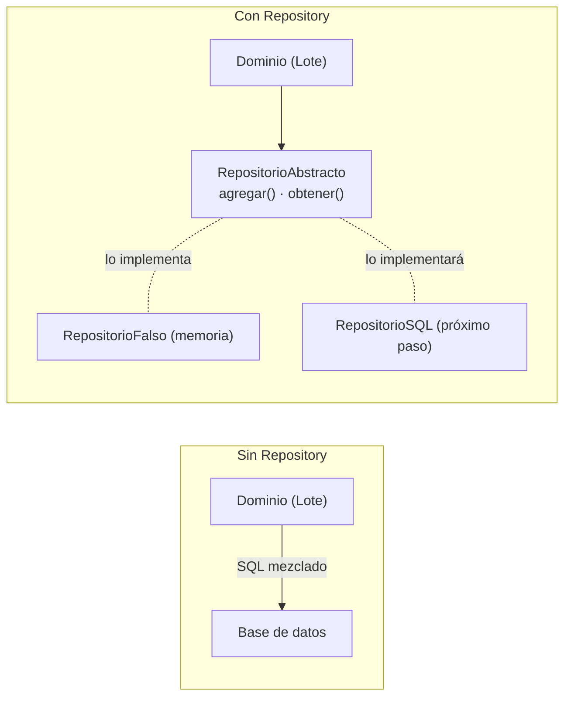
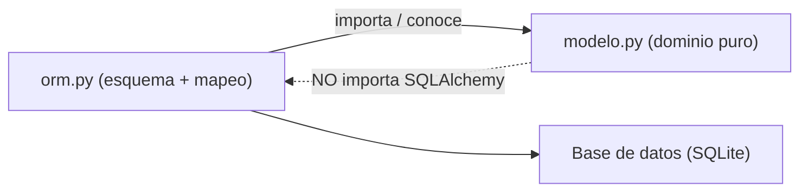
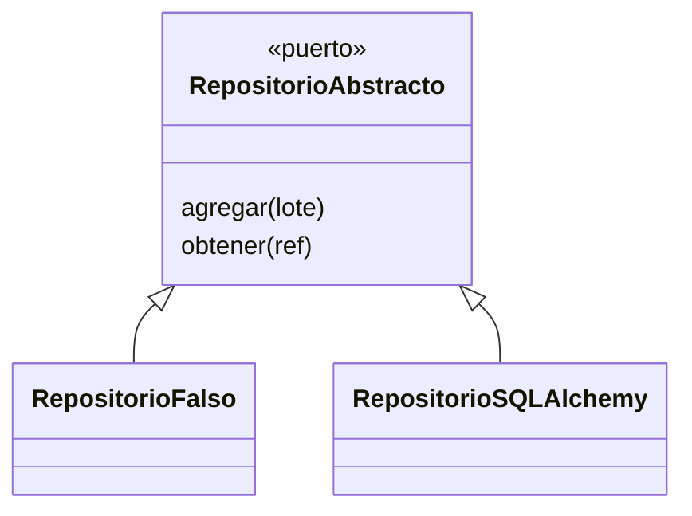

# Capítulo 2 — Repository Pattern

> Fase 1 · el libro. Capítulo autocontenido: la clase (aquí), el código en

⬅️ [Capítulo 1 · Domain Modeling](../01-domain-modeling/) · 🏠 [Índice de capítulos](../README.md) · ➡️ [Capítulo 3 · Coupling and Abstractions](../03-coupling-y-abstracciones/)
> [`proyecto/`](proyecto/) y los ejercicios en `ejercicios/`.
> El `proyecto/` parte del código del Capítulo 1 y lo hace evolucionar.

---

## Micro-paso 1 — El Repository Pattern (abstracción + fake)

### 0. 🧭 La pregunta
> *"Mi modelo vive en memoria. Me piden persistirlo, pero sin que el dominio sepa de
> base de datos ni SQL. ¿Cómo guardo sin ensuciar el modelo?"*

### 1. Objetivo
Un Repository: abstracción con `agregar`/`obtener` que esconde el almacenamiento, más
un repositorio falso para pruebas.

### 2. Cita de la fuente
> *"The simplest repository has just two methods: add() ... and get() ... This
> self-imposed simplicity stops us from coupling our domain model to the database."*
> / *"A simple fake repository using a set ... all the methods are one-liners."* — Cap. 2.

### 3. El dolor / necesidad
El modelo en memoria es efímero; meter SQL dentro del dominio lo acopla a la base de
datos. El Repository pone una frontera.

### 4. Explicación paso a paso (TDD)
1. Tests: el repo falso agrega/obtiene por referencia; la abstracta no se instancia. Rojo.
2. `repositorio.py`:
   - `RepositorioAbstracto(abc.ABC)` con `agregar(lote)` y `obtener(referencia)`.
   - `RepositorioFalso`: envoltorio sobre un `set` (métodos de una línea).
3. Verde: 15 passed.

### 5. Diagrama (Mermaid — reproduce la Figura 2-1)

El dominio depende de la abstracción; memoria o SQL la implementan (DIP, Lección 17).

### 6. Árbol de archivos
```
fase-1/capitulos/02-repository-pattern/proyecto/
├── modelo.py              # (del cap. 1)
├── repositorio.py         # RepositorioAbstracto + RepositorioFalso
├── test_modelo.py         # (del cap. 1)
└── test_repositorio.py
```

### 7. Tu turno
Test: `listar()` del repo falso devuelve todos los lotes agregados.

### 8. Comprobación
```bash
uv run pytest fase-1/capitulos/02-repository-pattern/proyecto/ -q      # 15 passed
```

### 9. Preguntas de recuerdo
1. ¿Qué dos métodos tiene el Repository y por qué solo esos?
2. ¿Qué acoplamiento evita?
3. ¿Para qué sirve el `RepositorioFalso`?

---

## Micro-paso 2 — El ORM (persistir sin ensuciar el modelo)

### 0. 🧭 La pregunta
> *"Quiero guardar el `Lote` en una base de datos real, pero sin que el modelo importe
> SQLAlchemy ni se llene de SQL."*

### 1. Objetivo
Mapear el modelo a tablas con **mapeo imperativo**, manteniendo `modelo.py` sin imports de ORM.

### 2. Cita de la fuente
> *"The ORM imports (or "depends on" or "knows about") the domain model, and not the other
> way around."* / *"But if we never call that function, our domain model classes stay
> blissfully unaware of the database."* — Cap. 2.

### 3. El dolor / necesidad
Si el modelo importa el ORM, queda acoplado a la base de datos. Invertimos: el ORM conoce al modelo.

### 4. Explicación paso a paso
1. Adaptación: `LineaPedido` de `frozen=True` a `unsafe_hash=True` (igualdad por valor + hash,
   pero el ORM puede escribir). El repo real del libro usa `unsafe_hash`.
2. `orm.py`: tablas (`lineas_pedido`, `lotes`, `asignaciones`) e `iniciar_mapeos()` con
   `map_imperatively` (SQLAlchemy 2.x; el libro usaba `mapper()`, eliminado en 2.x).
   `_asignaciones` se mapea como `relationship` con tabla intermedia.
3. `conftest.py`: sesión SQLite en memoria.
4. `test_orm.py`: round-trip de una línea y de un lote con asignación. Verde (17 passed).

### 5. Diagrama (Mermaid)

La dependencia está invertida: el detalle (ORM) depende del dominio.

### 6. Árbol de archivos
```
fase-1/capitulos/02-repository-pattern/proyecto/
├── modelo.py · orm.py · conftest.py · repositorio.py
└── test_modelo.py · test_repositorio.py · test_orm.py
```

### 7. Tu turno
Guardar dos líneas distintas y comprobar que `query(LineaPedido).all()` trae ambas.

### 8. Comprobación
```bash
uv run pytest fase-1/capitulos/02-repository-pattern/proyecto/ -q      # 17 passed
```

### 9. Preguntas de recuerdo
1. ¿Quién importa a quién: el ORM al modelo o al revés? ¿Por qué?
2. ¿Por qué `LineaPedido` tuvo que dejar de ser `frozen`?
3. ¿Qué pasa con el dominio si nunca llamas `iniciar_mapeos()`?

---

## Micro-paso 3 — El repositorio SQL (adaptador) + Puerto/Adaptador

### 0. 🧭 La pregunta
> *"Ya tengo el contrato y el fake. Me piden el repositorio de verdad que hable con la
> base de datos, sin tocar el dominio."*

### 1. Objetivo
Implementar `RepositorioSQLAlchemy` (adaptador real) y entender puerto vs. adaptador.

### 2. Cita de la fuente
> *"class SqlAlchemyRepository(AbstractRepository): ... def add(self, batch):
> self.session.add(batch); def get(self, reference): return
> self.session.query(model.Batch).filter_by(reference=reference).one()"* — Cap. 2.

### 3. El dolor / necesidad
El fake no persiste nada; producción necesita un adaptador real que cumpla el mismo contrato.

### 4. Explicación paso a paso
1. `RepositorioSQLAlchemy`: `agregar` → `sesion.add`; `obtener` → `query(Lote).filter_by(referencia=...).one()`.
2. Tests de integración con SQLite real (guardar/leer). Verde: 19 passed.
3. Puerto (`RepositorioAbstracto`) y adaptadores (`RepositorioFalso`, `RepositorioSQLAlchemy`).

### 5. Diagrama (Mermaid — Figura 2-5)

Un puerto y dos adaptadores intercambiables (LSP, Lección 15).

### 6. Árbol de archivos
```
fase-1/capitulos/02-repository-pattern/proyecto/
├── modelo.py · orm.py · conftest.py · repositorio.py
└── test_modelo.py · test_repositorio.py · test_orm.py
```

### 8. Comprobación
```bash
uv run pytest fase-1/capitulos/02-repository-pattern/proyecto/ -q      # 19 passed
```

### 9. Preguntas de recuerdo
1. ¿Qué es el "puerto" y qué son los "adaptadores" en el Repository?
2. ¿Por qué el fake y el SQL son intercambiables?
3. ¿Qué método de SQLAlchemy usa `obtener` para traer un lote por su referencia?

---

> **Capítulo 2 completo.** Repository (puerto + fake + SQL), ORM imperativo (modelo sin
> imports de ORM). Siguiente: **Capítulo 3 — Coupling and Abstractions**.

---

⬅️ [Capítulo 1 · Domain Modeling](../01-domain-modeling/) · 🏠 [Índice de capítulos](../README.md) · ➡️ [Capítulo 3 · Coupling and Abstractions](../03-coupling-y-abstracciones/)
