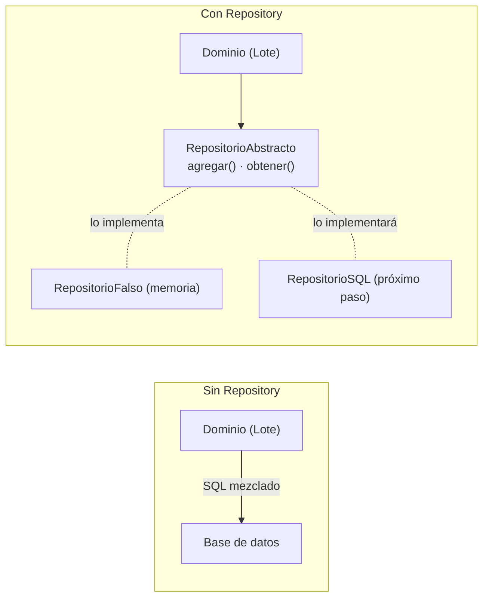

# Capítulo 2 — Repository Pattern

> Fase 1 · el libro. Capítulo autocontenido: la clase (aquí), el código en
> [`proyecto/`](proyecto/) y los ejercicios en `ejercicios/`.
> El `proyecto/` parte del código del Capítulo 1 y lo hace evolucionar.

---

## Micro-paso 1 — El Repository Pattern (abstracción + fake)

### 0. 🧭 La pregunta
> *"Mi modelo vive en memoria. Me piden persistirlo, pero sin que el dominio sepa de
> base de datos ni SQL. ¿Cómo guardo sin ensuciar el modelo?"*

### 1. Objetivo
Un Repository: abstracción con `agregar`/`obtener` que esconde el almacenamiento, más
un repositorio falso para pruebas.

### 2. Cita de la fuente
> *"The simplest repository has just two methods: add() ... and get() ... This
> self-imposed simplicity stops us from coupling our domain model to the database."*
> / *"A simple fake repository using a set ... all the methods are one-liners."* — Cap. 2.

### 3. El dolor / necesidad
El modelo en memoria es efímero; meter SQL dentro del dominio lo acopla a la base de
datos. El Repository pone una frontera.

### 4. Explicación paso a paso (TDD)
1. Tests: el repo falso agrega/obtiene por referencia; la abstracta no se instancia. Rojo.
2. `repositorio.py`:
   - `RepositorioAbstracto(abc.ABC)` con `agregar(lote)` y `obtener(referencia)`.
   - `RepositorioFalso`: envoltorio sobre un `set` (métodos de una línea).
3. Verde: 15 passed.

### 5. Diagrama (Mermaid — reproduce la Figura 2-1)

El dominio depende de la abstracción; memoria o SQL la implementan (DIP, Lección 17).

### 6. Árbol de archivos
```
fase-1/capitulos/02-repository-pattern/proyecto/
├── modelo.py              # (del cap. 1)
├── repositorio.py         # RepositorioAbstracto + RepositorioFalso
├── test_modelo.py         # (del cap. 1)
└── test_repositorio.py
```

### 7. Tu turno
Test: `listar()` del repo falso devuelve todos los lotes agregados.

### 8. Comprobación
```bash
uv run pytest fase-1/capitulos/02-repository-pattern/proyecto/ -q      # 15 passed
```

### 9. Preguntas de recuerdo
1. ¿Qué dos métodos tiene el Repository y por qué solo esos?
2. ¿Qué acoplamiento evita?
3. ¿Para qué sirve el `RepositorioFalso`?
