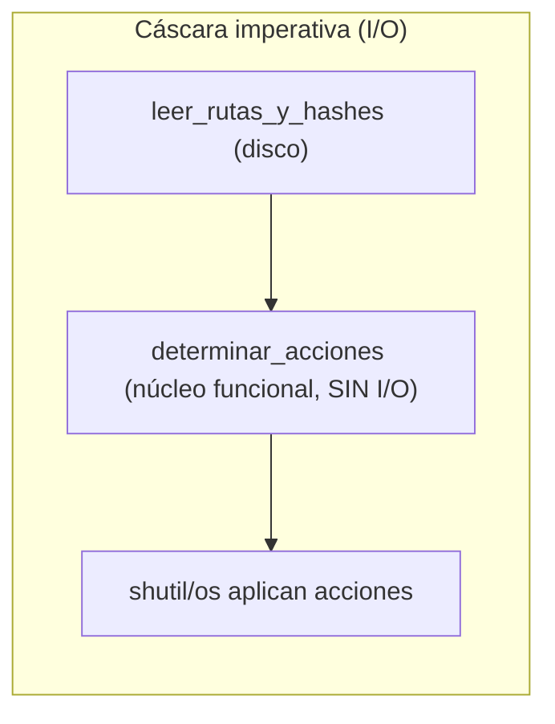

# Capítulo 3 — Coupling and Abstractions (interludio)

> Fase 1 · el libro. Capítulo autocontenido: la clase (aquí), el código en
> [`proyecto/`](proyecto/) y los ejercicios en `ejercicios/`.
> Interludio: no cambia el modelo de allocation; usa un ejemplo aparte (sincronizar carpetas)
> para enseñar a **elegir abstracciones** y probar con *fakes*/datos simples.

---

## Micro-paso 1 — Núcleo funcional (`determinar_acciones`)

### 0. 🧭 La pregunta
> *"Una función que sincroniza dos carpetas mezcla la lógica (qué copiar/mover/borrar)
> con el I/O. Probarla exige montar carpetas reales. ¿Cómo la pruebo fácil?"*

### 1. Objetivo
Aislar la lógica en una función pura que recibe dos dicts `{hash: nombre}` y devuelve acciones.

### 2. Cita de la fuente
> *"our domain logic ... is tightly coupled to the I/O code."* / *"Functional Core,
> Imperative Shell ... a 'core' of code that has no dependencies on external state."* — Cap. 3.

### 3. El dolor / necesidad
Lógica + I/O juntos = tests pesados (montar/borrar carpetas). Hay que separarlos.

### 4. Explicación paso a paso (TDD)
1. Tests con diccionarios: archivo nuevo → COPIAR; renombrado → MOVER; sobra → BORRAR. Rojo.
2. `determinar_acciones(hashes_origen, hashes_destino, origen, destino)` pura (sin I/O). Verde.

### 5. Diagrama (Mermaid — Figura 3-1/3-2)

El núcleo no toca nada externo; la cáscara hace el I/O.

### 6. Árbol de archivos
```
fase-1/capitulos/03-coupling-y-abstracciones/proyecto/
├── (código del cap. 2, sin cambios)
├── sincronizador.py       # determinar_acciones (núcleo) + sincronizar (cáscara)
└── test_sincronizador.py
```

### 7. Tu turno
Un test del núcleo: mismo archivo sin cambios → ninguna acción.

### 8. Comprobación
```bash
uv run pytest fase-1/capitulos/03-coupling-y-abstracciones/proyecto/ -q      # 24 passed
```

### 9. Preguntas de recuerdo
1. ¿Qué entra y qué sale del núcleo funcional? ¿Toca el disco?
2. ¿Por qué es fácil de probar?

---

## Micro-paso 2 — Cáscara imperativa (`sincronizar`) + edge-to-edge

### 0. 🧭 La pregunta
> *"Ya tengo la lógica aislada. ¿Cómo la conecto al disco real y compruebo que de verdad
> copia/borra?"*

### 1. Objetivo
Una cáscara imperativa en 3 pasos (leer, decidir, aplicar) y probarla edge-to-edge.

### 2. Cita de la fuente
> *"our top-level function will contain almost no logic at all; it's just an imperative
> series of steps: gather inputs, call our logic, apply outputs."* — Cap. 3.

### 3. El dolor / necesidad
La lógica pura no basta: hay que ejecutar el I/O real, pero concentrado en un solo lugar.

### 4. Explicación paso a paso
1. `leer_rutas_y_hashes` (I/O: recorre y hashea).
2. `sincronizar`: reunir hashes → `determinar_acciones` → aplicar con `shutil`/`os`.
3. Tests edge-to-edge con `tmp_path` (carpetas reales): archivo nuevo se copia; sobrante se borra. Verde.

### 6. Árbol de archivos
```
fase-1/capitulos/03-coupling-y-abstracciones/proyecto/
└── sincronizador.py  (núcleo + cáscara) · test_sincronizador.py (núcleo + edge-to-edge)
```

### 8. Comprobación
```bash
uv run pytest fase-1/capitulos/03-coupling-y-abstracciones/proyecto/ -q      # 24 passed
```

### 9. Preguntas de recuerdo
1. ¿Cuáles son los 3 pasos de la cáscara imperativa?
2. ¿Dónde vive todo el I/O?
3. ¿Qué es un test "edge-to-edge"?

---

> **Capítulo 3 completo.** Elegir abstracciones (Functional Core, Imperative Shell).
> Siguiente: **Capítulo 4 — Service Layer + API (FastAPI)**.
