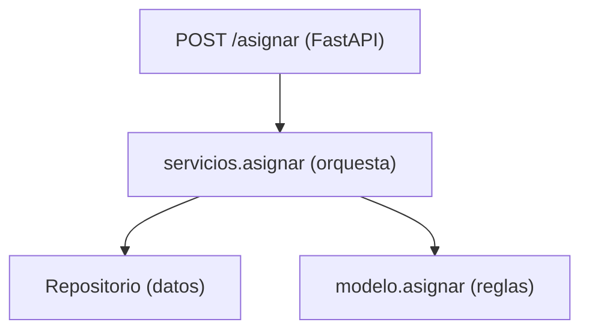

# Capítulo 4 — Service Layer + API (FastAPI)

> Fase 1 · el libro. Capítulo autocontenido: clase (aquí), código en [`proyecto/`](proyecto/),

⬅️ [Capítulo 3 · Coupling and Abstractions](../03-coupling-y-abstracciones/) · 🏠 [Índice de capítulos](../README.md) · ➡️ [Capítulo 5 · TDD en marchas](../05-tdd-marchas/)
> ejercicios en `ejercicios/`. **Regla 4:** el libro usa Flask; aquí usamos **FastAPI**.
> (Se quitó el ejemplo de sincronización del cap. 3; era un interludio aparte.)

---

## Micro-paso 1 — La capa de servicios (`servicios.asignar`)

### 0. 🧭 La pregunta
> *"¿Dónde pongo la orquestación del caso de uso (traer lotes, validar, asignar, confirmar)
> para que el endpoint quede fino y testeable?"*

### 1. Objetivo
Una función de servicio que coordina repo + dominio + commit, sin lógica de negocio propia.

### 2. Cita de la fuente
> *"def allocate(line: OrderLine, repo: AbstractRepository, session) -> str: batches =
> repo.list() if not is_valid_sku(line.sku, batches): raise InvalidSku(f'Invalid sku
> {line.sku}') batchref = model.allocate(line, batches) session.commit() return batchref"* — Cap. 4.

El mismo fragmento, con sus saltos de línea (el PDF los pierde):
```python
def allocate(line: OrderLine, repo: AbstractRepository, session) -> str:
    batches = repo.list()
    if not is_valid_sku(line.sku, batches):
        raise InvalidSku(f'Invalid sku {line.sku}')
    batchref = model.allocate(line, batches)
    session.commit()
    return batchref
```

### 3. El dolor / necesidad
Sin capa de servicios, la orquestación se filtra al endpoint o al modelo. La capa de
servicios la concentra y la hace testeable con fakes.

### 4. Explicación paso a paso (TDD)
1. Tests con `RepositorioFalso` + `SesionFalsa`: devuelve referencia; error si sku inválido; hace commit. Rojo.
2. `servicios.asignar(linea, repo, sesion)`: traer lotes → validar sku → `modelo.asignar` → `commit`. Verde.

### 6. Árbol de archivos
```
fase-1/capitulos/04-service-layer-fastapi/proyecto/
├── modelo.py · orm.py · repositorio.py · conftest.py
├── servicios.py       # la capa de servicios
└── test_servicios.py
```

### 8. Comprobación
```bash
uv run pytest fase-1/capitulos/04-service-layer-fastapi/proyecto/ -q      # 24 passed
```

### 9. Preguntas de recuerdo
1. ¿Qué hace la capa de servicios y qué NO hace (lógica de negocio)?
2. ¿Qué es la `SesionFalsa` y para qué sirve en los tests?

---

## Micro-paso 2 — El endpoint FastAPI (`api.py`)

### 0. 🧭 La pregunta
> *"¿Cómo expongo el caso de uso por una API web, con un endpoint fino?"*

### 1. Objetivo
Un endpoint `POST /asignar` (FastAPI) que delega en la capa de servicios.

### 2. Cita de la fuente
> *"We show how this layer makes it easy to build thin entrypoints to our system,
> whether it's a Flask API or a CLI."* — Preface. (Aquí FastAPI en vez de Flask.)

### 3. El dolor / necesidad
El endpoint no debe tener lógica; solo traducir HTTP ↔ servicio.

### 4. Explicación paso a paso
1. `api.py`: modelo Pydantic `PedidoEntrada`; `@app.post("/asignar", status_code=201)`.
   Construye repo SQL, llama `servicios.asignar`, devuelve `{referencia}`; `400` si `SkuInvalido`/`SinStock`.
2. La sesión se inyecta con `Depends(obtener_sesion)` (se reemplaza en tests con `dependency_overrides`).
3. Tests end-to-end con `TestClient`: 201 + referencia; 400 si sku inexistente. Verde.
4. Detalle técnico: el `conftest.py` usa `StaticPool` para compartir la BD en memoria entre hilos (FastAPI corre el endpoint en otro hilo).

### 5. Diagrama (Mermaid — Figura 4-2)

Endpoint fino → servicio → dominio/repositorio. Cada capa con su responsabilidad.

### 6. Árbol de archivos
```
fase-1/capitulos/04-service-layer-fastapi/proyecto/
├── servicios.py · api.py
└── test_servicios.py · test_api.py
```

### 8. Comprobación
```bash
uv run pytest fase-1/capitulos/04-service-layer-fastapi/proyecto/ -q      # 24 passed
```

### 9. Preguntas de recuerdo
1. ¿Qué responsabilidad tiene el endpoint y cuál NO?
2. ¿Cómo se inyecta la sesión y por qué ayuda en los tests?
3. ¿Por qué se necesitó `StaticPool`?

---

> **Capítulo 4 completo.** Capa de servicios + API FastAPI (3 capas: endpoint/servicio/dominio).
> Siguiente: **Capítulo 5 — TDD in High Gear and Low Gear**.

---

⬅️ [Capítulo 3 · Coupling and Abstractions](../03-coupling-y-abstracciones/) · 🏠 [Índice de capítulos](../README.md) · ➡️ [Capítulo 5 · TDD en marchas](../05-tdd-marchas/)
