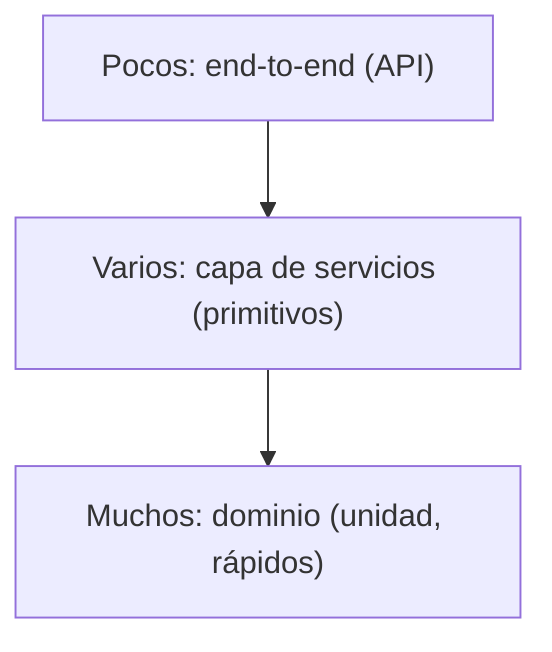
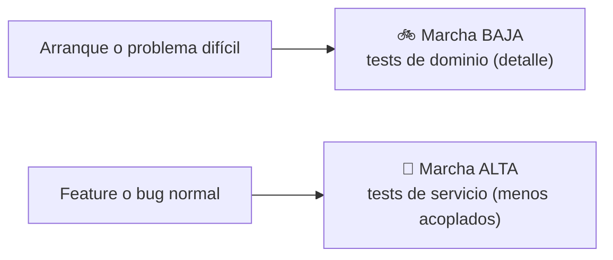

# Capítulo 5 — TDD in High Gear and Low Gear

> Fase 1 · el libro. Capítulo autocontenido: la clase (aquí), el código en
> [`proyecto/`](proyecto/) y los ejercicios en [`ejercicios/`](ejercicios/).

⬅️ [Capítulo 4 · Service Layer + API](../04-service-layer-fastapi/) · 🏠 [Índice de capítulos](../README.md) · ➡️ [Capítulo 6 · Unit of Work](../06-unit-of-work/)

Avanza en **micro-pasos** (estructura 0–9). Correr las pruebas del capítulo:
```bash
uv run pytest fase-1/capitulos/05-tdd-marchas/proyecto/ -q      # 24 passed
```

> 🧭 **Contexto (Python + FastAPI).** Este capítulo casi no cambia el código: cambia **cómo
> probamos**. El libro usa Flask + pytest; aquí FastAPI + pytest. Todo sigue siendo **síncrono**
> (SQLAlchemy clásico): no hay `async`. El objetivo es desacoplar los tests del dominio y saber
> elegir a qué nivel probar.

---

## Micro-paso 1 — Desacoplar los tests de servicio con primitivos

### 0. 🧭 La pregunta
> *"Mis tests de servicio usan objetos de dominio para prepararse; si cambio el modelo,
> se rompen muchos tests. ¿Cómo los desacoplo?"*

### 1. Objetivo
Que la capa de servicios reciba **primitivos** (`str`/`int`) y que los tests de servicio no
mencionen el dominio (`Lote`/`LineaPedido`).

### 2. Cita de la fuente
> *"To have a service layer that's fully decoupled from the domain, we need to rewrite
> its API to work in terms of primitives."* — Cap. 5.

En la práctica: el servicio recibe primitivos y **arma la `LineaPedido` adentro**; se añade
`agregar_lote` para preparar datos **sin** tocar el dominio.
```python
def agregar_lote(referencia, sku, cantidad, eta, repo, sesion):
    repo.agregar(Lote(referencia, sku, cantidad, eta))     # el servicio arma el Lote
    sesion.commit()

def asignar(id_pedido, sku, cantidad, repo, sesion) -> str:
    linea = LineaPedido(id_pedido, sku, cantidad)          # el servicio arma la línea
    lotes = repo.listar()
    if not sku_valido(linea.sku, lotes):
        raise SkuInvalido(f"Sku inválido {linea.sku}")
    referencia = modelo.asignar(linea, lotes)
    sesion.commit()
    return referencia
```

### 3. El dolor / necesidad
Tests acoplados al modelo = frágiles: un cambio en el constructor de `LineaPedido` rompe decenas
de tests de servicio que **ni siquiera prueban el modelo**. Si el servicio habla en primitivos,
el modelo puede cambiar por dentro sin romper esos tests.

### 4. Explicación paso a paso (TDD)
1. `asignar(id_pedido, sku, cantidad, repo, sesion)` arma la `LineaPedido` adentro (antes recibía
   el objeto ya construido).
2. `agregar_lote(referencia, sku, cantidad, eta, repo, sesion)` prepara datos sin dominio.
3. Los tests de servicio (`test_servicios.py`) **no importan** `Lote` ni `LineaPedido`: solo usan
   primitivos y `agregar_lote(...)`. Por ejemplo `agregar_lote("lote-1", "LAMPARA", 100, None, repo, sesion)`.
4. `api.py` pasa primitivos al servicio. Total del capítulo: **24 passed**.

### 5. Diagrama (Mermaid — Figura 5-1, espectro de tests)

El test de servicio no sabe nada de `Lote`/`LineaPedido`: habla con el servicio en primitivos.

### 6. Árbol de archivos
```
fase-1/capitulos/05-tdd-marchas/proyecto/
├── servicios.py       # asignar(primitivos) + agregar_lote(primitivos)
├── api.py             # pasa primitivos al servicio
├── modelo.py          # (sin cambios)
├── repositorio.py     # (sin cambios: RepositorioFalso con agregar/obtener/listar)
└── test_servicios.py  # SOLO primitivos; no importa el dominio
```

### 7. Tu turno
Escribe en `test_servicios.py` un test que, usando **solo** `agregar_lote` y `asignar`, agregue
dos lotes del mismo sku (uno en almacén sin `eta`, otro con `eta`) y compruebe que `asignar`
devuelve la referencia del lote en almacén. Todo con strings/ints, sin construir objetos de dominio.

### 8. Comprobación
```bash
uv run pytest fase-1/capitulos/05-tdd-marchas/proyecto/ -q      # 24 passed
```

### 9. Preguntas de recuerdo
1. ¿Por qué los tests de servicio ya no mencionan `Lote`/`LineaPedido`?
2. ¿Para qué sirve `agregar_lote` en la preparación de los tests?
3. ¿Qué gana el equipo al desacoplar los tests del modelo?

---

## Micro-paso 2 — Marcha alta / baja (elegir el nivel del test)

### 0. 🧭 La pregunta
> *"¿Pruebo al nivel de dominio (detalle) o de servicio (menos acoplado)?"*

### 1. Objetivo
Entender la metáfora de las **marchas**: cuándo bajar a **marcha baja** (tests de dominio,
detallados) y cuándo subir a **marcha alta** (tests de servicio, con primitivos).

### 2. Cita de la fuente
> *"When starting a journey, the bicycle needs to be in a low gear so that it can overcome
> inertia. Once we're off and running, we can go faster and more efficiently by changing into
> a high gear"* — Cap. 5.

La metáfora en la práctica:
```
Marcha baja (dominio)  → arrancar / problema peliagudo → feedback detallado, muchos tests pequeños
Marcha alta (servicio) → features y bugs normales      → menos acoplado, buena cobertura con pocos tests
```

### 3. El dolor / necesidad
Si **todo** se prueba en marcha baja (nivel dominio), cualquier refactor del modelo rompe muchos
tests. Si **todo** se prueba en marcha alta (nivel servicio), cuesta localizar un fallo fino. Hay
que elegir el nivel según el momento del proyecto.

### 4. Explicación paso a paso
1. **Marcha baja (dominio):** proyecto nuevo o problema difícil; tests unitarios del modelo que dan
   feedback muy detallado (como todo el Capítulo 1). Aquí son los 13 tests de `test_modelo.py`.
2. **Marcha alta (servicio):** para features y bugs del día a día; tests de servicio con primitivos,
   menos acoplados, que no se rompen al refactorizar el modelo (los 3 tests de `test_servicios.py`).
3. **Regla práctica:** explora en marcha baja; una vez estable, prueba comportamiento en marcha alta.
4. **Pirámide sana:** muchos tests de dominio rápidos, varios de servicio, pocos end-to-end lentos.

### 5. Diagrama (Mermaid)


### 6. Árbol de archivos
```
fase-1/capitulos/05-tdd-marchas/proyecto/
├── test_modelo.py      # marcha baja (13 tests de dominio, detallados)
└── test_servicios.py   # marcha alta (3 tests de servicio con primitivos)
```
(Sin cambios de código respecto al micro-paso 1; cambia **cómo** elegimos los tests.)

### 7. Tu turno
Decide: para probar "un lote sin `eta` va antes que uno con `eta`", ¿marcha alta o marcha baja?
Justifícalo en una frase y escribe el test en el nivel que elegiste.

### 8. Comprobación
```bash
uv run pytest fase-1/capitulos/05-tdd-marchas/proyecto/ -q      # 24 passed
```

### 9. Preguntas de recuerdo
1. ¿Cuándo pruebas en marcha alta y cuándo en marcha baja?
2. ¿Qué forma tiene una pirámide de tests sana?
3. ¿Por qué los tests de servicio con primitivos "sobreviven" a refactors del dominio?

---

> **Capítulo 5 completo.** Los tests de servicio están desacoplados del dominio (primitivos) y sabes
> elegir la marcha. Siguiente: **Capítulo 6 — Unit of Work** (ahí desaparece el `Sesion` manual y
> aparece una Unidad de Trabajo que agrupa el commit).

---

⬅️ [Capítulo 4 · Service Layer + API](../04-service-layer-fastapi/) · 🏠 [Índice de capítulos](../README.md) · ➡️ [Capítulo 6 · Unit of Work](../06-unit-of-work/)
