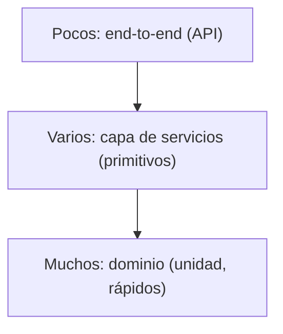

# Capítulo 5 — TDD in High Gear and Low Gear

> Fase 1 · el libro. Capítulo autocontenido (clase + `proyecto/` + `ejercicios/`).

---

## Micro-paso 1 — Desacoplar los tests de servicio con primitivos

### 0. 🧭 La pregunta
> *"Mis tests de servicio usan objetos de dominio para prepararse; si cambio el modelo,
> se rompen muchos tests. ¿Cómo los desacoplo?"*

### 1. Objetivo
Que la capa de servicios reciba primitivos (str/int) y que los tests no usen el dominio.

### 2. Cita de la fuente
> *"To have a service layer that's fully decoupled from the domain, we need to rewrite
> its API to work in terms of primitives."* — Cap. 5.

### 3. El dolor / necesidad
Tests acoplados al modelo = frágiles. Con primitivos, el modelo puede cambiar sin romperlos.

### 4. Explicación paso a paso
1. `asignar(id_pedido, sku, cantidad, repo, sesion)` arma la `LineaPedido` adentro.
2. `agregar_lote(referencia, sku, cantidad, eta, repo, sesion)` prepara datos sin dominio.
3. Los tests usan solo primitivos y `agregar_lote`. `api.py` pasa primitivos. 24 passed.

### 5. Diagrama (Mermaid — Figura 5-1, espectro de tests)


### 6. Árbol de archivos
```
fase-1/capitulos/05-tdd-marchas/proyecto/
├── servicios.py (primitivos + agregar_lote) · api.py · modelo.py · ...
└── test_servicios.py (solo primitivos) · test_api.py · ...
```

### 8. Comprobación
```bash
uv run pytest fase-1/capitulos/05-tdd-marchas/proyecto/ -q      # 24 passed
```

### 9. Preguntas de recuerdo
1. ¿Por qué los tests de servicio ya no mencionan `Lote`/`LineaPedido`?
2. ¿Para qué sirve `agregar_lote` en la preparación de los tests?

---

## Micro-paso 2 — Marcha alta / baja (elegir el nivel del test)

### 0. 🧭 La pregunta
> *"¿Pruebo al nivel de dominio (detalle) o de servicio (menos acoplado)?"*

### 1. Objetivo
Entender cuándo subir a marcha alta (servicio) y cuándo bajar a marcha baja (dominio).

### 2. Cita de la fuente
> *"When starting a journey, the bicycle needs to be in a low gear so that it can overcome
> inertia. Once we're off and running, we can go faster and more efficiently by changing into
> a high gear"* — Cap. 5.

### 3. Explicación
- **Marcha alta** (servicio): para features y bugs normales; menos acoplado, buena cobertura.
- **Marcha baja** (dominio): proyecto nuevo o problema peliagudo; feedback detallado.
- **Pirámide:** muchos tests de dominio rápidos, pocos end-to-end lentos.

### 9. Preguntas de recuerdo
1. ¿Cuándo pruebas en marcha alta y cuándo en marcha baja?
2. ¿Qué forma tiene una pirámide de tests sana?

---

> **Capítulo 5 completo.** Siguiente: **Capítulo 6 — Unit of Work**.
