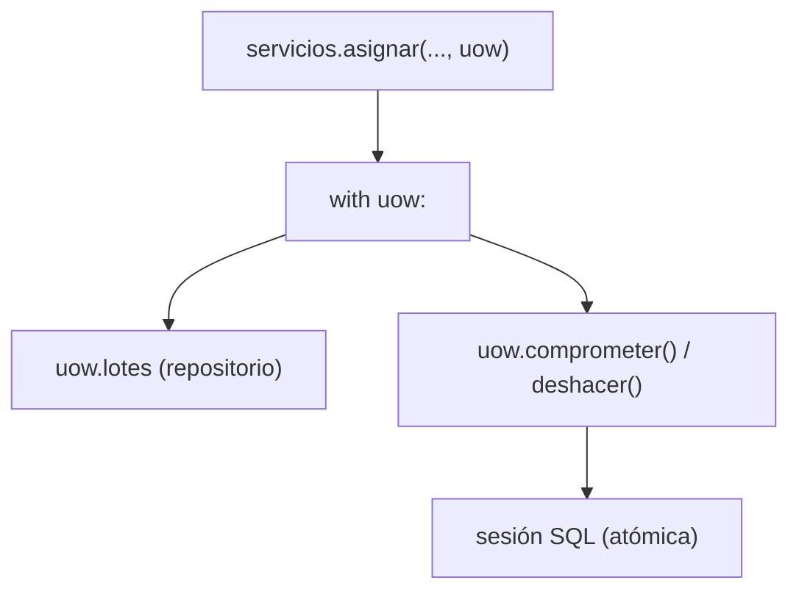

# Capítulo 6 — Unit of Work

> Fase 1 · el libro. Capítulo autocontenido (clase + `proyecto/` + `ejercicios/`).

---

## Micro-paso 1 — La UoW + fake + refactor del servicio

### 0. 🧭 La pregunta
> *"Me piden que un caso de uso sea atómico (todo o nada) y que el servicio no sepa de
> sesiones de BD. ¿Cómo lo agrupo?"*

### 1. Objetivo
Una Unit of Work (context manager) que agrupa repositorio + commit/rollback.

### 2. Cita de la fuente
> *"the Unit of Work (UoW) pattern is our abstraction over the idea of atomic operations.
> It will allow us to finally and fully decouple our service layer from the data layer."* — Cap. 6.

### 3. El dolor / necesidad
Repo + commit sueltos = el servicio conoce la sesión y la atomicidad se dispersa.

### 4. Explicación paso a paso (TDD)
1. `UnidadDeTrabajoAbstracta`: `with uow:`, `uow.lotes`, `comprometer()`, `deshacer()`; al salir sin confirmar, deshace.
2. `UnidadDeTrabajoFalsa` (repo falso + flag). Tests de servicio con ella.
3. `servicios.asignar(id, sku, cantidad, uow)` usa `with uow: ... uow.comprometer()`.

### 5. Diagrama (Mermaid — Figura 6-2)


### 6. Árbol de archivos
```
fase-1/capitulos/06-unit-of-work/proyecto/
├── unidad_de_trabajo.py · servicios.py · api.py · repositorio.py · modelo.py · orm.py · conftest.py
└── test_servicios.py · test_uow.py · test_api.py · test_modelo.py · test_repositorio.py · test_orm.py
```

### 8. Comprobación
```bash
uv run pytest fase-1/capitulos/06-unit-of-work/proyecto/ -q      # 26 passed
```

### 9. Preguntas de recuerdo
1. ¿Qué agrupa la UoW?
2. ¿Qué pasa al salir del `with uow:` sin `comprometer()`?

---

## Micro-paso 2 — La UoW real (SQLAlchemy) + atomicidad

### 0. 🧭 La pregunta
> *"¿Cómo conecto la UoW a la base de datos real y garantizo atomicidad?"*

### 2. Cita de la fuente
> *"class SqlAlchemyUnitOfWork(AbstractUnitOfWork): … def __enter__(self): self.session =
> self.session_factory() # type: Session self.batches =
> repository.SqlAlchemyRepository(self.session) return super().__enter__()"* — Cap. 6.

### 4. Explicación paso a paso
1. `UnidadDeTrabajoSQLAlchemy(fabrica_sesion)`: abre sesión + repo en `__enter__`;
   `comprometer`=`commit`, `deshacer`=`rollback`; cierra al salir.
2. Tests de integración: confirmar persiste; no confirmar deshace (rollback). El endpoint usa la UoW.

### 8. Comprobación
```bash
uv run pytest fase-1/capitulos/06-unit-of-work/proyecto/ -q      # 26 passed
```

### 9. Preguntas de recuerdo
1. ¿Qué hace `__enter__` de la UoW SQL?
2. ¿Qué garantiza no llamar a `comprometer()`?

---

> **Capítulo 6 completo.** Siguiente: **Capítulo 7 — Aggregates and Consistency Boundaries**.
