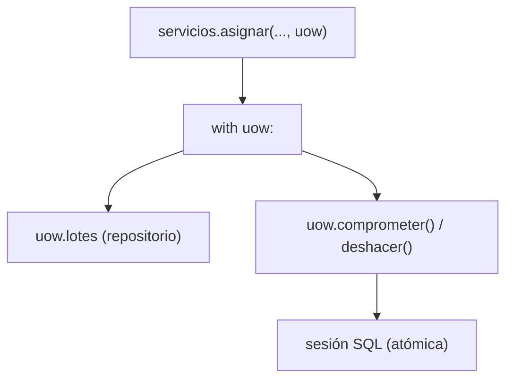
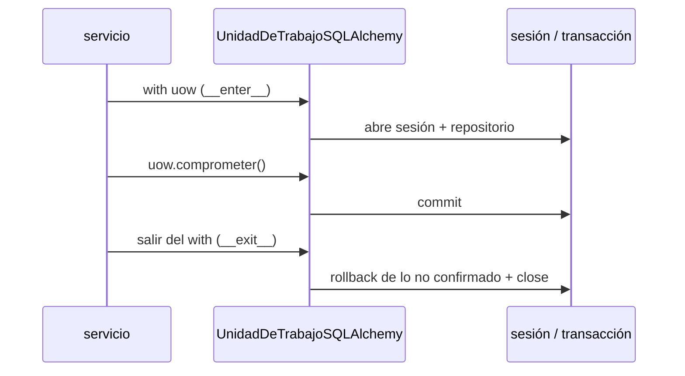

# Capítulo 6 — Unit of Work

> Fase 1 · el libro. Capítulo autocontenido: la clase (aquí), el código en
> [`proyecto/`](proyecto/) y los ejercicios en [`ejercicios/`](ejercicios/).

⬅️ [Capítulo 5 · TDD en marchas](../05-tdd-marchas/) · 🏠 [Índice de capítulos](../README.md) · ➡️ [Capítulo 7 · Aggregates](../07-aggregates/)

Avanza en **micro-pasos** (estructura 0–9). Correr las pruebas del capítulo:
```bash
uv run pytest fase-1/capitulos/06-unit-of-work/proyecto/ -q      # 26 passed
```

> 🧭 **Contexto (Python + FastAPI).** Aquí sí seguimos muy de cerca al libro: la UoW es un
> **context manager** (`with uow: ... uow.comprometer()`). Al salir del `with` sin confirmar, el
> `__exit__` **deshace** lo no confirmado (rollback). Todo síncrono (SQLAlchemy clásico). El libro
> llama `commit`/`rollback`; aquí usamos `comprometer`/`deshacer` para mantener el español.

---

## Micro-paso 1 — La UoW + su falsa + refactor del servicio

### 0. 🧭 La pregunta
> *"Me piden que un caso de uso sea atómico (todo o nada) y que el servicio no sepa de
> sesiones de BD. ¿Cómo lo agrupo?"*

### 1. Objetivo
Una `UnidadDeTrabajoAbstracta` (context manager) que agrupa el **repositorio** + **commit/rollback**,
una `UnidadDeTrabajoFalsa` para los tests, y refactorizar el servicio para que reciba la UoW.

### 2. Cita de la fuente
> *"the Unit of Work (UoW) pattern is our abstraction over the idea of atomic operations.
> It will allow us to finally and fully decouple our service layer from the data layer."* — Cap. 6.

La interfaz en Python (context manager + repositorio dentro):
```python
class UnidadDeTrabajoAbstracta(abc.ABC):
    lotes: repositorio.RepositorioAbstracto

    def __enter__(self):
        return self

    def __exit__(self, *args):
        self.deshacer()      # por defecto, al salir se deshace lo no confirmado

    @abc.abstractmethod
    def comprometer(self): ...
    @abc.abstractmethod
    def deshacer(self): ...
```

### 3. El dolor / necesidad
El servicio del cap. 5 recibía el repositorio y la sesión **sueltos** y hacía `sesion.commit()` a
mano. Eso reparte la responsabilidad de la atomicidad por cada caso de uso. La UoW la concentra en
un solo objeto: el servicio solo dice `with uow: ...; uow.comprometer()`.

### 4. Explicación paso a paso (TDD)
1. Defino `UnidadDeTrabajoAbstracta`: `with uow:`, `uow.lotes`, `comprometer()`, `deshacer()`; al
   salir sin confirmar, deshace.
2. `UnidadDeTrabajoFalsa` (en `test_servicios.py`): su `lotes` es un `RepositorioFalso([])` y
   recuerda si se confirmó (`self.comprometido`). Los tests de servicio la usan (sin base de datos).
3. El servicio pasa a recibir la UoW:
   ```python
   def asignar(id_pedido, sku, cantidad, uow) -> str:
       linea = LineaPedido(id_pedido, sku, cantidad)
       with uow:
           lotes = uow.lotes.listar()
           if not sku_valido(linea.sku, lotes):
               raise SkuInvalido(f"Sku inválido {linea.sku}")
           referencia = modelo.asignar(linea, lotes)
           uow.comprometer()
       return referencia
   ```

### 5. Diagrama (Mermaid — Figura 6-2)


### 6. Árbol de archivos
```
fase-1/capitulos/06-unit-of-work/proyecto/
├── unidad_de_trabajo.py   # UnidadDeTrabajoAbstracta + UnidadDeTrabajoSQLAlchemy
├── servicios.py           # agregar_lote / asignar reciben la UoW
├── api.py · repositorio.py · modelo.py · orm.py · conftest.py
└── test_servicios.py      # define UnidadDeTrabajoFalsa (en memoria) + usa la UoW
    test_uow.py · test_api.py · test_modelo.py · test_repositorio.py · test_orm.py
```

### 7. Tu turno
Escribe un test de servicio con la `UnidadDeTrabajoFalsa`: agrega un lote con `agregar_lote` y,
en otra llamada, `asignar` una línea a ese sku. Comprueba que devuelve la referencia del lote y
que `uow.comprometido is True`.

### 8. Comprobación
```bash
uv run pytest fase-1/capitulos/06-unit-of-work/proyecto/ -q      # 26 passed
```

### 9. Preguntas de recuerdo
1. ¿Qué agrupa la UoW?
2. ¿Qué pasa al salir del `with uow:` sin `comprometer()`?
3. ¿Qué recuerda la `UnidadDeTrabajoFalsa` y por qué no necesita base de datos?

---

## Micro-paso 2 — La UoW real (SQLAlchemy) + atomicidad

### 0. 🧭 La pregunta
> *"¿Cómo conecto la UoW a la base de datos real y garantizo atomicidad?"*

### 1. Objetivo
`UnidadDeTrabajoSQLAlchemy`: en `__enter__` abre una sesión y su repositorio; `comprometer` hace
`commit` y `deshacer` hace `rollback`; al salir cierra la sesión.

### 2. Cita de la fuente
> *"class SqlAlchemyUnitOfWork(AbstractUnitOfWork): … def __enter__(self): self.session =
> self.session_factory() # type: Session self.batches =
> repository.SqlAlchemyRepository(self.session) return super().__enter__()"* — Cap. 6.

Nuestra traducción al español, idéntica en estructura:
```python
class UnidadDeTrabajoSQLAlchemy(UnidadDeTrabajoAbstracta):
    def __init__(self, fabrica_sesion):
        self.fabrica_sesion = fabrica_sesion

    def __enter__(self):
        self.sesion = self.fabrica_sesion()
        self.lotes = repositorio.RepositorioSQLAlchemy(self.sesion)
        return super().__enter__()

    def __exit__(self, *args):
        super().__exit__(*args)     # deshace lo no confirmado
        self.sesion.close()         # y cierra la sesión

    def comprometer(self):
        self.sesion.commit()

    def deshacer(self):
        self.sesion.rollback()
```

### 3. El dolor / necesidad
La UoW falsa no prueba la **atomicidad real**: nunca toca la base. Necesitamos una UoW que use una
sesión y transacción de verdad para confirmar que "si no comprometo, no persiste".

### 4. Explicación paso a paso (TDD)
1. Test de integración: dentro del `with uow:`, agregar un lote y `comprometer()` → el lote
   **persiste** (se ve en `SELECT referencia FROM lotes`).
2. Test de integración: agregar un lote y **no** llamar a `comprometer()` → al salir del `with`,
   el `__exit__` deshace (rollback) y la tabla queda **vacía**.
3. El endpoint de `api.py` usa la UoW real. **26 passed**.

### 5. Diagrama (Mermaid)


### 6. Árbol de archivos
```
fase-1/capitulos/06-unit-of-work/proyecto/
├── unidad_de_trabajo.py   # + UnidadDeTrabajoSQLAlchemy (abre sesión en __enter__)
├── conftest.py            # fabrica_sesion (SQLite en memoria para los tests)
└── test_uow.py            # confirma persiste / no confirmar deshace
```

### 7. Tu turno
Añade en `test_uow.py` un tercer test: dentro del `with uow:` agrega **dos** lotes y compromételos;
comprueba con un `SELECT` que ambas referencias quedaron guardadas (atomicidad: entraron juntas).

### 8. Comprobación
```bash
uv run pytest fase-1/capitulos/06-unit-of-work/proyecto/ -q      # 26 passed
```

### 9. Preguntas de recuerdo
1. ¿Qué hace `__enter__` de la UoW SQL?
2. ¿Qué garantiza no llamar a `comprometer()`?
3. ¿Por qué el `__exit__` deshace y además cierra la sesión?

---

> **Capítulo 6 completo.** El servicio es atómico gracias a la Unit of Work y ya no toca sesiones a
> mano. Siguiente: **Capítulo 7 — Aggregates and Consistency Boundaries** (el agregado `Producto` y
> la concurrencia optimista).

---

⬅️ [Capítulo 5 · TDD en marchas](../05-tdd-marchas/) · 🏠 [Índice de capítulos](../README.md) · ➡️ [Capítulo 7 · Aggregates](../07-aggregates/)
