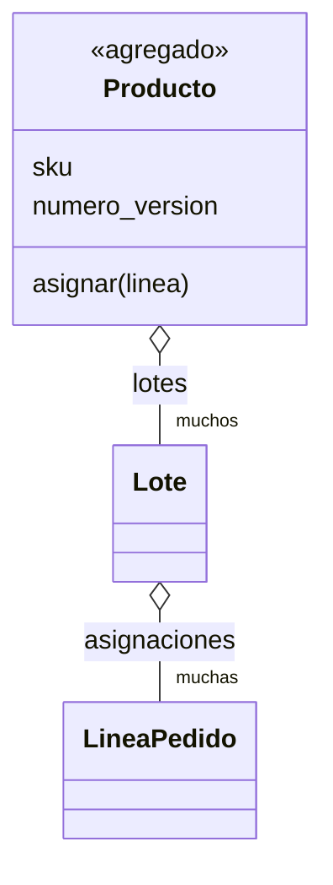

# Capítulo 7 — Aggregates and Consistency Boundaries

> Fase 1 · el libro (cierra la Parte I). Capítulo autocontenido (clase + `proyecto/` + `ejercicios/`).

---

## Micro-paso 1 — El agregado `Producto`

### 0. 🧭 La pregunta
> *"Dos pedidos a la vez para el mismo producto pueden sobrevender. ¿Cómo defino una
> frontera donde las reglas se cumplen siempre?"*

### 1. Objetivo
Un agregado `Producto` que agrupa los lotes de un sku y es la única puerta para asignar.

### 2. Cita de la fuente
> *"class Product: ... def allocate(self, line): ... self.version_number += 1"* — Cap. 7.

### 3. El dolor / necesidad
Sin una frontera, cambios concurrentes rompen invariantes (sobreventa).

### 4. Explicación paso a paso (TDD)
1. Tests de dominio: `producto.asignar` sube `numero_version`; sin stock → `SinStock`.
2. `Producto(sku, lotes, numero_version=0)` con `asignar(linea)` que elige lote y sube la versión.

### 5. Diagrama (Mermaid — Figura 7-1)


### 9. Preguntas de recuerdo
1. ¿Qué agrupa el agregado `Producto`?
2. ¿Qué hace `numero_version` y para qué?

---

## Micro-paso 2 — Un agregado = un repositorio

### 0. 🧭 La pregunta
> *"¿Cómo persisto el agregado y lo cargo como unidad?"*

### 2. Cita de la fuente
> *"One Aggregate = One Repository."* — Cap. 7.

### 4. Explicación paso a paso
1. El repositorio guarda `Producto`s y los obtiene por `sku`.
2. La UoW expone `uow.productos`; el servicio hace `producto = uow.productos.obtener(sku); producto.asignar(linea)`.
3. El ORM mapea `Producto → Lotes → Líneas`. 27 passed.

### 6. Árbol de archivos
```
fase-1/capitulos/07-aggregates/proyecto/
├── modelo.py (Producto) · repositorio.py (Productos) · unidad_de_trabajo.py (productos)
├── servicios.py · api.py · orm.py (Producto→Lotes→Líneas) · conftest.py
└── test_*.py
```

### 8. Comprobación
```bash
uv run pytest fase-1/capitulos/07-aggregates/proyecto/ -q      # 27 passed
```

### 9. Preguntas de recuerdo
1. ¿Por qué "un agregado = un repositorio"?
2. ¿Qué carga/guarda el repositorio: productos o lotes sueltos?

---

> **Capítulo 7 completo. ¡Parte I terminada!** (Dominio, Repository, Abstracciones, Service
> Layer + FastAPI, TDD, Unit of Work, Aggregates.)
> Siguiente: **Parte II — Capítulo 8: Events and the Message Bus**.
