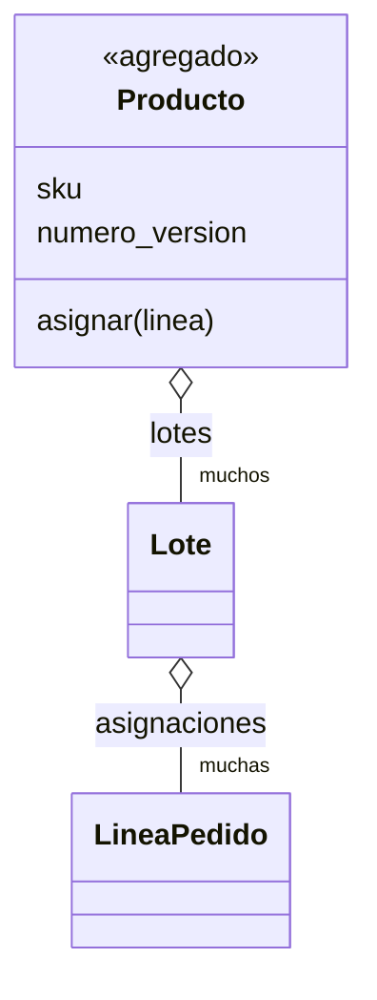
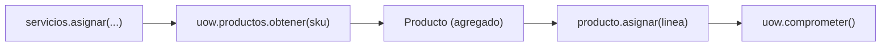

# Capítulo 7 — Aggregates and Consistency Boundaries

> Fase 1 · el libro (cierra la Parte I). Capítulo autocontenido: la clase (aquí), el código en
> [`proyecto/`](proyecto/) y los ejercicios en [`ejercicios/`](ejercicios/).

⬅️ [Capítulo 6 · Unit of Work](../06-unit-of-work/) · 🏠 [Índice de capítulos](../README.md) · ➡️ [Capítulo 8 · Events and the Message Bus](../08-events-message-bus/)

Avanza en **micro-pasos** (estructura 0–9). Correr las pruebas del capítulo:
```bash
uv run pytest fase-1/capitulos/07-aggregates/proyecto/ -q      # 27 passed
```

> 🧭 **Contexto (Python + FastAPI).** El agregado `Producto` agrupa los lotes de un mismo `sku` y
> es la **única** puerta para asignar. El `numero_version` sube en cada cambio (concurrencia
> optimista). El ORM lo mapea con la jerarquía `Producto → Lotes → Líneas` manteniendo el modelo de
> dominio puro (clase sin dependencias del ORM), como el Data Mapper del libro.

---

## Micro-paso 1 — El agregado `Producto`

### 0. 🧭 La pregunta
> *"Dos pedidos a la vez para el mismo producto pueden sobrevender. ¿Cómo defino una
> frontera donde las reglas se cumplen siempre?"*

### 1. Objetivo
Un **agregado** `Producto` que agrupa los lotes de un sku y es la única puerta para asignar, con un
`numero_version` que sube en cada cambio (concurrencia optimista).

### 2. Cita de la fuente
> *"An AGGREGATE is a cluster of associated objects that we treat as a unit for the purpose of
> data changes."* — Cap. 7.
>
> *"class Product: ... def allocate(self, line): ... self.version_number += 1"* — Cap. 7.

Nuestra traducción al español, fiel al código del proyecto:
```python
class Producto:
    # AGREGADO: la frontera de consistencia. Agrupa los lotes de un mismo sku.
    def __init__(self, sku, lotes, numero_version=0):
        self.sku = sku
        self.lotes = lotes
        self.numero_version = numero_version

    def asignar(self, linea: "LineaPedido") -> str:
        try:
            lote = next(l for l in sorted(self.lotes) if l.puede_asignar(linea))
            lote.asignar(linea)
            self.numero_version += 1          # el agregado sube su versión en cada cambio
            return lote.referencia
        except StopIteration:
            raise SinStock(f"Sin stock para el sku {linea.sku}")
```

### 3. El dolor / necesidad
Sin una frontera, cambios concurrentes rompen invariantes (sobreventa): dos transacciones leen el
mismo stock y ambas asignan. El agregado concentra todas las reglas de un sku en **un solo objeto**;
el `numero_version` permite detectar que algo cambió mientras trabajábamos.

### 4. Explicación paso a paso (TDD)
1. Test de dominio: `producto.asignar(linea)` elige el lote correcto (almacén antes que envío) y
   **sube `numero_version`** → rojo.
2. Test: sin stock suficiente → lanza `SinStock` → rojo.
3. Implemento `Producto(sku, lotes, numero_version=0)` con `asignar(linea)` que ordena los lotes,
   asigna al primero que pueda y sube la versión. Verde.
4. Toda asignación pasa **a través** del `Producto`, no de lotes sueltos.

### 5. Diagrama (Mermaid — Figura 7-1)

El agregado `Producto` es la raíz: se accede a los `Lote` **a través** de él, nunca sueltos.

### 6. Árbol de archivos
```
fase-1/capitulos/07-aggregates/proyecto/
├── modelo.py          # + class Producto (agregado) con numero_version y asignar()
├── orm.py             # mapea Producto → Lotes → Líneas
└── test_modelo.py     # el agregado elige lote, sube numero_version, lanza SinStock
```

### 7. Tu turno
Escribe un test de dominio: crea un `Producto` con un lote y asígnale **dos** líneas distintas
(que quepan); comprueba que `numero_version` quedó en **2** (sube una vez por cada asignación).

### 8. Comprobación
```bash
uv run pytest fase-1/capitulos/07-aggregates/proyecto/ -q      # 27 passed
```

### 9. Preguntas de recuerdo
1. ¿Qué agrupa el agregado `Producto`?
2. ¿Qué hace `numero_version` y para qué sirve?
3. ¿Por qué toda asignación pasa por el `Producto` y no por un lote suelto?

---

## Micro-paso 2 — Un agregado = un repositorio

### 0. 🧭 La pregunta
> *"¿Cómo persisto el agregado y lo cargo como una unidad (con sus lotes dentro)?"*

### 1. Objetivo
Que el repositorio guarde y obtenga **productos** (por `sku`), no lotes sueltos; que la UoW exponga
`uow.productos` y el servicio solo orqueste.

### 2. Cita de la fuente
> *"One Aggregate = One Repository."* — Cap. 7.
>
> *"we can move the allocate() domain service to be a method on the Product aggregate."* — Cap. 7.

El repositorio pasa a ser de productos (busca por `sku`):
```python
class RepositorioAbstracto(abc.ABC):
    @abc.abstractmethod
    def agregar(self, producto: Producto): ...
    @abc.abstractmethod
    def obtener(self, sku) -> Producto: ...
```

### 3. El dolor / necesidad
Si el repositorio devolviera lotes sueltos, se podría saltar la frontera del agregado y repartir las
reglas del sku. Cargando y guardando el **producto completo** (con sus lotes) se respeta la frontera
de consistencia: una asignación = un agregado = una transacción.

### 4. Explicación paso a paso
1. El repositorio (`RepositorioFalso` + `RepositorioSQLAlchemy`) guarda `Producto`s y los obtiene
   por `sku` con `obtener(sku)`.
2. La UoW expone `uow.productos`; el servicio hace `producto = uow.productos.obtener(sku)` y luego
   `referencia = producto.asignar(linea)` (la lógica de elegir lote vive ahora en el agregado):
   ```python
   def asignar(id_pedido, sku, cantidad, uow) -> str:
       linea = LineaPedido(id_pedido, sku, cantidad)
       with uow:
           producto = uow.productos.obtener(sku)
           if producto is None:
               raise SkuInvalido(f"Sku inválido {sku}")
           referencia = producto.asignar(linea)
           uow.comprometer()
       return referencia
   ```
3. El ORM mapea `Producto → Lotes → Líneas`: al guardar el producto se guardan sus lotes; al
   cargarlo, vienen con él. **27 passed**.

### 5. Diagrama (Mermaid)

El servicio habla con **un** agregado a través de **un** repositorio.

### 6. Árbol de archivos
```
fase-1/capitulos/07-aggregates/proyecto/
├── repositorio.py        # RepositorioAbstracto: agregar(Producto) / obtener(sku) (+ Falso + SQLAlchemy)
├── unidad_de_trabajo.py  # uow.productos
├── servicios.py          # obtener → asignar (por el agregado) → comprometer
├── api.py · orm.py (Producto→Lotes→Líneas) · conftest.py
└── test_*.py
```

### 7. Tu turno
Escribe un test de repositorio: guarda un `Producto` con **dos** lotes, vuelve a cargarlo con
`obtener(sku)` y comprueba que vuelve con los dos lotes (el agregado se carga como unidad).

### 8. Comprobación
```bash
uv run pytest fase-1/capitulos/07-aggregates/proyecto/ -q      # 27 passed
```

### 9. Preguntas de recuerdo
1. ¿Por qué "un agregado = un repositorio"?
2. ¿Qué carga/guarda el repositorio: productos o lotes sueltos?
3. ¿Dónde vive ahora la lógica de elegir el lote?

---

> **Capítulo 7 completo. ¡Parte I terminada!** (Dominio, Repository, Abstracciones, Service
> Layer + FastAPI, TDD, Unit of Work, Aggregates.) El modelo tiene su frontera de consistencia (el
> agregado `Producto`), se persiste como unidad y el servicio de dominio `asignar()` pasó a ser un
> método del agregado.
> Siguiente: **Parte II — Capítulo 8: Events and the Message Bus**.

---

⬅️ [Capítulo 6 · Unit of Work](../06-unit-of-work/) · 🏠 [Índice de capítulos](../README.md) · ➡️ [Capítulo 8 · Events and the Message Bus](../08-events-message-bus/)
