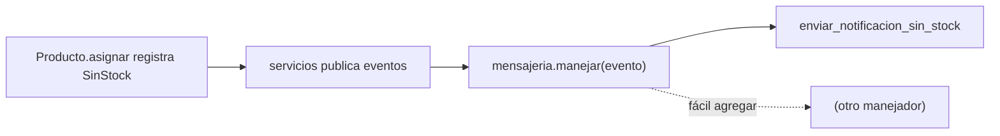

# Capítulo 8 — Events and the Message Bus

> Fase 1 · el libro (Parte II). Capítulo autocontenido (clase + `proyecto/` + `ejercicios/`).

---

## Micro-paso 1 — Eventos de dominio

### 0. 🧭 La pregunta
> *"Al quedarse sin stock, me piden avisar, pero sin meter notificaciones en el dominio.
> ¿Cómo separo 'algo pasó' de 'qué hacer'?"*

### 1. Objetivo
Eventos como dataclasses; el `Producto` los registra en vez de lanzar excepción.

### 2. Cita de la fuente
> *"Domain events are a vehicle for capturing the idea that some interactions with a
> system are triggers for others."* — Prefacio (resumen de la Parte II, *Event-driven architecture*).

### 4. Explicación paso a paso (TDD)
1. `eventos.py`: `@dataclass class SinStock(Evento): sku: str`.
2. `Producto.__init__` añade `self.eventos = []`; `asignar` hace
   `self.eventos.append(eventos.SinStock(linea.sku)); return None` al no poder.
3. Un listener del ORM reinicia `eventos` al cargar (modelo puro).

### 9. Preguntas de recuerdo
1. ¿Qué es un evento de dominio?
2. ¿Por qué el `Producto` registra un evento en vez de lanzar?

---

## Micro-paso 2 — El bus de mensajes

### 0. 🧭 La pregunta
> *"¿Cómo despacho cada evento a quien debe reaccionar, sin acoplar?"*

### 2. Cita de la fuente
> *"HANDLERS = { events.OutOfStock: [send_out_of_stock_notification] }"* — Cap. 8.

### 4. Explicación paso a paso
1. `mensajeria.py`: `MANEJADORES` mapea tipo de evento → lista de manejadores; `manejar(evento)` los llama.
2. El servicio publica `producto.eventos` en el bus tras confirmar. 28 passed.

### 5. Diagrama (Mermaid — Figura 8-1)


### 6. Árbol de archivos
```
fase-1/capitulos/08-events-message-bus/proyecto/
├── eventos.py · mensajeria.py · modelo.py (Producto.eventos) · servicios.py (publica) · orm.py (listener) · ...
└── test_mensajeria.py · test_modelo.py (evento) · ...
```

### 8. Comprobación
```bash
uv run pytest fase-1/capitulos/08-events-message-bus/proyecto/ -q      # 28 passed
```

### 9. Preguntas de recuerdo
1. ¿Qué mapea `MANEJADORES`?
2. ¿Cómo agregas una nueva reacción sin tocar el dominio?

---

> **Capítulo 8 completo.** Siguiente: **Capítulo 9 — Going to Town on the Message Bus**.
