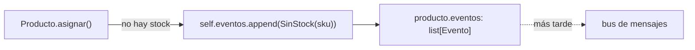
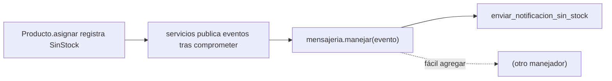

# Capítulo 8 — Events and the Message Bus

> Fase 1 · el libro (Parte II). Capítulo autocontenido: la clase (aquí), el código en
> [`proyecto/`](proyecto/) y los ejercicios en [`ejercicios/`](ejercicios/).

⬅️ [Capítulo 7 · Aggregates](../07-aggregates/) · 🏠 [Índice de capítulos](../README.md) · ➡️ [Capítulo 9 · Going to Town on the Message Bus](../09-message-bus-a-fondo/)

Avanza en **micro-pasos** (estructura 0–9). Correr las pruebas del capítulo:
```bash
uv run pytest fase-1/capitulos/08-events-message-bus/proyecto/ -q      # 28 passed
```

> 🧭 **Contexto (Python + FastAPI).** Empieza la Parte II (arquitectura dirigida por eventos). El
> modelo **registra** eventos ("algo pasó") en vez de ejecutar efectos secundarios, y un **bus de
> mensajes** (`MANEJADORES`, un dict cuya clave es la **clase** del evento) los despacha. La
> publicación es síncrona, como en el libro.

---

## Micro-paso 1 — Eventos de dominio

### 0. 🧭 La pregunta
> *"Al quedarse sin stock, me piden avisar (un email, una notificación), pero sin meter esa lógica
> de envío dentro del dominio ni del servicio. ¿Cómo separo 'algo pasó' de 'qué hacer'?"*

### 1. Objetivo
Que el modelo **registre eventos** (`SinStock`) en una lista en vez de ejecutar el efecto
secundario (enviar el email) él mismo.

### 2. Cita de la fuente
> *"Domain events are a vehicle for capturing the idea that some interactions with a
> system are triggers for others."* — Prefacio (resumen de la Parte II, *Event-driven architecture*).
>
> *"Events are simple dataclasses that define the data structures for inputs and internal
> messages within our system."* — Cap. 8.

Eventos como dataclasses simples; el agregado los acumula en una lista:
```python
# eventos.py
class Evento:
    pass

@dataclass
class SinStock(Evento):
    sku: str
```
```python
# en Producto.asignar(), cuando ningún lote puede asignar la línea:
except StopIteration:
    self.eventos.append(eventos.SinStock(linea.sku))   # registra el hecho; no envía nada
    return None
```

### 3. El dolor / necesidad
Si el modelo manda el email, se **acopla** a cómo se envía (SMTP, SMS…) y no se puede probar sin
mocks por todas partes. Mejor: el modelo dice "me quedé sin stock" y **otro** decide qué hacer. Es
el *Single Responsibility Principle*: una razón para cambiar por clase.

### 4. Explicación paso a paso (TDD)
1. Creo `eventos.py` con `Evento` y `@dataclass class SinStock(Evento): sku: str`.
2. `Producto.__init__` añade `self.eventos = []`. En `asignar`, al no poder asignar, hace
   `self.eventos.append(eventos.SinStock(linea.sku))` y **devuelve `None`** (en vez de lanzar
   `SinStock` como excepción, que es lo que hacía en el cap. 7).
3. Un listener del ORM reinicia `eventos` al cargar el producto, para no ensuciar el modelo con
   imports del ORM:
   ```python
   @event.listens_for(modelo.Producto, "load")
   def _init_eventos(producto, _contexto):
       producto.eventos = []
   ```
4. Test: tras un `asignar` imposible, `producto.eventos` contiene un `SinStock`.

### 5. Diagrama (Mermaid — Figura 8-1)

El modelo solo **registra**; publicar es tarea de otro (el bus).

### 6. Árbol de archivos
```
fase-1/capitulos/08-events-message-bus/proyecto/
├── modelo.py          # Producto acumula self.eventos; asignar registra SinStock y devuelve None
├── eventos.py         # Evento, SinStock (dataclass)
├── orm.py             # listener "load" que reinicia producto.eventos
└── test_modelo.py     # tras un asignar imposible, hay un SinStock en eventos
```

### 7. Tu turno
Añade un evento `Asignado(id_pedido, sku, referencia)` en `eventos.py` y acumúlalo en
`producto.eventos` cuando una asignación **sí** ocurre. Escribe el test que lo comprueba.

### 8. Comprobación
```bash
uv run pytest fase-1/capitulos/08-events-message-bus/proyecto/ -q      # 28 passed
```

### 9. Preguntas de recuerdo
1. ¿Qué es un evento de dominio?
2. ¿Por qué el `Producto` registra un evento en vez de lanzar (o de enviar el email)?
3. ¿Para qué sirve el listener `"load"` del ORM?

---

## Micro-paso 2 — El bus de mensajes

### 0. 🧭 La pregunta
> *"Tengo eventos registrados. ¿Cómo despacho cada evento a quien debe reaccionar, sin acoplar el
> modelo con los manejadores?"*

### 1. Objetivo
Un **bus de mensajes** (`MANEJADORES`) que mapea cada tipo de evento a sus manejadores, y una capa
de servicio que publica los eventos del modelo tras comprometer.

### 2. Cita de la fuente
> *"HANDLERS = { events.OutOfStock: [send_out_of_stock_notification] }"* — Cap. 8.

En Python la clave del diccionario es directamente la **clase** del evento, y se busca con
`type(evento)`:
```python
# mensajeria.py
MANEJADORES = {
    eventos.SinStock: [enviar_notificacion_sin_stock],
}

def manejar(evento):
    for manejador in MANEJADORES[type(evento)]:
        manejador(evento)
```

### 3. El dolor / necesidad
Llamar al manejador a mano desde el servicio (un `if` por tipo de evento) los acopla. El bus es una
**tabla**: "para este evento, estos manejadores". Agregar una reacción nueva es añadir una entrada,
**sin tocar el modelo ni el servicio**.

### 4. Explicación paso a paso (TDD)
1. `mensajeria.py`: `MANEJADORES` (dict por clase) y `manejar(evento)` que recorre los manejadores
   de ese tipo. Un `enviar_notificacion_sin_stock(evento)` apunta el sku en `notificaciones_enviadas`
   (un registro que los tests inspeccionan).
2. Test: `manejar(SinStock("MESA"))` deja `notificaciones_enviadas == ["MESA"]`.
3. El servicio `asignar`, **tras** `uow.comprometer()`, recorre `producto.eventos` y los pasa a
   `manejar`:
   ```python
   for evento in getattr(producto, "eventos", []):
       mensajeria.manejar(evento)
   ```
   Así solo se publican los eventos de un caso de uso que **sí** se confirmó. **28 passed**.

### 5. Diagrama (Mermaid — Figura 8-1)


### 6. Árbol de archivos
```
fase-1/capitulos/08-events-message-bus/proyecto/
├── eventos.py          # Evento, SinStock
├── mensajeria.py       # MANEJADORES (dict por clase), manejar(), notificaciones_enviadas
├── modelo.py           # Producto.eventos
├── servicios.py        # tras comprometer, publica producto.eventos en el bus
├── orm.py (listener) · repositorio.py · unidad_de_trabajo.py · api.py · conftest.py
└── test_mensajeria.py · test_modelo.py (evento) · test_servicios.py · ...
```

### 7. Tu turno
Agrega un **segundo** manejador para `SinStock` (por ejemplo, que lo apunte en un log en memoria),
regístralo en `MANEJADORES` y comprueba en un test que el bus llama a los **dos**.

### 8. Comprobación
```bash
uv run pytest fase-1/capitulos/08-events-message-bus/proyecto/ -q      # 28 passed
```

### 9. Preguntas de recuerdo
1. ¿Qué mapea `MANEJADORES` y cómo se busca la lista de manejadores de un evento?
2. ¿Cómo agregas una nueva reacción sin tocar el dominio?
3. ¿Cuándo publica el servicio los eventos: antes o después de `comprometer()`? ¿Por qué?

---

> **Capítulo 8 completo.** El modelo registra eventos y un bus de mensajes los despacha, sin acoplar
> el dominio con los efectos. Siguiente: **Capítulo 9 — Going to Town on the Message Bus** (el bus
> pasa a ser el punto de entrada).

---

⬅️ [Capítulo 7 · Aggregates](../07-aggregates/) · 🏠 [Índice de capítulos](../README.md) · ➡️ [Capítulo 9 · Going to Town on the Message Bus](../09-message-bus-a-fondo/)
