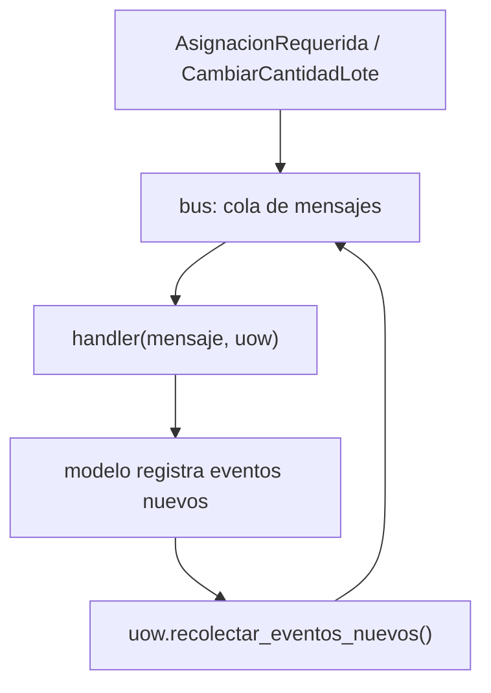

# Capítulo 9 — Going to Town on the Message Bus

> Fase 1 · el libro (Parte II). Capítulo autocontenido (clase + `proyecto/` + `ejercicios/`).

⬅️ [Capítulo 8 · Events and the Message Bus](../08-events-message-bus/) · 🏠 [Índice de capítulos](../README.md) · ➡️ [Capítulo 10 · Commands and Command Handler](../10-commands/)

---

## Micro-paso 1 — El bus recolecta eventos de la UoW (cascada)

### 0. 🧭 La pregunta
> *"¿Cómo encadeno reacciones (un cambio dispara otros) sin enredar el código?"*

### 2. Cita de la fuente
> *"A New Requirement Leads Us to a New Architecture."* / *"The Message Bus Now Collects
> Events from the UoW."* — Cap. 9.

### 4. Explicación paso a paso
1. `manejar(mensaje, uow)` procesa una cola; tras cada handler, encola `uow.recolectar_eventos_nuevos()`.
2. El repositorio rastrea `vistos`; la UoW recolecta eventos de esos productos.
3. Las funciones de servicio se vuelven handlers `(mensaje, uow)`.

### 5. Diagrama (Mermaid — Figura 9-2)


### 9. Preguntas de recuerdo
1. ¿Qué recolecta el bus tras cada handler?
2. ¿Para qué sirve `vistos` en el repositorio?

---

## Micro-paso 2 — Nuevo requisito: cambiar cantidad de lote (reasignar)

### 0. 🧭 La pregunta
> *"Si bajo la cantidad de un lote por debajo de lo asignado, ¿cómo reasigno lo que ya no cabe?"*

### 4. Explicación paso a paso
1. `Producto.cambiar_cantidad_lote(ref, cantidad)` ajusta la compra y, por cada línea que
   ya no cabe, registra `AsignacionRequerida`.
2. El handler `cambiar_cantidad_lote` dispara la cascada: el bus toma las `AsignacionRequerida`
   y reasigna (o registra `SinStock`). 27 passed.

### 6. Árbol de archivos
```
fase-1/capitulos/09-message-bus-a-fondo/proyecto/
├── eventos.py · mensajeria.py (bus + handlers) · modelo.py · repositorio.py (vistos) · unidad_de_trabajo.py (recolectar) · api.py · orm.py · conftest.py
└── test_mensajeria.py · test_api.py · test_*.py
```

### 8. Comprobación
```bash
uv run pytest fase-1/capitulos/09-message-bus-a-fondo/proyecto/ -q      # 27 passed
```

### 9. Preguntas de recuerdo
1. ¿Qué evento registra `cambiar_cantidad_lote` por cada línea que sobra?
2. ¿Quién reasigna esas líneas?

---

> **Capítulo 9 completo.** Siguiente: **Capítulo 10 — Commands and Command Handler**.

---

⬅️ [Capítulo 8 · Events and the Message Bus](../08-events-message-bus/) · 🏠 [Índice de capítulos](../README.md) · ➡️ [Capítulo 10 · Commands and Command Handler](../10-commands/)
