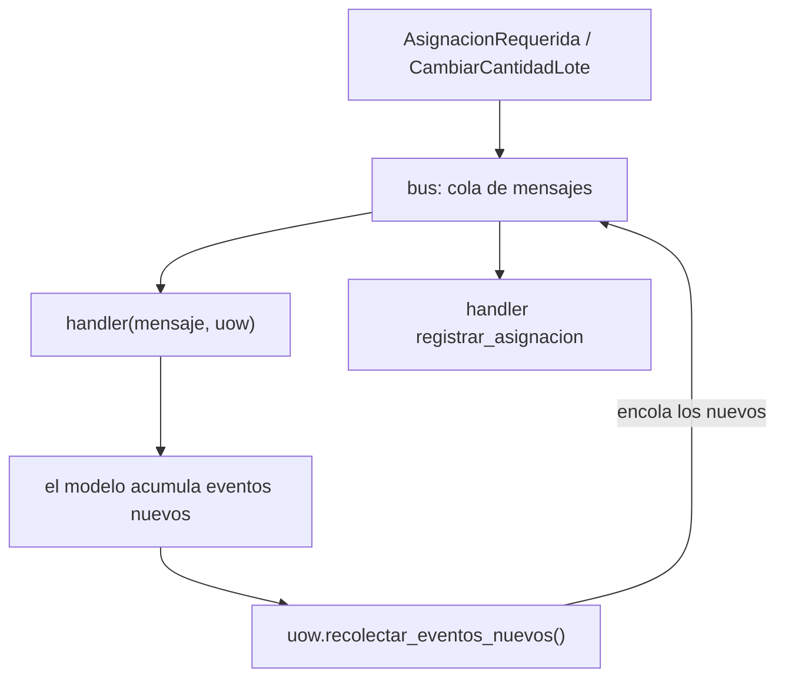
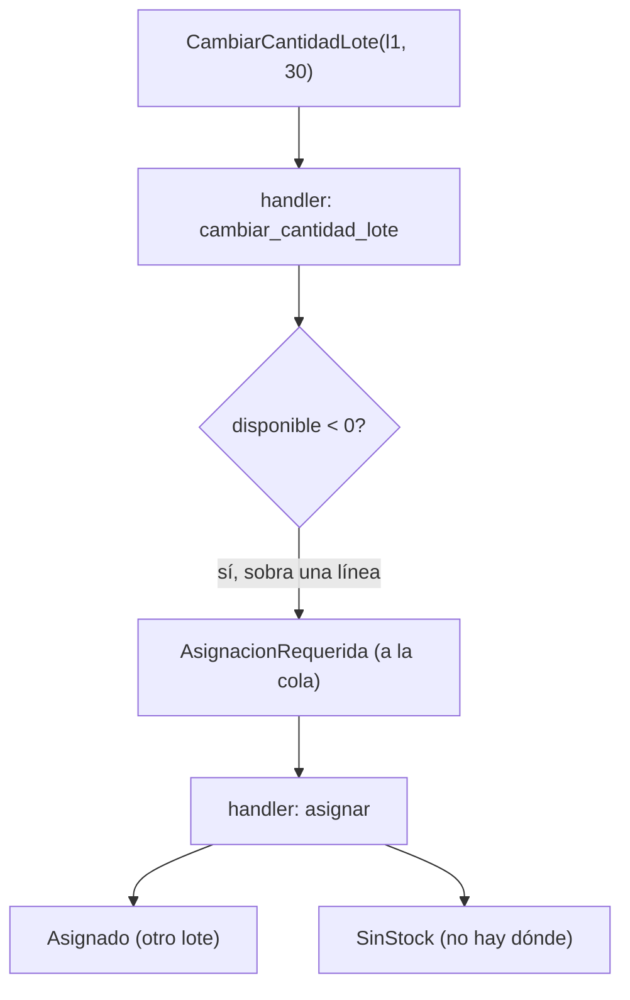

# Capítulo 9 — Going to Town on the Message Bus

> Fase 1 · el libro (Parte II). Capítulo autocontenido (clase + `proyecto/` + `ejercicios/`).

⬅️ [Capítulo 8 · Events and the Message Bus](../08-events-message-bus/) · 🏠 [Índice de capítulos](../README.md) · ➡️ [Capítulo 10 · Commands and Command Handler](../10-commands/)

> Idea central del capítulo: el **bus de mensajes** deja de ser un detalle del final y se
> convierte en el **punto de entrada** de la aplicación. Ya no hay una capa de servicio aparte:
> *"everything will be an event handler"* (Cap. 9). Un evento puede provocar otro, así que el bus
> procesa una **cola** y, tras cada handler, recolecta los eventos nuevos y los vuelve a encolar
> (cascada).

```bash
uv run pytest fase-1/capitulos/09-message-bus-a-fondo/proyecto/ -q      # 27 passed
```

---

## Micro-paso 1 — El bus es el punto de entrada (y recolecta eventos de la UoW)

### 0. 🧭 La pregunta
> *"En el cap. 8 el servicio llamaba al bus al final. ¿Y si una reacción provoca otra, y esa otra
> provoca una más? ¿Cómo encadeno reacciones (cascada) sin que un handler conozca al siguiente?"*

### 1. Objetivo
Convertir el **bus en el punto de entrada**: recibe un mensaje, procesa una **cola** y, tras cada
handler, recoge los **eventos nuevos** que la UoW haya acumulado y los encola. Así una reacción
dispara la siguiente sin acoplarse.

### 2. Cita de la fuente
> *"A New Requirement Leads Us to a New Architecture."* / *"The message bus is now the main
> entrypoint to the service layer"* / *"The message bus passes the UoW down to each handler.
> After each handler finishes, we collect any new events that have been generated and add them
> to the queue."* — Cap. 9.

En Python el bus procesa una lista como cola (`pop(0)` saca el primero, `extend` encola al final):

```python
def manejar(mensaje, uow):
    resultados = []
    cola = [mensaje]
    while cola:
        m = cola.pop(0)
        for manejador in MANEJADORES[type(m)]:
            resultados.append(manejador(m, uow))
            cola.extend(uow.recolectar_eventos_nuevos())   # cascada: lo nuevo vuelve a la cola
    return resultados
```

### 3. El dolor / necesidad
En el cap. 8 el servicio recorría `producto.eventos` a mano tras `comprometer()`. Pero si un
handler genera un evento que a su vez debe dispararse, el servicio tendría que volver a mirar
una y otra vez. Si el handler de asignar **llamara** al de registrar, se acoplarían. Mejor: el
modelo **emite** el evento, la UoW lo **recolecta** (de los productos `vistos`) y el bus lo
**encola**; su handler corre después. Agregar una reacción es registrar un handler más.

### 4. Explicación paso a paso (TDD)
1. El repositorio recuerda los productos `vistos` (un `set`): los que cargó con `obtener` o
   agregó con `agregar`.
2. La UoW gana `recolectar_eventos_nuevos()`: recorre los productos vistos y va sacando sus
   eventos (`yield producto.eventos.pop(0)`), un generador.
3. Las funciones de servicio se vuelven **handlers** con la firma `(mensaje, uow)`.
4. El bus procesa una cola; tras cada handler encola lo recolectado. Test: tras
   `AsignacionRequerida`, la cascada deja `asignaciones_registradas == ["l1"]` (el `Asignado`
   emitido al asignar se recoge y su handler lo registra).

```python
def recolectar_eventos_nuevos(self):
    for producto in self.productos.vistos:
        while producto.eventos:
            yield producto.eventos.pop(0)
```

### 5. Diagrama (Mermaid — Figura 9-2)

El bus es la puerta de entrada; la cola convierte una reacción en la siguiente (cascada).

### 6. Árbol de archivos
```
fase-1/capitulos/09-message-bus-a-fondo/proyecto/
├── eventos.py              # AsignacionRequerida, CambiarCantidadLote, Asignado, SinStock
├── modelo.py               # Producto acumula eventos; cambiar_cantidad_lote reasigna
├── repositorio.py          # + vistos (set de productos tocados)
├── unidad_de_trabajo.py    # + recolectar_eventos_nuevos()
├── mensajeria.py           # el bus (cola) + handlers
├── api.py                  # el POST llama al bus
└── test_*.py               # 27 tests
```

### 7. Tu turno
Añade un contador global en `mensajeria.py` que registre cuántos mensajes procesó el bus en
total (incluidos los de la cascada): incrementa dentro del `while cola` y comprueba en un test
que un `AsignacionRequerida` que acaba en `Asignado` cuenta **dos** mensajes.

### 8. Comprobación
```bash
uv run pytest fase-1/capitulos/09-message-bus-a-fondo/proyecto/ -q      # 27 passed
```

### 9. Preguntas de recuerdo
1. ¿Qué recolecta el bus tras cada handler?
2. ¿Para qué sirve `vistos` en el repositorio?
3. ¿Por qué una **cola** y no una simple lista recorrida una sola vez?
4. ¿Qué significa que "todo es un handler"?

---

## Micro-paso 2 — Nuevo requisito: cambiar la cantidad de un lote (reasignar)

### 0. 🧭 La pregunta
> *"El almacén baja la cantidad comprada de un lote por debajo de lo ya asignado (un lote llegó
> dañado). Si lo que ya estaba asignado ya no cabe, hay que **reasignar** esas líneas.
> ¿Cómo lo encadeno automáticamente?"*

### 1. Objetivo
Implementar `cambiar_cantidad_lote` y que la cascada reasigne (o avise `SinStock`) sola: bajar
la cantidad puede dejar el lote en negativo; cada línea sobrante se desasigna y vuelve a la cola
como `AsignacionRequerida`.

### 2. Cita de la fuente
> *"Example 2: Change Batch Quantity."* / *"Imagining an Architecture Change: Everything Will Be
> an Event Handler."* / *"Refactoring Service Functions to Message Handlers."* — Cap. 9.

En Python, `Producto.cambiar_cantidad_lote` ajusta la compra y, mientras sobre stock, desasigna
una línea y emite `AsignacionRequerida`:

```python
def cambiar_cantidad_lote(self, referencia, cantidad_nueva):
    lote = next(l for l in self.lotes if l.referencia == referencia)
    lote._cantidad_comprada = cantidad_nueva
    while lote.cantidad_disponible < 0:                 # sobra stock asignado
        linea = lote._asignaciones.pop()                # desasigna una
        self.eventos.append(
            eventos.AsignacionRequerida(linea.id_pedido, linea.sku, linea.cantidad)
        )
```

### 3. El dolor / necesidad
Si el lote queda con disponible **negativo**, hay líneas asignadas que ya no caben. No podemos
dejarlas "fantasma": hay que desasignarlas y **volver a intentar** asignarlas (quizá en otro
lote). Eso es "otra asignación", que ya sabemos disparar con un evento; no hace falta lógica
nueva de orquestación, basta con emitir `AsignacionRequerida` y dejar que la cascada haga el resto.

### 4. Explicación paso a paso (TDD)
1. `Producto.cambiar_cantidad_lote(ref, cantidad)` ajusta la compra y, por cada línea que sobra,
   la desasigna y registra `AsignacionRequerida`.
2. El handler `cambiar_cantidad_lote` dispara la cascada: el bus toma cada `AsignacionRequerida`
   y la reasigna con el handler `asignar` (o registra `SinStock` si no hay stock).
3. Test: tras usar todo un lote y bajarlo, la línea se re-encola; sin otro lote, acaba en
   `SinStock`; con otro lote del mismo sku, se reasigna allí.

### 5. Diagrama (Mermaid — Figura 9-3)


### 6. Árbol de archivos
```
proyecto/
├── eventos.py · modelo.py (cambiar_cantidad_lote) · repositorio.py · unidad_de_trabajo.py
├── mensajeria.py (handlers: asignar, cambiar_cantidad_lote, notificar_sin_stock, registrar_asignacion)
└── test_mensajeria.py · test_modelo.py · test_repositorio.py · test_uow.py · test_api.py · test_orm.py
```

### 7. Tu turno
Añade un segundo lote al producto y comprueba que, al bajar el primero, la línea se reasigna al
segundo (en vez de quedar `SinStock`). Pista: `Producto("MESA", [Lote("l1", ...), Lote("l2", ...)])`.

### 8. Comprobación
```bash
uv run pytest fase-1/capitulos/09-message-bus-a-fondo/proyecto/ -q      # 27 passed
```

### 9. Preguntas de recuerdo
1. ¿Qué evento registra `cambiar_cantidad_lote` por cada línea que sobra?
2. ¿Quién reasigna esas líneas?
3. ¿Qué pasa si no hay otro lote con stock?

---

> **Capítulo 9 completo.** El bus es ahora el punto de entrada y encadena reacciones en cascada
> recolectando los eventos de la UoW. Siguiente: **Capítulo 10 — Commands and Command Handler**
> (separar comandos de eventos y tratar sus errores de forma distinta).

---

⬅️ [Capítulo 8 · Events and the Message Bus](../08-events-message-bus/) · 🏠 [Índice de capítulos](../README.md) · ➡️ [Capítulo 10 · Commands and Command Handler](../10-commands/)
