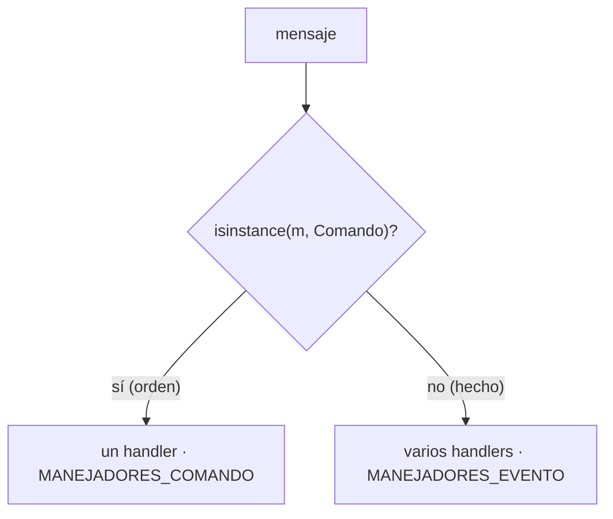
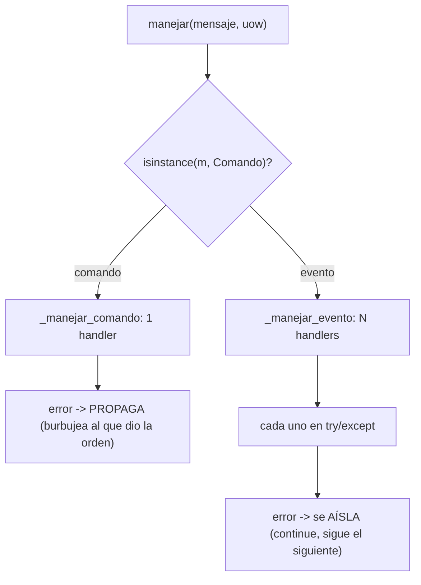

# Capítulo 10 — Commands and Command Handler

> Fase 1 · el libro (Parte II). Capítulo autocontenido (clase + `proyecto/` + `ejercicios/`).

⬅️ [Capítulo 9 · Going to Town on the Message Bus](../09-message-bus-a-fondo/) · 🏠 [Índice de capítulos](../README.md) · ➡️ [Capítulo 11 · Event-Driven Architecture](../11-microservicios-eventos/)

> Idea central del capítulo: en el cap. 9 **todo** era un evento, hasta "quiero asignar". Pero
> una **orden** ("haz esto") no es lo mismo que un **hecho** ("esto pasó"). Separarlos en dos
> tipos (`Comando` y `Evento`) y tratarlos distinto: el comando tiene **un** handler y su error
> **propaga**; el evento tiene **varios** y cada uno va aislado.

```bash
uv run pytest fase-1/capitulos/10-commands/proyecto/ -q      # 27 passed
```

---

## Micro-paso 1 — Separar comandos de eventos

### 0. 🧭 La pregunta
> *"Órdenes y hechos no son lo mismo: 'asigna esto' (una orden) vs 'se asignó esto' (un hecho).
> Si falla un email no debe fallar la asignación. ¿Cómo los distingo y por qué importa?"*

### 1. Objetivo
Crear una jerarquía `Comando` aparte de `Evento`. Los **comandos** se nombran en imperativo
(`Asignar`, `CrearLote`, `CambiarCantidadLote`); los **eventos** en pasado (`Asignado`,
`SinStock`, `Desasignado`). El bus los distingue y los trata distinto.

### 2. Cita de la fuente
> *"We name commands with imperative mood verb phrases like 'allocate stock' or 'delay shipment.'
> Commands capture intent. They express our wish for the system to do something. As a result,
> when they fail, the sender needs to receive error information."* — Cap. 10, *Commands and Events*.

En Python son dos clases base distintas, ambas con `@dataclass` para sus datos:

```python
# comandos.py — órdenes: "haz esto"
class Comando:
    pass

@dataclass
class Asignar(Comando):
    id_pedido: str
    sku: str
    cantidad: int

# eventos.py — hechos: "esto pasó"
class Evento:
    pass

@dataclass
class Asignado(Evento):
    id_pedido: str
    sku: str
    cantidad: int
    referencia: str
```

### 3. El dolor / necesidad
Mezclar órdenes y hechos en un solo tipo esconde una diferencia importante: una orden tiene un
único responsable y su fallo **importa** (quien la pidió espera un resultado); un hecho puede
tener cero, uno o muchos interesados, y que uno falle no debería tumbar a los demás.

### 4. Explicación paso a paso (TDD)
1. `comandos.py`: `Comando` base y `Asignar`, `CrearLote`, `CambiarCantidadLote`.
2. `eventos.py`: solo hechos (`Asignado`, `SinStock`, `Desasignado`).
3. El bus usa **dos** mapas: `MANEJADORES_COMANDO` (un handler por comando) y
   `MANEJADORES_EVENTO` (una lista de handlers por evento).
4. El bus despacha según el tipo con `isinstance(m, comandos.Comando)`.
5. Test: un comando `Asignar` produce, en cascada, la asignación registrada.

| | Comando | Evento |
|---|---|---|
| Nombre | imperativo (`Asignar`) | pasado (`Asignado`) |
| Handlers | **uno** | **varios** |
| Si falla | propaga | se aísla |

### 5. Diagrama (Mermaid)


### 6. Árbol de archivos
```
fase-1/capitulos/10-commands/proyecto/
├── comandos.py             # Comando, Asignar, CrearLote, CambiarCantidadLote
├── eventos.py              # Evento, Asignado, SinStock, Desasignado
├── mensajeria.py           # bus: 2 mapas (comandos vs eventos)
├── modelo.py · repositorio.py · unidad_de_trabajo.py · api.py · orm.py
└── test_*.py               # 27 tests
```

### 7. Tu turno
Agrega un comando nuevo (p. ej. `Desasignar(id_pedido, sku, cantidad)`) a `comandos.py` y
comprueba en un test que `isinstance(Desasignar(...), comandos.Comando)` es `True` y que NO es
un `Evento`.

### 8. Comprobación
```bash
uv run pytest fase-1/capitulos/10-commands/proyecto/ -q      # 27 passed
```

### 9. Preguntas de recuerdo
1. ¿En qué tiempo verbal se nombra un comando? ¿Y un evento?
2. ¿Cómo distingue el bus un comando de un evento?
3. ¿Cuántos handlers tiene un comando? ¿Y un evento?
4. ¿`CrearLote` es comando o evento?

---

## Micro-paso 2 — Manejo de errores distinto: el comando PROPAGA, el evento se AÍSLA

### 0. 🧭 La pregunta
> *"Si falla el envío de un email (un efecto de un evento), no debería fallar la asignación. Pero
> si falla la asignación misma (una orden), quien la pidió SÍ debe enterarse. ¿Cómo distingo?"*

### 1. Objetivo
Que el error de un **comando PROPAGUE** (sube a quien dio la orden) y el error de un **handler de
evento se AÍSLE** (se registra pero no interrumpe el flujo).

### 2. Cita de la fuente
> *"The command dispatcher expects just one handler per command. If any errors are raised, they
> fail fast and will bubble up."* / *"Events cannot interrupt the flow."* — Cap. 10,
> *Differences in Exception Handling*.

En Python, el bus reparte según el tipo y maneja los errores distinto:

```python
def manejar(mensaje, uow):
    resultados = []
    cola = [mensaje]
    while cola:
        m = cola.pop(0)
        if isinstance(m, comandos.Comando):
            resultados.append(_manejar_comando(m, uow, cola))
        else:
            _manejar_evento(m, uow, cola)
    return resultados

def _manejar_comando(comando, uow, cola):
    manejador = MANEJADORES_COMANDO[type(comando)]
    resultado = manejador(comando, uow)                 # si falla, PROPAGA (no se atrapa)
    cola.extend(uow.recolectar_eventos_nuevos())
    return resultado

def _manejar_evento(evento, uow, cola):
    for manejador in MANEJADORES_EVENTO[type(evento)]:
        try:
            manejador(evento, uow)
            cola.extend(uow.recolectar_eventos_nuevos())
        except Exception:
            continue                                     # AISLADO: no rompe el flujo
```

### 3. El dolor / necesidad
El usuario que manda un comando espera saber si funcionó: su error debe llegarle. Los efectos
secundarios de un evento (emails, logs, notificaciones) no deben tumbar el flujo si uno falla:
si un handler de notificación revienta, la asignación ya hecha debe sobrevivir.

### 4. Explicación paso a paso (TDD)
1. `_manejar_comando` llama al **único** handler y NO atrapa: el error sube (el test espera
   `pytest.raises(SkuInvalido)`).
2. `_manejar_evento` envuelve cada handler en `try/except Exception` y hace `continue`: sigue con
   el siguiente handler aunque uno reviente.
3. Test: con un handler de `Asignado` que lanza `Exception("boom")`, el comando `Asignar` igual
   se completa y el buen handler (`registrar_asignacion`) corre, dejando
   `asignaciones_registradas == ["l1"]`.

### 5. Diagrama (Mermaid)


### 6. Árbol de archivos
```
fase-1/capitulos/10-commands/proyecto/
├── comandos.py · eventos.py · modelo.py · repositorio.py · unidad_de_trabajo.py
├── mensajeria.py   # MANEJADORES_COMANDO (1 handler, propaga) + MANEJADORES_EVENTO (N, aislado)
└── test_mensajeria.py (comando/evento, aislamiento) · test_modelo.py · test_api.py · ...
```

### 7. Tu turno
Registra un segundo handler de `SinStock` en `MANEJADORES_EVENTO` que escriba en una lista de log
y comprueba que, si lo pones **antes** de uno que revienta, el bueno igual corre (recuerda
restaurar el mapa en un `finally`, como hace `test_los_errores_de_eventos_se_aislan`).

### 8. Comprobación
```bash
uv run pytest fase-1/capitulos/10-commands/proyecto/ -q      # 27 passed
```

### 9. Preguntas de recuerdo
1. ¿Por qué el error de un comando debe propagar?
2. ¿Por qué el de un handler de evento se aísla?
3. ¿Qué pasaría si no aisláramos los errores de eventos?

---

> **Capítulo 10 completo.** Comandos y eventos son tipos distintos y el bus los trata distinto:
> el comando con un handler y error que propaga; el evento con varios y error aislado.
> Siguiente: **Capítulo 11 — Event-Driven Architecture** (microservicios integrados con eventos
> por Redis).

---

⬅️ [Capítulo 9 · Going to Town on the Message Bus](../09-message-bus-a-fondo/) · 🏠 [Índice de capítulos](../README.md) · ➡️ [Capítulo 11 · Event-Driven Architecture](../11-microservicios-eventos/)
