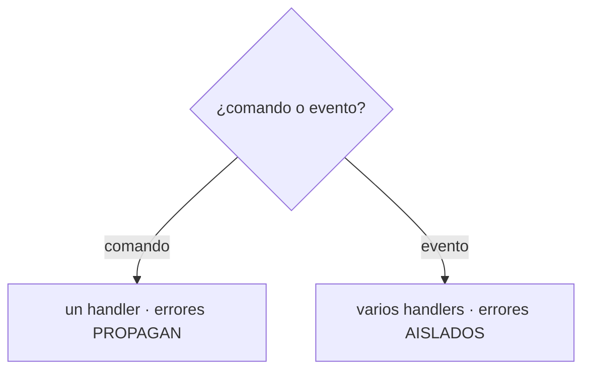

# Capítulo 10 — Commands and Command Handler

> Fase 1 · el libro (Parte II). Capítulo autocontenido (clase + `proyecto/` + `ejercicios/`).

⬅️ [Capítulo 9 · Going to Town on the Message Bus](../09-message-bus-a-fondo/) · 🏠 [Índice de capítulos](../README.md) · ➡️ [Capítulo 11 · Event-Driven Architecture](../11-microservicios-eventos/)

---

## Micro-paso 1 — Separar comandos de eventos

### 0. 🧭 La pregunta
> *"Órdenes y hechos no son lo mismo: si falla un email, no debe fallar la asignación.
> ¿Cómo los distingo?"*

### 2. Cita de la fuente
> *"Commands and Events ... Differences in Exception Handling."* — Cap. 10.

### 4. Explicación paso a paso
| | Comando | Evento |
|---|---|---|
| Handlers | uno | varios |
| Si falla | propaga | se aísla |

1. `comandos.py` (Asignar, CrearLote, CambiarCantidadLote) y `eventos.py` (Asignado, SinStock, Desasignado).
2. El bus tiene `MANEJADORES_COMANDO` y `MANEJADORES_EVENTO` y despacha según el tipo.

### 5. Diagrama (Mermaid)


### 9. Preguntas de recuerdo
1. ¿Cuántos handlers tiene un comando? ¿Y un evento?
2. ¿Qué pasa con un error en un handler de comando vs de evento?

---

## Micro-paso 2 — Manejo de errores distinto

### 4. Explicación paso a paso
1. `_manejar_comando`: llama al único handler; el error propaga.
2. `_manejar_evento`: recorre handlers con `try/except` que aísla fallos.
3. Test: un handler que "revienta" no impide que el comando `Asignar` se complete. 27 passed.

### 6. Árbol de archivos
```
fase-1/capitulos/10-commands/proyecto/
├── comandos.py · eventos.py · mensajeria.py (2 mapas) · modelo.py · api.py · ...
└── test_mensajeria.py (comando/evento, aislamiento) · ...
```

### 8. Comprobación
```bash
uv run pytest fase-1/capitulos/10-commands/proyecto/ -q      # 27 passed
```

### 9. Preguntas de recuerdo
1. ¿Por qué los errores de eventos se aíslan?
2. ¿Por qué los de comandos propagan?

---

> **Capítulo 10 completo.** Siguiente: **Capítulo 11 — Event-Driven Microservices (Redis)**.

---

⬅️ [Capítulo 9 · Going to Town on the Message Bus](../09-message-bus-a-fondo/) · 🏠 [Índice de capítulos](../README.md) · ➡️ [Capítulo 11 · Event-Driven Architecture](../11-microservicios-eventos/)
