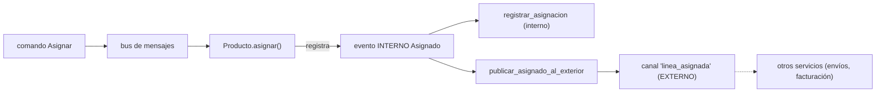

# Capítulo 11 — Event-Driven Architecture: Microservicios

> Fase 1 · el libro (Parte II). Capítulo autocontenido (clase + `proyecto/` + `ejercicios/`).

⬅️ [Capítulo 10 · Commands and Command Handler](../10-commands/) · 🏠 [Índice de capítulos](../README.md) · ➡️ [Capítulo 12 · CQRS](../12-cqrs/)

> **Nota:** el libro usa **Redis** real como canal pub/sub. Aquí se **simula** con un broker en
> memoria (`cola_externa.py`), porque este entorno no tiene servidor Redis. El concepto (eventos
> internos vs externos, Redis como adaptador fino) es idéntico; solo cambia el transporte. En
> producción, `cola_externa.publicar()` sería `redis.publish()` y `consumir_externo()` sería un
> worker que escucha el canal con `redis.subscribe()`.

```bash
uv run pytest fase-1/capitulos/11-microservicios-eventos/proyecto/ -q      # 29 passed
```

---

## Micro-paso 1 — Eventos internos vs externos

### 0. 🧭 La pregunta
> *"Me piden integrar con otros servicios sin llamarlos directamente (para no acoplarnos).
> Cuando asigno una línea, otro servicio (envíos, facturación) necesita enterarse. ¿Cómo aviso
> 'hacia afuera' sin que mi código dependa de ellos?"*

### 1. Objetivo
Distinguir el **evento interno** (viaja por el bus dentro de mi servicio) del **evento externo**
(se publica a un canal para que lo oigan otros servicios).

### 2. Cita de la fuente
> *"The Alternative: Temporal Decoupling Using Asynchronous Messaging."* — Cap. 11.

En Python, el evento interno `Asignado` ya existe (cap. 8). Añadimos un handler más a `Asignado`
que, al oírlo, publica un evento EXTERNO al canal:

```python
def publicar_asignado_al_exterior(evento, uow):
    # EVENTO EXTERNO: avisamos a otros servicios por el canal (Redis en producción).
    cola_externa.publicar(
        "linea_asignada",
        {"id_pedido": evento.id_pedido, "sku": evento.sku, "ref": evento.referencia},
    )
```

### 3. El dolor / necesidad
Si al asignar llamara directo a un `servicio_de_envios.crear(...)`, mi servicio dependería del de
envíos: un cambio allá rompe acá, y no puedo desplegarlos por separado. Ese **acoplamiento
temporal** ("tú tienes que estar vivo justo ahora") es el problema. Publicar un evento al canal
desacopla: el otro servicio lo consume cuando puede.

### 4. Explicación paso a paso
1. Los eventos **internos** (`Asignado`, `SinStock`, `Desasignado`) viajan por el bus
   (`mensajeria.py`) y los manejan handlers de mi propio servicio.
2. Añadimos un segundo handler a `Asignado`: `publicar_asignado_al_exterior`, que **publica** un
   evento externo. Por eso `MANEJADORES_EVENTO[eventos.Asignado]` tiene **dos** handlers:
   `[registrar_asignacion, publicar_asignado_al_exterior]`.
3. El evento externo es un `dict` plano (JSON en producción): datos simples, sin objetos de mi
   dominio. Así otros servicios (en otro lenguaje incluso) pueden entenderlo. Las claves van en
   `snake_case` (`id_pedido`), como todo Python.

### 5. Diagrama (Mermaid)

**Cómo leerlo:** un mismo evento interno dispara varios handlers. Uno de ellos cruza la frontera
del servicio publicando un evento externo al canal. La flecha punteada sale de mi servicio.

### 6. Árbol de archivos
```
fase-1/capitulos/11-microservicios-eventos/proyecto/
├── eventos.py               # Asignado, SinStock, Desasignado (internos)
├── comandos.py              # Asignar, CrearLote, CambiarCantidadLote
├── cola_externa.py          # NUEVO: broker simulado ("Redis")
├── mensajeria.py            # + publicar_asignado_al_exterior · consumir_externo
├── modelo.py · repositorio.py · unidad_de_trabajo.py · api.py · orm.py
└── test_*.py                # 29 tests (incl. test_integracion_externa.py)
```

### 7. Tu turno
Añade un tercer handler a `MANEJADORES_EVENTO[eventos.SinStock]` que publique al canal un mensaje
externo `("sin_stock", {"sku": evento.sku})`, y comprueba en un test que, tras un `Asignar` que no
cabe, `cola_externa.mensajes_publicados` contiene ese mensaje.

### 8. Comprobación
```bash
uv run pytest fase-1/capitulos/11-microservicios-eventos/proyecto/ -q      # 29 passed
```

### 9. Preguntas de recuerdo
1. ¿Qué diferencia hay entre un evento interno y uno externo?
2. ¿Por qué el evento externo es un `dict` plano y no un objeto `Asignado`?
3. ¿Por qué publicar en vez de llamar directo al otro servicio?

---

## Micro-paso 2 — Redis (aquí, `cola_externa`) como adaptador fino

### 0. 🧭 La pregunta
> *"Ya publico hacia afuera. Pero también me llegan mensajes de otros servicios (p. ej. 'el lote
> cambió de cantidad'). ¿Cómo los recibo y los convierto en algo que mi dominio entienda sin
> ensuciar el dominio?"*

### 1. Objetivo
Ver el canal como **dos adaptadores finos** alrededor del mismo bus: uno de **salida** (publicar)
y uno de **entrada** (consumir, que traduce un mensaje externo a un comando interno).

### 2. Cita de la fuente
> *"Redis Is Another Thin Adapter Around Our Message Bus."* — Cap. 11.

En Python, salida y entrada:

```python
# SALIDA: publicar al canal (en producción: redis.publish)
cola_externa.publicar("linea_asignada", datos)

# ENTRADA: traducir un mensaje externo (dict) a un comando interno y meterlo al bus
def consumir_externo(mensaje, uow):
    comando = comandos.CambiarCantidadLote(mensaje["referencia"], mensaje["cantidad"])
    return manejar(comando, uow)
```

### 3. El dolor / necesidad
Si el código que escucha Redis metiera lógica de negocio, estaría mezclando transporte con
dominio. El adaptador debe ser **fino**: solo traduce (`dict` externo ⇄ comando/evento) y delega
en el bus. Toda la lógica sigue en el dominio y los handlers; si mañana cambiamos Redis por otra
cola, solo tocamos el adaptador.

### 4. Explicación paso a paso
1. **Salida:** `cola_externa.publicar(canal, datos)`. En real sería `redis.publish`. Guarda lo
   enviado en `cola_externa.mensajes_publicados` (para que los tests lo comprueben).
2. **Entrada:** `consumir_externo(mensaje, uow)` toma el `dict` externo, crea el **comando**
   `CambiarCantidadLote` y llama a `manejar(...)`. No tiene reglas: solo traduce.
3. **Tests con el broker simulado** (`test_integracion_externa.py`): al asignar se publica un
   externo (`("linea_asignada", {"id_pedido": "o1", "sku": "MESA", "ref": "l1"})`); un mensaje
   externo entrante se consume como comando y baja la cantidad del lote (`_cantidad_comprada == 30`).

### 5. Diagrama (Mermaid — Figuras 11-1/11-2)

**Cómo leerlo:** el bus está en el centro. A la izquierda, el adaptador de entrada traduce lo que
llega. A la derecha, el de salida publica lo que sale. Ambos son finos: no tienen reglas; en el
medio, el bus y el dominio no saben nada de Redis.

### 6. Árbol de archivos
```
fase-1/capitulos/11-microservicios-eventos/proyecto/
├── cola_externa.py          # publicar(canal, datos), mensajes_publicados, limpiar()
├── mensajeria.py            # consumir_externo(mensaje, uow), publicar_asignado_al_exterior
└── test_integracion_externa.py  # publica y consume por el canal
```

### 7. Tu turno
Haz que `consumir_externo` también acepte un mensaje de tipo "asignar": si el `dict` trae
`{"id_pedido", "sku", "cantidad"}`, crea un comando `Asignar` en vez de `CambiarCantidadLote`.
Comprueba con un test que un mensaje externo de asignación cambia el stock del producto.

### 8. Comprobación
```bash
uv run pytest fase-1/capitulos/11-microservicios-eventos/proyecto/ -q      # 29 passed
```

### 9. Preguntas de recuerdo
1. ¿Qué hace el adaptador de entrada y qué hace el de salida?
2. ¿Por qué decimos que Redis (aquí `cola_externa`) es un adaptador "fino"?
3. ¿Dónde vive la lógica de negocio: en el adaptador o en el dominio/handlers?

---

> **Capítulo 11 completo.** Los servicios se integran publicando y consumiendo eventos por un
> canal (Redis), con adaptadores finos de entrada y salida alrededor del bus.
> Siguiente: **Capítulo 12 — CQRS**.

---

⬅️ [Capítulo 10 · Commands and Command Handler](../10-commands/) · 🏠 [Índice de capítulos](../README.md) · ➡️ [Capítulo 12 · CQRS](../12-cqrs/)
