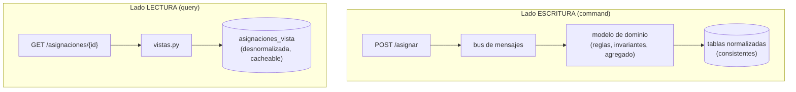
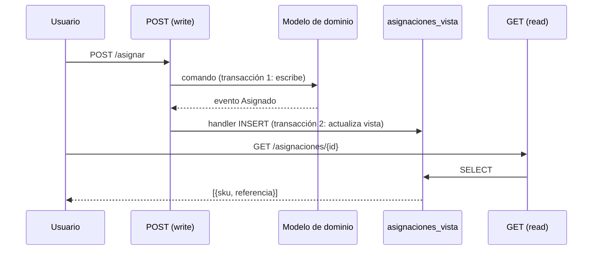

# Capítulo 12 — CQRS (Command-Query Responsibility Segregation)

> Fase 1 · el libro (Parte II). Capítulo autocontenido (clase + `proyecto/` + `ejercicios/`).

⬅️ [Capítulo 11 · Event-Driven Architecture](../11-microservicios-eventos/) · 🏠 [Índice de capítulos](../README.md) · ➡️ [Capítulo 13 · Dependency Injection](../13-dependency-injection/)
> Idea central del capítulo: *"reads (queries) and writes (commands) are different, so they
> should be treated differently (or have their responsibilities segregated)."* — Cap. 12.

---

## Micro-paso 1 — CQS: leer y escribir son cosas distintas

### 0. 🧭 La pregunta
> *"Mi endpoint de asignar MODIFICA el stock y además me DEVUELVE datos para mostrar.
> Cuando el usuario recarga la página, ¡asigna dos veces! ¿Cómo lo separo?"*

### 1. Objetivo
Aplicar **CQS**: una función **o** cambia estado **o** responde preguntas, nunca las dos.

### 2. Cita de la fuente
> *"In CQS we follow one simple rule: functions should either modify state or answer
> questions, but never both."* — Cap. 12, *Post/Redirect/Get and CQS*.

### 3. El dolor / necesidad
El POST `/asignar` devolvía la referencia del lote. Eso mezcla escribir con leer: al
recargar, el navegador reenvía el POST y se asigna de nuevo (el usuario compra dos sofás).

### 4. Explicación paso a paso (sin recortar)
1. **Separamos.** El POST pasa a devolver un OK simple (`202 {"ok": true}`): solo ESCRIBE.
2. **Creamos un lado de lectura.** Un GET `/asignaciones/{id_pedido}` que solo LEE.
3. **`vistas.py`** reúne el código de solo-lectura, aparte de los handlers que cambian estado.
   > *"Splitting out your read-only views from your state-modifying command and event
   > handlers is probably a good idea, even if you don't want to go to full-blown CQRS."* — Cap. 12.
4. Por qué podemos permitirnos leer datos un poco viejos (eventual consistency):
   > *"It's OK to trade performance for consistency on the read side, because stale data is
   > essentially unavoidable."* — Cap. 12, *Most Users Aren't Going to Buy Your Furniture*.

### 5. Figura del libro + diagrama Mermaid (Figura 12-1 — *Separating reads from writes*)

**Explicación:** a la izquierda/arriba, escribir es complejo (pasa por el dominio y el bus) y
debe ser consistente. A la derecha/abajo, leer es un SELECT simple contra una tabla preparada
para leer; puede estar un poco desactualizada sin causar daño.

### 9. Preguntas de recuerdo
1. ¿Qué regla define CQS?
2. ¿Por qué el POST ya no devuelve la referencia?
3. ¿Por qué un dato de lectura “viejo” no suele ser un problema?

---

## Micro-paso 2 — CQRS: un modelo de lectura mantenido por eventos

### 0. 🧭 La pregunta
> *"El modelo de dominio está hecho para escribir (métodos que cambian estado).
> Para leer rápido me estorba. ¿Y si tuviera una copia aparte, solo para leer?"*

### 2. Cita de la fuente
> *"The chin-stroking-architect's justification for CQRS … a domain model is not a data
> model … Most of this stuff is totally irrelevant for read-only operations."* — Cap. 12,
> *Your Domain Model Is Not Optimized for Read Operations*.

### 3. El dolor / necesidad
Leer reusando el repositorio o el ORM obliga a bucles y `joins` lentos (incluso el problema
`SELECT N+1`). La consulta más rápida siempre es `SELECT * FROM tabla WHERE clave = :valor`.

### 4. Explicación paso a paso (sin recortar)
1. **Tabla desnormalizada** `asignaciones_vista` (`id_pedido`, `sku`, `referencia`): sin claves
   foráneas, solo strings.
   > *"Hee hee hee, no foreign keys, just strings, YOLO."* — Cap. 12, *Time to Completely Jump the Shark*.
2. **Se mantiene con eventos.** Al evento `Asignado` le añadimos un handler que hace un
   `INSERT` en la vista; al `Desasignado`, uno que hace `DELETE`.
   > *"Updating a Read Model Table Using an Event Handler."* — Cap. 12.
3. **`vistas.asignaciones(id, uow)`** hace solo un `SELECT` sobre esa tabla.
4. **Cambiar el motor del modelo de lectura es fácil** (p. ej. a Redis) sin tocar el dominio:
   > *"Event handlers are a great way to manage updates to a read model … They also make it
   > easy to change the implementation of that read model at a later date."* — Cap. 12.

### 5. Figura del libro + diagrama Mermaid (Figura 12-2 — *Sequence diagram for read model*)

**Explicación:** en el POST hay **dos transacciones**: una actualiza el modelo de escritura y
otra, disparada por el evento, actualiza el modelo de lectura. El GET después solo consulta esa
vista. Si el handler de la vista fallara, el `allocate` seguiría funcionando y se podría
reconstruir la vista desde el estado de escritura.

### 6. Árbol de archivos
```
fase-1/capitulos/12-cqrs/proyecto/
├── vistas.py            (NUEVO: lado de lectura, CQS)
├── orm.py               (+ tabla desnormalizada asignaciones_vista)
├── mensajeria.py        (+ handlers agregar/quitar_asignacion_de_vista)
├── api.py               (POST 202 ok · GET /asignaciones/{id})
├── test_vistas.py       (NUEVO: integración del read model)
└── ... (modelo, comandos, eventos, repositorio, uow, orm, conftest, tests)
```

### 8. Comprobación (§3.4)
```bash
uv run pytest fase-1/capitulos/12-cqrs/proyecto/ -q      # 32 passed
```

### 9. Preguntas de recuerdo
1. ¿Por qué el modelo de lectura es una tabla desnormalizada y no el dominio?
2. ¿Quién mantiene esa tabla al día?
3. Si el handler de la vista falla, ¿se rompe la asignación? ¿Cómo se recupera la vista?

---

> 🛠️ **Nota de diseño (por qué no te confunda al estudiar):** el handler que llena el modelo
> de lectura (`agregar_asignacion_a_vista`) hace `uow.sesion.execute(...)`. En los tests con
> la **UoW falsa** (que no tiene `.sesion`) ese handler **falla y el bus lo ignora en silencio**
> — es a propósito: los handlers de evento están aislados con `try/except` (eso se enseña en el
> cap. 10). Por eso el modelo de lectura **solo se llena de verdad** cuando se usa la **UoW real**
> de SQLAlchemy, que es como lo prueba [`proyecto/test_vistas.py`](proyecto/test_vistas.py). No
> es un bug: es la propiedad de "si falla el read model, la asignación sigue funcionando".

> **Capítulo 12 completo.** Siguiente: **Capítulo 13 — Dependency Injection (and Bootstrapping)**.

---

⬅️ [Capítulo 11 · Event-Driven Architecture](../11-microservicios-eventos/) · 🏠 [Índice de capítulos](../README.md) · ➡️ [Capítulo 13 · Dependency Injection](../13-dependency-injection/)
