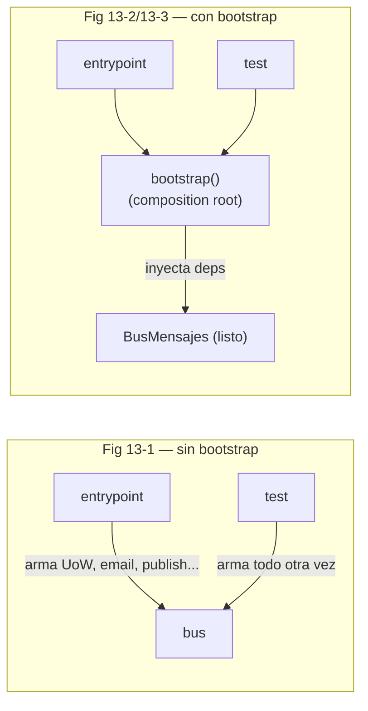
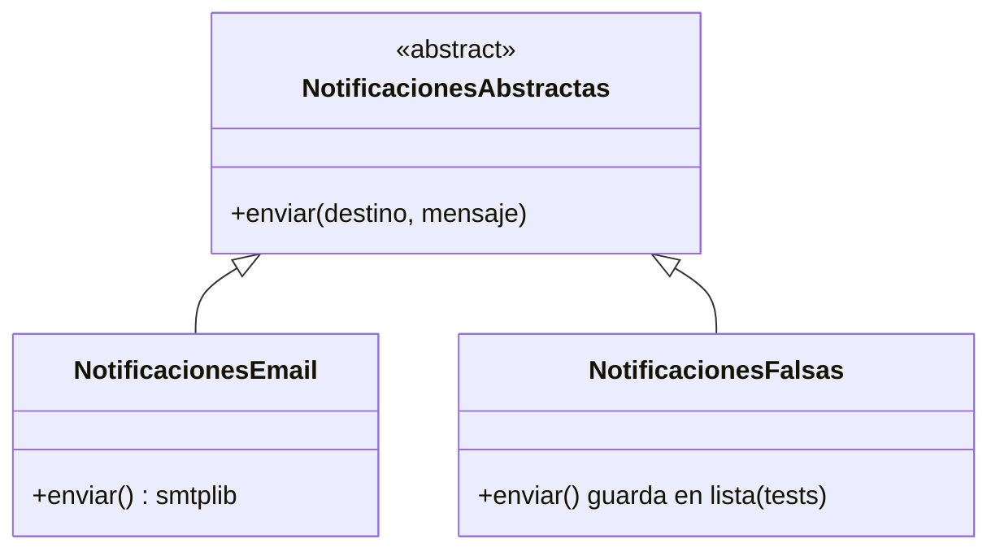

# Capítulo 13 — Dependency Injection (and Bootstrapping)

> Fase 1 · el libro (Parte II, **cierre**). Capítulo autocontenido (clase + `proyecto/` + `ejercicios/`).
> El último capítulo: reunimos la configuración y la inyección de dependencias en un solo sitio.

---

## Micro-paso 1 — Dependencias explícitas y el bootstrap

### 0. 🧭 La pregunta
> *"Mis handlers importan directamente el email, la UoW, Redis… Para testear tengo que
> `mock.patch` todo. ¿Cómo hago las dependencias fáciles de cambiar sin tanto mock?"*

### 1. Objetivo
Declarar **dependencias explícitas** y montarlas en un único **bootstrap** (composition root).

### 2. Cita de la fuente
> *"Explicit is better than implicit. —The Zen of Python … declaring an explicit dependency
> is an example of the dependency inversion principle—rather than having an (implicit)
> dependency on a specific detail, we have an (explicit) dependency on an abstraction."* — Cap. 13.

### 3. El dolor / necesidad
Importar y llamar algo directo (`email.send(...)`) ata el código a ese detalle: para los
tests hay que `mock.patch` en cada prueba, y un refactor trivial rompe todos los mocks.

### 4. Explicación paso a paso (sin recortar)
1. **Handler con dependencia explícita:** `notificar_sin_stock(evento, notificaciones)`
   recibe la dependencia como argumento (no la importa).
2. **Bootstrap** declara los defaults de producción y los puede sobreescribir.
   > *"We want our bootstrap script to do the following: 1. Declare default dependencies
   > but allow us to override them … 4. Give us back the core object for our app, the
   > message bus"* — Cap. 13.
3. **Inyección por inspección de la firma:** `inspect.signature(handler)` dice qué pide cada
   handler; se le pasan solo esas deps como kwargs y queda una función que solo pide el mensaje.
4. En **tests** llamamos a `bootstrap()` con defaults sobreescritos (UoW falsa, notificaciones
   falsas, `publicar` noop); en **producción** usamos los defaults.

### 5. Figura del libro + diagrama Mermaid (Figuras 13-1 → 13-3)

**Explicación:** sin bootstrap, cada entrypoint (y cada test) arma y pasa las dependencias
(duplicación). Con bootstrap, hay **un solo lugar** que las declara, inyecta y devuelve el bus.

### 9. Preguntas de recuerdo
1. ¿Por qué una dependencia explícita es un ejemplo del DIP?
2. ¿Qué 4 cosas hace el bootstrap?
3. ¿Cómo sabe `inyectar_dependencias` qué pasarle a cada handler?

---

## Micro-paso 2 — El bus como clase y el adaptador "de verdad"

### 0. 🧭 La pregunta
> *"Si los handlers ya traen sus dependencias inyectadas, ¿qué recibe el bus? ¿Y cómo
> convierto una dependencia simple (email) en un adaptador que pueda intercambiar?"*

### 2. Cita de la fuente
> *"Our message bus will no longer be static; it needs to have the already-injected handlers
> given to it. So we turn it from being a module into a configurable class."* — Cap. 13.

### 4. Explicación paso a paso (sin recortar)
1. **`BusMensajes` es una clase:** recibe la `uow` y los diccionarios de handlers **ya
   inyectados**. `manejar(mensaje)` es igual que antes, pero los handlers solo piden el mensaje.
2. **Adaptador "de verdad"** (ejemplo trabajado): `NotificacionesAbstractas` (ABC) +
   `NotificacionesEmail` (real) + `NotificacionesFalsas` (en los tests).
   > Receta: *"1. Define your API using an ABC. 2. Implement the real thing. 3. Build a fake
   > and use it for … tests…"* — Cap. 13, *DI and Bootstrap recap*.
3. Cambiar el adaptador (email → SMS → Slack) es cambiar **una línea del bootstrap**, sin
   tocar los handlers.

### 5. Diagrama (Mermaid — el adaptador y su fake)

**Explicación:** los handlers dependen de la **abstracción** (`NotificacionesAbstractas`). En
producción se inyecta `NotificacionesEmail`; en tests, `NotificacionesFalsas`. Nadie cambia.

### 6. Árbol de archivos
```
fase-1/capitulos/13-dependency-injection/proyecto/
├── bootstrap.py          (NUEVO: composition root + inyectar_dependencias)
├── notificaciones.py     (NUEVO: ABC + adaptador real)
├── mensajeria.py         (BusMensajes clase · handlers con deps explícitas)
├── api.py                (pide un bus del bootstrap)
├── test_bootstrap.py     (NUEVO: prueba la DI)
└── ... (modelo, vistas, comandos, eventos, repositorio, uow, orm, conftest, tests)
```

### 8. Comprobación (§3.4)
```bash
uv run pytest fase-1/capitulos/13-dependency-injection/proyecto/ -q      # 34 passed
```

### 9. Preguntas de recuerdo
1. ¿Qué recibe ahora el bus en su constructor?
2. ¿Cuál es la ventaja de que los handlers dependan de la ABC y no de `NotificacionesEmail`?
3. ¿Dónde cambiarías email por SMS?

---

> 🛠️ **Nota de diseño (sigue valiendo lo del cap. 12):** los handlers que escriben el modelo de
> lectura siguen necesitando `uow.sesion`. En los tests con **UoW falsa** fallan en silencio (el
> bus aísla los eventos con `try/except`), así que el read model **solo se llena con la UoW real**
> (ver [`proyecto/test_vistas.py`](proyecto/test_vistas.py)). Además, al montar el bus con
> `bootstrap(...)` en los tests pasamos `iniciar_orm=False`, porque el `conftest.py` ya arranca el
> ORM; si pusieras `True` en un test que ya mapeó, SQLAlchemy se queja de "mappers duplicados".

> **Capítulo 13 completo.** 🎉 **¡Fin de los 13 capítulos del libro!** (Quedan los apéndices
> como material opcional de cierre — ver [`../../../progreso/apendices.md`](../../../progreso/apendices.md).)
