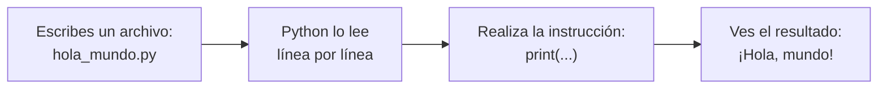

# Lección 00 — ¿Qué es ejecutar un programa?

> Fase 0 (Python desde cero) · micro-paso · un solo concepto nuevo.

## 0. 🧭 La pregunta

> *"No tengo nada: ni sé programar, ni tengo nada instalado. **Me piden** que la
> computadora **muestre un mensaje por mí**. ¿Qué hago? ¡Estoy perdido!"*

## 1. Objetivo

Entender **qué significa "ejecutar un programa"** y **ejecutar tu primera línea**
de Python.

## 2. Cita de la fuente

> *"the best way to learn about code is to code."*
> — Preface → *Example Code and Coding Along*

Por eso la primera lección **no es teoría**: es correr código de verdad.

## 3. El dolor / necesidad

1. Quiero un resultado (ver un mensaje) pero **no sé qué es un programa**.
2. Tampoco sé **cómo se le pide a la computadora** que lo haga.
3. Necesito dos cosas: (a) un **programa** = un archivo de texto con instrucciones,
   y (b) algo que lo **ejecute** = Python.

## 4. Explicación paso a paso

1. Un **programa** es un archivo de texto con **instrucciones**. El nuestro es
   `hola_mundo.py` y tiene una sola instrucción:

   ```python
   print("¡Hola, mundo!")
   ```

   `print(...)` significa "muestra en pantalla lo que va entre paréntesis".

2. **Python** es el programa que **lee** tu archivo y **realiza** cada instrucción,
   de arriba hacia abajo. "Ejecutar" = pedirle a Python que haga eso.

3. Para no pelear con instalaciones, usamos **uv**, que prepara Python y el entorno
   por nosotros. Dos comandos:

   ```bash
   uv init --bare --python 3.12     # crea el proyecto (una sola vez)
   uv run python lecciones/00-que-es-ejecutar-un-programa/hola_mundo.py
   ```

4. Al ejecutar, verás:

   ```
   ¡Hola, mundo!
   ```

   Eso es "ejecutar un programa": tu texto se convirtió en una acción.

## 5. Diagrama (Mermaid) — qué pasa al ejecutar

> Pégalo en un previsualizador de Mermaid para verlo dibujado.



**Explicación:** tú solo escribes el archivo (A). Al "ejecutar", Python lo lee de
arriba abajo (B), realiza cada instrucción (C) y el resultado aparece en pantalla
(D). Tú no "hablas con la computadora": escribes instrucciones y Python las cumple.

## 6. Árbol de archivos

```
aprendiendo-ddd-con-python-y-fastapi/
├── pyproject.toml                         # creado por `uv init`
└── lecciones/
    └── 00-que-es-ejecutar-un-programa/
        ├── README.md                      # esta lección
        ├── hola_mundo.py                  # el programa de ejemplo
        └── tu_turno.py                    # tu ejercicio (con hueco)
```

## 7. Tu turno (pair programming)

Abre `tu_turno.py` y completa el `# TODO`: escribe **una línea** que muestre tu
nombre. Luego ejecútalo:

```bash
uv run python lecciones/00-que-es-ejecutar-un-programa/tu_turno.py
```

## 8. Comprobación

En esta lección **no hay pytest todavía** (lo introducimos en la Lección 08, junto
con módulos y entorno). Aquí la comprobación es: **ejecutar tu programa y ver tu
nombre** en pantalla.

## 9. Preguntas de recuerdo

1. Con tus palabras: ¿qué es "ejecutar un programa"?
2. ¿Qué hace exactamente `print(...)`?
3. ¿Quién lee tu archivo y realiza las instrucciones?
