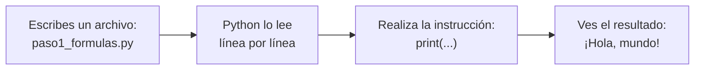
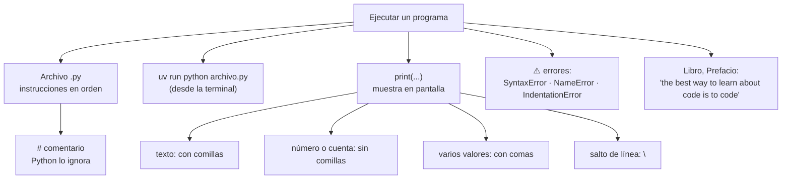

# Lección 00 — ¿Qué es ejecutar un programa?

> Fase 0 · Formulario · Familia de concepto: **ejecutar código y mostrar resultados** · Orden de estudio: **1 de 18**

⬅️ [Cómo estudiar](../../COMO-ESTUDIAR.md) · 🏠 [Índice de lecciones](../README.md) · ➡️ [Lección 01 · Variables y tipos](../01-variables-y-tipos/)

---

## 🧭 Ruta de estudio · Lección 00 (≈ 45 min)

**Antes necesitas:** nada. Esta es la primera lección. 🎉

| Paso | Qué haces | Dónde | ⏱ |
|:-:|---|---|:-:|
| **0** | Lee la teoría, los comandos, las fórmulas, las propiedades y los errores | este README §0–§8 | 15 min |
| **1** | Ejecuta las fórmulas y compara cada línea con la tabla | [`paso1_formulas.py`](paso1_formulas.py) | 5 min |
| **2** | Sigue los ejemplos resueltos línea por línea | §9 + [`paso2_ejemplos_resueltos.py`](paso2_ejemplos_resueltos.py) | 5 min |
| **3** | Completa los `# TODO` | [`paso3_tu_turno.py`](paso3_tu_turno.py) | 8 min |
| **4** | Compara con la solución de referencia | [`paso4_tu_turno_solucion.py`](paso4_tu_turno_solucion.py) | 2 min |
| **5** | Resuelve los 12 problemas **en un archivo tuyo**, luego revisa claves y solucionario | §10–§11 + [`paso5_solucionario/`](paso5_solucionario/) | 7 min |
| **6** | Compara solución mala vs buena | [`paso6_ejercicios/`](paso6_ejercicios/) | 3 min |
| **7** | Responde las preguntas de recuerdo **sin mirar** | §15 | 2 min |
| **🚦** | Evalúa si puedes pasar a la siguiente | §16 | 1 min |

---

## 0. 🧭 La pregunta
> *"No tengo nada: ni sé programar, ni tengo nada instalado. **Me piden** que la
> computadora **muestre un mensaje por mí**. ¿Qué hago? ¡Estoy perdido!"*

## 1. Objetivos (al terminar podrás…)
1. Explicar con tus palabras qué es **un programa** y qué es **ejecutarlo**.
2. Ejecutar un archivo `.py` con **uv**.
3. Mostrar textos y números en pantalla con `print`.
4. Escribir **comentarios** que Python ignora.
5. Reconocer y corregir `SyntaxError`, `NameError` e `IndentationError`.

## 2. Cita de la fuente
> *"the best way to learn about code is to code."* — Preface, *Example Code and Coding Along*

**Por qué importa:** el libro dice que se aprende **escribiendo y ejecutando código**, no
solo leyendo. Por eso esta primera lección no es pura teoría: vas a **correr código de
verdad** desde el primer minuto.

## 3. El dolor
Quiero un resultado (ver un mensaje en pantalla), pero:
1. No sé **qué es un programa**.
2. No sé **cómo pedirle a la computadora** que lo haga.

Necesito dos cosas: **(a)** un **programa** (un archivo de texto con instrucciones) y
**(b)** algo que lo **ejecute** (Python, preparado por uv).

---

## 4. 📘 Teoría

> **📄 Definición — Programa**
> Un **programa** es un **archivo de texto** con **instrucciones**, una debajo de otra.
> En Python, el archivo termina en `.py`. Ejemplo: `paso1_formulas.py`.

> **⚙️ Definición — Ejecutar**
> **Ejecutar** un programa es pedirle a **Python** que lea el archivo **de arriba hacia
> abajo** y **realice** cada instrucción, en ese orden.

> **🖨️ Definición — `print`**
> `print(...)` es la instrucción que significa **"muestra en pantalla lo que va entre
> paréntesis"**. `print("¡Hola, mundo!")` → aparece `¡Hola, mundo!`.

> **🔤 Vocabulario**
> - **Instrucción:** una orden para Python, normalmente una línea (`print("Hola")`).
> - **Texto (cadena):** lo que va entre comillas: `"Hola"` o `'Hola'`.
> - **Terminal (consola):** la ventana donde escribes comandos y ves lo que muestra el programa.
> - **Comando:** lo que escribes en la terminal para que algo pase (`uv run python archivo.py`).
> - **uv:** la herramienta que instala y prepara Python por nosotros.
> - **Comentario:** una línea que empieza con `#`; es una nota para personas, Python la ignora.

> **🧠 Regla de oro**
> **Tú escribes** las instrucciones en un archivo; **Python las cumple** de arriba hacia
> abajo. Si algo sale mal, Python te avisa con un **mensaje de error**: léelo, no lo temas.

**Qué pasa al ejecutar** (Mermaid):

Tú solo escribes el archivo (A). Al ejecutar, Python lo lee de arriba hacia abajo (B),
realiza cada instrucción (C) y el resultado aparece en la terminal (D).

---

## 5. 🧮 Formulario: comandos de la terminal

| # | Para qué | Comando | Resultado |
|---|---|---|---|
| K0 | Instalar uv (una sola vez) | macOS/Linux: `curl -LsSf https://astral.sh/uv/install.sh \| sh` · Windows (PowerShell): `powershell -ExecutionPolicy ByPass -c "irm https://astral.sh/uv/install.ps1 \| iex"` | uv queda instalado ([guía oficial](https://docs.astral.sh/uv/getting-started/installation/)) |
| K1 | ¿Tengo uv? | `uv --version` | `uv 0.x.y …` |
| K2 | Crear el proyecto (**ya está hecho** en este repo; no lo repitas) | `uv init --bare --python 3.12` | crea `pyproject.toml` |
| K3 | ¿Qué Python usa el proyecto? | `uv run python --version` | `Python 3.12.x` |
| K4 | **Ejecutar un programa** | `uv run python ruta/al/archivo.py` | se ve lo que el programa muestra |

> Los comandos se escriben en la **terminal**, parado en la carpeta del repositorio
> (`aprendiendo-ddd-con-python-y-fastapi/`), **no** dentro del archivo `.py`.

## 6. 🧮 Formulario: `print` y comentarios

| # | Operación | Sintaxis | Ejemplo | Resultado en pantalla |
|---|---|---|---|---|
| P1 | Mostrar un texto | `print("texto")` | `print("¡Hola, mundo!")` | `¡Hola, mundo!` |
| P2 | Comillas simples | `print('texto')` | `print('¡Hola, mundo!')` | `¡Hola, mundo!` (igual que P1) |
| P3 | Comillas dentro del texto | `print('… "…" …')` | `print('Ella gritó: "Alto!"')` | `Ella gritó: "Alto!"` |
| P4 | Varios valores | `print(a, b)` | `print("Producto:", "Mesa")` | `Producto: Mesa` (pone un espacio) |
| P5 | Línea en blanco | `print()` | `print()` | *(una línea vacía)* |
| P6 | Salto de línea | `\n` dentro del texto | `print("Línea 1\nLínea 2")` | `Línea 1` / `Línea 2` |
| P7 | Mostrar un número | `print(número)` | `print(100)` | `100` |
| P8 | Python calcula primero | `print(cuenta)` | `print(2 + 3)` | `5` |
| P9 | Con comillas NO se calcula | `print("cuenta")` | `print("2 + 3")` | `2 + 3` |
| P10 | Comentario | `# nota` | `# esto no se ve` | *(nada: Python lo ignora)* |
| P11 | Orden de ejecución | una instrucción por línea | `print("primero")` y luego `print("segundo")` | `primero` / `segundo` |

> 💡 Todas estas fórmulas están ejecutables en [`paso1_formulas.py`](paso1_formulas.py).

## 7. 📐 Propiedades
| Sobre el programa | Sobre `print` y el texto |
|---|---|
| **P-a.** Python lee **de arriba hacia abajo**, una instrucción tras otra. | **P-e.** El texto va **entre comillas**; sin comillas, Python cree que es un nombre. |
| **P-b.** Python **distingue mayúsculas**: `print` funciona, `Print` no. | **P-f.** La comilla que **abre** debe ser la misma que **cierra**: `"…"` o `'…'`. |
| **P-c.** Un comentario (`#`) **no se ejecuta**: es una nota para personas. | **P-g.** Con comas, `print` separa los valores con **un espacio**. |
| **P-d.** Por ahora, cada instrucción empieza **pegada al margen** (sin espacios delante). | **P-h.** Cada `print` termina con un **salto de línea**: el siguiente sale abajo. |

## 8. ⚠️ Errores frecuentes
| # | ❌ Así no | Qué pasa | ✅ Así sí |
|---|---|---|---|
| E1 | `print("Hola)` | `SyntaxError: unterminated string literal (detected at line 1)` | cierra la comilla: `print("Hola")` |
| E2 | `print(Hola)` | `NameError: name 'Hola' is not defined` | el texto va con comillas: `print("Hola")` |
| E3 | `Print("Hola")` | `NameError: name 'Print' is not defined` | en minúscula: `print("Hola")` |
| E4 | `print("Hola"` | `SyntaxError: '(' was never closed` | cierra el paréntesis: `print("Hola")` |
| E5 | `  print("Hola")` (espacios delante) | `IndentationError: unexpected indent` | pégalo al margen: `print("Hola")` |
| E6 | `print("Hola')` (abre `"` y cierra `'`) | `SyntaxError: unterminated string literal (detected at line 1)` | usa la misma comilla: `print("Hola")` |

> 🔬 Pruébalos: al final de [`paso1_formulas.py`](paso1_formulas.py) están E1–E5
> comentados. Quita el `#` de **uno**, ejecuta, lee el mensaje y vuelve a ponerlo.
> Fíjate que Python te dice **en qué línea** está el problema.

---

## 9. ✍️ Ejemplos resueltos (paso a paso)
> Todos están en [`paso2_ejemplos_resueltos.py`](paso2_ejemplos_resueltos.py).

**Ejemplo 1 — Saludo en dos líneas** *(fácil)*
> Enunciado: muestra `Hola, soy Benjamin` y debajo `Estoy aprendiendo Python`.
```python
print("Hola, soy Benjamin")          # Paso 1: primera línea (P1)
print("Estoy aprendiendo Python")    # Paso 2: va DESPUÉS porque está abajo (P11)
```
Salida:
```
Hola, soy Benjamin
Estoy aprendiendo Python
```

**Ejemplo 2 — Un mensaje con comillas** *(fácil)*
> Enunciado: muestra `El cliente dijo: "Quiero una mesa"` (con las comillas dobles).
```python
# Paso 1: el texto lleva comillas dobles por dentro -> por fuera uso simples (P3)
print('El cliente dijo: "Quiero una mesa"')
```
Si usaras dobles por fuera (`print("El cliente dijo: "Quiero una mesa"")`), Python
creería que el texto termina en la segunda comilla y daría `SyntaxError`.

**Ejemplo 3 — Ficha de producto con comas** *(intermedio)*
> Enunciado: muestra el producto, su precio y el total de 3 unidades.
```python
print("Producto:", "Mesa")           # Paso 1: dos valores con coma -> un espacio (P4)
print("Precio:", 100)                # Paso 2: un texto y un número (P7)
print("Total de 3 mesas:", 3 * 100)  # Paso 3: Python calcula 3 * 100 ANTES de mostrar (P8)
```
Salida:
```
Producto: Mesa
Precio: 100
Total de 3 mesas: 300
```
En el Paso 3, `*` significa "multiplicar". Python resuelve `3 * 100 = 300` y recién
después lo muestra.

**Ejemplo 4 — Mini ticket con saltos de línea y comentarios** *(avanzado)*
> Enunciado: arma un ticket con un título subrayado, el producto, una línea en blanco y
> un agradecimiento.
```python
# Paso 1: un comentario como nota para mí (no sale en pantalla) (P10)
print("TIENDA LA MESA\n--------------")   # Paso 2: dos líneas con un solo print (P6)
print("Mesa", "x", 2)                       # Paso 3: varios valores (P4)
print()                                     # Paso 4: línea en blanco (P5)
print("Gracias por su compra")              # Paso 5: cierre
```
Salida:
```
TIENDA LA MESA
--------------
Mesa x 2

Gracias por su compra
```

---

## 10. 📝 Problemas propuestos
> Resuélvelos **antes** de mirar las claves. Crea tu propio archivo, por ejemplo
> `mis_problemas.py`, en esta carpeta, y ejecútalo con `uv run python …`.

**🟢 Nivel básico**
1. Muestra exactamente: `Buenos días`.
2. Con dos `print` distintos, muestra `Nombre: Ana` y debajo `Ciudad: Lima`.
3. Muestra `Inicio`, luego una **línea en blanco** y luego `Fin`.
4. Muestra el **resultado** de `7 + 8` (debe salir `15`, no `7 + 8`).

**🟡 Nivel intermedio**

5. Muestra: `Ella dijo: "Hola"` (con las comillas dobles).
6. Muestra `Precio: 100` usando **dos valores separados por coma**.
7. Con **un solo** `print`, muestra tres líneas: `uno`, `dos`, `tres`.
8. Muestra `2 + 2 = 4`, donde el `4` lo **calcula Python**.

**🔴 Nivel avanzado**

9. Muestra una mini factura de 4 líneas: `Producto: Mesa`, `Cantidad: 2`, `Precio: 100` y
   `Total: 200`, donde el total lo **calcula Python**.
10. Este programa tiene **dos** errores: `Print("Hola)`. Corrígelo para que muestre `Hola`
    y escribe en un comentario cuáles eran los dos errores.
11. Escribe un comentario `# saludo` y debajo muestra `Hola`; luego un comentario
    `# despedida` y debajo muestra `Chau`. **Antes de ejecutar**, predice la salida.
12. *(Puente al libro)* Muestra la frase del Prefacio
    `the best way to learn about code is to code.` y debajo
    `— Architecture Patterns with Python`.

## 11. 🔑 Claves (respuestas)
<details><summary>Ver claves (solo después de intentarlo)</summary>

| # | Salida esperada | Fórmula clave |
|---|---|---|
| 1 | `Buenos días` | P1 |
| 2 | `Nombre: Ana` / `Ciudad: Lima` | P1 + P11 |
| 3 | `Inicio` / *(línea vacía)* / `Fin` | P5 |
| 4 | `15` | P8 (sin comillas) |
| 5 | `Ella dijo: "Hola"` | P3 |
| 6 | `Precio: 100` | P4 |
| 7 | `uno` / `dos` / `tres` | P6 (`"uno\ndos\ntres"`) |
| 8 | `2 + 2 = 4` | P9 + P8: `print("2 + 2 =", 2 + 2)` |
| 9 | `Producto: Mesa` / `Cantidad: 2` / `Precio: 100` / `Total: 200` | P4 + P8 (`2 * 100`) |
| 10 | `Hola` — errores: `Print` con mayúscula (`NameError`) y comilla sin cerrar (`SyntaxError`) | E3 + E1 |
| 11 | `Hola` / `Chau` (los comentarios no salen) | P10 + P11 |
| 12 | `the best way to learn about code is to code.` / `— Architecture Patterns with Python` | P1 |

El código completo de cada solución está en [`paso5_solucionario/`](paso5_solucionario/):
[`nivel_basico.py`](paso5_solucionario/nivel_basico.py) ·
[`nivel_intermedio.py`](paso5_solucionario/nivel_intermedio.py) ·
[`nivel_avanzado.py`](paso5_solucionario/nivel_avanzado.py).
</details>

---

## 12. 🗺️ Mapa mental (Mermaid)

**Cómo leerlo:** al centro está la idea de la lección. Una rama dice **dónde** van las
instrucciones (el archivo), otra **cómo** se ejecutan (uv), otra **qué** hace `print` y
sus variantes, y otra los **errores** típicos. La hoja final conecta con la frase del
libro que guía todo el aprendizaje.

## 13. 🌳 Árbol de archivos
```
lecciones/00-que-es-ejecutar-un-programa/
├── README.md                    ← PASO 0 · EMPIEZA AQUÍ (este formulario)
├── paso1_formulas.py            ← PASO 1 · las fórmulas P1–P11 (incluye el "¡Hola, mundo!")
├── paso2_ejemplos_resueltos.py  ← PASO 2 · los 4 ejemplos resueltos
├── paso3_tu_turno.py            ← PASO 3 · completa los # TODO
├── paso4_tu_turno_solucion.py   ← PASO 4 · solución de referencia
├── paso5_solucionario/          ← PASO 5 · soluciones de los 12 problemas
│   ├── nivel_basico.py
│   ├── nivel_intermedio.py
│   └── nivel_avanzado.py
└── paso6_ejercicios/            ← PASO 6 · solución mala vs buena
    ├── ejercicio-1/ … ejercicio-3/
    └── ejercicio-4-reto/
```
Y a nivel del repositorio, `pyproject.toml` (creado por `uv init`) es lo que le dice a uv
que este es un proyecto Python 3.12.

## 14. 🤝 Tu turno y ✅ comprobación
`pytest` llega en la [Lección 08](../08-modulos-y-pytest/), así que aquí se comprueba
**ejecutando y comparando** con la salida esperada:
```bash
uv run python lecciones/00-que-es-ejecutar-un-programa/paso3_tu_turno.py
# compara con la "Salida esperada" del final de ese archivo
git diff --no-index lecciones/00-que-es-ejecutar-un-programa/paso3_tu_turno.py lecciones/00-que-es-ejecutar-un-programa/paso4_tu_turno_solucion.py
```
> Si al principio `paso3_tu_turno.py` no muestra nada, es normal: solo tiene comentarios.
> Cada `# TODO` que completes agregará una línea a la salida.

## 15. ❓ Preguntas de recuerdo
> Respóndelas **sin mirar**; luego abre cada una para comprobar.

<details><summary>1. Con tus palabras: ¿qué es "ejecutar un programa"?</summary>

Pedirle a Python que lea el archivo **de arriba hacia abajo** y **realice** cada instrucción.
</details>
<details><summary>2. ¿Qué hace exactamente <code>print(...)</code>?</summary>

Muestra en pantalla lo que va entre los paréntesis.
</details>
<details><summary>3. ¿Quién lee tu archivo y realiza las instrucciones?</summary>

**Python** (uv lo prepara y lo llama por nosotros con `uv run python …`).
</details>
<details><summary>4. ¿Qué diferencia hay entre <code>print(2 + 3)</code> y <code>print("2 + 3")</code>?</summary>

Sin comillas, Python **calcula** y muestra `5`; con comillas es **texto** y muestra `2 + 3`.
</details>
<details><summary>5. ¿Para qué sirve una línea que empieza con <code>#</code>?</summary>

Es un **comentario**: una nota para personas. Python la ignora y no aparece en pantalla.
</details>
<details><summary>6. Ves <code>NameError: name 'Print' is not defined</code>. ¿Qué pasó?</summary>

Escribiste `Print` con mayúscula. Python distingue mayúsculas y minúsculas: es `print`.
</details>

---

## 16. 🚦 ¿Puedo pasar a la siguiente lección?
| Indicador | Criterio |
|:-:|---|
| 🟢 **Sí, sigue** | `paso3_tu_turno.py` da la salida esperada **y** aciertas **≥ 9 de 12** problemas **y** respondes las 6 preguntas sin mirar |
| 🟡 **Repasa** | aciertas **6 a 8** → vuelve a §8 (errores frecuentes) y §9 (ejemplos resueltos) y reintenta los que fallaste |
| 🔴 **Repite la lección** | aciertas **menos de 6** → empieza otra vez desde el Paso 0 |

Cuando estés en 🟢, marca la lección en
[`progreso/fase-0-python.md`](../../progreso/fase-0-python.md) (sección *"Mi avance"*) y haz
commit; así también practicas Git.

---

⬅️ [Cómo estudiar](../../COMO-ESTUDIAR.md) · 🏠 [Índice de lecciones](../README.md) · ➡️ [Lección 01 · Variables y tipos](../01-variables-y-tipos/)
