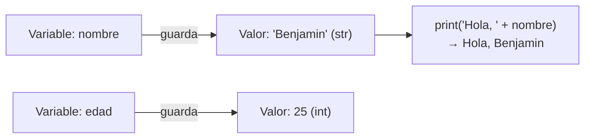

# Lección 01 — Variables y tipos

> Fase 0 (Python desde cero) · micro-paso · concepto nuevo: la **variable**.

## 0. 🧭 La pregunta
> *"Ya sé mostrar un texto fijo. Me piden saludar con un nombre que puede cambiar.
> Si lo escribo a mano en cada `print`, tengo que editar todo cada vez. ¿Qué hago?"*

## 1. Objetivo
Conocer la **variable** (nombre que guarda un valor) y la idea de **tipo**
(texto `str` vs. número `int`).

## 2. Cita de la fuente
> *"We ... agree on a glossary and some rules ... we ask for concrete examples to
> illustrate each rule."* — Cap. 1, *Exploring the Domain Language*

Darle nombre a las cosas (un glosario) es lo que hace una variable.

## 3. El dolor / necesidad
Un nombre escrito a mano en muchos `print` obliga a editar en todos lados.
La variable lo guarda **en un solo lugar**.

## 4. Explicación paso a paso
1. Crear variable: `nombre = "Benjamin"` → `nombre`(cajita) `=`(guardar) `"Benjamin"`(valor).
2. Tipos: `"Benjamin"` es `str` (texto, con comillas); `25` es `int` (entero, sin comillas).
   `type(...)` lo confirma: `<class 'str'>`, `<class 'int'>`.
3. Usar: `print("Hola, " + nombre)` → el `+` une (concatena) textos.
4. Cambiar en un solo lugar: reasignar `nombre = "Ana"` y todo lo que la use cambia.

Ver [`saludo.py`](saludo.py). Ejecutar:
```bash
uv run python lecciones/01-variables-y-tipos/saludo.py
```

## 5. Diagrama (Mermaid)

Cada variable apunta a un valor con su tipo; `print` saca el valor de la cajita y lo usa.

## 6. Árbol de archivos
```
lecciones/01-variables-y-tipos/
├── README.md
└── saludo.py
```

## 7. Tu turno
Agrega una variable `ciudad = "Lima"` y un `print("Vivo en " + ciudad)`.

## 8. Comprobación
Sin pytest aún (llega en la Lección 08). Se comprueba ejecutando y viendo las salidas.

## 9. Preguntas de recuerdo
1. ¿Qué es una variable?
2. ¿Qué significa `=` en Python?
3. ¿Cómo se distingue un `str` de un `int`?
