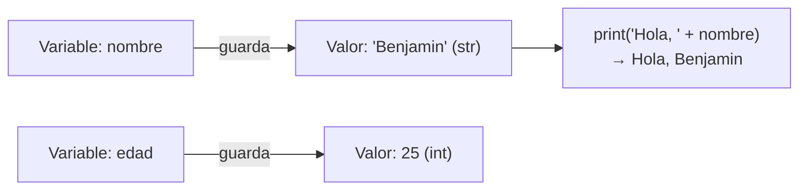
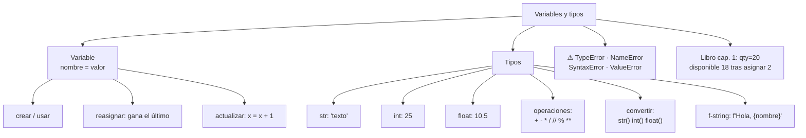

# Lección 01 — Variables y tipos

> Fase 0 · Formulario · Familia de concepto: **guardar datos con nombre** (variable y tipo) · Orden de estudio: **2 de 18**

⬅️ [Lección 00 · ¿Qué es ejecutar un programa?](../00-que-es-ejecutar-un-programa/) · 🏠 [Índice de lecciones](../README.md) · ➡️ [Lección 02 · Condicionales](../02-condicionales/)

---

## 🧭 Ruta de estudio · Lección 01 (≈ 1.5 h)

**Antes necesitas:** [Lección 00 · ¿Qué es ejecutar un programa?](../00-que-es-ejecutar-un-programa/) (`print` y `uv run python`).

| Paso | Qué haces | Dónde | ⏱ |
|:-:|---|---|:-:|
| **0** | Lee la teoría, las tablas de fórmulas, las propiedades y los errores | este README §0–§8 | 25 min |
| **1** | Ejecuta las fórmulas y compara cada línea con la tabla | [`paso1_formulas.py`](paso1_formulas.py) | 10 min |
| **2** | Sigue los ejemplos resueltos línea por línea | §9 + [`paso2_ejemplos_resueltos.py`](paso2_ejemplos_resueltos.py) | 15 min |
| **3** | Completa los `# TODO` | [`paso3_tu_turno.py`](paso3_tu_turno.py) | 15 min |
| **4** | Compara con la solución de referencia | [`paso4_tu_turno_solucion.py`](paso4_tu_turno_solucion.py) | 5 min |
| **5** | Resuelve los 12 problemas **en un archivo tuyo**, luego revisa claves y solucionario | §10–§11 + [`paso5_solucionario/`](paso5_solucionario/) | 15 min |
| **6** | Compara solución mala vs buena | [`paso6_ejercicios/`](paso6_ejercicios/) | 5 min |
| **7** | Responde las preguntas de recuerdo **sin mirar** | §15 | 5 min |
| **🚦** | Evalúa si puedes pasar a la siguiente | §16 | 1 min |

---

## 0. 🧭 La pregunta
> *"Ya sé mostrar un texto fijo. Me piden saludar con un nombre que **puede cambiar**.
> Si lo escribo a mano en cada `print`, tengo que editar todo cada vez. ¿Qué hago?"*

## 1. Objetivos (al terminar podrás…)
1. Crear una **variable**, usarla y cambiar su valor.
2. Distinguir los tipos **`str`** (texto), **`int`** (entero) y **`float`** (decimal), y comprobarlos con `type()`.
3. Hacer cuentas (`+ - * / // % **`) y guardar el resultado.
4. Unir texto con números usando `str()` o una **f-string**.
5. Reconocer y evitar `TypeError`, `NameError`, `SyntaxError` y `ValueError`.

## 2. Cita de la fuente
> *"We have an initial conversation with our business experts and agree on a glossary and
> some rules for the first minimal version of the domain model."* — Cap. 1, *Exploring the Domain Language*

> *"batch = Batch("batch-001", "SMALL-TABLE", qty=20, eta=date.today())"* … *"assert batch.available_quantity == 18"* — Cap. 1

> *"f'Out of stock for {event.sku}'"* — Cap. 8

**Por qué importa:** el libro empieza **poniéndole nombre a las cosas** (un glosario): eso
es justamente lo que hace una variable. En su primer test guarda un **texto**
(`"SMALL-TABLE"`) y un **número** (`qty=20`), y espera que después de asignar 2 queden `18`:
una cuenta con variables. Y para armar mensajes usa una **f-string**, que verás en esta lección.

## 3. El dolor
```python
print("Hola, Ana")
print("Ana, tu pedido está listo")
print("Gracias por tu compra, Ana")   # ¿y si mañana es Carlos? editar 3 lugares...
```
El nombre está repetido a mano. Si cambia, hay que editar **todos** los lugares, y basta
olvidar uno para tener un error. Necesito guardar el nombre **en un solo lugar**.

---

## 4. 📘 Teoría

> **📦 Definición — Variable**
> Una **variable** es un **nombre** que **guarda un valor**. Piensa en una cajita con una
> etiqueta: la etiqueta es el nombre y lo que hay adentro es el valor.
> `nombre = "Benjamin"` → la cajita `nombre` guarda el texto `"Benjamin"`.

> **⬅️ Definición — Asignación (`=`)**
> El signo `=` **no** significa "igual" como en matemáticas: significa **"guarda lo de la
> derecha en el nombre de la izquierda"**. Python calcula **primero la derecha** y después
> la guarda.

> **🏷️ Definición — Tipo**
> Todo valor tiene un **tipo**, que dice qué clase de dato es y qué se puede hacer con él:
>
> | Tipo | Qué es | Ejemplo | Se reconoce porque… |
> |---|---|---|---|
> | `str` | texto | `"Mesa"` | va entre comillas |
> | `int` | número entero | `25` | sin comillas, sin punto |
> | `float` | número decimal | `10.5` | sin comillas, con **punto** |

> **🔤 Vocabulario**
> - **Valor:** el dato en sí (`"Ana"`, `25`, `10.5`).
> - **Asignar / reasignar:** guardar un valor en una variable / guardar uno nuevo encima.
> - **Operador:** un símbolo que hace una operación: `+`, `-`, `*`, `/`, `//`, `%`, `**`.
> - **Concatenar:** unir textos con `+`.
> - **Convertir:** pasar un valor de un tipo a otro: `str(25)` → `"25"`, `int("20")` → `20`.
> - **f-string:** un texto que empieza con `f` y lleva variables entre llaves: `f"Hola, {nombre}"`.

> **🧠 Regla de oro**
> Si un dato **se usa más de una vez** o **puede cambiar**, guárdalo en una **variable** con
> un nombre que diga qué es (`precio`, no `x`). Y antes de unir o comparar, pregúntate:
> **¿de qué tipo es?**

**Cómo funciona una variable** (Mermaid):

Cada variable apunta a un valor con su tipo; `print` saca el valor de la cajita y lo usa.

---

## 5. 🧮 Formulario: variables

| # | Operación | Sintaxis | Ejemplo | Resultado |
|---|---|---|---|---|
| V1 | Crear | `nombre = valor` | `nombre = "Benjamin"` | `nombre` guarda `"Benjamin"` |
| V2 | Usar | escribir el nombre, **sin comillas** | `print("Hola,", nombre)` | `Hola, Benjamin` |
| V3 | Reasignar | `nombre = otro_valor` | `nombre = "Ana"` | ahora guarda `"Ana"` (el anterior se pierde) |
| V4 | Copiar | `b = a` | `copia = nombre` | `copia` guarda `"Ana"` |
| V5 | Actualizar con su propio valor | `x = x + n` | `stock = 20` y luego `stock = stock - 2` | `18` |
| V6 | Guardar el resultado de una cuenta | `r = a * b` | `total = precio * cantidad` (100 y 3) | `300` |
| V7 | Nombre de varias palabras | palabras unidas con `_` | `precio_unitario = 100` | nombre válido |

## 6. 🧮 Formulario: tipos y operaciones

| # | Operación | Sintaxis | Ejemplo | Resultado |
|---|---|---|---|---|
| T1 | Texto | `"…"` o `'…'` | `type("Mesa")` | `<class 'str'>` |
| T2 | Entero | dígitos | `type(25)` | `<class 'int'>` |
| T3 | Decimal | dígitos con **punto** | `type(10.5)` | `<class 'float'>` |
| T4 | Ver el tipo | `type(valor)` | `edad = 25` y `type(edad)` | `<class 'int'>` |
| T5 | Sumar, restar, multiplicar | `+` `-` `*` | `7 + 3`, `7 - 3`, `7 * 3` | `10`, `4`, `21` |
| T6 | Dividir | `/` | `10 / 4` · `10 / 2` | `2.5` · `5.0` (siempre `float`) |
| T7 | División entera | `//` | `10 // 4` | `2` |
| T8 | Resto | `%` | `10 % 4` | `2` |
| T9 | Potencia | `**` | `2 ** 3` | `8` |
| T10 | Unir textos | `texto + texto` | `"Hola, " + "Ana"` | `'Hola, Ana'` |
| T11 | Repetir texto | `texto * n` | `"-" * 5` | `'-----'` |
| T12 | Número → texto | `str(n)` | `"Edad: " + str(25)` | `'Edad: 25'` |
| T13 | Texto → número | `int("…")` · `float("…")` | `int("20") + 1` · `float("10.5")` | `21` · `10.5` |
| T14 | Texto con variables | `f"…{variable}…"` | `f"Hola, {nombre}. Tienes {edad} años"` | `'Hola, Ana. Tienes 25 años'` |

> 💡 Todas estas fórmulas están ejecutables en [`paso1_formulas.py`](paso1_formulas.py),
> con su código (V1, T1…) en cada línea de salida.

## 7. 📐 Propiedades
| Variables | Tipos y operaciones |
|---|---|
| **P1.** `=` significa **"guarda en"**: primero se calcula la derecha y luego se guarda a la izquierda. | **P5.** `/` **siempre** da `float`: `10 / 2` → `5.0`. Si quieres entero, `//`. |
| **P2.** Una variable guarda **solo el último** valor que le asignaste. | **P6.** Orden de las cuentas: primero `**`, luego `*` `/` `//` `%`, al final `+` `-`. Los **paréntesis** van primero: `2 + 3 * 4` → `14`, `(2 + 3) * 4` → `20`. |
| **P3.** Los nombres **distinguen mayúsculas**: `nombre` y `Nombre` son variables distintas. | **P7.** El tipo depende del **valor**, no del nombre: `"25"` es `str`, `25` es `int`. |
| **P4.** Hay que **crear** la variable **antes** de usarla (Python lee de arriba hacia abajo). | **P8.** `+` **suma** dos números y **une** dos textos, pero **no** mezcla texto con número. |

## 8. ⚠️ Errores frecuentes
| # | ❌ Así no | Qué pasa | ✅ Así sí |
|---|---|---|---|
| E1 | `print("Edad: " + 25)` | `TypeError: can only concatenate str (not "int") to str` | convierte: `"Edad: " + str(25)`, o usa `f"Edad: {25}"` |
| E2 | `nombre = "Ana"` y luego `print(nombr)` | `NameError: name 'nombr' is not defined` | escribe el nombre **exactamente** igual: `print(nombre)` |
| E3 | `mi nombre = "Ana"` | `SyntaxError: invalid syntax` | sin espacios: `mi_nombre = "Ana"` |
| E4 | `2nombre = "Ana"` | `SyntaxError: invalid decimal literal` | no empieces con número: `nombre2 = "Ana"` |
| E5 | `int("veinte")` | `ValueError: invalid literal for int() with base 10: 'veinte'` | `int()` solo convierte texto con **dígitos**: `int("20")` |
| E6 | `print(descuento)` antes de `descuento = 10` | `NameError: name 'descuento' is not defined` | **primero** crea la variable, **luego** úsala |

> 🔬 Pruébalos: al final de [`paso1_formulas.py`](paso1_formulas.py) están E1–E6 comentados.
> Quita el `#` de **uno**, ejecuta, lee el mensaje y vuelve a ponerlo.
>
> ⚠️ Un error que **no** da mensaje: `print("nombre")` muestra la palabra `nombre`, no el
> valor de la variable. **Con comillas es texto; sin comillas es la variable.**

---

## 9. ✍️ Ejemplos resueltos (paso a paso)
> Todos están en [`paso2_ejemplos_resueltos.py`](paso2_ejemplos_resueltos.py).

**Ejemplo 1 — Un saludo que cambia en un solo lugar** *(fácil)*
> Enunciado: saluda a un cliente en dos mensajes; luego cambia de cliente editando **una** línea.
```python
nombre = "Benjamin"                      # Paso 1: crear la variable (V1)
print("Hola, " + nombre)                 # Paso 2: usarla uniendo textos (V2 + T10)
print(nombre + ", tu pedido está listo")
nombre = "Ana"                           # Paso 3: reasignar en UN solo lugar (V3)
print("Hola, " + nombre)                 # Paso 4: todo lo que la usa, cambia
print(nombre + ", tu pedido está listo")
```
Salida: `Hola, Benjamin` / `Benjamin, tu pedido está listo` / `Hola, Ana` / `Ana, tu pedido está listo`.

**Ejemplo 2 — Precio total** *(fácil)*
> Enunciado: una mesa cuesta 100 y se compran 3. Calcula el total.
```python
precio = 100                             # Paso 1: datos en variables (V1)
cantidad = 3
total = precio * cantidad                # Paso 2: guardar el resultado de una cuenta (V6)
print("Total:", total)                   # -> Total: 300
```

**Ejemplo 3 — Unir texto y número** *(intermedio)*
> Enunciado: muestra `Tienes 25 años` a partir de la variable `edad = 25`.
```python
edad = 25                                # Paso 1: edad es int (T2)
print(type(edad))                        # -> <class 'int'>
texto = "Tienes " + str(edad) + " años"  # Paso 2: str() convierte 25 en "25" (T12)
print(texto)                             # -> Tienes 25 años
print(f"Tienes {edad} años")             # Paso 3: lo mismo con f-string (T14)
```
Sin `str()`, el Paso 2 daría el error E1 (`TypeError`), porque `+` no mezcla texto con número.

**Ejemplo 4 — Stock disponible de un lote, como en el libro** *(avanzado)*
> Enunciado: un lote compró 20 unidades. Llegan dos líneas de pedido, de 2 y de 5.
> ¿Cuánto queda disponible después de cada una?
```python
comprado = 20                            # Paso 1: el lote compró 20 unidades
asignado = 0                             # Paso 2: todavía no se asignó nada
asignado = asignado + 2                  # Paso 3: llega una línea de pedido de 2 (V5)
disponible = comprado - asignado         # Paso 4: disponible = comprado - asignado (V6)
print("Disponible:", disponible)         # -> 18 (lo mismo que espera el test del libro)
asignado = asignado + 5                  # Paso 5: llega otra línea de 5
disponible = comprado - asignado         # Paso 6: hay que RECALCULAR
print("Disponible:", disponible)         # -> 13
```
Traza (lo que vale cada variable **después** de cada paso):

| paso | `comprado` | `asignado` | `disponible` |
|---|---|---|---|
| 1 | `20` | — | — |
| 2 | `20` | `0` | — |
| 3 | `20` | `2` | — |
| 4 | `20` | `2` | `18` |
| 5 | `20` | `7` | `18` ← ¡todavía el valor viejo! |
| 6 | `20` | `7` | `13` |

Fíjate en el paso 5: `disponible` **no** se actualiza solo. Una variable guarda un valor,
no una fórmula (P2): si cambian los datos, hay que **volver a calcular**.

---

## 10. 📝 Problemas propuestos
> Resuélvelos **antes** de mirar las claves. Crea tu propio archivo, por ejemplo
> `mis_problemas.py`, en esta carpeta.

**🟢 Nivel básico**
1. Guarda `"Ana"` en la variable `nombre` y muestra `Hola, Ana` uniendo textos con `+`.
2. Muestra el **tipo** de `"Mesa"`, de `7` y de `7.5`.
3. Crea `precio = 100`, luego **cámbialo** a `120` y muéstralo.
4. Guarda en `suma` el resultado de `15 + 27` y muéstralo.

**🟡 Nivel intermedio**

5. Con `producto = "Silla"`, `precio = 50` y `cantidad = 4`, muestra con una **f-string**
   `Silla: 4 x 50 = 200` (el `200` lo calcula Python).
6. Con `stock = 20`, muestra `Stock: 20` **uniendo con `+`** y sin que dé error.
7. Convierte `125` minutos a horas y minutos usando `//` y `%`. Debe salir `2 h 5 min`.
8. Tienes `edad_texto = "30"`. Conviértelo a número y muéstralo **sumándole 1**.

**🔴 Nivel avanzado**

9. Con `a = 5` y `b = 9`, **intercambia** sus valores (que `a` valga 9 y `b` 5) usando una
   tercera variable. Muestra `a` y `b`.
10. Calcula el **promedio** de las notas 12, 15 y 18 (cada una en su variable).
11. Un producto cuesta `80` y tiene **25 %** de descuento. Calcula el precio final.
12. *(Puente al libro)* Un lote compró `20` unidades. Se le asignan dos líneas de pedido, de
    `2` y de `3`. Muestra con una f-string `Disponible: …` lo que queda.

## 11. 🔑 Claves (respuestas)
<details><summary>Ver claves (solo después de intentarlo)</summary>

| # | Salida esperada | Fórmula clave |
|---|---|---|
| 1 | `Hola, Ana` | V1 + T10 |
| 2 | `<class 'str'> <class 'int'> <class 'float'>` | T1–T3 |
| 3 | `120` | V3 (gana el último valor) |
| 4 | `42` | V6 |
| 5 | `Silla: 4 x 50 = 200` | T14 (`{cantidad * precio}` dentro de la f-string) |
| 6 | `Stock: 20` | T12 (`"Stock: " + str(stock)`) |
| 7 | `2 h 5 min` | T7 (`125 // 60`) + T8 (`125 % 60`) |
| 8 | `31` | T13 (`int(edad_texto) + 1`) |
| 9 | `9 5` | V4 con variable temporal |
| 10 | `15.0` | P6 (paréntesis) + T6 (`/` da `float`) |
| 11 | `60.0` | `80 - 80 * 25 / 100` |
| 12 | `Disponible: 15` | V5 + V6 + T14 (como el Ejemplo 4) |

El código completo de cada solución está en [`paso5_solucionario/`](paso5_solucionario/):
[`nivel_basico.py`](paso5_solucionario/nivel_basico.py) ·
[`nivel_intermedio.py`](paso5_solucionario/nivel_intermedio.py) ·
[`nivel_avanzado.py`](paso5_solucionario/nivel_avanzado.py).
</details>

---

## 12. 🗺️ Mapa mental (Mermaid)

**Cómo leerlo:** la lección tiene dos ramas: la **variable** (cómo se crea, se cambia y se
actualiza) y los **tipos** (cuáles hay, qué operaciones admiten, cómo se convierten y cómo se
meten en un texto). Abajo, los errores típicos y la conexión con el primer test del libro.

## 13. 🌳 Árbol de archivos
```
lecciones/01-variables-y-tipos/
├── README.md                    ← PASO 0 · EMPIEZA AQUÍ (este formulario)
├── paso1_formulas.py            ← PASO 1 · las fórmulas V1–V7 y T1–T14, ejecutables
├── paso2_ejemplos_resueltos.py  ← PASO 2 · los 4 ejemplos resueltos
├── paso3_tu_turno.py            ← PASO 3 · completa los # TODO
├── paso4_tu_turno_solucion.py   ← PASO 4 · solución de referencia
├── paso5_solucionario/          ← PASO 5 · soluciones de los 12 problemas
│   ├── nivel_basico.py
│   ├── nivel_intermedio.py
│   └── nivel_avanzado.py
└── paso6_ejercicios/            ← PASO 6 · solución mala vs buena
    ├── ejercicio-1/ … ejercicio-3/
    └── ejercicio-4-reto/
```

## 14. 🤝 Tu turno y ✅ comprobación
`pytest` llega en la [Lección 08](../08-modulos-y-pytest/), así que aquí se comprueba
**ejecutando y comparando** con la salida esperada:
```bash
uv run python lecciones/01-variables-y-tipos/paso3_tu_turno.py
# compara con la "Salida esperada" del final de ese archivo
git diff --no-index lecciones/01-variables-y-tipos/paso3_tu_turno.py lecciones/01-variables-y-tipos/paso4_tu_turno_solucion.py
```

## 15. ❓ Preguntas de recuerdo
> Respóndelas **sin mirar**; luego abre cada una para comprobar.

<details><summary>1. ¿Qué es una variable?</summary>

Un **nombre** que **guarda un valor** (una cajita con etiqueta).
</details>
<details><summary>2. ¿Qué significa <code>=</code> en Python?</summary>

"Guarda lo de la derecha en el nombre de la izquierda". No es el "igual" de matemáticas.
</details>
<details><summary>3. ¿Cómo distingues un <code>str</code> de un <code>int</code>?</summary>

El `str` va **entre comillas** (`"25"`); el `int` no (`25`). Para estar seguro: `type(valor)`.
</details>
<details><summary>4. ¿Por qué <code>"Edad: " + 25</code> da error y cómo se arregla?</summary>

Porque `+` no mezcla texto con número (`TypeError`). Se arregla con `"Edad: " + str(25)` o con `f"Edad: {25}"`.
</details>
<details><summary>5. ¿Qué dan <code>10 / 4</code>, <code>10 // 4</code> y <code>10 % 4</code>?</summary>

`2.5` (división normal, siempre `float`), `2` (división entera) y `2` (el resto).
</details>
<details><summary>6. Si <code>disponible = comprado - asignado</code> y después cambia <code>asignado</code>, ¿cambia solo <code>disponible</code>?</summary>

**No.** La variable guardó un **valor**, no la fórmula. Hay que volver a calcular `disponible`.
</details>

---

## 16. 🚦 ¿Puedo pasar a la siguiente lección?
| Indicador | Criterio |
|:-:|---|
| 🟢 **Sí, sigue** | `paso3_tu_turno.py` da la salida esperada **y** aciertas **≥ 9 de 12** problemas **y** respondes las 6 preguntas sin mirar |
| 🟡 **Repasa** | aciertas **6 a 8** → vuelve a §8 (errores frecuentes) y §9 (ejemplos resueltos) y reintenta los que fallaste |
| 🔴 **Repite la lección** | aciertas **menos de 6** → empieza otra vez desde el Paso 0 |

Cuando estés en 🟢, marca la lección en
[`progreso/fase-0-python.md`](../../progreso/fase-0-python.md) (sección *"Mi avance"*) y haz
commit; así también practicas Git.

---

⬅️ [Lección 00 · ¿Qué es ejecutar un programa?](../00-que-es-ejecutar-un-programa/) · 🏠 [Índice de lecciones](../README.md) · ➡️ [Lección 02 · Condicionales](../02-condicionales/)
