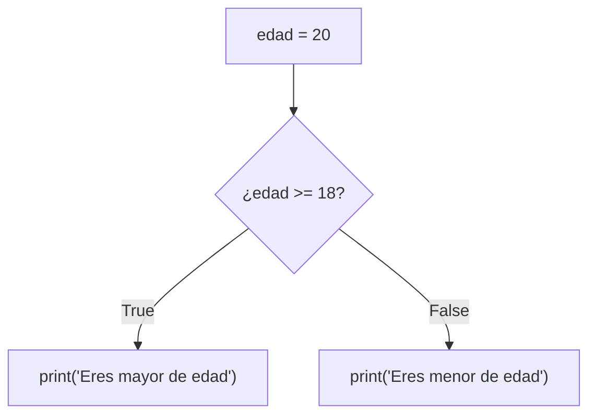

# Lección 02 — Condicionales (`if`/`else`)

> Fase 0 · micro-paso · concepto nuevo: **decidir** con `if`/`else`.

## 0. 🧭 La pregunta
> *"Me piden que el mensaje cambie según una condición (si es mayor de edad, uno;
> si no, otro). ¿Cómo le enseño a mi programa a decidir?"*

## 1. Objetivo
Tomar decisiones con `if`/`else` y conocer los booleanos (`True`/`False`).

## 2. Cita de la fuente
> *"When we allocate, if we have enough available quantity, we just add to the set."*
> — Cap. 1 (sobre `Figure 1-3`)

El negocio decide con un "si (if) hay suficiente…".

## 3. El dolor / necesidad
El programa hacía siempre lo mismo; una regla real depende de una condición.

## 4. Explicación paso a paso
1. Una comparación da un booleano: `edad >= 18` → `True`/`False`.
2. `if condición:` ejecuta su bloque si es `True`; `else:` si es `False`.
3. La **sangría de 4 espacios** marca qué va "dentro" del `if`/`else` (obligatoria).
4. Cambiar el dato cambia la decisión, con la misma estructura.

Ver [`decidir.py`](decidir.py). Ejecutar:
```bash
uv run python lecciones/02-condicionales/decidir.py
```

## 5. Diagrama (Mermaid)

El rombo es la decisión (`if`): según el booleano, toma un camino u otro.

## 6. Árbol de archivos
```
lecciones/02-condicionales/
├── README.md
└── decidir.py
```

## 7. Tu turno
Agrega un caso intermedio con `elif` (p. ej. edad exactamente 18).

## 8. Comprobación
Sin pytest aún (Lección 08). Se comprueba ejecutando y viendo las salidas.

## 9. Preguntas de recuerdo
1. ¿Qué es un booleano?
2. ¿Qué hace `else`?
3. ¿Por qué importa la sangría?
