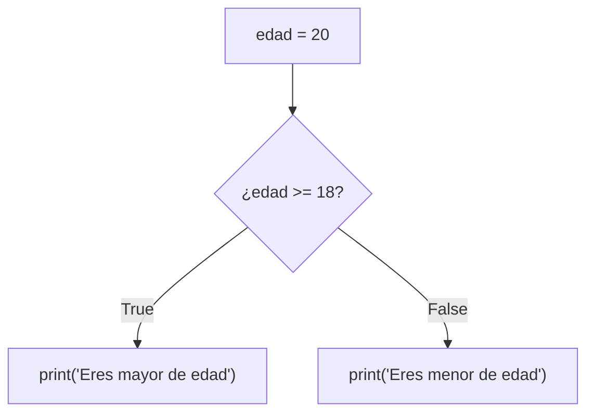
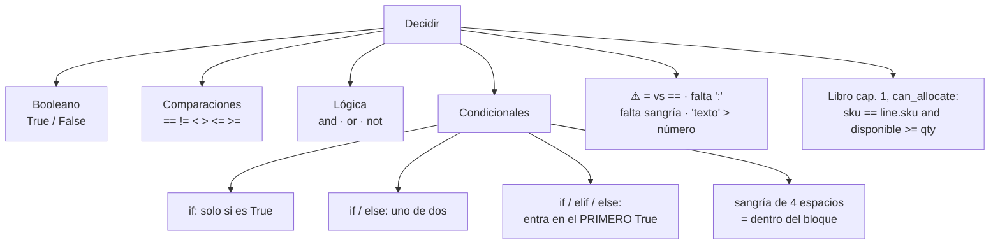

# Lección 02 — Condicionales (`if` / `elif` / `else`)

> Fase 0 · Formulario · Familia de concepto: **decidir** (booleanos, comparaciones y condicionales) · Orden de estudio: **3 de 18**

⬅️ [Lección 01 · Variables y tipos](../01-variables-y-tipos/) · 🏠 [Índice de lecciones](../README.md) · ➡️ [Lección 03 · Bucles](../03-bucles/)

---

## 🧭 Ruta de estudio · Lección 02 (≈ 1.5 h)

**Antes necesitas:** [Lección 01 · Variables y tipos](../01-variables-y-tipos/) (variables, `int`, `str`, el operador `%`).

| Paso | Qué haces | Dónde | ⏱ |
|:-:|---|---|:-:|
| **0** | Lee la teoría, las tablas de fórmulas, las propiedades y los errores | este README §0–§8 | 25 min |
| **1** | Ejecuta las fórmulas y compara cada línea con la tabla | [`paso1_formulas.py`](paso1_formulas.py) | 10 min |
| **2** | Sigue los ejemplos resueltos línea por línea | §9 + [`paso2_ejemplos_resueltos.py`](paso2_ejemplos_resueltos.py) | 15 min |
| **3** | Completa los `# TODO` | [`paso3_tu_turno.py`](paso3_tu_turno.py) | 15 min |
| **4** | Compara con la solución de referencia | [`paso4_tu_turno_solucion.py`](paso4_tu_turno_solucion.py) | 5 min |
| **5** | Resuelve los 12 problemas **en un archivo tuyo**, luego revisa claves y solucionario | §10–§11 + [`paso5_solucionario/`](paso5_solucionario/) | 15 min |
| **6** | Compara solución mala vs buena | [`paso6_ejercicios/`](paso6_ejercicios/) | 5 min |
| **7** | Responde las preguntas de recuerdo **sin mirar** | §15 | 5 min |
| **🚦** | Evalúa si puedes pasar a la siguiente | §16 | 1 min |

---

## 0. 🧭 La pregunta
> *"Me piden que el mensaje **cambie según una condición**: si es mayor de edad, uno; si no,
> otro. Hasta ahora mi programa hace siempre lo mismo. ¿Cómo le enseño a **decidir**?"*

## 1. Objetivos (al terminar podrás…)
1. Escribir **comparaciones** (`==`, `!=`, `<`, `>`, `<=`, `>=`) y saber que dan `True` o `False`.
2. Combinar condiciones con **`and`**, **`or`** y **`not`**.
3. Decidir con **`if`**, **`if/else`** e **`if/elif/else`**, respetando la **sangría**.
4. Elegir el **orden** correcto de los `elif`.
5. Reconocer y evitar `SyntaxError`, `IndentationError` y `TypeError` al comparar.

## 2. Cita de la fuente
> *"When we allocate, if we have enough available quantity, we just add to the set."* — Cap. 1 (junto a *Figure 1-3*)

> *"return self.sku == line.sku and self.available_quantity >= line.qty"* — Cap. 1 (`can_allocate`)

**Por qué importa:** la regla del negocio se dice con un **"si"**: *si* hay suficiente
cantidad, se asigna. Y en código, el libro la escribe como **dos comparaciones unidas con
`and`**: el SKU tiene que coincidir (`==`) **y** la cantidad disponible tiene que alcanzar
(`>=`). Esa línea es exactamente lo que vas a aprender aquí.

## 3. El dolor
```python
edad = 15
print("Eres mayor de edad")   # ¡mentira! El programa no mira la edad: siempre dice lo mismo
```
Una regla real **depende de los datos**. Necesito que el programa **elija** qué hacer según
una condición.

---

## 4. 📘 Teoría

> **⚖️ Definición — Booleano (`bool`)**
> Un **booleano** es un valor que solo puede ser **`True`** (verdadero) o **`False`** (falso).
> Es el tipo `bool`. Toda **comparación** da un booleano: `20 >= 18` → `True`.

> **🔀 Definición — Condicional**
> Un **condicional** (`if`) ejecuta un **bloque** de instrucciones **solo si** su condición es
> `True`. Con `elif` ("si no, si…") y `else` ("si no") se arman caminos alternativos.
> ```python
> if condición:
>     # bloque: va con 4 espacios de sangría
> elif otra_condición:
>     # otro bloque
> else:
>     # bloque si ninguna fue True
> ```

> **🔣 Tabla de verdad de `and`, `or` y `not`**
>
> | A | B | `A and B` | `A or B` | `not A` |
> |---|---|---|---|---|
> | `True` | `True` | `True` | `True` | `False` |
> | `True` | `False` | `False` | `True` | `False` |
> | `False` | `True` | `False` | `True` | `True` |
> | `False` | `False` | `False` | `False` | `True` |

> **🔤 Vocabulario**
> - **Condición:** la expresión que va después de `if` y da `True` o `False`.
> - **Bloque:** las líneas con sangría debajo de `if`, `elif` o `else`; se ejecutan juntas.
> - **Sangría (indentación):** los 4 espacios al inicio de la línea que dicen "esto va **dentro**".
> - **Operador de comparación:** `==`, `!=`, `<`, `>`, `<=`, `>=`.
> - **Operador lógico:** `and`, `or`, `not`.

> **🧠 Regla de oro**
> **Un solo `=` guarda; dos `==` comparan.** Y en una cadena `if/elif/else`, Python entra
> **solo en el primer** camino cuya condición sea `True`; los demás se los salta.

**Cómo decide un `if/else`** (Mermaid):

El rombo es la decisión (`if`): según el booleano, el programa toma un camino u otro.

---

## 5. 🧮 Formulario: comparaciones y lógica

| # | Operación | Sintaxis | Ejemplo | Resultado |
|---|---|---|---|---|
| C1 | ¿Iguales? | `a == b` | `5 == 5` | `True` |
| C2 | ¿Distintos? | `a != b` | `5 != 3` | `True` |
| C3 | Menor / mayor | `a < b` · `a > b` | `3 < 5` · `3 > 5` | `True` · `False` |
| C4 | Menor o igual / mayor o igual | `a <= b` · `a >= b` | `18 >= 18` · `17 <= 16` | `True` · `False` |
| C5 | Comparar textos | `"…" == "…"` | `"mesa" == "mesa"` · `"Mesa" == "mesa"` | `True` · `False` |
| C6 | Tipo booleano | `True` / `False` | `type(True)` | `<class 'bool'>` |
| C7 | Guardar una comparación | `var = a >= b` | `es_mayor = edad >= 18` (edad 20) | `True` |
| C8 | Y (las dos) | `A and B` | `True and False` | `False` |
| C9 | O (al menos una) | `A or B` | `True or False` | `True` |
| C10 | No (invierte) | `not A` | `not True` | `False` |
| C11 | ¿Está en un rango? | `a <= x <= b` | `1 <= 5 <= 10` | `True` |
| C12 | ¿Es par? | `n % 2 == 0` | `8 % 2 == 0` · `7 % 2 == 0` | `True` · `False` |

## 6. 🧮 Formulario: formas de decidir

| # | Forma | Plantilla | Ejemplo | Resultado |
|---|---|---|---|---|
| F1 | `if` solo | `if c:` + bloque | `if stock == 0: print("Agotado")` (stock 0) | `Agotado` (si fuera otro valor, **nada**) |
| F2 | `if` / `else` | `if c:` … `else:` … | edad 15: `if edad >= 18: … else: print("Menor de edad")` | `Menor de edad` |
| F3 | `if` / `elif` / `else` | `if c1:` … `elif c2:` … `else:` … | nota 14: `>= 18` excelente · `>= 11` aprobado · si no desaprobado | `aprobado` |
| F4 | Condición compuesta | `if c1 and c2:` | `if usuario == "ana" and clave == "1234":` | `Bienvenida` |
| F5 | Variable booleana | `if variable:` | `hay_stock = True` y `if hay_stock:` | `Se puede vender` |
| F6 | `if` anidado | un `if` dentro de otro, con **más** sangría | `if sku_correcto:` → `if disponible >= 2:` | `Se puede asignar` |

> 💡 Todas estas fórmulas están ejecutables en [`paso1_formulas.py`](paso1_formulas.py),
> con su código (C1, F1…) en cada línea de salida.

## 7. 📐 Propiedades
| Comparaciones | Condicionales |
|---|---|
| **P1.** Toda comparación da **siempre** `True` o `False`. | **P5.** La **sangría** (4 espacios) marca qué está **dentro** del `if`/`elif`/`else`. Es **obligatoria**. |
| **P2.** `=` **guarda**, `==` **compara**. Confundirlos es el error más común. | **P6.** En `if/elif/else` se ejecuta **solo el primer** bloque cuya condición sea `True`. |
| **P3.** Los textos se comparan **exactamente**: `"Mesa"` y `"mesa"` son distintos. | **P7.** `else` **no lleva condición** y es **opcional**. `elif` puede repetirse cuantas veces quieras. |
| **P4.** `and` es `True` solo si **las dos** lo son; `or`, si **al menos una**. | **P8.** Texto y número **no** se ordenan entre sí: `"18" > 5` da error, y `"18" == 18` da `False`. |

## 8. ⚠️ Errores frecuentes
| # | ❌ Así no | Qué pasa | ✅ Así sí |
|---|---|---|---|
| E1 | `if edad = 18:` | `SyntaxError: invalid syntax. Maybe you meant '==' or ':=' instead of '='?` | para comparar, doble igual: `if edad == 18:` |
| E2 | `if edad >= 18` (sin `:`) | `SyntaxError: expected ':'` | termina la línea con dos puntos: `if edad >= 18:` |
| E3 | `if edad >= 18:` y en la línea siguiente `print("x")` **sin** sangría | `IndentationError: expected an indented block after 'if' statement on line 1` | 4 espacios delante: `    print("x")` |
| E4 | `"18" > 5` | `TypeError: '>' not supported between instances of 'str' and 'int'` | compara números con números: `int("18") > 5` |
| E5 | `else edad < 5:` | `SyntaxError: expected ':'` (`else` no lleva condición) | si necesitas condición, usa `elif edad < 5:` |
| E6 | `if nota >= 11:` "aprobado" · `elif nota >= 18:` "excelente" | **sin mensaje de error**: una nota de 19 dice "aprobado" porque entra en el primero | pon **primero** la condición más exigente: `>= 18` y después `>= 11` |

> 🔬 Pruébalos: al final de [`paso1_formulas.py`](paso1_formulas.py) están E1, E2 y E4
> comentados. Quita el `#`, ejecuta, lee el mensaje y vuelve a ponerlo.
> E6 es el más peligroso: el programa **funciona** pero da la respuesta equivocada.

---

## 9. ✍️ Ejemplos resueltos (paso a paso)
> Todos están en [`paso2_ejemplos_resueltos.py`](paso2_ejemplos_resueltos.py).

**Ejemplo 1 — ¿Mayor de edad?** *(fácil)*
> Enunciado: con `edad = 20`, muestra si la persona es mayor o menor de edad.
```python
edad = 20                                # Paso 1: el dato
if edad >= 18:                           # Paso 2: la condición da True o False (C4)
    print("Eres mayor de edad")          # Paso 3: este bloque corre si es True
else:
    print("Eres menor de edad")          #         este, si es False (F2)
```
`20 >= 18` es `True`, así que se muestra `Eres mayor de edad` y el `else` se salta.

**Ejemplo 2 — ¿Par o impar?** *(fácil)*
> Enunciado: di si `7` es par o impar.
```python
numero = 7                               # Paso 1: el dato
resto = numero % 2                       # Paso 2: el resto de dividir entre 2 -> 1
if resto == 0:                           # Paso 3: par si el resto es 0 (C12)
    print(numero, "es par")
else:
    print(numero, "es impar")            # -> 7 es impar
```

**Ejemplo 3 — Clasificar una nota** *(intermedio)*
> Enunciado: de 18 en adelante, `excelente`; de 11 a 17, `aprobado`; si no, `desaprobado`.
```python
nota = 14                                # Paso 1: el dato
if nota >= 18:                           # Paso 2: ¿14 >= 18? False -> se salta
    print("excelente")
elif nota >= 11:                         # Paso 3: ¿14 >= 11? True -> entra aquí
    print("aprobado")
else:                                    # Paso 4: ya entró en uno: el else se salta
    print("desaprobado")
```
Traza (qué camino toma con distintas notas):

| `nota` | ¿`>= 18`? | ¿`>= 11`? | camino | se muestra |
|---|---|---|---|---|
| `19` | `True` | *(no se pregunta)* | `if` | `excelente` |
| `14` | `False` | `True` | `elif` | `aprobado` |
| `11` | `False` | `True` | `elif` | `aprobado` |
| `7` | `False` | `False` | `else` | `desaprobado` |

Fíjate en la fila del 19: como el `if` ya fue `True`, Python **ni siquiera pregunta** el
`elif` (P6). Por eso el orden importa (E6).

**Ejemplo 4 — ¿Se puede asignar la línea al lote?, como `can_allocate` del libro** *(avanzado)*
> Enunciado: un lote de `SMALL-TABLE` tiene 20 disponibles. Llega una línea de pedido de 2
> `SMALL-TABLE`. Si el SKU coincide **y** alcanza la cantidad, asígnala y muestra lo que queda.
```python
sku_lote = "SMALL-TABLE"                 # Paso 1: datos del lote
disponible = 20
sku_linea = "SMALL-TABLE"                # Paso 2: datos de la línea de pedido
cantidad = 2
puede = sku_lote == sku_linea and disponible >= cantidad   # Paso 3: las DOS reglas (C1, C4, C8)
print("¿Puede asignar?", puede)          # -> True
if puede:                                # Paso 4: decidir con el booleano (F5)
    disponible = disponible - cantidad
    print("Asignado. Disponible:", disponible)   # -> 18
else:
    print("No se puede asignar")
```
El Paso 3 es la misma idea que `return self.sku == line.sku and self.available_quantity >= line.qty`
del libro: primero se calculan las dos comparaciones (`True` y `True`) y luego el `and` las une.

---

## 10. 📝 Problemas propuestos
> Resuélvelos **antes** de mirar las claves. Crea tu propio archivo, por ejemplo
> `mis_problemas.py`, en esta carpeta.

**🟢 Nivel básico**
1. Con `precio = 120`, si el precio es **mayor que 100** muestra `Caro` (si no, no muestres nada).
2. Muestra el resultado de comparar `"Mesa" == "mesa"`.
3. Con `n = 8`, muestra `par` o `impar`.
4. Con `a = 7` y `b = 12`, muestra el **mayor** de los dos usando `if/else`.

**🟡 Nivel intermedio**

5. Con `numero = -4`, muestra `positivo`, `negativo` o `cero`.
6. Con `monto = 150`: si el monto es **100 o más**, se descuenta el **10 %**. Muestra el total a pagar.
7. Con `edad = 70`: menor de 18 → `menor`; de 18 a 64 → `adulto`; 65 o más → `adulto mayor`.
8. Con `dia = "sábado"`: si es `"sábado"` **o** `"domingo"` muestra `Fin de semana`; si no, `Día laboral`.

**🔴 Nivel avanzado**

9. Un año es **bisiesto** si es divisible entre 4 **y** (no es divisible entre 100 **o** sí lo es
   entre 400). Con `anio = 1900`, muestra si es bisiesto o no.
10. Con `color = "amarillo"`: `"verde"` → `Avanza`, `"amarillo"` → `Precaución`,
    `"rojo"` → `Detente`, cualquier otro → `Color inválido`.
11. El envío es gratis si el monto es **100 o más** **o** si el cliente es socio. Con
    `monto = 80` y `es_socio = True`, muestra `Envío gratis` o `Envío: 10`.
12. *(Puente al libro)* Un lote `"SMALL-TABLE"` tiene `20` disponibles y llega una línea de
    `2` `"SMALL-TABLE"`. Aplica la regla de `can_allocate` (mismo SKU **y** cantidad
    suficiente); si se cumple, resta y muestra `Asignado. Disponible: …`.

## 11. 🔑 Claves (respuestas)
<details><summary>Ver claves (solo después de intentarlo)</summary>

| # | Salida esperada | Fórmula clave |
|---|---|---|
| 1 | `Caro` | F1 |
| 2 | `False` | C5 (mayúsculas importan) |
| 3 | `par` | C12 + F2 |
| 4 | `12` | C3 + F2 |
| 5 | `negativo` | F3 (`> 0`, `< 0`, `else`) |
| 6 | `135.0` | F1 + cuenta: `150 - 150 * 10 / 100` |
| 7 | `adulto mayor` | F3 con rangos en orden |
| 8 | `Fin de semana` | C9 (`or`) |
| 9 | `1900 no es bisiesto` | C8 + C9 + paréntesis: `anio % 4 == 0 and (anio % 100 != 0 or anio % 400 == 0)` |
| 10 | `Precaución` | F3 con varios `elif` |
| 11 | `Envío gratis` | C9 + F5 (`monto >= 100 or es_socio`) |
| 12 | `Asignado. Disponible: 18` | C1 + C4 + C8 (Ejemplo 4) |

El código completo de cada solución está en [`paso5_solucionario/`](paso5_solucionario/):
[`nivel_basico.py`](paso5_solucionario/nivel_basico.py) ·
[`nivel_intermedio.py`](paso5_solucionario/nivel_intermedio.py) ·
[`nivel_avanzado.py`](paso5_solucionario/nivel_avanzado.py).
</details>

---

## 12. 🗺️ Mapa mental (Mermaid)

**Cómo leerlo:** para decidir hacen falta **booleanos**, que salen de **comparaciones** y se
combinan con **lógica**; los **condicionales** usan ese booleano para elegir un camino. Abajo,
los errores típicos y la línea del libro que junta todo.

## 13. 🌳 Árbol de archivos
```
lecciones/02-condicionales/
├── README.md                    ← PASO 0 · EMPIEZA AQUÍ (este formulario)
├── paso1_formulas.py            ← PASO 1 · las fórmulas C1–C12 y F1–F6, ejecutables
├── paso2_ejemplos_resueltos.py  ← PASO 2 · los 4 ejemplos resueltos
├── paso3_tu_turno.py            ← PASO 3 · completa los # TODO
├── paso4_tu_turno_solucion.py   ← PASO 4 · solución de referencia
├── paso5_solucionario/          ← PASO 5 · soluciones de los 12 problemas
│   ├── nivel_basico.py
│   ├── nivel_intermedio.py
│   └── nivel_avanzado.py
└── paso6_ejercicios/            ← PASO 6 · solución mala vs buena
    ├── ejercicio-1/ … ejercicio-3/
    └── ejercicio-4-reto/
```

## 14. 🤝 Tu turno y ✅ comprobación
`pytest` llega en la [Lección 08](../08-modulos-y-pytest/), así que aquí se comprueba
**ejecutando y comparando** con la salida esperada:
```bash
uv run python lecciones/02-condicionales/paso3_tu_turno.py
# compara con la "Salida esperada" del final de ese archivo
git diff --no-index lecciones/02-condicionales/paso3_tu_turno.py lecciones/02-condicionales/paso4_tu_turno_solucion.py
```

## 15. ❓ Preguntas de recuerdo
> Respóndelas **sin mirar**; luego abre cada una para comprobar.

<details><summary>1. ¿Qué es un booleano?</summary>

Un valor que solo puede ser `True` o `False` (tipo `bool`). Toda comparación da uno.
</details>
<details><summary>2. ¿Qué diferencia hay entre <code>=</code> y <code>==</code>?</summary>

`=` **guarda** un valor en una variable; `==` **compara** dos valores y da `True`/`False`.
</details>
<details><summary>3. ¿Qué hace <code>else</code>? ¿Lleva condición?</summary>

Ejecuta su bloque cuando **ninguna** condición anterior fue `True`. **No** lleva condición.
</details>
<details><summary>4. ¿Por qué importa la sangría?</summary>

Porque le dice a Python qué líneas están **dentro** del `if`/`elif`/`else`. Sin ella da `IndentationError`.
</details>
<details><summary>5. En un <code>if/elif/else</code>, si dos condiciones son <code>True</code>, ¿cuántos bloques se ejecutan?</summary>

**Uno solo**: el del **primer** `True`. Por eso las condiciones más exigentes van primero.
</details>
<details><summary>6. ¿Cuándo es <code>True</code> la expresión <code>A and B</code>? ¿Y <code>A or B</code>?</summary>

`A and B`: solo si **las dos** son `True`. `A or B`: si **al menos una** es `True`.
</details>

---

## 16. 🚦 ¿Puedo pasar a la siguiente lección?
| Indicador | Criterio |
|:-:|---|
| 🟢 **Sí, sigue** | `paso3_tu_turno.py` da la salida esperada **y** aciertas **≥ 9 de 12** problemas **y** respondes las 6 preguntas sin mirar |
| 🟡 **Repasa** | aciertas **6 a 8** → vuelve a §8 (errores frecuentes) y §9 (ejemplos resueltos) y reintenta los que fallaste |
| 🔴 **Repite la lección** | aciertas **menos de 6** → empieza otra vez desde el Paso 0 |

Cuando estés en 🟢, marca la lección en
[`progreso/fase-0-python.md`](../../progreso/fase-0-python.md) (sección *"Mi avance"*) y haz
commit; así también practicas Git.

---

⬅️ [Lección 01 · Variables y tipos](../01-variables-y-tipos/) · 🏠 [Índice de lecciones](../README.md) · ➡️ [Lección 03 · Bucles](../03-bucles/)
