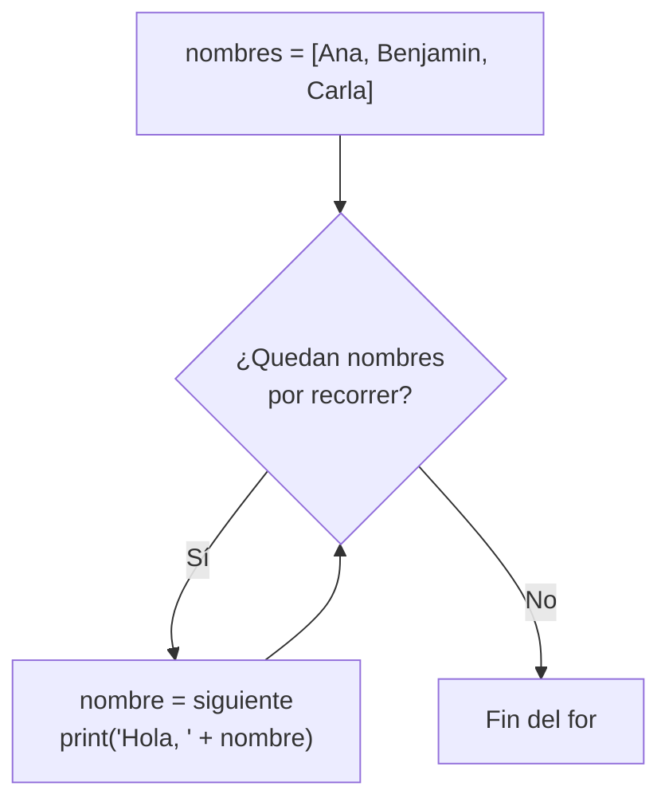

# Lección 03 — Bucles (`for`/`while`)

> Fase 0 · micro-paso · concepto nuevo: **repetir** con `for` y `while`.

## 0. 🧭 La pregunta
> *"Me piden saludar a muchas personas de una lista. Un `print` por cada una no
> escala. ¿Cómo repito una acción sin copiar y pegar?"*

## 1. Objetivo
Repetir con `for` (una vez por elemento) y `while` (mientras una condición sea `True`).

## 2. Cita de la fuente
> *"batch = next(b for b in sorted(batches) if b.can_allocate(line))"* — Cap. 1

El `for b in sorted(batches)` recorre cada elemento de una colección.

## 3. El dolor / necesidad
Copiar y pegar un `print` por persona no se mantiene; necesito una instrucción que
se repita por cada elemento.

## 4. Explicación paso a paso
1. Lista: `nombres = ["Ana", "Benjamin", "Carla"]` (a fondo en la Lección 05).
2. `for nombre in nombres:` → en cada vuelta `nombre` toma el siguiente valor.
3. `while cuenta > 0:` repite mientras la condición sea `True`.
4. En el `while` hay que acercarse al final (`cuenta = cuenta - 1`) o es infinito.

Ver [`bucles.py`](bucles.py). Ejecutar:
```bash
uv run python lecciones/03-bucles/bucles.py
```

## 5. Diagrama (Mermaid)

La flecha que regresa al rombo es "repetir"; se sale cuando no quedan elementos.

## 6. Árbol de archivos
```
lecciones/03-bucles/
├── README.md
└── bucles.py
```

## 7. Tu turno
Agrega tu nombre a la lista, o saluda solo a los nombres que empiezan con "A".

## 8. Comprobación
Sin pytest aún (Lección 08). Se comprueba ejecutando y viendo la salida.

## 9. Preguntas de recuerdo
1. ¿Qué hace un `for`?
2. ¿Cuándo para un `while`?
3. ¿Qué es un bucle infinito y cómo se evita?
