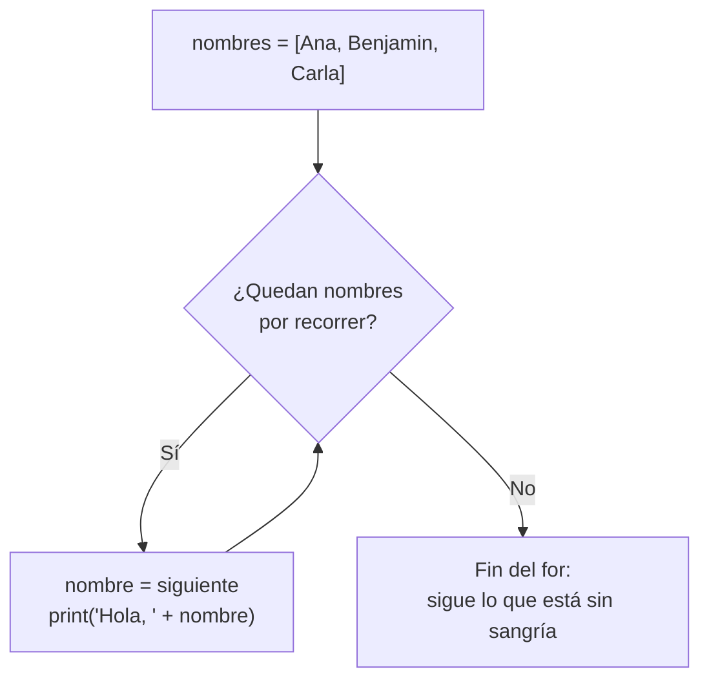
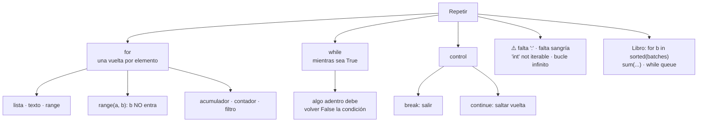

# Lección 03 — Bucles (`for` / `while`)

> Fase 0 · Formulario · Familia de concepto: **repetir** (`for`, `while`, `range`, acumuladores, `break`/`continue`) · Orden de estudio: **4 de 18**

⬅️ [Lección 02 · Condicionales](../02-condicionales/) · 🏠 [Índice de lecciones](../README.md) · ➡️ [Lección 04 · Funciones](../04-funciones/)

---

## 🧭 Ruta de estudio · Lección 03 (≈ 2 h)

**Antes necesitas:** [Lección 02 · Condicionales](../02-condicionales/) (`if`, comparaciones, sangría).

| Paso | Qué haces | Dónde | ⏱ |
|:-:|---|---|:-:|
| **0** | Lee la teoría, las tablas de fórmulas, las propiedades y los errores | este README §0–§8 | 30 min |
| **1** | Ejecuta las fórmulas y compara cada línea con la tabla | [`paso1_formulas.py`](paso1_formulas.py) | 10 min |
| **2** | Sigue los ejemplos resueltos línea por línea (¡mira las trazas!) | §9 + [`paso2_ejemplos_resueltos.py`](paso2_ejemplos_resueltos.py) | 20 min |
| **3** | Completa los `# TODO` | [`paso3_tu_turno.py`](paso3_tu_turno.py) | 20 min |
| **4** | Compara con la solución de referencia | [`paso4_tu_turno_solucion.py`](paso4_tu_turno_solucion.py) | 5 min |
| **5** | Resuelve los 12 problemas **en un archivo tuyo**, luego revisa claves y solucionario | §10–§11 + [`paso5_solucionario/`](paso5_solucionario/) | 25 min |
| **6** | Compara solución mala vs buena | [`paso6_ejercicios/`](paso6_ejercicios/) | 5 min |
| **7** | Responde las preguntas de recuerdo **sin mirar** | §15 | 5 min |
| **🚦** | Evalúa si puedes pasar a la siguiente | §16 | 1 min |

---

## 0. 🧭 La pregunta
> *"Me piden saludar a **muchas** personas de una lista. Un `print` por cada una no escala:
> ¿y si son 500? ¿Cómo **repito** una acción sin copiar y pegar?"*

## 1. Objetivos (al terminar podrás…)
1. Repetir con **`for`**, una vez por cada elemento de una lista, de un texto o de un `range`.
2. Usar **`range(n)`**, **`range(a, b)`** y **`range(a, b, paso)`** sabiendo dónde empiezan y terminan.
3. Construir **acumuladores** (sumas, productos) y **contadores**.
4. Repetir con **`while`** cuando no sabes cuántas vueltas serán, **sin** caer en un bucle infinito.
5. Controlar un bucle con **`break`** y **`continue`**, y buscar "el primero que cumple".

## 2. Cita de la fuente
> *"batch = next( b for b in sorted(batches) if b.can_allocate(line) )"* — Cap. 1

> *"return sum(line.qty for line in self._allocations)"* — Cap. 1 (`allocated_quantity`)

> *"queue = [event] while queue: event = queue.pop(0) for handler in HANDLERS[type(event)]:"* — Cap. 9

**Por qué importa:** el libro **recorre** lotes con `for b in sorted(batches)` y se queda
con **el primero** que puede asignar; **suma** las cantidades de las líneas asignadas con un
`for` dentro de `sum(...)` (un acumulador); y su bus de mensajes es un **`while`** que repite
mientras queden eventos en la cola. Los tres patrones están en esta lección.

## 3. El dolor
```python
print("Hola, Ana")
print("Hola, Benjamin")
print("Hola, Carla")    # ¿y si mañana son 500 nombres? ¿500 líneas?
```
Copiar y pegar no se mantiene: si cambia el saludo, hay que editar todas las líneas. Necesito
**una** instrucción que se **repita** por cada elemento.

---

## 4. 📘 Teoría

> **🔁 Definición — Bucle**
> Un **bucle** es un bloque de instrucciones que se **repite**. Cada repetición se llama
> **vuelta** (o **iteración**).

> **📋 Definición — `for`**
> El **`for`** da **una vuelta por cada elemento** de algo recorrible (una lista, un texto o un
> `range`). En cada vuelta, la **variable del for** toma el **siguiente** elemento.
> ```python
> for nombre in ["Ana", "Benjamin"]:   # vuelta 1: nombre = "Ana"; vuelta 2: nombre = "Benjamin"
>     print("Hola, " + nombre)
> ```

> **⏳ Definición — `while`**
> El **`while`** repite **mientras** su condición sea `True`. La condición se revisa **antes**
> de cada vuelta. Algo **dentro** del bucle debe hacerla `False` en algún momento.
> ```python
> cuenta = 3
> while cuenta > 0:
>     print(cuenta)
>     cuenta = cuenta - 1     # sin esta línea, nunca termina
> ```

> **🔢 Definición — `range`**
> `range(a, b)` genera los números **desde `a` hasta `b - 1`** (el `b` **no** se incluye).
> `range(n)` es lo mismo que `range(0, n)`.

> **🔤 Vocabulario**
> - **Vuelta / iteración:** cada repetición del bloque.
> - **Recorrer / iterar:** pasar por los elementos uno por uno.
> - **Acumulador:** variable que **va juntando** un resultado vuelta a vuelta (`total = total + x`).
> - **Contador:** acumulador que **suma 1** cada vez que algo se cumple.
> - **Bandera:** variable `True`/`False` que **recuerda** si algo pasó durante el bucle.
> - **Bucle infinito:** un bucle que nunca termina (se detiene con **Ctrl + C**).

> **🧠 Regla de oro**
> **`for`** cuando sabes **qué** recorrer o **cuántas** veces; **`while`** cuando solo sabes
> **hasta cuándo**. Y todo acumulador se crea **antes** del bucle, nunca dentro.

**Cómo funciona un `for`** (Mermaid):

La flecha que **regresa** al rombo es "repetir"; se sale cuando no quedan elementos.

---

## 5. 🧮 Formulario: `for`

| # | Operación | Sintaxis | Ejemplo | Resultado |
|---|---|---|---|---|
| R1 | Recorrer una lista | `for x in lista:` | `for nombre in ["Ana", "Benjamin", "Carla"]: print("Hola, " + nombre)` | `Hola, Ana` / `Hola, Benjamin` / `Hola, Carla` |
| R2 | Repetir n veces | `for i in range(n):` | `range(3)` | `0 1 2` (empieza en 0, el 3 **no** sale) |
| R3 | Desde a hasta b-1 | `range(a, b)` | `range(1, 4)` | `1 2 3` |
| R4 | Con paso | `range(a, b, paso)` | `range(0, 10, 3)` | `0 3 6 9` |
| R5 | Hacia atrás | `range(a, b, -1)` | `range(3, 0, -1)` | `3 2 1` |
| R6 | Recorrer un texto | `for letra in "texto":` | `for letra in "sol":` | `s o l` |
| R7 | Acumulador (suma) | `total = 0` y dentro `total = total + x` | `[10, 20, 30]` | `60` |
| R8 | Contador | `cuenta = 0` y dentro `if …: cuenta = cuenta + 1` | ¿cuántos de `[10, 20, 30]` son `> 15`? | `2` |
| R9 | Filtrar | `if` dentro del `for` | pares de `range(1, 7)` | `2 4 6` |
| R10 | Bucle anidado | `for` dentro de `for` | `a` y `b` en `range(1, 3)`: `a x b` | `1 x 1 = 1` / `1 x 2 = 2` / `2 x 1 = 2` / `2 x 2 = 4` |
| R11 | Sin saltar de línea | `print(x, end=" ")` | `print("uno", end=" ")` y `print("dos")` | `uno dos` |

## 6. 🧮 Formulario: `while` y control del bucle

| # | Operación | Sintaxis | Ejemplo | Resultado |
|---|---|---|---|---|
| W1 | Repetir mientras | `while condición:` | `cuenta = 3`; `while cuenta > 0:` … `cuenta = cuenta - 1` | `3 2 1` (y luego `¡Despegue!`) |
| W2 | Hasta un límite | `while total < límite:` | ahorrar `30` por mes hasta tener `100` o más | `120` en `4` meses |
| W3 | Salir ya | `break` | en `range(1, 10)`, `break` cuando `n == 4` | `1 2 3` |
| W4 | Saltar una vuelta | `continue` | en `range(1, 6)`, `continue` cuando `n == 3` | `1 2 4 5` |
| W5 | El primero que cumple | `for` + `if` + `break` | primer múltiplo de 7 en `range(50, 100)` | `56` |
| W6 | Bandera | `encontrado = False` y dentro `encontrado = True` | ¿está `"Carla"` en la lista? | `True` |

> 💡 Todas estas fórmulas están ejecutables en [`paso1_formulas.py`](paso1_formulas.py),
> con su código (R1, W1…) en cada línea de salida.

## 7. 📐 Propiedades
| `for` y `range` | `while`, `break` y `continue` |
|---|---|
| **P1.** El `for` da **una vuelta por elemento**; la variable del `for` toma el **siguiente** valor en cada vuelta. | **P5.** El `while` revisa la condición **antes** de cada vuelta: si al inicio ya es `False`, **no** da ninguna. |
| **P2.** `range(a, b)` **no incluye** a `b`: para ir del 1 al 10 se escribe `range(1, 11)`. | **P6.** Dentro del `while`, algo debe acercar la condición a `False`; si no, es un **bucle infinito**. |
| **P3.** Lo que tiene **sangría** se repite; lo que **no** la tiene corre **una vez**, después del bucle. | **P7.** `break` sale del bucle **entero**; `continue` salta solo **esa** vuelta y sigue con la siguiente. |
| **P4.** El acumulador se crea **antes** del bucle. Si lo creas dentro, se **reinicia** en cada vuelta. | **P8.** Un acumulador de **suma** empieza en `0`; uno de **multiplicación** empieza en `1`. |

## 8. ⚠️ Errores frecuentes
| # | ❌ Así no | Qué pasa | ✅ Así sí |
|---|---|---|---|
| E1 | `for i in range(3)` (sin `:`) | `SyntaxError: expected ':'` | `for i in range(3):` |
| E2 | `for i in range(3):` y en la línea siguiente `print(i)` **sin** sangría | `IndentationError: expected an indented block after 'for' statement on line 1` | `    print(i)` (4 espacios) |
| E3 | `for i in 5:` | `TypeError: 'int' object is not iterable` | para repetir 5 veces: `for i in range(5):` |
| E4 | `acumulado = acumulado + p` sin crear `acumulado` antes | `NameError: name 'acumulado' is not defined` | `acumulado = 0` **antes** del `for` |
| E5 | `break` fuera de un bucle | `SyntaxError: 'break' outside loop` | `break` (y `continue`) solo van **dentro** de un `for` o `while` |
| E6 | `while n > 0:` sin cambiar `n` adentro | **sin mensaje**: el programa **nunca termina** (bucle infinito) | agrega `n = n - 1` dentro; para detenerlo: **Ctrl + C** (`KeyboardInterrupt`) |
| E7 | `total = 0` **dentro** del `for` | **sin mensaje**: el total sale mal (solo el último valor) | `total = 0` **antes** del `for` (P4) |

> 🔬 Pruébalos: al final de [`paso1_formulas.py`](paso1_formulas.py) están E1, E3, E4 y E6
> comentados. Quita el `#`, ejecuta, lee el mensaje y vuelve a ponerlo. **Cuidado con E6:**
> tendrás que detenerlo con **Ctrl + C**.

---

## 9. ✍️ Ejemplos resueltos (paso a paso)
> Todos están en [`paso2_ejemplos_resueltos.py`](paso2_ejemplos_resueltos.py).

**Ejemplo 1 — Saludar a varias personas** *(fácil)*
> Enunciado: saluda a Ana, Benjamin y Carla, cada uno en su línea; al final escribe `Fin`.
```python
nombres = ["Ana", "Benjamin", "Carla"]   # Paso 1: los datos, en una lista
for nombre in nombres:                   # Paso 2: una vuelta por nombre (R1)
    print("Hola, " + nombre)             # Paso 3: lo que se repite (con sangría)
print("Fin")                             # Paso 4: sin sangría -> corre UNA vez, al final
```
| vuelta | `nombre` | se muestra |
|---|---|---|
| 1 | `"Ana"` | `Hola, Ana` |
| 2 | `"Benjamin"` | `Hola, Benjamin` |
| 3 | `"Carla"` | `Hola, Carla` |
| (fin) | — | `Fin` |

**Ejemplo 2 — Cuenta regresiva** *(fácil)*
> Enunciado: cuenta de 3 a 1 y luego muestra `¡Despegue!`.
```python
cuenta = 3                               # Paso 1: valor inicial
while cuenta > 0:                        # Paso 2: ¿sigo? se pregunta ANTES de cada vuelta (W1)
    print(cuenta)
    cuenta = cuenta - 1                  # Paso 3: me acerco al final (si no, es infinito)
print("¡Despegue!")
```
| antes de la vuelta | ¿`cuenta > 0`? | se muestra | `cuenta` después |
|---|---|---|---|
| `cuenta = 3` | `True` | `3` | `2` |
| `cuenta = 2` | `True` | `2` | `1` |
| `cuenta = 1` | `True` | `1` | `0` |
| `cuenta = 0` | `False` → sale | `¡Despegue!` | — |

**Ejemplo 3 — Total y caros de una lista de precios** *(intermedio)*
> Enunciado: con `[10, 20, 30]`, calcula el total y cuenta cuántos precios son mayores que 15.
```python
precios = [10, 20, 30]
total = 0                                # Paso 1: acumulador, ANTES del for (R7)
caros = 0                                # Paso 2: contador, ANTES del for (R8)
for precio in precios:                   # Paso 3: recorrer
    total = total + precio               # Paso 4: acumular
    if precio > 15:                      # Paso 5: contar solo los que cumplen
        caros = caros + 1
print("Total:", total, "| caros:", caros)   # -> Total: 60 | caros: 2
```
| vuelta | `precio` | `total` después | ¿`precio > 15`? | `caros` después |
|---|---|---|---|---|
| 1 | `10` | `10` | `False` | `0` |
| 2 | `20` | `30` | `True` | `1` |
| 3 | `30` | `60` | `True` | `2` |

**Ejemplo 4 — Elegir el primer lote que alcance, como `next(...)` del libro** *(avanzado)*
> Enunciado: tres lotes, ya ordenados por preferencia, tienen `0`, `5` y `20` unidades
> disponibles. Una línea de pedido pide `10`. Elige **el primer** lote que alcance.
```python
disponibles = [0, 5, 20]                 # Paso 1: lo que tiene cada lote, YA en orden de preferencia
pedido = 10                              # Paso 2: lo que pide la línea de pedido
elegido = 0                              # Paso 3: aquí guardaré el lote elegido (0 = ninguno)
for disponible in disponibles:           # Paso 4: recorrer en orden
    if disponible >= pedido:             # Paso 5: el PRIMERO que alcance...
        elegido = disponible
        break                            # ...y dejo de buscar (W5)
print("Lote elegido: el que tiene", elegido)   # -> 20
```
| vuelta | `disponible` | ¿`>= 10`? | acción |
|---|---|---|---|
| 1 | `0` | `False` | sigue |
| 2 | `5` | `False` | sigue |
| 3 | `20` | `True` | `elegido = 20` y **`break`** |

Es la misma idea que `next(b for b in sorted(batches) if b.can_allocate(line))` del libro:
recorrer **en orden** y quedarse con **el primero** que cumple. Lo que verás en el libro es
una forma **corta** de escribir este mismo `for` + `if` + `break`.

---

## 10. 📝 Problemas propuestos
> Resuélvelos **antes** de mirar las claves. Crea tu propio archivo, por ejemplo
> `mis_problemas.py`, en esta carpeta.

**🟢 Nivel básico**
1. Muestra los números del **1 al 10**, uno por línea, usando `range`.
2. Suma los precios `[10, 20, 30]` con un **acumulador** y muestra el total.
3. Saluda a `"Ana"`, `"Benjamin"` y `"Carla"` (`Hola, …`) recorriendo una lista.
4. Con un **`while`**, haz una cuenta regresiva de **5 a 1** y luego muestra `¡Despegue!`.

**🟡 Nivel intermedio**

5. Muestra la **tabla del 7** del 1 al 10 con el formato `7 x 1 = 7`.
6. **Cuenta** cuántos números **pares** hay entre 1 y 20 (ambos incluidos).
7. Con `[30, 80, 45, 120, 60]`, suma **solo** los precios **mayores que 50**.
8. Encuentra el **primer** número **desde 50** que sea divisible entre 7.

**🔴 Nivel avanzado**

9. Calcula el **factorial** de 5 (`1 x 2 x 3 x 4 x 5`) con un acumulador.
10. Dibuja esta pirámide con un `for` (pista: `"*" * i`, de la Lección 01):
    ```
    *
    **
    ***
    ****
    ```
11. Ahorras **30** por mes empezando en 0. ¿Cuántos **meses** necesitas para tener **100 o más**? Usa `while`.
12. *(Puente al libro)* Un lote compró `20` unidades y tiene asignadas líneas de pedido de
    `[2, 3, 5]`. Calcula con un acumulador lo **asignado** (como `allocated_quantity`) y lo
    **disponible**, y muestra `Asignado: … | Disponible: …`.

## 11. 🔑 Claves (respuestas)
<details><summary>Ver claves (solo después de intentarlo)</summary>

| # | Salida esperada | Fórmula clave |
|---|---|---|
| 1 | `1` … `10` (uno por línea) | R3: `range(1, 11)` |
| 2 | `60` | R7 |
| 3 | `Hola, Ana` / `Hola, Benjamin` / `Hola, Carla` | R1 |
| 4 | `5` / `4` / `3` / `2` / `1` / `¡Despegue!` | W1 |
| 5 | `7 x 1 = 7` … `7 x 10 = 70` | R3 + f-string |
| 6 | `10` | R8 + R9 |
| 7 | `260` (`80 + 120 + 60`) | R7 + `if` |
| 8 | `56` | W5 (o un `while n % 7 != 0`) |
| 9 | `120` | acumulador de multiplicación que empieza en `1` (P8) |
| 10 | `*` / `**` / `***` / `****` | R3 + `"*" * i` |
| 11 | `4 meses (ahorro final: 120)` | W2 |
| 12 | `Asignado: 10 \| Disponible: 10` | R7 (como `sum(line.qty for line in self._allocations)`) |

El código completo de cada solución está en [`paso5_solucionario/`](paso5_solucionario/):
[`nivel_basico.py`](paso5_solucionario/nivel_basico.py) ·
[`nivel_intermedio.py`](paso5_solucionario/nivel_intermedio.py) ·
[`nivel_avanzado.py`](paso5_solucionario/nivel_avanzado.py).
</details>

---

## 12. 🗺️ Mapa mental (Mermaid)

**Cómo leerlo:** hay dos formas de repetir: **`for`** (recorrer algo) y **`while`** (repetir
mientras se cumpla una condición). Las dos se pueden **controlar** con `break` y `continue`.
Abajo, los errores típicos y los tres lugares del libro donde aparecen estos bucles.

## 13. 🌳 Árbol de archivos
```
lecciones/03-bucles/
├── README.md                    ← PASO 0 · EMPIEZA AQUÍ (este formulario)
├── paso1_formulas.py            ← PASO 1 · las fórmulas R1–R11 y W1–W6, ejecutables
├── paso2_ejemplos_resueltos.py  ← PASO 2 · los 4 ejemplos resueltos (con trazas)
├── paso3_tu_turno.py            ← PASO 3 · completa los # TODO
├── paso4_tu_turno_solucion.py   ← PASO 4 · solución de referencia
├── paso5_solucionario/          ← PASO 5 · soluciones de los 12 problemas
│   ├── nivel_basico.py
│   ├── nivel_intermedio.py
│   └── nivel_avanzado.py
└── paso6_ejercicios/            ← PASO 6 · solución mala vs buena
    ├── ejercicio-1/ … ejercicio-3/
    └── ejercicio-4-reto/
```

## 14. 🤝 Tu turno y ✅ comprobación
`pytest` llega en la [Lección 08](../08-modulos-y-pytest/), así que aquí se comprueba
**ejecutando y comparando** con la salida esperada:
```bash
uv run python lecciones/03-bucles/paso3_tu_turno.py
# compara con la "Salida esperada" del final de ese archivo
git diff --no-index lecciones/03-bucles/paso3_tu_turno.py lecciones/03-bucles/paso4_tu_turno_solucion.py
```
> Si tu programa se queda "colgado" y no termina, probablemente hiciste un bucle infinito
> (E6): detenlo con **Ctrl + C** y revisa que algo dentro del `while` cambie la condición.

## 15. ❓ Preguntas de recuerdo
> Respóndelas **sin mirar**; luego abre cada una para comprobar.

<details><summary>1. ¿Qué hace un <code>for</code>?</summary>

Repite su bloque **una vez por cada elemento** de algo recorrible; en cada vuelta la variable toma el siguiente elemento.
</details>
<details><summary>2. ¿Qué números da <code>range(1, 5)</code>?</summary>

`1, 2, 3, 4`. El `5` **no** se incluye.
</details>
<details><summary>3. ¿Cuándo para un <code>while</code>?</summary>

Cuando su condición se vuelve `False` (se revisa **antes** de cada vuelta), o cuando se ejecuta un `break`.
</details>
<details><summary>4. ¿Qué es un bucle infinito y cómo se evita?</summary>

Un bucle que nunca termina porque su condición nunca llega a ser `False`. Se evita haciendo que algo **dentro** del bucle cambie la condición (por ejemplo, `cuenta = cuenta - 1`). Si ocurre, se detiene con **Ctrl + C**.
</details>
<details><summary>5. ¿Dónde se crea un acumulador y por qué?</summary>

**Antes** del bucle. Si se crea dentro, vuelve a `0` en cada vuelta y se pierde lo acumulado.
</details>
<details><summary>6. ¿Qué diferencia hay entre <code>break</code> y <code>continue</code>?</summary>

`break` **sale** del bucle por completo; `continue` **salta** el resto de la vuelta actual y sigue con la siguiente.
</details>

---

## 16. 🚦 ¿Puedo pasar a la siguiente lección?
| Indicador | Criterio |
|:-:|---|
| 🟢 **Sí, sigue** | `paso3_tu_turno.py` da la salida esperada **y** aciertas **≥ 9 de 12** problemas **y** respondes las 6 preguntas sin mirar |
| 🟡 **Repasa** | aciertas **6 a 8** → vuelve a §8 (errores frecuentes) y §9 (ejemplos resueltos) y reintenta los que fallaste |
| 🔴 **Repite la lección** | aciertas **menos de 6** → empieza otra vez desde el Paso 0 |

Cuando estés en 🟢, marca la lección en
[`progreso/fase-0-python.md`](../../progreso/fase-0-python.md) (sección *"Mi avance"*) y haz
commit; así también practicas Git.

---

⬅️ [Lección 02 · Condicionales](../02-condicionales/) · 🏠 [Índice de lecciones](../README.md) · ➡️ [Lección 04 · Funciones](../04-funciones/)
