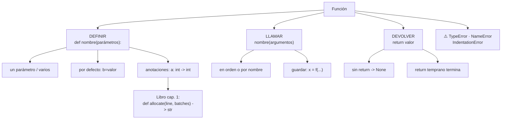

# Lección 04 — Funciones

> Fase 0 · Formulario · Familia de concepto: **empaquetar código** (`def`, parámetros, `return`) · Orden de estudio: **5 de 18**

⬅️ [Lección 03 · Bucles](../03-bucles/) · 🏠 [Índice de lecciones](../README.md) · ➡️ [Lección 05 · Listas y diccionarios](../05-listas-y-diccionarios/)

---

## 🧭 Ruta de estudio · Lección 04 (≈ 2 h)

**Antes necesitas:** [Lección 03 · Bucles](../03-bucles/) (`for`, `while`) y, por tanto, variables (01) y condicionales (02).

| Paso | Qué haces | Dónde | ⏱ |
|:-:|---|---|:-:|
| **0** | Lee la teoría, la tabla de fórmulas, las propiedades y los errores | este README §0–§8 | 25 min |
| **1** | Ejecuta las fórmulas y compara cada línea con la tabla | [`paso1_formulas.py`](paso1_formulas.py) | 10 min |
| **2** | Sigue los ejemplos resueltos línea por línea | §9 + [`paso2_ejemplos_resueltos.py`](paso2_ejemplos_resueltos.py) | 20 min |
| **3** | Completa los `# TODO` | [`paso3_tu_turno.py`](paso3_tu_turno.py) | 20 min |
| **4** | Compara con la solución de referencia | [`paso4_tu_turno_solucion.py`](paso4_tu_turno_solucion.py) | 5 min |
| **5** | Resuelve los 12 problemas **en papel o en un archivo tuyo**, luego revisa claves y solucionario | §10–§11 + [`paso5_solucionario/`](paso5_solucionario/) | 30 min |
| **6** | Compara solución mala vs buena | [`paso6_ejercicios/`](paso6_ejercicios/) | 10 min |
| **7** | Responde las preguntas de recuerdo **sin mirar** | §15 | 5 min |
| **🚦** | Evalúa si puedes pasar a la siguiente | §16 | 1 min |

---

## 0. 🧭 La pregunta
> *"Repito el mismo bloque de código en varios lugares. Me piden cambiar cómo se calcula
> y tengo que editarlo en todos lados. ¿Cómo lo empaqueto con un nombre para reutilizarlo
> y cambiarlo en un solo sitio?"*

## 1. Objetivos (al terminar podrás…)
1. **Definir** una función con `def` y **llamarla** por su nombre.
2. Pasarle datos por **parámetros** (uno, varios, por defecto, por nombre).
3. **Devolver** un resultado con `return` y guardarlo en una variable.
4. Distinguir **imprimir** de **devolver**, y reconocer `None`.
5. Leer las **anotaciones de tipo** (`: int`, `-> str`) que usa el libro.
6. Reconocer y evitar `TypeError`, `NameError` e `IndentationError` en funciones.

## 2. Cita de la fuente
> *"def allocate(line: OrderLine, batches: List[Batch]) -> str:"* — Cap. 1, *Not Everything Has to Be an Object: A Domain Service Function*

> *"Sometimes, it just isn’t a thing."* — Eric Evans, citado en el Cap. 1

**Por qué importa:** el libro empaqueta su regla de negocio más importante, *asignar*, en
una **función** con `def`. Recibe dos **parámetros** (`line`, `batches`), y las anotaciones
`: OrderLine` y `-> str` documentan qué tipo recibe y qué tipo **devuelve**. La frase de
Evans justifica que no todo tiene que ser una clase: a veces basta una función.

## 3. El dolor
```python
total1 = 15 * 4 + 5      # compra 1: precio * cantidad + envío
total2 = 20 * 2 + 5      # compra 2: la MISMA cuenta, copiada
total3 = 10 * 3 + 5      # compra 3: copiada otra vez
# Me piden cambiar el envío de 5 a 8... ¡hay que editar 3 líneas (o 300)!
```
Copiar y pegar un cálculo lo **desparrama**. Con una función, la regla vive en **un**
solo lugar.

---

## 4. 📘 Teoría

> **📦 Definición — Función**
> Una **función** es un bloque de código con **nombre** que hace una tarea. Se escribe
> **una vez** (se *define*) y se usa **muchas veces** (se *llama*).
> ```python
> def saludar(nombre):          # definición
>     return "Hola, " + nombre
>
> saludar("Ana")                # llamada  -> "Hola, Ana"
> ```

> **🧩 Anatomía de una función**
>
> | Parte | En el ejemplo | Qué es |
> |---|---|---|
> | `def` | `def` | palabra clave: "voy a definir una función" |
> | nombre | `saludar` | cómo la llamarás después |
> | parámetros | `(nombre)` | las cajitas que reciben los datos |
> | `:` + sangría | `:` y 4 espacios | lo que está adentro es el **cuerpo** |
> | `return` | `return "Hola, " + nombre` | el valor que **devuelve** a quien la llamó |

> **🔤 Vocabulario**
> - **Definir:** escribir la función con `def`. *No la ejecuta.*
> - **Llamar:** ejecutarla escribiendo su nombre con paréntesis: `saludar("Ana")`.
> - **Parámetro:** el nombre de la cajita en la definición (`nombre`).
> - **Argumento:** el valor concreto que pasas al llamarla (`"Ana"`).
> - **Valor de retorno:** lo que devuelve `return`. Si no hay `return`, devuelve `None`.
> - **Variable local:** la que se crea dentro de la función; no existe afuera.

> **🧠 Regla de oro**
> Si vas a escribir **lo mismo dos veces**, hazlo una función.
> Si el resultado se va a **usar** después (sumar, comparar, guardar), **devuélvelo** con `return`; no lo imprimas adentro.

---

## 5. 🧮 Formulario: funciones

| # | Operación | Sintaxis | Ejemplo | Resultado |
|---|---|---|---|---|
| F1 | Definir sin parámetros | `def nombre():` | `def saludar_a_todos(): print("Hola a todos")` | — (definir no ejecuta) |
| F2 | Llamar | `nombre()` | `saludar_a_todos()` | imprime `Hola a todos` |
| F3 | Con un parámetro | `def f(x):` | `saludar("Ana")` | `'Hola, Ana'` |
| F4 | Varios parámetros | `def f(a, b):` | `sumar(2, 3)` | `5` |
| F5 | Devolver | `return valor` | `return a + b` | entrega el valor a quien llamó |
| F6 | Guardar lo devuelto | `x = f(...)` | `resultado = sumar(10, 5)` | `resultado` vale `15` |
| F7 | Sin `return` | (no escribir `return`) | `r = solo_imprime()` | `r` vale `None` |
| F8 | Parámetro por defecto | `def f(a, b=valor):` | `saludar_con("Ana")` / `saludar_con("Ana", "Buenas")` | `'Hola, Ana'` / `'Buenas, Ana'` |
| F9 | Argumento por nombre | `f(b=..., a=...)` | `saludar_con(saludo="Chau", nombre="Luis")` | `'Chau, Luis'` |
| F10 | Devolver booleano | `return condición` | `es_mayor(20)` / `es_mayor(15)` | `True` / `False` |
| F11 | `return` temprano | `if ...: return x` | `clasificar(0)` / `clasificar(7)` | `'agotado'` / `'disponible'` |
| F12 | Llamar a otra función | `return otra(...) + ...` | `total_con_envio(10, 3)` | `35` |
| F13 | Anotaciones de tipo | `def f(a: int) -> int:` | `asignar(20, 5)` | `15` |
| F14 | Variable local | `def f(): x = ...` | `armar_mensaje()` | `'soy local'` (y `mensaje` no existe afuera) |
| F15 | Reutilizar en un `for` | `for x in ...: f(x)` | `for p in ["Benjamin", "Carla"]: print(saludar(p))` | `Hola, Benjamin` / `Hola, Carla` |

> 💡 Todas estas fórmulas están ejecutables en [`paso1_formulas.py`](paso1_formulas.py),
> con su código (F1, F2…) en cada línea de salida.

## 6. 🧮 Formulario de apoyo: cómo viaja un dato por una función (orden de ejecución)
```python
def sumar(a, b):        # 1) Python LEE la definición y la recuerda (no la ejecuta)
    return a + b        # 4) calcula 2 + 3 y DEVUELVE 5

x = sumar(2, 3)         # 2) LLAMA: a = 2, b = 3   3) salta adentro de la función
print(x)                # 5) x ya vale 5 -> imprime 5
```

| Momento | Qué pasa | `a` | `b` | `x` |
|---|---|---|---|---|
| 1 | se define `sumar` | — | — | — |
| 2 | se llama `sumar(2, 3)` | `2` | `3` | — |
| 3–4 | se ejecuta el cuerpo y `return 5` | `2` | `3` | — |
| 5 | el `5` devuelto se guarda | — (ya no existen) | — | `5` |

## 7. 📐 Propiedades
| # | Propiedad |
|---|---|
| **P1** | **Definir no es ejecutar.** El cuerpo corre recién cuando la **llamas**. |
| **P2** | La función debe estar **definida antes** de la línea que la llama. |
| **P3** | `return` **termina** la función: lo que esté debajo de un `return` ejecutado no corre. |
| **P4** | Sin `return`, la función devuelve **`None`**. |
| **P5** | Al llamarla, los argumentos se asignan a los parámetros **en orden**, salvo que los pases **por nombre**. |
| **P6** | Las variables de adentro son **locales**: nacen al llamar y desaparecen al terminar. |
| **P7** | Las **anotaciones** (`: int`, `-> str`) **no obligan** nada en Python: solo documentan. |

## 8. ⚠️ Errores frecuentes
| # | ❌ Así no | Qué pasa | ✅ Así sí |
|---|---|---|---|
| E1 | Llamar `despedir("Ana")` **antes** de definirla | `NameError: name 'despedir' is not defined` | escribe el `def` **arriba** de la llamada |
| E2 | `print(saludar)` (sin paréntesis) | no revienta, pero imprime `<function saludar at 0x…>`: **no la llamaste** | `print(saludar("Ana"))` |
| E3 | `saludar()` (falta el argumento) | `TypeError: saludar() missing 1 required positional argument: 'nombre'` | pasa todos los argumentos, o usa un valor por defecto (F8) |
| E4 | `saludar("Ana", "Luis")` (sobra uno) | `TypeError: saludar() takes 1 positional argument but 2 were given` | tantos argumentos como parámetros |
| E5 | `print(...)` adentro en vez de `return` | `x = f(...)` deja `x` en `None` | `return` el valor y que quien llama decida si imprime |
| E6 | Usar `mensaje` afuera de la función | `NameError: name 'mensaje' is not defined` | devuelve el valor: `m = armar_mensaje()` |
| E7 | Cuerpo sin sangría | `IndentationError: expected an indented block after function definition on line 1` | 4 espacios en cada línea del cuerpo |
| E8 | Olvidar los `:` en `def f()` | `SyntaxError: expected ':'` | `def f():` |

> 🔬 Pruébalos: al final de [`paso1_formulas.py`](paso1_formulas.py) están E1, E2, E3, E4
> y E6 comentados. Quita el `#` de **uno**, ejecuta, lee el mensaje y vuelve a ponerlo.

---

## 9. ✍️ Ejemplos resueltos (paso a paso)
> Todos están en [`paso2_ejemplos_resueltos.py`](paso2_ejemplos_resueltos.py).

**Ejemplo 1 — Saludo reutilizable** *(fácil)*
> Enunciado: crea una función que arme un saludo y úsala con dos nombres.
```python
def saludar(nombre):                  # Paso 1: definir con un parámetro (F3)
    return "Hola, " + nombre          # Paso 2: devolver el texto armado (F5)

print(saludar("Ana"))                 # Paso 3: llamar y mostrar (F2)  -> Hola, Ana
print(saludar("Luis"))                # Paso 4: reutilizar             -> Hola, Luis
```

**Ejemplo 2 — Total de una compra** *(fácil)*
> Enunciado: calcula el total de 4 productos de 15 soles cada uno.
```python
def calcular_total(precio, cantidad):  # Paso 1: dos parámetros (F4)
    total = precio * cantidad          # Paso 2: calcular (variable local, F14)
    return total                       # Paso 3: devolver (F5)

compra = calcular_total(15, 4)         # Paso 4: guardar lo devuelto (F6)
print(compra)                          # -> 60
```

**Ejemplo 3 — ¿Puedo asignar?** *(intermedio)*
> Enunciado: con 20 unidades disponibles, responde si se pueden atender pedidos de 5, 20 y 25.
```python
def puede_asignar(disponible, pedido):  # Paso 1: la pregunta como función
    return disponible >= pedido         # Paso 2: devolver True/False (F10)

for pedido in [5, 20, 25]:              # Paso 3: probarla con varios pedidos (F15)
    print("pedido", pedido, "->", puede_asignar(20, pedido))
```
Traza:

| vuelta | `pedido` | `20 >= pedido` | imprime |
|---|---|---|---|
| 1 | `5` | `True` | `pedido 5 -> True` |
| 2 | `20` | `True` | `pedido 20 -> True` |
| 3 | `25` | `False` | `pedido 25 -> False` |

**Ejemplo 4 — Funciones que se llaman entre sí, con anotaciones como el libro** *(avanzado)*
> Enunciado: escribe `asignar(disponible, pedido)` que reste si alcanza y, si no, deje el
> stock igual. Reutiliza una función que responda si alcanza.
```python
def puede(disponible: int, pedido: int) -> bool:           # Paso 1: pregunta (F10 + F13)
    return disponible >= pedido

def asignar(disponible: int, pedido: int) -> int:          # Paso 2: usa a la otra (F12)
    if puede(disponible, pedido):                          # Paso 3: si alcanza...
        return disponible - pedido                         #   ...resta y TERMINA (F11)
    return disponible                                      # Paso 4: no alcanzó: no cambia

print(asignar(20, 5))     # -> 15
print(asignar(20, 25))    # -> 20 (no alcanzaba)
```
Es la **misma forma** que `def allocate(line: OrderLine, batches: List[Batch]) -> str:` del
libro: parámetros con anotación de tipo y `->` indicando qué devuelve. En la
[Lección 07](../07-excepciones/) cambiarás el "no alcanzó" por un error con nombre (`SinStock`),
exactamente como hace el libro.

---

## 10. 📝 Problemas propuestos
> Resuélvelos **antes** de mirar las claves. Puedes crear tu propio archivo, por ejemplo
> `mis_problemas.py`, en esta carpeta.

**🟢 Nivel básico**
1. Define `doble(n)` que devuelva el doble de `n`. Imprime `doble(4)`.
2. Define `despedir(nombre)` que devuelva `"Adiós, " + nombre`. Imprime `despedir("Ana")`.
3. Define `area_rectangulo(base, altura)`. Imprime `area_rectangulo(3, 4)`.
4. Usa una función `saludar(nombre)` dentro de un `for` para saludar a `"Ana"`, `"Luis"` y `"Eva"`.

**🟡 Nivel intermedio**

5. Define `es_par(n)` que devuelva `True` si `n` es par. *Pista: `n % 2` es el **resto** de dividir entre 2; si es `0`, es par.* Imprime `es_par(8)` y `es_par(7)`.
6. Define `precio_con_descuento(precio, descuento=0)`. Imprime `precio_con_descuento(100)` y `precio_con_descuento(100, 20)`.
7. Define `mayor(a, b)` que devuelva el mayor **sin** usar `max`. Imprime `mayor(3, 9)`.
8. Define `contar_hasta(n)` que **imprima** del 1 al `n` con `while` y **no** tenga `return`. Guarda lo que devuelve `contar_hasta(3)` e imprímelo. ¿Qué sale y por qué?

**🔴 Nivel avanzado**

9. Define `sumar_hasta(n)` que **devuelva** `1 + 2 + … + n` usando `while`. Imprime `sumar_hasta(5)`.
10. Define `clasificar_stock(cantidad)` que devuelva `"agotado"` (0), `"bajo"` (menos de 5) u `"ok"`. Pruébala con `0`, `3` y `10`.
11. Define `calcular_total(precio, cantidad)` y `total_con_envio(precio, cantidad, envio=5)` que **llame** a la primera. Imprime `total_con_envio(10, 3)` y `total_con_envio(10, 3, 0)`.
12. *(Puente al libro)* Escribe `asignar(disponible: int, pedido: int) -> int` **con anotaciones**, como `allocate` del cap. 1: resta si alcanza; si no, devuelve `disponible` sin cambios. Imprime `asignar(20, 5)` y `asignar(20, 25)`.

## 11. 🔑 Claves (respuestas)
<details><summary>Ver claves (solo después de intentarlo)</summary>

| # | Salida esperada | Fórmula clave |
|---|---|---|
| 1 | `8` | F3 + F5 |
| 2 | `Adiós, Ana` | F3 |
| 3 | `12` | F4 |
| 4 | `Hola, Ana` / `Hola, Luis` / `Hola, Eva` | F15 |
| 5 | `True False` | F10 |
| 6 | `100 80` | F8 |
| 7 | `9` | F11 (return temprano) |
| 8 | `contando 1`, `contando 2`, `contando 3` y luego `None` (no tiene `return`) | F7 |
| 9 | `15` | acumulador + F5 |
| 10 | `agotado bajo ok` | F11 |
| 11 | `35 30` | F12 + F8 |
| 12 | `15 20` | F13 + F11 |

El código completo de cada solución está en [`paso5_solucionario/`](paso5_solucionario/):
[`nivel_basico.py`](paso5_solucionario/nivel_basico.py) ·
[`nivel_intermedio.py`](paso5_solucionario/nivel_intermedio.py) ·
[`nivel_avanzado.py`](paso5_solucionario/nivel_avanzado.py).
</details>

---

## 12. 🗺️ Mapa mental (Mermaid)

**Cómo leerlo:** toda función tiene tres momentos: **definir**, **llamar** y **devolver**.
Cada rama muestra sus variantes. La hoja de abajo conecta las anotaciones con la función
real del libro.

## 13. 🌳 Árbol de archivos
```
lecciones/04-funciones/
├── README.md                    ← PASO 0 · EMPIEZA AQUÍ (este formulario)
├── paso1_formulas.py            ← PASO 1 · las fórmulas F1–F15, ejecutables
├── paso2_ejemplos_resueltos.py  ← PASO 2 · los 4 ejemplos resueltos
├── paso3_tu_turno.py            ← PASO 3 · completa los # TODO
├── paso4_tu_turno_solucion.py   ← PASO 4 · solución de referencia
├── paso5_solucionario/          ← PASO 5 · soluciones de los 12 problemas
│   ├── nivel_basico.py
│   ├── nivel_intermedio.py
│   └── nivel_avanzado.py
└── paso6_ejercicios/            ← PASO 6 · solución mala vs buena
    ├── ejercicio-1/ … ejercicio-3/
    └── ejercicio-4-reto/
```

## 14. 🤝 Tu turno y ✅ comprobación
`pytest` llega en la [Lección 08](../08-modulos-y-pytest/), así que aquí se comprueba
**ejecutando y comparando** con la salida esperada:
```bash
uv run python lecciones/04-funciones/paso3_tu_turno.py
# compara con la "Salida esperada" del final de ese archivo
git diff --no-index lecciones/04-funciones/paso3_tu_turno.py lecciones/04-funciones/paso4_tu_turno_solucion.py
```

## 15. ❓ Preguntas de recuerdo
> Respóndelas **sin mirar**; luego abre cada una para comprobar.

<details><summary>1. ¿Qué diferencia hay entre definir y llamar una función?</summary>

**Definir** (`def ...:`) solo la escribe y Python la recuerda; **llamar** (`nombre(...)`) la ejecuta.
</details>
<details><summary>2. ¿Qué diferencia hay entre parámetro y argumento?</summary>

El **parámetro** es el nombre en la definición (`nombre`); el **argumento** es el valor que pasas al llamarla (`"Ana"`).
</details>
<details><summary>3. ¿Qué devuelve una función sin <code>return</code>?</summary>

`None`.
</details>
<details><summary>4. ¿Por qué conviene <code>return</code> en vez de <code>print</code> dentro de la función?</summary>

Porque con `return` el resultado se puede **usar** (guardar, sumar, comparar); con `print` solo se muestra y se pierde.
</details>
<details><summary>5. ¿Qué pasa con el código que está debajo de un <code>return</code> que se ejecutó?</summary>

No se ejecuta: `return` **termina** la función en ese momento.
</details>
<details><summary>6. En <code>def allocate(line: OrderLine, batches: List[Batch]) -> str:</code>, ¿qué significa <code>-> str</code>?</summary>

Que la función **devuelve** un texto (`str`). Es una anotación: documenta, pero Python no la obliga.
</details>

---

## 16. 🚦 ¿Puedo pasar a la siguiente lección?
| Indicador | Criterio |
|:-:|---|
| 🟢 **Sí, sigue** | `paso3_tu_turno.py` da la salida esperada **y** aciertas **≥ 9 de 12** problemas **y** respondes las 6 preguntas sin mirar |
| 🟡 **Repasa** | aciertas **6 a 8** → vuelve a §8 (errores frecuentes) y §9 (ejemplos resueltos) y reintenta los que fallaste |
| 🔴 **Repite la lección** | aciertas **menos de 6** → empieza otra vez desde el Paso 0 |

Cuando estés en 🟢, marca la lección en
[`progreso/fase-0-python.md`](../../progreso/fase-0-python.md) (sección *"Mi avance"*) y haz
commit; así también practicas Git.

---

⬅️ [Lección 03 · Bucles](../03-bucles/) · 🏠 [Índice de lecciones](../README.md) · ➡️ [Lección 05 · Listas y diccionarios](../05-listas-y-diccionarios/)
