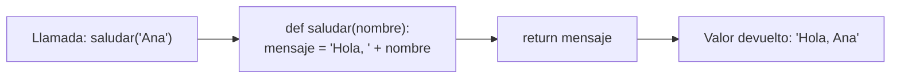

# Lección 04 — Funciones

> Fase 0 · micro-paso · concepto nuevo: **empaquetar código** con `def` y `return`.

## 0. 🧭 La pregunta
> *"Repito el mismo bloque en varios lugares. ¿Cómo lo empaqueto con un nombre para
> reutilizarlo y cambiarlo en un solo sitio?"*

## 1. Objetivo
Definir funciones con `def`, recibir datos por **parámetros** y devolver resultados con `return`.

## 2. Cita de la fuente
> *"def allocate(orderid: str, sku: str, qty: int, ...) -> str:"* — Cap. 4

El libro empaqueta su lógica en funciones con `def`.

## 3. El dolor / necesidad
Un bloque repetido hay que editarlo en todos lados; empaquetarlo en una función lo
deja en un solo sitio y reutilizable.

## 4. Explicación paso a paso
1. `def saludar(nombre):` define la función; `nombre` es un **parámetro**.
2. `return mensaje` devuelve un valor a quien la llamó.
3. Definir no ejecuta: la función corre al **llamarla** (`saludar("Ana")`).
4. Empaquetada, se reutiliza (p. ej. dentro de un `for`).

Ver [`funciones.py`](funciones.py). Ejecutar:
```bash
uv run python lecciones/04-funciones/funciones.py
```

## 5. Diagrama (Mermaid)

Le pasas un dato, la función lo procesa y devuelve un resultado reutilizable.

## 6. Árbol de archivos
```
lecciones/04-funciones/
├── README.md
└── funciones.py
```

## 7. Tu turno
Crea una función `despedir(nombre)` que devuelva `"Adiós, <nombre>"`.

## 8. Comprobación
Sin pytest aún (Lección 08). Se comprueba ejecutando y viendo la salida.

## 9. Preguntas de recuerdo
1. ¿Qué es un parámetro?
2. ¿Qué hace `return`?
3. ¿Por qué "definir" no es lo mismo que "ejecutar/llamar"?
