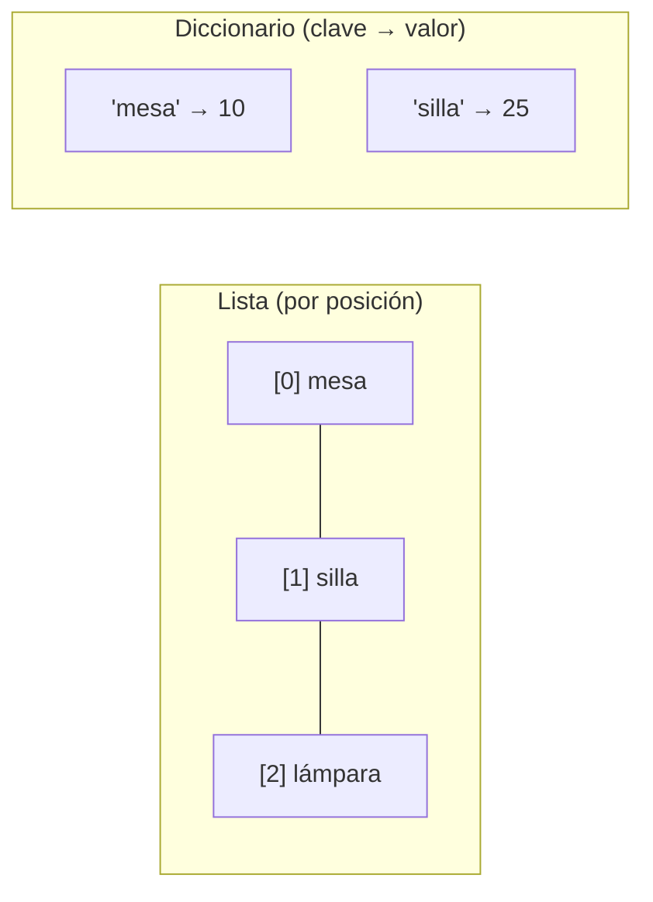

# Lección 05 — Listas y diccionarios

> Fase 0 · micro-paso · concepto nuevo: **colecciones** (lista y diccionario).

## 0. 🧭 La pregunta
> *"Me piden manejar muchos productos y saber el stock de cada uno. ¿Cómo guardo
> colecciones ordenadas y también pares 'nombre → cantidad'?"*

## 1. Objetivo
Usar **listas** (valores en orden, por posición) y **diccionarios** (pares clave → valor).

## 2. Cita de la fuente
> *"HANDLERS = { events.OutOfStock: [send_out_of_stock_notification] }"* — Cap. 8

El libro usa un diccionario para mapear clave → valor.

## 3. El dolor / necesidad
Datos sueltos no bastan para manejar muchos elementos ni para buscar por nombre.

## 4. Explicación paso a paso
1. Lista: `productos[0]` (posición, empieza en 0), `len(...)`, `.append(...)`.
2. Diccionario: `stock["mesa"]` (por clave), `stock["lámpara"] = 7` (agrega/cambia).
3. `for` sobre un diccionario recorre sus **claves**; `stock[clave]` da el valor.
4. Lista = por posición; diccionario = por clave con significado.

Ver [`colecciones.py`](colecciones.py). Ejecutar:
```bash
uv run python lecciones/05-listas-y-diccionarios/colecciones.py
```

## 5. Diagrama (Mermaid)

La lista se consulta por índice; el diccionario por clave.

## 6. Árbol de archivos
```
lecciones/05-listas-y-diccionarios/
├── README.md
└── colecciones.py
```

## 7. Tu turno
Agrega el producto "cama" con stock 4 al diccionario y muéstralo.

## 8. Comprobación
Sin pytest aún (Lección 08). Se comprueba ejecutando y viendo la salida.

## 9. Preguntas de recuerdo
1. ¿En qué posición está el primer elemento de una lista?
2. ¿Cómo se accede a un valor en un diccionario?
3. ¿Cuándo usar lista y cuándo diccionario?
