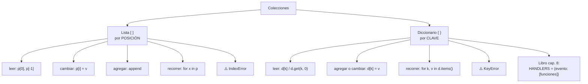

# Lección 05 — Listas y diccionarios

> Fase 0 · Formulario · Familia de concepto: **colecciones** · Orden de estudio: **6 de 18**

⬅️ [Lección 04 · Funciones](../04-funciones/) · 🏠 [Índice de lecciones](../README.md) · ➡️ [Lección 06 · Clases y objetos](../06-clases-y-objetos/)

---

## 🧭 Ruta de estudio · Lección 05 (≈ 2 h)

**Antes necesitas:** [Lección 03 · Bucles](../03-bucles/) (`for`) y [Lección 04 · Funciones](../04-funciones/) (`def`).

| Paso | Qué haces | Dónde | ⏱ |
|:-:|---|---|:-:|
| **0** | Lee la teoría, las tablas de fórmulas, las propiedades y los errores | este README §0–§8 | 25 min |
| **1** | Ejecuta las fórmulas y compara cada línea con la tabla | [`paso1_formulas.py`](paso1_formulas.py) | 10 min |
| **2** | Sigue los ejemplos resueltos línea por línea | §9 + [`paso2_ejemplos_resueltos.py`](paso2_ejemplos_resueltos.py) | 20 min |
| **3** | Completa los `# TODO` | [`paso3_tu_turno.py`](paso3_tu_turno.py) | 20 min |
| **4** | Compara con la solución de referencia | [`paso4_tu_turno_solucion.py`](paso4_tu_turno_solucion.py) | 5 min |
| **5** | Resuelve los 12 problemas **en papel o en un archivo tuyo**, luego revisa claves y solucionario | §10–§11 + [`paso5_solucionario/`](paso5_solucionario/) | 30 min |
| **6** | Compara solución mala vs buena | [`paso6_ejercicios/`](paso6_ejercicios/) | 10 min |
| **7** | Responde las preguntas de recuerdo **sin mirar** | §15 | 5 min |
| **🚦** | Evalúa si puedes pasar a la siguiente | §16 | 1 min |

---

## 0. 🧭 La pregunta
> *"Tengo **un** producto en una variable. Me piden manejar **muchos** productos y saber el
> stock de **cada uno**. ¿Cómo lo hago?"*

## 1. Objetivos (al terminar podrás…)
1. Crear, leer, cambiar y recorrer una **lista**.
2. Crear, leer, cambiar y recorrer un **diccionario**.
3. Elegir cuándo usar cada una.
4. Reconocer y evitar `IndexError`, `KeyError` y `ValueError`.

## 2. Cita de la fuente
> *"allocation = allocate(line, [in_stock_batch, shipment_batch])"* — Cap. 1

> *"batch = next( b for b in sorted(batches) if b.can_allocate(line) )"* — Cap. 1

> *"HANDLERS = { events.OutOfStock: [send_out_of_stock_notification], }"* — Cap. 8

**Por qué importa:** en el cap. 1 el libro le pasa a `allocate` una **lista** de lotes
(`[in_stock_batch, shipment_batch]`) y la **recorre ordenada** (`sorted(batches)`). En el
cap. 8 usa un **diccionario** cuyos valores son **listas** (`HANDLERS`). Sin esta lección
no podrás leer esas líneas.

## 3. El dolor
```python
producto1 = "mesa"
producto2 = "silla"
producto3 = "lámpara"      # ¿y si son 500? ¿500 variables?
```
Con variables sueltas **no puedes** recorrer los datos, contarlos, ni preguntar
"¿cuál es el stock de la silla?".

---

## 4. 📘 Teoría

> **📦 Definición — Lista**
> Una **lista** es una colección **ordenada** de valores. Cada valor ocupa una **posición**
> (llamada **índice**) que **empieza en 0**.
> `productos = ["mesa", "silla", "lámpara"]`
>
> | índice | 0 | 1 | 2 |
> |---|---|---|---|
> | valor | `"mesa"` | `"silla"` | `"lámpara"` |
> | índice negativo | -3 | -2 | -1 |

> **🗂️ Definición — Diccionario**
> Un **diccionario** es una colección de pares **clave → valor**. No se busca por
> posición sino por **clave**, que es un nombre con significado.
> `stock = {"mesa": 10, "silla": 25}`
>
> | clave | valor |
> |---|---|
> | `"mesa"` | `10` |
> | `"silla"` | `25` |

> **🔤 Vocabulario**
> - **Elemento:** cada valor dentro de una lista.
> - **Índice:** la posición de un elemento (0, 1, 2…).
> - **Clave / valor:** las dos mitades de cada par de un diccionario.
> - **Método:** una función que se llama con punto sobre un valor: `productos.append("x")`.
> - **Mutable:** que se puede cambiar después de creado (listas y diccionarios lo son).

> **🧠 Regla de oro**
> ¿Te importa el **orden** o la **posición**? → **lista**.
> ¿Buscas algo **por su nombre**? → **diccionario**.

---

## 5. 🧮 Formulario: listas
Con `p = ["mesa", "silla", "lámpara"]` (cada fila parte de esa lista):

| # | Operación | Sintaxis | Ejemplo | Resultado |
|---|---|---|---|---|
| L1 | Crear | `[a, b, c]` | `p = ["mesa","silla","lámpara"]` | — |
| L2 | Lista vacía | `[]` | `v = []` | `[]` |
| L3 | Acceder | `lista[i]` | `p[0]` | `'mesa'` |
| L4 | Último | `lista[-1]` | `p[-1]` | `'lámpara'` |
| L5 | Cambiar | `lista[i] = v` | `p[1] = "sofá"` | `['mesa', 'sofá', 'lámpara']` |
| L6 | Tamaño | `len(lista)` | `len(p)` | `3` |
| L7 | Agregar al final | `.append(x)` | `p.append("cama")` | `['mesa', 'silla', 'lámpara', 'cama']` |
| L8 | ¿Está? / ¿No está? | `x in lista` / `x not in lista` | `"mesa" in p` | `True` |
| L9 | Posición de | `.index(x)` | `p.index("silla")` | `1` |
| L10 | Quitar por valor | `.remove(x)` | `p.remove("silla")` | `['mesa', 'lámpara']` |
| L11 | Sacar el último | `.pop()` | `p.pop()` | devuelve `'lámpara'`, queda `['mesa', 'silla']` |
| L12 | Rebanar | `lista[a:b]` | `p[0:2]` | `['mesa', 'silla']` (el `b` **no** se incluye) |
| L13 | Ordenar (copia) | `sorted(lista)` | `sorted(p)` | `['lámpara', 'mesa', 'silla']` |
| L14 | Recorrer | `for x in lista:` | `for prod in p: print(prod)` | una línea por elemento |

## 6. 🧮 Formulario: diccionarios
Con `stock = {"mesa": 10, "silla": 25}` (cada fila parte de ese diccionario):

| # | Operación | Sintaxis | Ejemplo | Resultado |
|---|---|---|---|---|
| D1 | Crear | `{k: v, …}` | `stock = {"mesa": 10, "silla": 25}` | — |
| D2 | Vacío | `{}` | `d = {}` | `{}` |
| D3 | Leer | `d[clave]` | `stock["mesa"]` | `10` |
| D4 | Leer seguro | `d.get(clave, defecto)` | `stock.get("cama", 0)` | `0` |
| D5 | Agregar / cambiar | `d[clave] = v` | `stock["cama"] = 4` | `{'mesa': 10, 'silla': 25, 'cama': 4}` |
| D6 | ¿Existe la clave? | `clave in d` | `"mesa" in stock` | `True` |
| D7 | Tamaño | `len(d)` | `len(stock)` | `2` |
| D8 | Borrar | `del d[clave]` | `del stock["mesa"]` | `{'silla': 25}` |
| D9 | Claves | `d.keys()` | `list(stock.keys())` | `['mesa', 'silla']` |
| D10 | Valores | `d.values()` | `list(stock.values())` | `[10, 25]` |
| D11 | Recorrer pares | `for k, v in d.items():` | `for k, v in stock.items(): print(k, v)` | `mesa 10` / `silla 25` |

> 💡 Todas estas fórmulas están ejecutables en [`paso1_formulas.py`](paso1_formulas.py),
> con su código (L1, D1…) en cada línea de salida.

## 7. 📐 Propiedades
| Lista | Diccionario |
|---|---|
| **P1.** Es **ordenada**: el índice empieza en **0** y el último es `len(p) - 1`. | **P5.** La clave es **única**: si se repite, **gana la última**. `{"a": 1, "a": 2}` → `{'a': 2}` |
| **P2.** Permite **repetidos**: `["mesa", "mesa"]` es válido. | **P6.** Se busca **por clave**, no por posición: `stock[0]` **no** da "el primero". |
| **P3.** Es **mutable**: se puede cambiar después de crearla. | **P7.** Conserva el **orden en que agregaste** los pares. |
| **P4.** `lista[-1]` es el último, `lista[-2]` el penúltimo. | **P8.** `in` busca en las **claves**, **no** en los valores. |

## 8. ⚠️ Errores frecuentes
| # | ❌ Así no | Qué pasa | ✅ Así sí |
|---|---|---|---|
| E1 | `p[3]` (lista de 3 elementos) | `IndexError: list index out of range` | los índices van de `0` a `len(p) - 1`; el último es `p[-1]` |
| E2 | `stock["cama"]` (la clave no existe) | `KeyError: 'cama'` | `stock.get("cama", 0)` |
| E3 | `10 in stock` | `False`, porque `in` busca **claves** | `10 in stock.values()` |
| E4 | `p.remove("sofá")` (no está) | `ValueError: list.remove(x): x not in list` | `if "sofá" in p: p.remove("sofá")` |
| E5 | `p = p.append("x")` | `p` queda en `None` y pierdes la lista | `p.append("x")` (cambia la lista; no devuelve nada) |
| E6 | `stock("mesa")` | `TypeError: 'dict' object is not callable` | corchetes, no paréntesis: `stock["mesa"]` |

> 🔬 Pruébalos: al final de [`paso1_formulas.py`](paso1_formulas.py) están E1, E2, E4 y
> E6 comentados. Quita el `#` de **uno**, ejecuta, lee el mensaje y vuelve a ponerlo.

---

## 9. ✍️ Ejemplos resueltos (paso a paso)
> Todos están en [`paso2_ejemplos_resueltos.py`](paso2_ejemplos_resueltos.py).

**Ejemplo 1 — Inventario con lista** *(fácil)*
> Enunciado: crea una lista con 3 productos, muestra el primero y el último, cambia el
> segundo y recorre la lista.
```python
productos = ["mesa", "silla", "lámpara"]   # Paso 1: crear (L1)
print(productos[0])                        # Paso 2: el primero (L3)  -> mesa
print(productos[-1])                       # Paso 3: el último (L4)   -> lámpara
productos[1] = "sofá"                      # Paso 4: cambiar (L5)
for prod in productos:                     # Paso 5: recorrer (L14)
    print(prod)                            # -> mesa / sofá / lámpara
```

**Ejemplo 2 — Registrar una venta** *(fácil)*
> Enunciado: hay 10 mesas y se venden 3. Actualiza el stock.
```python
stock = {"mesa": 10, "silla": 25}          # Paso 1: crear (D1)
vendidas = 3                               # Paso 2: el dato de la venta
stock["mesa"] = stock["mesa"] - vendidas   # Paso 3: leer (D3), restar y guardar (D5)
print(stock["mesa"])                       # -> 7
```
Fíjate en el Paso 3: **primero** se calcula lo de la derecha (`10 - 3`) y **después** se
guarda el resultado en la clave `"mesa"`.

**Ejemplo 3 — Contar repeticiones** *(intermedio)*
> Enunciado: cuenta cuántas veces se pidió cada producto en `["mesa", "silla", "mesa"]`.
```python
pedidos = ["mesa", "silla", "mesa"]
conteo = {}                                       # Paso 1: diccionario vacío (D2)
for prod in pedidos:                              # Paso 2: recorrer la lista (L14)
    conteo[prod] = conteo.get(prod, 0) + 1        # Paso 3: leer seguro (D4) y sumar 1
print(conteo)                                     # -> {'mesa': 2, 'silla': 1}
```
Traza (lo que vale cada cosa en cada vuelta):

| vuelta | `prod` | `conteo.get(prod, 0)` | `conteo` después |
|---|---|---|---|
| 1 | `"mesa"` | `0` | `{'mesa': 1}` |
| 2 | `"silla"` | `0` | `{'mesa': 1, 'silla': 1}` |
| 3 | `"mesa"` | `1` | `{'mesa': 2, 'silla': 1}` |

**Ejemplo 4 — Lista dentro de diccionario, como en el libro** *(avanzado)*
> Enunciado: replica la idea de `HANDLERS` del cap. 8: para el evento `"SinStock"` hay
> **una lista** de avisos.
```python
def avisar_email(sku):
    print("EMAIL: sin stock de", sku)

def avisar_sms(sku):
    print("SMS: sin stock de", sku)

MANEJADORES = {"SinStock": [avisar_email, avisar_sms]}   # Paso 1: clave -> LISTA de funciones

for funcion in MANEJADORES["SinStock"]:                  # Paso 2: leer la lista (D3) y recorrerla (L14)
    funcion("MESA")                                      # Paso 3: llamar a cada una
# -> EMAIL: sin stock de MESA
# -> SMS: sin stock de MESA
```
Esto es **exactamente** la forma de `HANDLERS = { events.OutOfStock: [send_out_of_stock_notification] }`:
una clave (el evento) que guarda una lista (las funciones que reaccionan a él).

---

## 10. 📝 Problemas propuestos
> Resuélvelos **antes** de mirar las claves. Puedes crear tu propio archivo, por ejemplo
> `mis_problemas.py`, en esta carpeta.

**🟢 Nivel básico**
1. Crea `colores = ["rojo", "verde", "azul"]` e imprime el **segundo** color.
2. Imprime el **último** color **sin** usar `len`.
3. Agrega `"negro"` a la lista e imprime cuántos colores hay.
4. Crea `precios = {"pan": 1, "leche": 4}` e imprime el precio de la leche.

**🟡 Nivel intermedio**

5. En `precios`, cambia el precio del pan a `2` y agrega `"huevo": 6`. Imprime el diccionario.
6. Recorre `precios` con `.items()` imprimiendo `pan cuesta 2`, `leche cuesta 4`, etc.
7. Con `notas = [12, 15, 9, 18]`, calcula la suma **con un `for`** (sin usar `sum`) y el promedio.
8. Si `"queso"` **no** está en `precios`, imprime `no hay queso` *(usa el `if` de la Lección 02)*.

**🔴 Nivel avanzado**

9. Cuenta cuántas veces aparece cada palabra en `["mesa", "silla", "mesa", "cama", "mesa"]`
   y guarda el resultado en un diccionario.
10. Con `stock = {"mesa": 10, "silla": 0, "cama": 4}`, arma una **lista** con los productos
    agotados (los que tienen `0`).
11. Muestra el stock de `"sofá"`. Si no existe, debe salir `0` **sin** que el programa reviente.
12. *(Puente al libro)* Arma un diccionario `MANEJADORES` con la clave `"Asignado"` cuyo valor
    sea una lista de **dos funciones** que impriman algo. Llámalas recorriendo esa lista.

## 11. 🔑 Claves (respuestas)
<details><summary>Ver claves (solo después de intentarlo)</summary>

| # | Salida esperada | Fórmula clave |
|---|---|---|
| 1 | `verde` | L3 (`colores[1]`) |
| 2 | `azul` | L4 (`colores[-1]`) |
| 3 | `4` | L7 + L6 |
| 4 | `4` | D3 |
| 5 | `{'pan': 2, 'leche': 4, 'huevo': 6}` | D5 (cambia y agrega) |
| 6 | `pan cuesta 2` / `leche cuesta 4` / `huevo cuesta 6` | D11 |
| 7 | suma `54`, promedio `13.5` | L14 + acumulador |
| 8 | `no hay queso` | D6 con `not in` |
| 9 | `{'mesa': 3, 'silla': 1, 'cama': 1}` | patrón contador (Ejemplo 3) |
| 10 | `['silla']` | D11 + L2 + L7 |
| 11 | `0` | D4 (`stock.get("sofá", 0)`) |
| 12 | dos líneas impresas, una por función | Ejemplo 4 |

El código completo de cada solución está en [`paso5_solucionario/`](paso5_solucionario/):
[`nivel_basico.py`](paso5_solucionario/nivel_basico.py) ·
[`nivel_intermedio.py`](paso5_solucionario/nivel_intermedio.py) ·
[`nivel_avanzado.py`](paso5_solucionario/nivel_avanzado.py).
</details>

---

## 12. 🗺️ Mapa mental (Mermaid)

**Cómo leerlo:** de "Colecciones" salen dos ramas. Cada rama muestra cómo se **lee**,
**cambia**, **agrega** y **recorre**, y su **error típico**. La hoja final conecta con la
línea real del libro.

## 13. 🌳 Árbol de archivos
```
lecciones/05-listas-y-diccionarios/
├── README.md                    ← PASO 0 · EMPIEZA AQUÍ (este formulario)
├── paso1_formulas.py            ← PASO 1 · las fórmulas L1–L14 y D1–D11, ejecutables
├── paso2_ejemplos_resueltos.py  ← PASO 2 · los 4 ejemplos resueltos
├── paso3_tu_turno.py            ← PASO 3 · completa los # TODO
├── paso4_tu_turno_solucion.py   ← PASO 4 · solución de referencia
├── paso5_solucionario/          ← PASO 5 · soluciones de los 12 problemas
│   ├── nivel_basico.py
│   ├── nivel_intermedio.py
│   └── nivel_avanzado.py
└── paso6_ejercicios/            ← PASO 6 · solución mala vs buena
    ├── ejercicio-1/ … ejercicio-3/
    └── ejercicio-4-reto/
```

## 14. 🤝 Tu turno y ✅ comprobación
`pytest` llega en la [Lección 08](../08-modulos-y-pytest/), así que aquí se comprueba
**ejecutando y comparando** con la salida esperada:
```bash
uv run python lecciones/05-listas-y-diccionarios/paso3_tu_turno.py
# compara con la "Salida esperada" del final de ese archivo
git diff --no-index lecciones/05-listas-y-diccionarios/paso3_tu_turno.py lecciones/05-listas-y-diccionarios/paso4_tu_turno_solucion.py
```

## 15. ❓ Preguntas de recuerdo
> Respóndelas **sin mirar**; luego abre cada una para comprobar.

<details><summary>1. ¿En qué índice está el primer elemento de una lista?</summary>

En el **0**. El último está en `len(lista) - 1`, o simplemente en `-1`.
</details>
<details><summary>2. ¿Qué diferencia hay entre <code>stock["x"]</code> y <code>stock.get("x", 0)</code>?</summary>

`stock["x"]` lanza `KeyError` si la clave no existe; `stock.get("x", 0)` devuelve `0`.
</details>
<details><summary>3. ¿<code>in</code> en un diccionario busca en las claves o en los valores?</summary>

En las **claves**. Para buscar en los valores: `x in d.values()`.
</details>
<details><summary>4. ¿Por qué <code>p = p.append("x")</code> está mal?</summary>

Porque `append` cambia la lista **y devuelve `None`**, así que `p` queda en `None` y se pierde la lista.
</details>
<details><summary>5. En <code>HANDLERS = {evento: [f1, f2]}</code>, ¿qué tipo de dato es el valor?</summary>

Una **lista** (de funciones). Es un diccionario cuyos valores son listas.
</details>
<details><summary>6. ¿Cuándo uso lista y cuándo diccionario?</summary>

Lista si me importa el **orden o la posición**; diccionario si busco **por un nombre** (clave).
</details>

---

## 16. 🚦 ¿Puedo pasar a la siguiente lección?
| Indicador | Criterio |
|:-:|---|
| 🟢 **Sí, sigue** | `paso3_tu_turno.py` da la salida esperada **y** aciertas **≥ 9 de 12** problemas **y** respondes las 6 preguntas sin mirar |
| 🟡 **Repasa** | aciertas **6 a 8** → vuelve a §8 (errores frecuentes) y §9 (ejemplos resueltos) y reintenta los que fallaste |
| 🔴 **Repite la lección** | aciertas **menos de 6** → empieza otra vez desde el Paso 0 |

Cuando estés en 🟢, marca la lección en
[`progreso/fase-0-python.md`](../../progreso/fase-0-python.md) (sección *"Mi avance"*) y haz
commit; así también practicas Git.

---

⬅️ [Lección 04 · Funciones](../04-funciones/) · 🏠 [Índice de lecciones](../README.md) · ➡️ [Lección 06 · Clases y objetos](../06-clases-y-objetos/)
