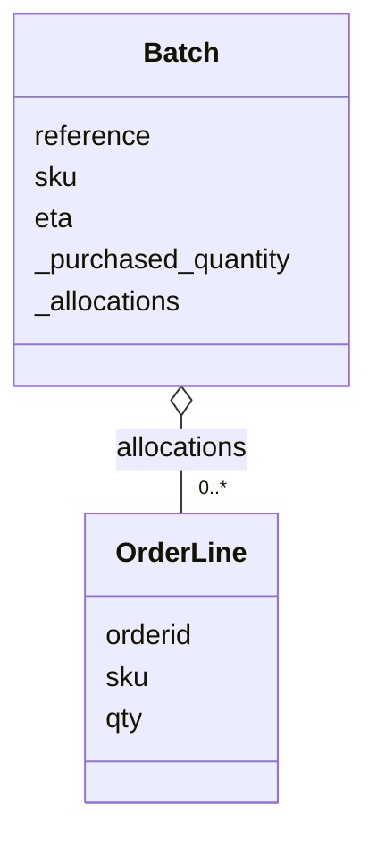

# Lección 06 — Clases y objetos

> Fase 0 · micro-paso · concepto nuevo: la **clase** (datos + comportamiento).
> Usa la **Figura 1-3** del libro (§3.8).

## 0. 🧭 La pregunta
> *"Tengo un lote como datos sueltos. Me piden que el lote sepa decir si **puede
> asignar** un pedido. Con datos sueltos la regla se desparrama. ¿Qué hago?"*

## 1. Objetivo
Crear una **clase** (molde), una **instancia** (objeto concreto) y usar sus **métodos**,
mostrando cada paso: clase → instancia → objeto → uso.

## 2. Cita de la fuente
> *"First cut of a domain model for batches (model.py)"* — Cap. 1

El libro junta datos y comportamiento en una clase (`Batch` = nuestro `Lote`).

## 3. El dolor / necesidad
Datos y regla separados se repiten y se olvidan; una clase los junta en un objeto.

## 4. Explicación paso a paso (sin recortar, §3.6)
1. CLASE = molde: `class Lote:`; `__init__` corre al crear; `self` = "este objeto";
   `self.cantidad = cantidad` guarda el dato dentro.
2. MÉTODO: `puede_asignar(self, pedido_cantidad)` usa `self.cantidad` (forma simple, §3.7).
3. INSTANCIA: `lote = Lote("LOTE-001", "MESA", 20)` crea un lote concreto.
4. OBJETO en uso: `lote.cantidad` → 20; `lote.puede_asignar(5)` → True; `(25)` → False.

Ver [`clases.py`](clases.py). Ejecutar:
```bash
uv run python lecciones/06-clases-y-objetos/clases.py
```

## 5. Figura del libro + diagrama (Mermaid)
Figura 1-3 original: [`imagenes/fig-1-3.png`](imagenes/fig-1-3.png). Reproducción fiel:

El rombo (`o--`) es agregación: un `Batch` contiene varias `OrderLine`. Nuestro `Lote`
es una versión simplificada de ese `Batch`.

## 6. Árbol de archivos
```
lecciones/06-clases-y-objetos/
├── README.md
├── clases.py
└── imagenes/fig-1-3.png
```

## 7. Tu turno
Agrega un método `asignar(self, pedido_cantidad)` que reste del stock si puede.

## 8. Comprobación
Sin pytest aún (Lección 08). Se comprueba ejecutando y viendo la salida.

## 9. Preguntas de recuerdo
1. ¿Qué diferencia hay entre la clase `Lote` y la instancia `lote`?
2. ¿Qué es `self`?
3. ¿Qué es un método y en qué se diferencia de una función suelta?
