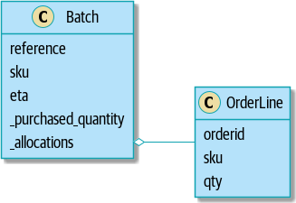
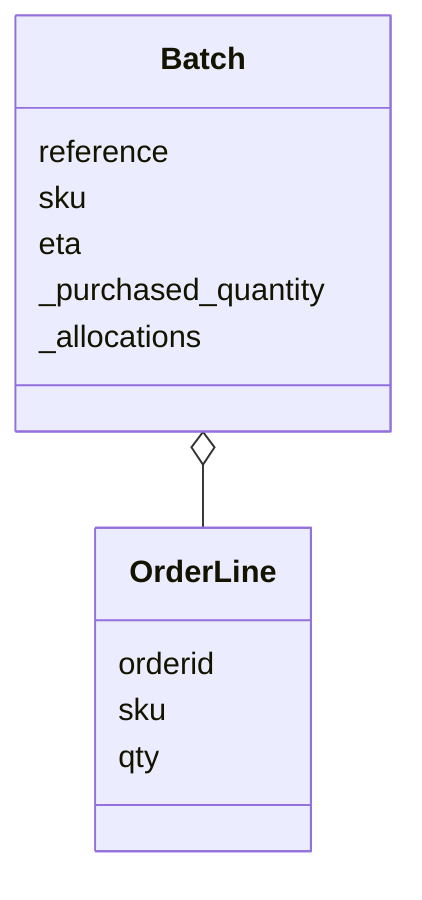
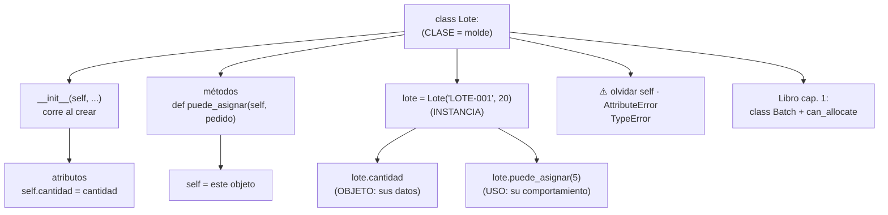

# Lección 06 — Clases y objetos

> Fase 0 · Formulario · Familia de concepto: **la clase** (datos + comportamiento juntos) · Orden de estudio: **7 de 18**
> Usa la **Figura 1-3** del libro (§12).

⬅️ [Lección 05 · Listas y diccionarios](../05-listas-y-diccionarios/) · 🏠 [Índice de lecciones](../README.md) · ➡️ [Lección 07 · Excepciones](../07-excepciones/)

---

## 🧭 Ruta de estudio · Lección 06 (≈ 2.5 h)

**Antes necesitas:** [Lección 04 · Funciones](../04-funciones/) (`def`, `return`) y [Lección 05 · Listas y diccionarios](../05-listas-y-diccionarios/).

| Paso | Qué haces | Dónde | ⏱ |
|:-:|---|---|:-:|
| **0** | Lee la teoría, las tablas de fórmulas, las propiedades y los errores | este README §0–§8 | 35 min |
| **1** | Ejecuta las fórmulas y compara cada línea con la tabla | [`paso1_formulas.py`](paso1_formulas.py) | 10 min |
| **2** | Sigue los ejemplos resueltos línea por línea | §9 + [`paso2_ejemplos_resueltos.py`](paso2_ejemplos_resueltos.py) | 25 min |
| **3** | Completa los `# TODO` | [`paso3_tu_turno.py`](paso3_tu_turno.py) | 25 min |
| **4** | Compara con la solución de referencia | [`paso4_tu_turno_solucion.py`](paso4_tu_turno_solucion.py) | 5 min |
| **5** | Resuelve los 12 problemas **en papel o en un archivo tuyo**, luego revisa claves y solucionario | §10–§11 + [`paso5_solucionario/`](paso5_solucionario/) | 35 min |
| **6** | Compara solución mala vs buena | [`paso6_ejercicios/`](paso6_ejercicios/) | 10 min |
| **7** | Mira la Figura 1-3 y responde las preguntas de recuerdo **sin mirar** | §12 + §15 | 10 min |
| **🚦** | Evalúa si puedes pasar a la siguiente | §16 | 1 min |

---

## 0. 🧭 La pregunta
> *"Tengo un lote como datos sueltos (referencia, sku, cantidad). Me piden que el lote
> sepa decir si **puede asignar** un pedido. Con datos sueltos y funciones aparte, la
> regla se desparrama. ¿Qué hago?"*

## 1. Objetivos (al terminar podrás…)
1. Definir una **clase** con `class` y su `__init__`.
2. Crear **instancias** (objetos) y leer/cambiar sus **atributos**.
3. Escribir **métodos** que usen `self` y llamarlos con `objeto.metodo()`.
4. Seguir la cadena completa **clase → instancia → objeto → uso** sin saltarte pasos.
5. Leer la **Figura 1-3** del libro (UML de `Batch` y `OrderLine`).
6. Reconocer y evitar los errores típicos: olvidar `self`, `AttributeError`, `TypeError`.

## 2. Cita de la fuente
> *"First cut of a domain model for batches (model.py)"* — Cap. 1

> *"def __init__( self, ref: str, sku: str, qty: int, eta: Optional[date] ): self.reference = ref self.sku = sku"* — Cap. 1

> *"def can_allocate(self, line: OrderLine) -> bool: … return self.sku == line.sku and self.available_quantity >= line.qty"* — Cap. 1

**Por qué importa:** el primer modelo de dominio del libro es una **clase** `Batch` (nuestro
`Lote`). Su `__init__` guarda los datos con `self.reference = ref`, y su **método**
`can_allocate` usa esos datos para decidir. Es exactamente lo que aprendes aquí.

## 3. El dolor
```python
referencia = "LOTE-001"          # datos sueltos de UN lote
cantidad = 20

def puede_asignar(cantidad, pedido):   # la regla vive APARTE de los datos
    return cantidad >= pedido

# ¿Y con 3 lotes? referencia2, cantidad2, referencia3, cantidad3...
# Y en cada llamada tengo que acordarme de pasar el dato correcto.
```
Los datos y la regla que los usa están **separados**: hay que pasarlos a mano, se
mezclan entre lotes y la regla se copia por todos lados.

---

## 4. 📘 Teoría

> **🏭 Definición — Clase**
> Una **clase** es un **molde** que describe qué **datos** (atributos) y qué **acciones**
> (métodos) tendrá cada objeto. No es un lote: es la *receta* para hacer lotes.
> ```python
> class Lote:
>     def __init__(self, referencia, cantidad):
>         self.referencia = referencia
>         self.cantidad = cantidad
> ```

> **📦 Definición — Instancia / objeto**
> Una **instancia** es un **objeto concreto** hecho con el molde: `lote = Lote("LOTE-001", 20)`.
> Cada objeto tiene **sus propios** datos.

> **🪞 Definición — `self`**
> `self` significa **"este objeto"**. Dentro de la clase, `self.cantidad` es *la cantidad
> de este lote en particular*. Al llamar `lote.puede_asignar(5)`, Python pasa `lote` como
> `self` **automáticamente**.

> **🔤 Vocabulario**
> - **Atributo:** un dato guardado dentro del objeto (`self.cantidad`).
> - **Método:** una función que vive dentro de la clase; su primer parámetro es `self`.
> - **`__init__`:** el método especial que corre **al crear** cada objeto (el "constructor").
> - **Estado:** los valores que tienen los atributos de un objeto en este momento.
> - **`and`:** une dos condiciones; el resultado es `True` solo si **las dos** son `True`.

> **🧠 Regla de oro**
> Si unos **datos** y las **reglas** que los usan siempre van juntos, ponlos en **una clase**.

---

## 5. 🧮 Formulario: clases y objetos
Con la clase `Lote(referencia, sku, cantidad)` de [`paso1_formulas.py`](paso1_formulas.py):

| # | Operación | Sintaxis | Ejemplo | Resultado |
|---|---|---|---|---|
| C1 | Definir la clase | `class Nombre:` | `class Lote:` | — (es el molde) |
| C2 | Constructor | `def __init__(self, ...):` | `def __init__(self, referencia, sku, cantidad):` | corre al crear cada objeto |
| C3 | Guardar un atributo | `self.atributo = valor` | `self.cantidad = cantidad` | el dato queda **dentro** del objeto |
| C4 | Crear una instancia | `obj = Clase(args)` | `lote = Lote("LOTE-001", "MESA", 20)` | un objeto concreto (sin escribir `self`) |
| C5 | Leer un atributo | `obj.atributo` | `lote.cantidad` | `20` |
| C6 | Cambiar un atributo | `obj.atributo = v` | `lote.sku = "MESA-GRANDE"` | `lote.sku` vale `'MESA-GRANDE'` |
| C7 | Definir un método | `def metodo(self, ...):` | `def puede_asignar(self, pedido): return self.cantidad >= pedido` | — |
| C8 | Llamar un método | `obj.metodo(args)` | `lote.puede_asignar(5)` / `(25)` | `True` / `False` |
| C9 | Método que cambia el estado | `self.atributo = ...` | `lote.asignar(5)` | `lote.cantidad` pasa de `20` a `15` |
| C10 | Instancias independientes | dos `Clase(...)` | `otro = Lote("LOTE-002", "SILLA", 50)` | `lote.cantidad` / `otro.cantidad` → `15` / `50` |
| C11 | Método que usa otro método | `self.otro(...)` | `asignar` llama a `self.puede_asignar(pedido)` | `lote.asignar(100)` no cambia nada (`15`) |
| C12 | ¿Es de esta clase? | `isinstance(obj, Clase)` | `isinstance(lote, Lote)` / `isinstance(5, Lote)` | `True` / `False` |
| C13 | ¿De qué clase es? | `type(obj)` | `type(lote).__name__` | `'Lote'` |
| C14 | Objetos en una lista | `for o in lista: o.metodo()` | `for l in [lote, otro]: l.puede_asignar(30)` | `False` / `True` |
| C15 | Imprimir el objeto | `print(obj)` | `print(lote)` | `<__main__.Lote object at 0x…>` (normal) |

> 💡 Todas estas fórmulas están ejecutables en [`paso1_formulas.py`](paso1_formulas.py),
> con su código (C1, C2…) en cada línea de salida.

## 6. 🧮 Formulario de apoyo: clase → instancia → objeto → uso (sin recortar pasos)
| Paso | Nombre | Código | Qué existe después |
|:-:|---|---|---|
| 1 | **Clase** (molde) | `class Lote:` + `def __init__(self, referencia, cantidad): ...` | la *receta*; todavía **no hay** ningún lote |
| 2 | **Instancia** (crear) | `lote = Lote("LOTE-001", 20)` | Python crea un objeto vacío, llama a `__init__(objeto, "LOTE-001", 20)` y lo guarda en `lote` |
| 3 | **Objeto** (sus datos) | `lote.referencia`, `lote.cantidad` | un lote concreto con `referencia='LOTE-001'` y `cantidad=20` |
| 4 | **Uso** (comportamiento) | `lote.puede_asignar(5)` | Python ejecuta `Lote.puede_asignar(lote, 5)` → `True` |

| | Función suelta (Lección 04) | Método (esta lección) |
|---|---|---|
| Dónde vive | afuera, sola | **dentro** de una clase |
| Cómo recibe los datos | se los pasas todos: `puede_asignar(cantidad, 5)` | ya los tiene en `self`: `lote.puede_asignar(5)` |
| Cómo se llama | `funcion(args)` | `objeto.metodo(args)` |
| Cuándo usarla | operación que no es "de" ninguna cosa (el `allocate` del cap. 1) | operación que pertenece a un objeto (`can_allocate` de `Batch`) |

## 7. 📐 Propiedades
| # | Propiedad |
|---|---|
| **P1** | Definir la clase **no crea** ningún objeto; cada `Clase(...)` crea **uno nuevo**. |
| **P2** | `__init__` se ejecuta **una vez por cada objeto**, justo al crearlo. |
| **P3** | Cada objeto tiene **sus propios** atributos: cambiar uno no toca a los demás. |
| **P4** | Todo método recibe `self` **primero**, pero al llamarlo **no** lo escribes: Python lo pasa solo. |
| **P5** | Dentro de la clase, los atributos se usan **siempre** con `self.` (`self.cantidad`, no `cantidad`). |
| **P6** | Un método puede **leer** el estado (devolver algo) o **cambiarlo** (asignar a `self.algo`). |
| **P7** | Por convención, las clases se nombran en **MayúsculaInicial** (`Lote`, `LineaPedido`) y los objetos en minúscula (`lote`). |

## 8. ⚠️ Errores frecuentes
| # | ❌ Así no | Qué pasa | ✅ Así sí |
|---|---|---|---|
| E1 | `def puede_asignar(pedido):` (sin `self`) y luego `lote.puede_asignar(5)` | `TypeError: Lote.puede_asignar() takes 1 positional argument but 2 were given` | `def puede_asignar(self, pedido):` |
| E2 | En `__init__`: `cantidad = cantidad` (sin `self.`) y luego `lote.cantidad` | `AttributeError: 'Lote' object has no attribute 'cantidad'` | `self.cantidad = cantidad` |
| E3 | `Lote("L1")` (faltan datos) | `TypeError: Lote.__init__() missing 2 required positional arguments: 'sku' and 'cantidad'` | pasa todos los argumentos de `__init__` (menos `self`) |
| E4 | `print(lote.puede_asignar)` (sin paréntesis) | no revienta, pero muestra `<bound method Lote.puede_asignar of …>`: **no lo llamaste** | `lote.puede_asignar(5)` |
| E5 | `Lote.cantidad` (usar el molde en vez del objeto) | `AttributeError: type object 'Lote' has no attribute 'cantidad'` | `lote.cantidad` (la instancia) |
| E6 | Escribir `def _init_(...)` (un guion bajo) y luego `Lote("L1", "MESA", 20)` | `TypeError: Lote() takes no arguments` | `__init__`: **dos** guiones bajos a cada lado |

> 🔬 Pruébalos: al final de [`paso1_formulas.py`](paso1_formulas.py) están E2, E3, E4 y
> E5 comentados. Quita el `#` de **uno**, ejecuta, lee el mensaje y vuelve a ponerlo.

---

## 9. ✍️ Ejemplos resueltos (paso a paso)
> Todos están en [`paso2_ejemplos_resueltos.py`](paso2_ejemplos_resueltos.py).

**Ejemplo 1 — Clase → instancia → objeto → uso** *(fácil)*
> Enunciado: representa un producto con nombre y precio, y muestra sus datos.
```python
class Producto:                          # Paso 1: CLASE = el molde (C1)
    def __init__(self, nombre, precio):  # Paso 2: __init__ recibe los datos (C2)
        self.nombre = nombre             # Paso 3: guardarlos DENTRO (C3)
        self.precio = precio

mesa = Producto("mesa", 120)             # Paso 4: INSTANCIA concreta (C4)
print(mesa.nombre)                       # Paso 5: OBJETO en uso: leer (C5) -> mesa
print(mesa.precio)                       #                                -> 120
```

**Ejemplo 2 — Un método que usa los datos del objeto** *(fácil)*
> Enunciado: un rectángulo que sepa calcular su área.
```python
class Rectangulo:
    def __init__(self, base, altura):
        self.base = base
        self.altura = altura

    def area(self):                      # Paso 1: método; usa self.base y self.altura (C7)
        return self.base * self.altura

r = Rectangulo(3, 4)                     # Paso 2: crear
print(r.area())                          # Paso 3: llamar al método (C8) -> 12
```

**Ejemplo 3 — Un método que cambia el estado** *(intermedio)*
> Enunciado: un lote de 20 recibe pedidos de 5, 30 y 15; solo asigna si alcanza.
```python
class Lote:
    def __init__(self, referencia, cantidad):
        self.referencia = referencia
        self.cantidad = cantidad

    def puede_asignar(self, pedido):
        return self.cantidad >= pedido

    def asignar(self, pedido):                       # usa OTRO método (C11)
        if self.puede_asignar(pedido):
            self.cantidad = self.cantidad - pedido   # cambia el estado (C9)

lote = Lote("LOTE-001", 20)
for pedido in [5, 30, 15]:
    lote.asignar(pedido)
    print("pedido", pedido, "-> queda", lote.cantidad)
```
Traza del **estado** del objeto:

| vuelta | `pedido` | `self.puede_asignar(pedido)` | `lote.cantidad` después |
|---|---|---|---|
| 1 | `5` | `20 >= 5` → `True` | `15` |
| 2 | `30` | `15 >= 30` → `False` | `15` (no cambia) |
| 3 | `15` | `15 >= 15` → `True` | `0` |

**Ejemplo 4 — Dos clases como en la Figura 1-3 del libro** *(avanzado)*
> Enunciado: un lote **guarda** las líneas de pedido que se le asignan (el rombo de la
> Figura 1-3), y calcula cuánto le queda disponible.
```python
class LineaPedido:                       # = OrderLine: orderid, sku, qty
    def __init__(self, id_pedido, sku, cantidad):
        self.id_pedido = id_pedido
        self.sku = sku
        self.cantidad = cantidad

class LoteConAsignaciones:               # = Batch: reference, sku, _purchased_quantity, _allocations
    def __init__(self, referencia, sku, cantidad_comprada):
        self.referencia = referencia
        self.sku = sku
        self.cantidad_comprada = cantidad_comprada
        self.asignaciones = []           # Paso 1: una LISTA de LineaPedido (el rombo de la figura)

    def cantidad_disponible(self):       # Paso 2: se CALCULA recorriendo las asignaciones
        asignado = 0
        for linea in self.asignaciones:
            asignado = asignado + linea.cantidad
        return self.cantidad_comprada - asignado

    def puede_asignar(self, linea):      # Paso 3: mismo sku Y alcanza (como can_allocate)
        return self.sku == linea.sku and self.cantidad_disponible() >= linea.cantidad

    def asignar(self, linea):            # Paso 4: si puede, guarda la línea dentro del lote
        if self.puede_asignar(linea):
            self.asignaciones.append(linea)

lote = LoteConAsignaciones("LOTE-001", "MESA", 20)
lote.asignar(LineaPedido("pedido-1", "MESA", 8))
lote.asignar(LineaPedido("pedido-2", "SILLA", 3))   # otro sku: no se asigna
lote.asignar(LineaPedido("pedido-3", "MESA", 5))
print("líneas asignadas:", len(lote.asignaciones))  # -> 2
print("disponible:", lote.cantidad_disponible())     # -> 7
```
`20 - (8 + 5) = 7`. La línea de `"SILLA"` no entra porque `self.sku == linea.sku` es `False`.

---

## 10. 📝 Problemas propuestos
> Resuélvelos **antes** de mirar las claves. Puedes crear tu propio archivo, por ejemplo
> `mis_problemas.py`, en esta carpeta.

**🟢 Nivel básico**
1. Define la clase `Perro` con el atributo `nombre`. Crea `firulais = Perro("Firulais")` e imprime su nombre.
2. Define `Rectangulo(base, altura)` con el método `area()`. Imprime el área de `Rectangulo(3, 4)`.
3. Define `Producto(nombre, precio)`. Crea un lápiz de 2 y un cuaderno de 8 e imprime ambos precios.
4. Cambia el precio del lápiz a 3 **desde afuera** e imprímelo.

**🟡 Nivel intermedio**

5. Define `Cuenta(saldo)` con el método `depositar(monto)`. Empieza con 100, deposita 50 e imprime el saldo.
6. Agrega a `Cuenta` el método `retirar(monto)` que **solo** retire si alcanza y devuelva `True` o `False`. Imprime el resultado y el saldo al retirar 30 y luego 500.
7. Crea una **lista** con 3 productos (pan 1, leche 4, queso 9). Recórrela imprimiendo nombre y precio, y al final el total.
8. Imprime `isinstance(productos[0], Producto)` e `isinstance("pan", Producto)`.

**🔴 Nivel avanzado**

9. Define `Lote(referencia, cantidad)` con `puede_asignar(pedido)` y `asignar(pedido)`, donde `asignar` **use** a `puede_asignar`. Con un lote de 10, asigna 4 y luego 8. ¿Cuánto queda?
10. Define `Carrito` que empiece con una lista vacía `items`, con `agregar(producto)` y `total()`. Agrega pan (1) y leche (4); imprime cuántos ítems hay y el total.
11. Define `Contador` con `valor` en 0 y `incrementar()`. Crea `a` y `b`; incrementa `a` dos veces y `b` una. Imprime ambos.
12. *(Puente al libro)* Define `LineaPedido(id_pedido, sku, cantidad)` y un lote con `puede_asignar(linea)` que devuelva `self.sku == linea.sku and self.cantidad_disponible >= linea.cantidad`, como `can_allocate` del cap. 1. Con un lote `"SMALL-TABLE"` de 20, prueba: 2 de `"SMALL-TABLE"`, 2 de `"BLUE-CUSHION"` y 25 de `"SMALL-TABLE"`.

## 11. 🔑 Claves (respuestas)
<details><summary>Ver claves (solo después de intentarlo)</summary>

| # | Salida esperada | Fórmula clave |
|---|---|---|
| 1 | `Firulais` | C1–C5 |
| 2 | `12` | C7 + C8 |
| 3 | `2 8` | C10 |
| 4 | `3` | C6 |
| 5 | `150` | C9 |
| 6 | `True 120` y luego `False 120` | C9 + método que devuelve booleano |
| 7 | `pan 1` / `leche 4` / `queso 9` y `total 14` | C14 |
| 8 | `True False` | C12 |
| 9 | `6` (el pedido de 8 no alcanzaba) | C11 |
| 10 | `2 5` | objeto con una lista dentro |
| 11 | `2 1` | C10 |
| 12 | `True False False` | `can_allocate` del libro |

El código completo de cada solución está en [`paso5_solucionario/`](paso5_solucionario/):
[`nivel_basico.py`](paso5_solucionario/nivel_basico.py) ·
[`nivel_intermedio.py`](paso5_solucionario/nivel_intermedio.py) ·
[`nivel_avanzado.py`](paso5_solucionario/nivel_avanzado.py).
</details>

---

## 12. 🖼️ Figura del libro + 🗺️ mapa mental

### 12.a Figura 1-3 del libro — *"Our model in UML"*


> *"Figure 1-3. Our model in UML Now we’re getting somewhere! A batch now keeps track of a set of allocated OrderLine objects."* — Cap. 1

Reproducción fiel en Mermaid (mismas clases, mismos atributos, mismo rombo):

**Cómo leerla:**
1. Cada **caja** es una **clase**; dentro están sus **atributos** (los `self.algo` del `__init__`).
2. `Batch` es nuestro `Lote` y `OrderLine` es nuestra `LineaPedido`.
3. El **rombo vacío** del lado de `Batch` es una **agregación**: un `Batch` **contiene** líneas de pedido
   (las guarda en `_allocations`). Es lo que hace el Ejemplo 4 con `self.asignaciones = []`.
4. El guion bajo de `_purchased_quantity` y `_allocations` indica "uso interno"; eso se estudia
   en la [Lección 09 · Encapsulación](../09-encapsulacion/).

### 12.b Mapa mental

**Cómo leerlo:** de la **clase** salen sus dos partes (atributos vía `__init__` y métodos).
Al crear una **instancia** obtienes un **objeto** con datos propios que puedes **usar**
llamando a sus métodos. La hoja de abajo conecta con la clase real del libro.

## 13. 🌳 Árbol de archivos
```
lecciones/06-clases-y-objetos/
├── README.md                    ← PASO 0 · EMPIEZA AQUÍ (este formulario)
├── paso1_formulas.py            ← PASO 1 · las fórmulas C1–C15, ejecutables
├── paso2_ejemplos_resueltos.py  ← PASO 2 · los 4 ejemplos resueltos
├── paso3_tu_turno.py            ← PASO 3 · completa los # TODO
├── paso4_tu_turno_solucion.py   ← PASO 4 · solución de referencia
├── paso5_solucionario/          ← PASO 5 · soluciones de los 12 problemas
│   ├── nivel_basico.py
│   ├── nivel_intermedio.py
│   └── nivel_avanzado.py
├── paso6_ejercicios/            ← PASO 6 · solución mala vs buena
│   ├── ejercicio-1/ … ejercicio-3/
│   └── ejercicio-4-reto/
└── imagenes/
    └── fig-1-3.png              ← la Figura 1-3 original del libro (§12)
```

## 14. 🤝 Tu turno y ✅ comprobación
`pytest` llega en la [Lección 08](../08-modulos-y-pytest/), así que aquí se comprueba
**ejecutando y comparando** con la salida esperada:
```bash
uv run python lecciones/06-clases-y-objetos/paso3_tu_turno.py
# compara con la "Salida esperada" del final de ese archivo
git diff --no-index lecciones/06-clases-y-objetos/paso3_tu_turno.py lecciones/06-clases-y-objetos/paso4_tu_turno_solucion.py
```

## 15. ❓ Preguntas de recuerdo
> Respóndelas **sin mirar**; luego abre cada una para comprobar.

<details><summary>1. ¿Qué diferencia hay entre la clase <code>Lote</code> y la instancia <code>lote</code>?</summary>

`Lote` es el **molde** (la receta); `lote` es **un objeto concreto** hecho con ese molde, con sus propios datos.
</details>
<details><summary>2. ¿Qué es <code>self</code>?</summary>

"Este objeto": el objeto sobre el que se está ejecutando el método. Python lo pasa solo al llamar `lote.metodo()`.
</details>
<details><summary>3. ¿Cuándo se ejecuta <code>__init__</code>?</summary>

Una vez por cada objeto, en el momento de crearlo con `Clase(...)`.
</details>
<details><summary>4. ¿Qué diferencia hay entre un método y una función suelta?</summary>

El método vive **dentro** de la clase y ya tiene los datos en `self`; la función suelta vive afuera y hay que pasarle todos los datos.
</details>
<details><summary>5. Si escribes <code>cantidad = cantidad</code> en vez de <code>self.cantidad = cantidad</code>, ¿qué pasa?</summary>

El dato no se guarda en el objeto; al leer `lote.cantidad` sale `AttributeError: 'Lote' object has no attribute 'cantidad'`.
</details>
<details><summary>6. En la Figura 1-3, ¿qué significa el rombo entre <code>Batch</code> y <code>OrderLine</code>?</summary>

**Agregación**: un `Batch` contiene (guarda) varias `OrderLine` en su atributo `_allocations`.
</details>

---

## 16. 🚦 ¿Puedo pasar a la siguiente lección?
| Indicador | Criterio |
|:-:|---|
| 🟢 **Sí, sigue** | `paso3_tu_turno.py` da la salida esperada **y** aciertas **≥ 9 de 12** problemas **y** respondes las 6 preguntas sin mirar |
| 🟡 **Repasa** | aciertas **6 a 8** → vuelve a §8 (errores frecuentes) y §9 (ejemplos resueltos) y reintenta los que fallaste |
| 🔴 **Repite la lección** | aciertas **menos de 6** → empieza otra vez desde el Paso 0 |

Cuando estés en 🟢, marca la lección en
[`progreso/fase-0-python.md`](../../progreso/fase-0-python.md) (sección *"Mi avance"*) y haz
commit; así también practicas Git.

---

⬅️ [Lección 05 · Listas y diccionarios](../05-listas-y-diccionarios/) · 🏠 [Índice de lecciones](../README.md) · ➡️ [Lección 07 · Excepciones](../07-excepciones/)
