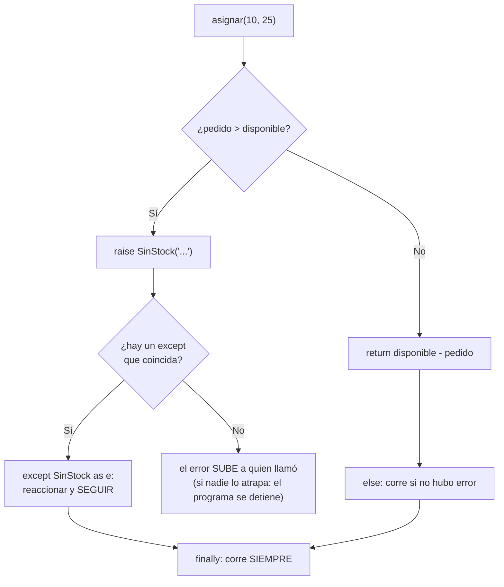

# Lección 07 — Excepciones

> Fase 0 · Formulario · Familia de concepto: **señalar y manejar errores** (`raise`, `try`/`except`) · Orden de estudio: **8 de 18**

⬅️ [Lección 06 · Clases y objetos](../06-clases-y-objetos/) · 🏠 [Índice de lecciones](../README.md) · ➡️ [Lección 08 · Módulos, uv y pytest](../08-modulos-y-pytest/)

---

## 🧭 Ruta de estudio · Lección 07 (≈ 2 h)

**Antes necesitas:** [Lección 02 · Condicionales](../02-condicionales/) (`if`) y [Lección 06 · Clases y objetos](../06-clases-y-objetos/) (`class`).

| Paso | Qué haces | Dónde | ⏱ |
|:-:|---|---|:-:|
| **0** | Lee la teoría, las tablas de fórmulas, las propiedades y los errores | este README §0–§8 | 25 min |
| **1** | Ejecuta las fórmulas y compara cada línea con la tabla | [`paso1_formulas.py`](paso1_formulas.py) | 10 min |
| **2** | Sigue los ejemplos resueltos línea por línea | §9 + [`paso2_ejemplos_resueltos.py`](paso2_ejemplos_resueltos.py) | 20 min |
| **3** | Completa los `# TODO` | [`paso3_tu_turno.py`](paso3_tu_turno.py) | 20 min |
| **4** | Compara con la solución de referencia | [`paso4_tu_turno_solucion.py`](paso4_tu_turno_solucion.py) | 5 min |
| **5** | Resuelve los 12 problemas **en papel o en un archivo tuyo**, luego revisa claves y solucionario | §10–§11 + [`paso5_solucionario/`](paso5_solucionario/) | 30 min |
| **6** | Compara solución mala vs buena | [`paso6_ejercicios/`](paso6_ejercicios/) | 10 min |
| **7** | Responde las preguntas de recuerdo **sin mirar** | §15 | 5 min |
| **🚦** | Evalúa si puedes pasar a la siguiente | §16 | 1 min |

---

## 0. 🧭 La pregunta
> *"Mi función resta stock. Me piden que, si piden más de lo que hay, avise un error
> **claro** en vez de devolver un número raro (como `-15`). ¿Cómo señalo un error y cómo
> hago que el programa reaccione sin caerse?"*

## 1. Objetivos (al terminar podrás…)
1. **Lanzar** un error con `raise`.
2. **Atraparlo** con `try` / `except` y leer su mensaje con `as e`.
3. Crear **tus propios errores** con nombre del negocio (`SinStock`), como el libro.
4. Usar **varios `except`**, `else` y `finally`.
5. Reconocer los errores incorporados más comunes (`ValueError`, `KeyError`, `IndexError`, `ZeroDivisionError`…).
6. Entender cómo un error **sube** (se propaga) desde una función hasta quien la llamó.

## 2. Cita de la fuente
> *"class OutOfStock(Exception): pass"* — Cap. 1, *Exceptions Can Express Domain Concepts Too*

> *"raise OutOfStock(f'Out of stock for sku {line.sku}')"* — Cap. 1

**Por qué importa:** el libro no devuelve un valor raro cuando no hay stock: **lanza** un
error con **nombre del dominio**, `OutOfStock` (nuestro `SinStock`). El título de la sección
lo dice todo: *las excepciones también pueden expresar conceptos del negocio*.

## 3. El dolor
```python
def asignar(disponible, pedido):
    return disponible - pedido

print(asignar(10, 25))   # -15  ¿stock negativo? El programa sigue como si nada...
                         # ...y el error aparece mucho después, lejos de su causa.
```
Un resultado "raro" **esconde** el problema. Una excepción lo **detiene y lo nombra**
justo donde ocurre.

---

## 4. 📘 Teoría

> **🚨 Definición — Excepción**
> Una **excepción** es una **señal de error** que interrumpe el flujo normal del
> programa. Si nadie la atrapa, el programa se **detiene** y muestra el error.
> ```python
> raise ValueError("cantidad inválida")    # LANZAR
> ```

> **🛟 Definición — `try` / `except`**
> `try` marca el código que **puede fallar**; `except` dice **qué hacer** si falla con
> cierto tipo de error. Así el programa reacciona y **sigue**.
> ```python
> try:
>     asignar(10, 25)
> except SinStock as e:
>     print("No se pudo:", e)
> ```

> **🏷️ Definición — Excepción propia**
> Puedes crear tu propio tipo de error, con un nombre del negocio:
> `class SinStock(Exception): pass`. El `(Exception)` significa *"es un tipo de error"*
> (cómo funciona por dentro lo verás en la [Lección 10 · Herencia](../10-herencia/)).

> **🔤 Vocabulario**
> - **Lanzar (`raise`):** provocar el error a propósito.
> - **Atrapar (`except`):** reaccionar al error para que el programa no se caiga.
> - **Mensaje:** el texto que acompaña al error; se lee con `except Tipo as e: print(e)`.
> - **Propagar:** si una función no atrapa el error, este **sube** a quien la llamó.
> - **`str(numero)`:** convierte un número en texto para unirlo con `+` (`"pedido " + str(25)`).

> **🧠 Regla de oro**
> Si algo **no se puede hacer**, no devuelvas un valor inventado: **lanza** un error con nombre claro.
> Atrápalo **solo** donde sepas qué hacer con él, y atrapa el **tipo concreto**, no "cualquier cosa".

---

## 5. 🧮 Formulario: excepciones

| # | Operación | Sintaxis | Ejemplo | Resultado |
|---|---|---|---|---|
| X1 | Lanzar | `raise Tipo("mensaje")` | `raise ValueError("cantidad inválida")` | se interrumpe el flujo |
| X2 | Atrapar | `try: … except Tipo:` | `except ValueError: print("atrapado")` | `atrapado un ValueError` |
| X3 | Leer el mensaje | `except Tipo as e: print(e)` | `print("mensaje:", e)` | `mensaje: cantidad inválida` |
| X4 | Error propio | `class Nombre(Exception): pass` | `class SinStock(Exception): pass` | un tipo de error nuevo |
| X5 | Lanzar el propio | `raise Nombre("msg")` | `asignar(10, 25)` | `SinStock: No hay stock suficiente` |
| X6 | Varios `except` | `except A: … except B: …` | `convertir_y_dividir("4" / "abc" / "0")` | `25.0` / `no es un número` / `no se puede dividir entre 0` |
| X7 | `else` | `try: … except: … else: …` | `asignar(10, 4)` sin error | `else, quedan: 6` |
| X8 | `finally` | `… finally: …` | (con o sin error) | `finally: siempre me ejecuto` |
| X9 | `KeyError` (diccionario) | `d[clave_que_no_existe]` | `stock["cama"]` | `KeyError` → mensaje `'cama'` |
| X10 | `IndexError` (lista) | `lista[i_fuera_de_rango]` | `productos[5]` | `list index out of range` |
| X11 | `ZeroDivisionError` | `x / 0` | `10 / 0` | `division by zero` |
| X12 | `ValueError` al convertir | `int("texto")` | `int("abc")` | `invalid literal for int() with base 10: 'abc'` |
| X13 | Nombre del tipo de error | `type(e).__name__` | en `except SinStock as e` | `SinStock` |
| X14 | Propagación | función sin `try` llamada dentro de un `try` | `procesar(50)` | el error sube desde `asignar()` hasta el `except` |
| X15 | Seguir después | código después del `try` | `print("sigo ejecutándome")` | el programa **no** se cae |

> 💡 Todas estas fórmulas están ejecutables en [`paso1_formulas.py`](paso1_formulas.py),
> con su código (X1, X2…) en cada línea de salida.

## 6. 🧮 Formulario de apoyo: errores incorporados más comunes (cuándo aparece cada uno)
| Error | Cuándo aparece | Ejemplo | Mensaje real |
|---|---|---|---|
| `ValueError` | el **tipo** es correcto pero el **valor** no sirve | `int("abc")` | `invalid literal for int() with base 10: 'abc'` |
| `KeyError` | la **clave** no existe en el diccionario | `stock["cama"]` | `'cama'` |
| `IndexError` | la **posición** no existe en la lista | `productos[5]` | `list index out of range` |
| `ZeroDivisionError` | dividir entre cero | `10 / 0` | `division by zero` |
| `TypeError` | el **tipo** no sirve para esa operación | `"stock: " + 5` | `can only concatenate str (not "int") to str` |
| `NameError` | usas un nombre que no existe | `print(resto)` sin haberlo creado | `name 'resto' is not defined` |
| `AttributeError` | el objeto no tiene ese atributo (Lección 06) | `lote.precio` | `'Lote' object has no attribute 'precio'` |
| **el tuyo** (`SinStock`) | una regla del **negocio** no se cumple | `asignar(10, 25)` | el mensaje que tú escribas |

## 7. 📐 Propiedades
| # | Propiedad |
|---|---|
| **P1** | Al ejecutarse `raise`, la función **se detiene** en esa línea: nada de lo que sigue corre. |
| **P2** | Dentro del `try`, al primer error se **salta** al `except`; las líneas restantes del `try` **no** corren. |
| **P3** | Se ejecuta el **primer** `except` cuyo tipo coincide; si ninguno coincide, el error sigue subiendo. |
| **P4** | `else` corre **solo** si no hubo error; `finally` corre **siempre** (haya o no error). |
| **P5** | Si nadie atrapa el error, el programa se **detiene** y muestra `Tipo: mensaje`. |
| **P6** | Un error **sube** (se propaga) por las funciones que se llamaron hasta encontrar un `except`. |
| **P7** | `except Exception` atrapa **casi cualquier** error: úsalo con cuidado (ver E1). |

## 8. ⚠️ Errores frecuentes
| # | ❌ Así no | Qué pasa | ✅ Así sí |
|---|---|---|---|
| E1 | `except Exception: pass` para "que no falle" | **esconde** errores reales (hasta un nombre mal escrito) y no te enteras | atrapa el tipo **concreto**: `except SinStock:` |
| E2 | `try: stock["cama"]` … `except ValueError:` | el `except` no coincide: `KeyError: 'cama'` sigue y detiene el programa | atrapa el tipo correcto: `except KeyError:` |
| E3 | `raise SinStockk("x")` (mal escrito o sin definir) | `NameError: name 'SinStockk' is not defined` | define la clase antes y escríbela igual |
| E4 | `raise "error"` (lanzar un texto) | `TypeError: exceptions must derive from BaseException` | lanza una excepción: `raise ValueError("error")` |
| E5 | `return -1` cuando no hay stock | nadie se entera; el `-1` se usa como si fuera stock | `raise SinStock("…")` |
| E6 | Usar `resto` después de un `try` que falló | `NameError: name 'resto' is not defined` | usa el valor en el `else`, o dale un valor antes del `try` |
| E7 | `print(e)` sin haber escrito `as e` | `NameError: name 'e' is not defined` | `except ValueError as e:` |

> 🔬 Pruébalos: al final de [`paso1_formulas.py`](paso1_formulas.py) están comentados un
> `SinStock` sin atrapar, E2, E3 y E4. Quita el `#` de **uno** (o del bloque), ejecuta, lee el
> mensaje y vuelve a ponerlo.

---

## 9. ✍️ Ejemplos resueltos (paso a paso)
> Todos están en [`paso2_ejemplos_resueltos.py`](paso2_ejemplos_resueltos.py).

**Ejemplo 1 — Lanzar y atrapar un `ValueError`** *(fácil)*
> Enunciado: una cantidad negativa no es válida; avísalo con un error y atrápalo.
```python
def validar_cantidad(cantidad):
    if cantidad < 0:                                            # Paso 1: detectar el problema
        raise ValueError("la cantidad no puede ser negativa")  # Paso 2: lanzar (X1)
    return cantidad

try:                                                            # Paso 3: intentar (X2)
    validar_cantidad(-3)
except ValueError as e:                                         # Paso 4: atrapar y leer (X3)
    print("Error:", e)              # -> Error: la cantidad no puede ser negativa
```

**Ejemplo 2 — Atrapar un `KeyError` al leer el stock** *(fácil)*
> Enunciado: consulta el stock de `"mesa"` y `"cama"`; si no existe, avisa sin caerte.
```python
stock = {"mesa": 10, "silla": 25}
for producto in ["mesa", "cama"]:                     # Paso 1: dos consultas
    try:
        print(producto, "->", stock[producto])        # Paso 2: puede fallar
    except KeyError:
        print(producto, "-> no existe")               # Paso 3: reacción (X9)
# -> mesa -> 10 / cama -> no existe
```
(En la Lección 05 lo resolvías con `stock.get("cama", 0)`. Ambas formas son válidas: `get`
cuando hay un valor por defecto razonable; `try/except` cuando "no existe" es un problema.)

**Ejemplo 3 — Error propio + `else` + `finally`** *(intermedio)*
> Enunciado: con 10 unidades, intenta pedidos de 4 y de 25.
```python
class SinStock(Exception):                            # Paso 1: error del negocio (X4)
    pass

def asignar(disponible, pedido):
    if pedido > disponible:
        raise SinStock("pedido de " + str(pedido) + " supera " + str(disponible))  # Paso 2 (X5)
    return disponible - pedido

for pedido in [4, 25]:
    try:
        resto = asignar(10, pedido)                   # Paso 3: intentar
    except SinStock as e:
        print("pedido", pedido, "-> sin stock:", e)   # Paso 4a: falló
    else:
        print("pedido", pedido, "-> quedan", resto)   # Paso 4b: salió bien (X7)
    finally:
        print("pedido", pedido, "-> revisado")        # Paso 5: siempre (X8)
```
Traza:

| `pedido` | ¿lanza? | bloque que corre | salida |
|---|---|---|---|
| `4` | no | `else` y `finally` | `pedido 4 -> quedan 6` / `pedido 4 -> revisado` |
| `25` | sí, `SinStock` | `except` y `finally` | `pedido 25 -> sin stock: pedido de 25 supera 10` / `pedido 25 -> revisado` |

**Ejemplo 4 — Un `allocate` como el del libro** *(avanzado)*
> Enunciado: recorre una lista de lotes y asigna al primero que pueda; si ninguno puede,
> lanza `SinStock` como hace el libro con `OutOfStock`. El programa debe seguir con el
> siguiente pedido.
```python
class Lote:
    def __init__(self, referencia, sku, cantidad):
        self.referencia = referencia
        self.sku = sku
        self.cantidad = cantidad

    def puede_asignar(self, sku, cantidad):
        return self.sku == sku and self.cantidad >= cantidad

def asignar_a_lotes(sku, cantidad, lotes):
    for lote in lotes:                                  # Paso 1: recorrer los lotes
        if lote.puede_asignar(sku, cantidad):
            lote.cantidad = lote.cantidad - cantidad
            return lote.referencia                      # Paso 2: el primero que puede
    raise SinStock("Sin stock para el sku " + sku)      # Paso 3: ninguno pudo (como OutOfStock)

lotes = [Lote("lote-1", "SMALL-FORK", 10), Lote("lote-2", "MESA", 5)]
for sku, cantidad in [("SMALL-FORK", 4), ("MESA", 9), ("MESA", 5)]:
    try:
        print(sku, cantidad, "-> asignado a", asignar_a_lotes(sku, cantidad, lotes))
    except SinStock as e:
        print(sku, cantidad, "->", e)                   # Paso 4: el programa sigue
# -> SMALL-FORK 4 -> asignado a lote-1
# -> MESA 9 -> Sin stock para el sku MESA
# -> MESA 5 -> asignado a lote-2
```
El libro arma el mensaje con `f'Out of stock for sku {line.sku}'` (un *f-string*, otra forma
de meter un valor dentro de un texto); aquí usamos `+`, que ya conoces.

---

## 10. 📝 Problemas propuestos
> Resuélvelos **antes** de mirar las claves. Puedes crear tu propio archivo, por ejemplo
> `mis_problemas.py`, en esta carpeta.

**🟢 Nivel básico**
1. Intenta `int("abc")`; si falla, imprime `no es un número`.
2. Define `dividir(a, b)`. Llama `dividir(10, 0)` y atrapa el error imprimiendo `no se puede dividir entre 0`.
3. Define `validar_edad(edad)` que lance `ValueError("edad negativa")` si `edad < 0`. Llámala con `-5` e imprime el **mensaje** del error.
4. Con `stock = {"mesa": 10}`, intenta leer `stock["cama"]`; si falla, imprime `no existe cama`.

**🟡 Nivel intermedio**

5. Recorre `["5", "abc", "0"]`: convierte cada texto a número e imprime `100 / numero`. Usa **dos** `except` distintos: `no es número` y `división entre cero`.
6. Recorre `["7", "x"]`: intenta `int(texto)`; imprime `ok` + número en el `else`, `error con` + texto en el `except`, y `fin` en el `finally`.
7. Define `SinStock` y `asignar(disponible, pedido)` que la lance si no alcanza. Llama `asignar(10, 25)`, imprime el mensaje, y **después** del `try` imprime `sigo`.
8. Atrapa con `except Exception as e` tres errores (`int("x")`, `{}["k"]`, `[][0]`) e imprime el **nombre del tipo** de cada uno.

**🔴 Nivel avanzado**

9. Define `SaldoInsuficiente` y `retirar(saldo, monto)` que lance `ValueError("monto inválido")` si `monto <= 0` y `SaldoInsuficiente("saldo insuficiente")` si `monto > saldo`. Con saldo 100, prueba montos `30`, `-5` y `500`.
10. Define una clase `Lote(cantidad)` cuyo método `asignar(pedido)` lance `SinStock` si no alcanza. Con un lote de 20, asigna `5`, `30` y `10` sin que el programa se caiga.
11. Define `ProductoNoExiste` y `obtener_stock(stock, nombre)` que **traduzca** el `KeyError` en `ProductoNoExiste("no existe: " + nombre)` (lanza el nuevo error dentro del `except`). Pruébala con `"sofá"`.
12. *(Puente al libro)* Escribe `allocate(sku, cantidad, lotes)` que devuelva la referencia del primer lote con ese `sku` y cantidad suficiente, y si no hay, lance `SinStock("Out of stock for sku " + sku)`, como `raise OutOfStock(f'Out of stock for sku {line.sku}')`. Con un lote `"batch1"` de 10 `"SMALL-FORK"`, asigna 10 y luego 1.

## 11. 🔑 Claves (respuestas)
<details><summary>Ver claves (solo después de intentarlo)</summary>

| # | Salida esperada | Fórmula clave |
|---|---|---|
| 1 | `no es un número` | X12 |
| 2 | `no se puede dividir entre 0` | X11 |
| 3 | `edad negativa` | X1 + X3 |
| 4 | `no existe cama` | X9 |
| 5 | `5 -> 20.0` / `abc -> no es número` / `0 -> división entre cero` | X6 |
| 6 | `ok 7` / `fin` / `error con x` / `fin` | X7 + X8 |
| 7 | `pedido de 25 supera 10` y luego `sigo` | X4 + X5 + X15 |
| 8 | `ValueError` / `KeyError` / `IndexError` | X13 |
| 9 | `30 -> queda 70` / `-5 -> monto inválido` / `500 -> saldo insuficiente` | dos `except` |
| 10 | `asignado 5 queda 15` / `sin stock para pedido 30` / `asignado 10 queda 5` | método que lanza |
| 11 | `no existe: sofá` | `raise` dentro de `except` |
| 12 | `batch1` y luego `Out of stock for sku SMALL-FORK` | `OutOfStock` del libro |

El código completo de cada solución está en [`paso5_solucionario/`](paso5_solucionario/):
[`nivel_basico.py`](paso5_solucionario/nivel_basico.py) ·
[`nivel_intermedio.py`](paso5_solucionario/nivel_intermedio.py) ·
[`nivel_avanzado.py`](paso5_solucionario/nivel_avanzado.py).
</details>

---

## 12. 🗺️ Mapa mental (Mermaid)

**Cómo leerlo:** si la regla no se cumple, `raise` **interrumpe** la función. Python busca un
`except` del mismo tipo: si lo encuentra, el programa reacciona y sigue; si no, el error
**sube**. Si no hubo error, corre el `else`. En ambos casos termina pasando por `finally`.

## 13. 🌳 Árbol de archivos
```
lecciones/07-excepciones/
├── README.md                    ← PASO 0 · EMPIEZA AQUÍ (este formulario)
├── paso1_formulas.py            ← PASO 1 · las fórmulas X1–X15, ejecutables
├── paso2_ejemplos_resueltos.py  ← PASO 2 · los 4 ejemplos resueltos
├── paso3_tu_turno.py            ← PASO 3 · completa los # TODO
├── paso4_tu_turno_solucion.py   ← PASO 4 · solución de referencia
├── paso5_solucionario/          ← PASO 5 · soluciones de los 12 problemas
│   ├── nivel_basico.py
│   ├── nivel_intermedio.py
│   └── nivel_avanzado.py
└── paso6_ejercicios/            ← PASO 6 · solución mala vs buena
    ├── ejercicio-1/ … ejercicio-3/
    └── ejercicio-4-reto/
```

## 14. 🤝 Tu turno y ✅ comprobación
`pytest` llega en la [Lección 08](../08-modulos-y-pytest/) (la siguiente), así que aquí se
comprueba **ejecutando y comparando** con la salida esperada:
```bash
uv run python lecciones/07-excepciones/paso3_tu_turno.py
# compara con la "Salida esperada" del final de ese archivo
git diff --no-index lecciones/07-excepciones/paso3_tu_turno.py lecciones/07-excepciones/paso4_tu_turno_solucion.py
```

## 15. ❓ Preguntas de recuerdo
> Respóndelas **sin mirar**; luego abre cada una para comprobar.

<details><summary>1. ¿Qué hace <code>raise</code>?</summary>

Lanza un error: interrumpe la función en esa línea y el error empieza a subir hasta que alguien lo atrape.
</details>
<details><summary>2. ¿Para qué sirven <code>try</code> y <code>except</code>?</summary>

`try` marca el código que puede fallar; `except` dice qué hacer si falla con cierto tipo de error, para que el programa siga.
</details>
<details><summary>3. ¿Cuál es la diferencia entre <code>else</code> y <code>finally</code>?</summary>

`else` corre solo si **no** hubo error; `finally` corre **siempre**.
</details>
<details><summary>4. ¿Qué pasa si el tipo del <code>except</code> no coincide con el error?</summary>

No lo atrapa: el error sigue subiendo y, si nadie lo atrapa, el programa se detiene.
</details>
<details><summary>5. ¿Por qué <code>raise SinStock(...)</code> es mejor que <code>return -1</code>?</summary>

Porque el error se nota justo donde ocurre y tiene un nombre del negocio; el `-1` pasa desapercibido y se usa como si fuera stock real.
</details>
<details><summary>6. En el libro, ¿qué representa <code>OutOfStock</code>?</summary>

Un error con **nombre del dominio** que se lanza cuando no hay stock para asignar una línea de pedido (nuestro `SinStock`).
</details>

---

## 16. 🚦 ¿Puedo pasar a la siguiente lección?
| Indicador | Criterio |
|:-:|---|
| 🟢 **Sí, sigue** | `paso3_tu_turno.py` da la salida esperada **y** aciertas **≥ 9 de 12** problemas **y** respondes las 6 preguntas sin mirar |
| 🟡 **Repasa** | aciertas **6 a 8** → vuelve a §8 (errores frecuentes) y §9 (ejemplos resueltos) y reintenta los que fallaste |
| 🔴 **Repite la lección** | aciertas **menos de 6** → empieza otra vez desde el Paso 0 |

Cuando estés en 🟢, marca la lección en
[`progreso/fase-0-python.md`](../../progreso/fase-0-python.md) (sección *"Mi avance"*) y haz
commit; así también practicas Git.

---

⬅️ [Lección 06 · Clases y objetos](../06-clases-y-objetos/) · 🏠 [Índice de lecciones](../README.md) · ➡️ [Lección 08 · Módulos, uv y pytest](../08-modulos-y-pytest/)
