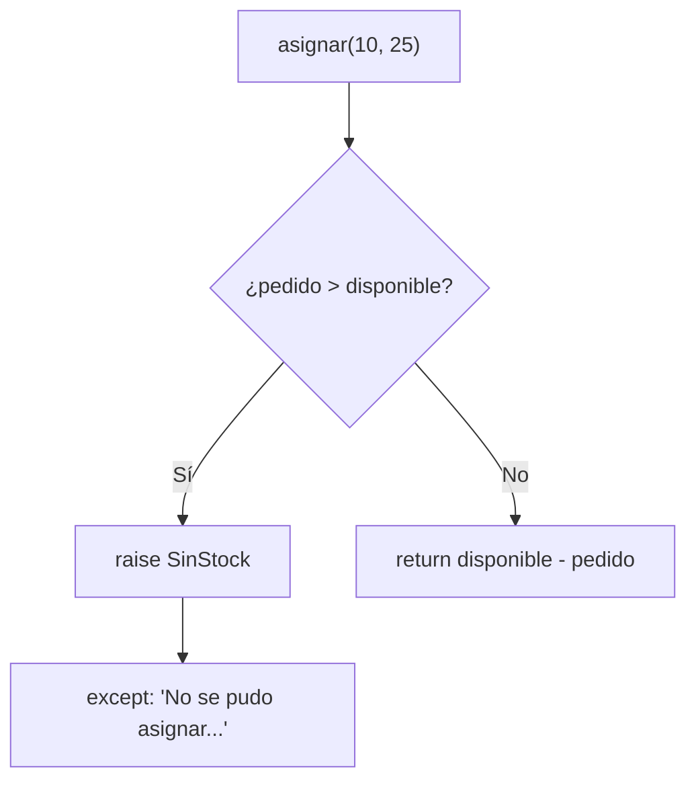

# Lección 07 — Excepciones

> Fase 0 · micro-paso · concepto nuevo: **señalar y manejar errores** (`raise`, `try`/`except`).

## 0. 🧭 La pregunta
> *"Mi función resta stock. Me piden que, si piden más de lo que hay, avise un error
> claro en vez de dar un número raro. ¿Cómo señalo y manejo errores?"*

## 1. Objetivo
Lanzar excepciones con `raise` y manejarlas con `try`/`except`.

## 2. Cita de la fuente
> *"class OutOfStock(Exception):"* / *"raise OutOfStock(f'Out of stock for sku {line.sku}')"*
> — Cap. 1, *Exceptions Can Express Domain Concepts Too*

El libro usa excepciones con nombre del dominio (`OutOfStock` = nuestro `SinStock`).

## 3. El dolor / necesidad
Devolver un valor inventado cuando no hay stock oculta el problema; una excepción lo
señala de forma explícita.

## 4. Explicación paso a paso
1. Definir el error: `class SinStock(Exception):`.
2. Lanzarlo: `raise SinStock("No hay stock suficiente")`.
3. Manejarlo: `try:` … `except SinStock as error:`.
4. Si no hay error, el programa sigue normal.

Ver [`excepciones.py`](excepciones.py). Ejecutar:
```bash
uv run python lecciones/07-excepciones/excepciones.py
```

## 5. Diagrama (Mermaid)

El `raise` hace "saltar" el flujo hacia el `except`; si no, sigue y devuelve el resultado.

## 6. Árbol de archivos
```
lecciones/07-excepciones/
├── README.md
└── excepciones.py
```

## 7. Tu turno
Maneja también el caso de pedir una cantidad negativa lanzando otra excepción.

## 8. Comprobación
Sin pytest aún (se introduce en la Lección 08). Se comprueba ejecutando y viendo la salida.

## 9. Preguntas de recuerdo
1. ¿Qué hace `raise`?
2. ¿Para qué sirve `try`/`except`?
3. ¿Por qué una excepción con nombre (`SinStock`) es mejor que devolver un número raro?
