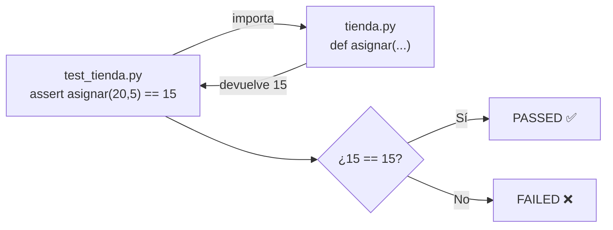

# Lección 08 — Módulos, entorno con `uv` y primer `pytest`

> Fase 0 (cierre) · conceptos nuevos: **import entre módulos** y **pruebas con pytest**.

## 0. 🧭 La pregunta
> *"Me piden reutilizar una función desde otro archivo y comprobar automáticamente
> que funciona, sin revisarla a ojo. ¿Cómo lo hago?"*

## 1. Objetivo
Reutilizar código con `import` y comprobarlo con **pytest** (`assert`).

## 2. Cita de la fuente
> *"We use TDD at work, so we tend to show listings of tests first, followed by
> implementation."* — Preface → *Who Should Read This Book*

## 3. El dolor / necesidad
Ejecutar a mano y revisar a ojo no escala; necesito reutilizar código y comprobarlo
automáticamente.

## 4. Explicación paso a paso
1. Módulo: `tienda.py` con la función `asignar(disponible, pedido)`.
2. Import: `from tienda import asignar` trae la función desde otro archivo.
3. Prueba: función `test_...` con `assert valor == esperado`.
4. Instalar y correr pytest con uv:
   ```bash
   uv add --dev pytest
   uv run pytest lecciones/08-modulos-y-pytest/ -v
   ```
   Resultado: `2 passed` (en Python 3.12).

## 5. Diagrama (Mermaid)

La prueba importa, ejecuta con datos conocidos y afirma el resultado. Coincide → PASSED.

## 6. Árbol de archivos
```
lecciones/08-modulos-y-pytest/
├── README.md
├── tienda.py          # el módulo (código reutilizable)
└── test_tienda.py     # sus pruebas (pytest)
```

## 7. Tu turno
Agrega una prueba `test_asignar_todo_el_stock` que afirme `asignar(10, 10) == 0`.

## 8. Comprobación
¡Aquí sí hay pytest! `uv run pytest` debe mostrar todo en verde (`passed`).

## 9. Preguntas de recuerdo
1. ¿Qué hace `import`?
2. ¿Qué significa `assert`?
3. ¿Qué ventaja tiene pytest frente a revisar la salida a ojo?
