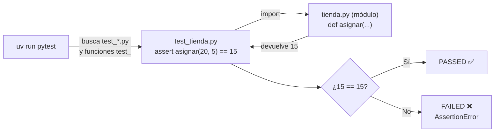

# Lección 08 — Módulos, entorno con `uv` y primer `pytest`

> Fase 0 · Formulario · Familia de concepto: **reutilizar código entre archivos** (`import`) y **comprobarlo automáticamente** (`pytest`) · Orden de estudio: **9 de 18**

⬅️ [Lección 07 · Excepciones](../07-excepciones/) · 🏠 [Índice de lecciones](../README.md) · ➡️ [Lección 09 · Encapsulación](../09-encapsulacion/)

---

## 🧭 Ruta de estudio · Lección 08 (≈ 2.5 h)

**Antes necesitas:** [Lección 04 · Funciones](../04-funciones/) y [Lección 07 · Excepciones](../07-excepciones/) (`raise`, `try`/`except`).

| Paso | Qué haces | Dónde | ⏱ |
|:-:|---|---|:-:|
| **0** | Lee la teoría, las tablas de fórmulas, las propiedades y los errores | este README §0–§8 | 30 min |
| **1** | Ejecuta las fórmulas y compara cada línea con las tablas | [`paso1_formulas.py`](paso1_formulas.py) (usa el módulo [`tienda.py`](tienda.py)) | 10 min |
| **2** | Sigue los ejemplos resueltos línea por línea | §9 + [`paso2_ejemplos_resueltos.py`](paso2_ejemplos_resueltos.py) | 20 min |
| **3** | Completa los `# TODO` hasta que las pruebas pasen de **rojo a verde** | [`paso3_tu_turno.py`](paso3_tu_turno.py) + [`test_paso3_tu_turno.py`](test_paso3_tu_turno.py) | 30 min |
| **4** | Compara con la solución de referencia | [`paso4_tu_turno_solucion.py`](paso4_tu_turno_solucion.py) | 5 min |
| **5** | Resuelve los 12 problemas **en archivos tuyos**, luego revisa claves y solucionario | §10–§11 + [`paso5_solucionario/`](paso5_solucionario/) | 35 min |
| **6** | Compara solución mala vs buena | [`paso6_ejercicios/`](paso6_ejercicios/) | 15 min |
| **7** | Responde las preguntas de recuerdo **sin mirar** | §15 | 5 min |
| **🚦** | Evalúa si puedes pasar a la siguiente | §16 | 1 min |

---

## 0. 🧭 La pregunta
> *"Me piden reutilizar una función desde **otro archivo** y comprobar **automáticamente**
> que funciona, sin revisar la salida a ojo cada vez que cambio algo. ¿Cómo lo hago?"*

## 1. Objetivos (al terminar podrás…)
1. Explicar qué es un **módulo** y usarlo con `import` y `from … import …`.
2. Usar módulos de la **biblioteca estándar** (como `datetime`, que usa el libro).
3. Entender `if __name__ == "__main__":`.
4. Escribir **pruebas** con `assert` y correrlas con **`pytest`** usando `uv`.
5. Probar que un código **lanza** un error con `pytest.raises` (Lección 07).
6. Hacer tu primer ciclo **TDD**: prueba en **rojo** → código → prueba en **verde**.

## 2. Cita de la fuente
> *"We use TDD at work, so we tend to show listings of tests first, followed by implementation."* — Preface, *Who Should Read This Book*

> *"def test_allocating_to_a_batch_reduces_the_available_quantity(): … assert batch.available_quantity == 18"* — Cap. 1

> *"with pytest.raises(OutOfStock, match='SMALL-FORK'):"* — Cap. 1

**Por qué importa:** el libro muestra **primero la prueba** y después el código (TDD). Su
primera prueba es una función `test_…` con un `assert`; y para comprobar que se lanza
`OutOfStock` usa `pytest.raises`. Desde esta lección **todo** lo comprobarás así.

## 3. El dolor
```python
# Copias asignar() en cada archivo que la necesita...
def asignar(disponible, pedido):
    return disponible - pedido

print(asignar(20, 5))   # ...y compruebas "a ojo" que salga 15.
# Cambias algo: ¿sigue bien? Tienes que volver a mirar TODAS las salidas, una por una.
```
Copiar código entre archivos lo **duplica**; revisar a ojo **no escala**. Necesitas
importar el código desde un solo lugar y que una herramienta lo compruebe por ti.

---

## 4. 📘 Teoría

> **📄 Definición — Módulo**
> Un **módulo** es simplemente un **archivo `.py`**. Su nombre (sin `.py`) sirve para
> importarlo: `tienda.py` → `import tienda`.

> **📥 Definición — `import`**
> `import` trae código de otro módulo para **reutilizarlo** sin copiarlo.
> ```python
> import tienda                  # todo el módulo: tienda.asignar(20, 5)
> from tienda import asignar     # un solo nombre: asignar(20, 5)
> ```

> **✅ Definición — Prueba y `assert`**
> Una **prueba** es una función cuyo nombre empieza con `test_`. Dentro, `assert`
> **afirma** que algo es verdad; si no lo es, la prueba **falla**.
> ```python
> def test_asignar_resta_del_stock():
>     assert asignar(20, 5) == 15
> ```

> **🧪 Definición — pytest y uv**
> **pytest** es la herramienta que **busca** todas las funciones `test_…` y las ejecuta.
> **uv** maneja el entorno del proyecto: con `uv run pytest` corres pytest con las
> versiones correctas (Python 3.12 y lo que dice `pyproject.toml`).

> **🔤 Vocabulario**
> - **Biblioteca estándar:** módulos que ya vienen con Python (`datetime`, `math`…).
> - **Dependencia de desarrollo:** algo que necesitas para trabajar pero no para usar el programa (pytest).
> - **PASSED / FAILED:** la prueba pasó / falló. En `-q`, un punto `.` es PASSED y una `F` es FAILED.
> - **TDD (Test-Driven Development):** escribir la prueba **antes** que el código.
> - **`with … :`** abre un bloque con una condición especial; con `pytest.raises` significa "espero este error aquí dentro".

> **🧠 Regla de oro**
> Código que se reutiliza → **un módulo** y se **importa**, nunca se copia.
> Comportamiento que importa → **una prueba** que lo afirme. Si la prueba no existe, no sabes si funciona.

---

## 5. 🧮 Formulario: módulos (`import`)
Con el módulo [`tienda.py`](tienda.py) de esta carpeta:

| # | Operación | Sintaxis | Ejemplo | Resultado |
|---|---|---|---|---|
| M1 | Crear un módulo | un archivo `nombre.py` | `tienda.py` con `def asignar(...)` | ya es importable como `tienda` |
| M2 | Importar el módulo | `import modulo` | `tienda.asignar(20, 5)` | `15` |
| M3 | Importar un nombre | `from modulo import nombre` | `asignar(20, 5)` | `15` |
| M4 | Importar varios | `from modulo import a, b` | `from tienda import puede_asignar, SinStock` → `puede_asignar(20, 25)` | `False` |
| M5 | Alias | `import modulo as m` | `import tienda as t` → `t.asignar(10, 3)` | `7` |
| M6 | Biblioteca estándar | `from datetime import date` | `date(2024, 1, 15).year` | `2024` |
| M7 | "Solo si lo ejecuto" | `if __name__ == "__main__":` | `__name__` en el archivo ejecutado / en `tienda` | `__main__` / `tienda` |
| M8 | Nombres importables | letras, números y `_`; **no** empezar con número ni usar `-` | `paso1_formulas.py` ✅ · `1_formulas.py` ❌ · `mi-modulo.py` ❌ | ver E5 |

## 6. 🧮 Formulario: pruebas con `pytest` y comandos de `uv`

| # | Operación | Sintaxis | Ejemplo | Resultado |
|---|---|---|---|---|
| T1 | Archivo de pruebas | `test_*.py` | `test_tienda.py` | pytest lo encuentra solo |
| T2 | Función de prueba | `def test_…():` | `def test_asignar_resta_del_stock():` | pytest la ejecuta sola |
| T3 | Afirmar igualdad | `assert a == b` | `assert asignar(20, 5) == 15` | si es verdad, no dice nada |
| T4 | Afirmación falsa | `assert` de algo falso | `assert asignar(20, 5) == 99` | `AssertionError` → prueba FAILED |
| T5 | Afirmar booleanos | `assert x is True` / `is False` | `assert puede_asignar(20, 25) is False` | pasa |
| T6 | Afirmar que lanza | `with pytest.raises(Error):` | `with pytest.raises(SinStock): asignar_estricto(10, 25)` | pasa **solo** si se lanza `SinStock` |
| T7 | …con mensaje | `pytest.raises(Error, match="texto")` | `match="piden 25"` | además revisa el mensaje |
| T8 | Leer el resultado | `.` / `F` / resumen | `5 failed, 2 passed` | cuántas pasaron y fallaron |
| U1 | Agregar pytest al proyecto | `uv add --dev pytest` | (ya está hecho: mira `pyproject.toml`) | queda en `[dependency-groups] dev` |
| U2 | Correr pruebas de una carpeta | `uv run pytest ruta -q` | `uv run pytest lecciones/08-modulos-y-pytest -q` | resumen corto |
| U3 | Ver cada prueba | `uv run pytest ruta -v` | `… test_tienda.py -v` | una línea `PASSED`/`FAILED` por prueba |
| U4 | Correr **una** prueba | `ruta::nombre_test` | `… test_tienda.py::test_asignar_resta_del_stock` | solo esa |

> 💡 M1–M7 y T3–T7 están ejecutables en [`paso1_formulas.py`](paso1_formulas.py). T1, T2,
> T8 y U1–U4 se practican en la terminal (§14).

## 7. 📐 Propiedades
| # | Propiedad |
|---|---|
| **P1** | Al importar un módulo, Python **ejecuta** su código una vez (por eso el código de "prueba manual" va dentro de `if __name__ == "__main__":`). |
| **P2** | `import tienda` obliga a escribir `tienda.asignar`; `from tienda import asignar` permite `asignar` a secas. |
| **P3** | Python busca los módulos en la **carpeta del archivo que ejecutas** (y en la biblioteca estándar). |
| **P4** | pytest solo ejecuta **funciones** que empiezan con `test_`, dentro de archivos `test_*.py`. |
| **P5** | Cada prueba es **independiente**: que una falle no detiene a las demás. |
| **P6** | Una prueba sin `assert` (ni `pytest.raises`) **siempre pasa**… pero no comprueba nada. |
| **P7** | En TDD, ver la prueba **fallar primero** (rojo) demuestra que de verdad comprueba algo. |

## 8. ⚠️ Errores frecuentes
| # | ❌ Así no | Qué pasa | ✅ Así sí |
|---|---|---|---|
| E1 | `import tiendaa` (mal escrito, o el archivo está en otra carpeta) | `ModuleNotFoundError: No module named 'tiendaa'` | nombre exacto, y el módulo **en la misma carpeta** |
| E2 | `from tienda import vender` (no existe en el módulo) | `ImportError: cannot import name 'vender' from 'tienda' (…/tienda.py)` | importa un nombre que sí esté definido en `tienda.py` |
| E3 | `import tienda` y luego `asignar(20, 5)` | `NameError: name 'asignar' is not defined` | `tienda.asignar(20, 5)` o `from tienda import asignar` |
| E4 | Prueba llamada `def prueba_doble():` | pytest **no la ve**: `no tests ran` | el nombre empieza con `test_` |
| E5 | Archivo `1_formulas.py` o `mi-modulo.py` | `import 1_formulas` → `SyntaxError: invalid decimal literal`; `import mi-modulo` → `SyntaxError: invalid syntax` | `paso1_formulas.py`, `mi_modulo.py` |
| E6 | `assert asignar(20, 5) == 99` | `AssertionError` → la prueba sale `FAILED` | afirma el valor correcto (y revisa si el error está en el código o en la prueba) |
| E7 | `def test_x(): asignar(20, 5)` (sin `assert`) | pasa siempre, **sin comprobar nada** | `assert asignar(20, 5) == 15` |
| E8 | Correr `pytest` en vez de `uv run pytest` | puede usar **otro** Python u otras versiones (o no encontrar pytest) | `uv run pytest …` |

> 🔬 Pruébalos: al final de [`paso1_formulas.py`](paso1_formulas.py) están E1, E2, E3 y E6
> comentados. Quita el `#` de **uno**, ejecuta, lee el mensaje y vuelve a ponerlo.

---

## 9. ✍️ Ejemplos resueltos (paso a paso)
> Todos están en [`paso2_ejemplos_resueltos.py`](paso2_ejemplos_resueltos.py). Allí las
> pruebas se llaman a mano para verlas con `python`; con `pytest` se ejecutarían solas.

**Ejemplo 1 — Usar un módulo de dos maneras** *(fácil)*
```python
import tienda                                   # Paso 1: traer el módulo entero (M2)
from tienda import puede_asignar                # Paso 2: traer un solo nombre (M3)

print(tienda.asignar(20, 5))                    # Paso 3: con prefijo   -> 15
print(puede_asignar(20, 5))                     # Paso 4: sin prefijo   -> True
```

**Ejemplo 2 — Tu primera prueba** *(fácil)*
```python
def test_asignar_resta_del_stock():             # Paso 1: nombre que empieza con test_ (T2)
    resultado = tienda.asignar(20, 5)           # Paso 2: ejecutar con datos conocidos
    assert resultado == 15                      # Paso 3: afirmar lo esperado (T3)
```
Es exactamente lo que hace [`test_tienda.py`](test_tienda.py). Córrelo:
```bash
uv run pytest lecciones/08-modulos-y-pytest/test_tienda.py -v
# test_tienda.py::test_asignar_resta_del_stock PASSED
# test_tienda.py::test_asignar_sin_pedido_no_cambia PASSED
# 2 passed
```

**Ejemplo 3 — Probar que se LANZA un error** *(intermedio)*
```python
import pytest

def test_sin_stock_lanza_error():
    with pytest.raises(tienda.SinStock, match="piden 25"):   # Paso 1: espero este error (T6 + T7)
        tienda.asignar_estricto(10, 25)                      # Paso 2: el código que debe lanzarlo
```
Si `asignar_estricto` **no** lanzara `SinStock`, la prueba fallaría con `DID NOT RAISE`.
Es la misma forma que `with pytest.raises(OutOfStock, match='SMALL-FORK'):` del libro.

**Ejemplo 4 — TDD rojo → verde, como hace el libro** *(avanzado)*
```python
def test_stock_total():                          # Paso 1: la PRUEBA primero
    assert stock_total([10, 5, 3]) == 18

def stock_total(cantidades):                     # Paso 2: versión vacía -> ROJO
    pass                                         #   (devuelve None; None == 18 es False)

def stock_total(cantidades):                     # Paso 3: lo mínimo para que pase
    total = 0
    for c in cantidades:
        total = total + c
    return total                                 # Paso 4: ahora la prueba pasa -> VERDE
```

| Momento | `stock_total([10, 5, 3])` | `assert … == 18` | Estado |
|---|---|---|---|
| Paso 2 | `None` | `None == 18` → `False` | 🔴 ROJO |
| Paso 4 | `18` | `18 == 18` → `True` | 🟢 VERDE |

---

## 10. 📝 Problemas propuestos
> Resuélvelos **antes** de mirar las claves. Crea tus archivos en esta carpeta (por ejemplo
> `calculos.py` y `test_calculos.py`) y córrelos con `uv run python …` o `uv run pytest …`.

**🟢 Nivel básico**
1. Crea un módulo `calculos.py` con `doble(n)`. Desde otro archivo haz `import calculos` e imprime `calculos.doble(4)`.
2. Ahora impórtalo con `from calculos import doble` e imprime `doble(5)`.
3. Usa `from datetime import date`, crea `date(2024, 1, 15)` e imprime su `.year`.
4. Escribe la prueba `test_doble` que afirme `doble(3) == 6` y córrela con pytest.

**🟡 Nivel intermedio**

5. Agrega `es_par(n)` a `calculos.py` y escribe **dos** pruebas: una para `4` (`True`) y otra para `7` (`False`).
6. Importa `calculos` con el alias `c` e imprime `c.doble(7)`.
7. Agrega `dividir(a, b)` y escribe una prueba que afirme, con `pytest.raises`, que `dividir(1, 0)` lanza `ZeroDivisionError`.
8. Agrega al final de `calculos.py` un `if __name__ == "__main__": print("probando calculos")`. Ejecuta `calculos.py` y luego un archivo que lo **importe**. ¿Cuándo se imprime el mensaje?

**🔴 Nivel avanzado**

9. *(TDD)* Escribe **primero** la prueba `test_total_con_descuento` que afirme `total(100, 2, descuento=10) == 190`. Mírala fallar y **después** escribe `total(precio, cantidad, descuento=0)`.
10. En un módulo `inventario.py`, crea `SinStock` y `asignar_sku(sku, disponible, pedido)` que lance `SinStock("Sin stock para " + sku)`. Prueba con `pytest.raises(..., match="MESA")` que `asignar_sku("MESA", 3, 10)` lo lanza.
11. Pon en `inventario.py` las clases `LineaPedido` y `Lote` (Lección 06) con `puede_asignar(linea)`. Escribe dos pruebas: mismo sku → `True`; otro sku → `False`.
12. *(Puente al libro)* Reescribe la primera prueba del libro: un lote `"batch-001"` de 20 `"SMALL-TABLE"`, asígnale una línea de 2 y afirma que la cantidad disponible queda en **18** (`assert batch.available_quantity == 18`).

## 11. 🔑 Claves (respuestas)
<details><summary>Ver claves (solo después de intentarlo)</summary>

| # | Salida esperada | Fórmula clave |
|---|---|---|
| 1 | `8` | M1 + M2 |
| 2 | `10` | M3 |
| 3 | `2024` | M6 |
| 4 | `1 passed` | T1–T3 |
| 5 | `2 passed` | T5 |
| 6 | `14` | M5 |
| 7 | `1 passed` | T6 |
| 8 | Solo al **ejecutar** `calculos.py`; al importarlo **no** se imprime | M7 |
| 9 | primero `1 failed` (rojo); luego `1 passed` y `total(100, 2, descuento=10)` vale `190` | TDD |
| 10 | `1 passed` | T6 + T7 |
| 11 | `2 passed` | prueba de una clase importada |
| 12 | `1 passed` (20 − 2 = 18) | primera prueba del libro |

El código completo está en [`paso5_solucionario/`](paso5_solucionario/), con sus módulos de
apoyo [`calculos.py`](paso5_solucionario/calculos.py) e [`inventario.py`](paso5_solucionario/inventario.py):
[`nivel_basico.py`](paso5_solucionario/nivel_basico.py) ·
[`nivel_intermedio.py`](paso5_solucionario/nivel_intermedio.py) ·
[`nivel_avanzado.py`](paso5_solucionario/nivel_avanzado.py).
Cada archivo funciona de dos formas:
```bash
uv run python lecciones/08-modulos-y-pytest/paso5_solucionario/nivel_avanzado.py   # imprime P9–P12
uv run pytest lecciones/08-modulos-y-pytest/paso5_solucionario/nivel_avanzado.py -v # corre sus test_
```
</details>

---

## 12. 🗺️ Mapa mental (Mermaid)

**Cómo leerlo:** `uv run pytest` busca los archivos y funciones `test_…`. Cada prueba
**importa** el módulo, ejecuta el código con datos conocidos y **afirma** el resultado: si
coincide, PASSED; si no, FAILED.

## 13. 🌳 Árbol de archivos
```
lecciones/08-modulos-y-pytest/
├── README.md                    ← PASO 0 · EMPIEZA AQUÍ (este formulario)
├── tienda.py                    ← módulo de apoyo (lo importan paso1, paso2 y test_tienda)
├── test_tienda.py               ← las pruebas de tienda.py (2 passed)
├── paso1_formulas.py            ← PASO 1 · las fórmulas M1–M8 y T3–T7, ejecutables
├── paso2_ejemplos_resueltos.py  ← PASO 2 · los 4 ejemplos resueltos
├── paso3_tu_turno.py            ← PASO 3 · completa los # TODO (es un módulo)
├── test_paso3_tu_turno.py       ← PASO 3 · sus pruebas: ROJO hasta que termines
├── paso4_tu_turno_solucion.py   ← PASO 4 · solución de referencia
├── paso5_solucionario/          ← PASO 5 · soluciones de los 12 problemas
│   ├── calculos.py              ←   módulo de apoyo (problemas 1–9)
│   ├── inventario.py            ←   módulo de apoyo (problemas 10–12)
│   ├── nivel_basico.py
│   ├── nivel_intermedio.py
│   └── nivel_avanzado.py
└── paso6_ejercicios/            ← PASO 6 · solución mala vs buena
    ├── ejercicio-1/ … ejercicio-3/
    └── ejercicio-4-reto/
```

## 14. 🤝 Tu turno y ✅ comprobación
**Desde esta lección se comprueba con pytest**, en ciclo **rojo → verde** (TDD):
```bash
# 1) Antes de tocar nada: las pruebas FALLAN a propósito (ROJO)
uv run pytest lecciones/08-modulos-y-pytest/test_paso3_tu_turno.py -v
#    ... 5 failed

# 2) Completa los # TODO de paso3_tu_turno.py y vuelve a correr (VERDE)
uv run pytest lecciones/08-modulos-y-pytest/test_paso3_tu_turno.py -v
#    ... 5 passed

# 3) Compara con la referencia
git diff --no-index lecciones/08-modulos-y-pytest/paso3_tu_turno.py lecciones/08-modulos-y-pytest/paso4_tu_turno_solucion.py
```
> ℹ️ Si corres **toda la carpeta** (`uv run pytest lecciones/08-modulos-y-pytest -q`) antes de
> completar los TODO, verás `5 failed, 2 passed`: las 5 rojas son las de tu turno (a
> propósito) y las 2 verdes son las de `test_tienda.py`. Cuando termines: `7 passed`.
>
> ¿Quieres ver la referencia en verde? En `test_paso3_tu_turno.py` cambia
> `import paso3_tu_turno as modulo` por `import paso4_tu_turno_solucion as modulo`
> (y luego déjalo como estaba).

## 15. ❓ Preguntas de recuerdo
> Respóndelas **sin mirar**; luego abre cada una para comprobar.

<details><summary>1. ¿Qué es un módulo?</summary>

Un archivo `.py`. Su nombre sin `.py` sirve para importarlo.
</details>
<details><summary>2. ¿Qué diferencia hay entre <code>import tienda</code> y <code>from tienda import asignar</code>?</summary>

Con el primero escribes `tienda.asignar(...)`; con el segundo, `asignar(...)` directamente.
</details>
<details><summary>3. ¿Para qué sirve <code>if __name__ == "__main__":</code>?</summary>

Para que ese código corra **solo** cuando ejecutas el archivo directamente, y no cuando otro archivo lo importa.
</details>
<details><summary>4. ¿Qué hace <code>assert</code>?</summary>

Afirma que algo es verdad; si es falso, lanza `AssertionError` y la prueba falla.
</details>
<details><summary>5. ¿Cómo encuentra pytest las pruebas?</summary>

Busca archivos `test_*.py` y, dentro, funciones cuyo nombre empieza con `test_`.
</details>
<details><summary>6. En TDD, ¿por qué conviene ver la prueba fallar primero?</summary>

Porque demuestra que la prueba **de verdad comprueba** algo. Una prueba que nunca falla podría no estar comprobando nada.
</details>

---

## 16. 🚦 ¿Puedo pasar a la siguiente lección?
| Indicador | Criterio |
|:-:|---|
| 🟢 **Sí, sigue** | `test_paso3_tu_turno.py` pasa de `5 failed` a `5 passed` **y** aciertas **≥ 9 de 12** problemas **y** respondes las 6 preguntas sin mirar |
| 🟡 **Repasa** | aciertas **6 a 8** → vuelve a §8 (errores frecuentes) y §9 (ejemplos resueltos) y reintenta los que fallaste |
| 🔴 **Repite la lección** | aciertas **menos de 6** → empieza otra vez desde el Paso 0 |

Cuando estés en 🟢, marca la lección en
[`progreso/fase-0-python.md`](../../progreso/fase-0-python.md) (sección *"Mi avance"*) y haz
commit; así también practicas Git.

---

⬅️ [Lección 07 · Excepciones](../07-excepciones/) · 🏠 [Índice de lecciones](../README.md) · ➡️ [Lección 09 · Encapsulación](../09-encapsulacion/)
