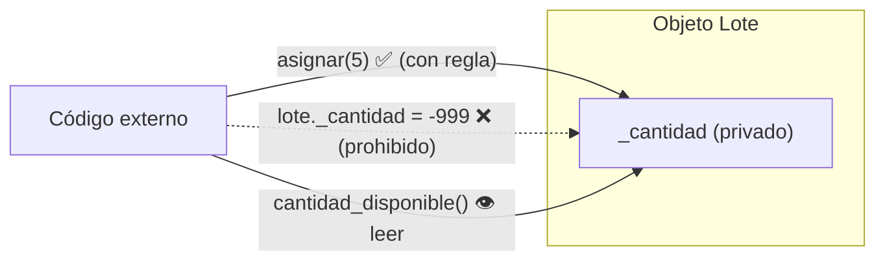

# Lección 09 — Encapsulación

> Fase 0 · POO · micro-paso · concepto nuevo: **proteger el estado** del objeto.

## 0. 🧭 La pregunta
> *"Mi `Lote` tiene `cantidad` abierta. Me piden que nunca quede en un valor
> imposible, pero cualquiera puede escribir `lote.cantidad = -999`. ¿Cómo protejo
> el estado?"*

## 1. Objetivo
Ocultar los datos de un objeto y exponer solo **puertas controladas** (métodos) que
respeten las reglas.

## 2. Cita de la fuente
> *"encapsulation covers two closely related ideas: simplifying behavior and hiding data."*
> *"Encapsulation and abstraction help us by hiding details and protecting the
> consistency of our data."* — Introducción, *Encapsulation and Abstractions*

## 3. El dolor / necesidad
Un dato "a la vista" se puede cambiar sin respetar la regla y dejar el objeto inválido.

## 4. Explicación paso a paso (§3.6, §3.7)
1. Ocultar el dato: `self._cantidad` (el `_` = privado por convención).
2. Puerta para leer: método `cantidad_disponible()`.
3. Puerta para cambiar: método `asignar(pedido)` que aplica la regla.
4. Un cambio inválido lanza `ValueError` y el estado no se corrompe.

Ver [`encapsulacion.py`](encapsulacion.py). Ejecutar:
```bash
uv run python lecciones/09-encapsulacion/encapsulacion.py
```

## 5. Diagrama (Mermaid)

El dato vive dentro del objeto; el exterior solo lo usa por las puertas (métodos).

## 6. Árbol de archivos
```
lecciones/09-encapsulacion/
├── README.md
└── encapsulacion.py
```

## 7. Tu turno
Agrega un método `reponer(cantidad)` que sume stock solo si la cantidad es positiva.

## 8. Comprobación
Se puede comprobar ejecutando; opcionalmente, una prueba pytest de `asignar`.

## 9. Preguntas de recuerdo
1. ¿Qué significa el guion bajo `_` en `_cantidad`?
2. ¿Por qué cambiar el dato solo por un método y no directamente?
3. ¿Qué es "encapsular" en una frase?
