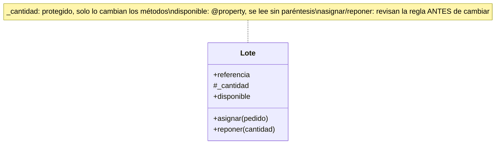
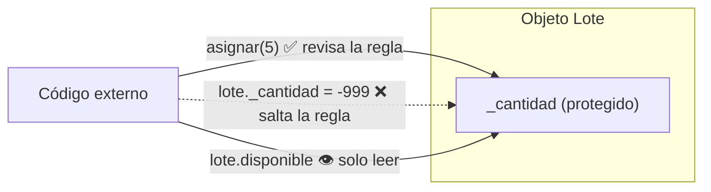

# Lección 09 — Encapsulación

> Fase 0 · POO · Formulario · Familia de concepto: **proteger el estado del objeto** · Orden de estudio: **10 de 18**

⬅️ [Lección 08 · Módulos y pytest](../08-modulos-y-pytest/) · 🏠 [Índice de lecciones](../README.md) · ➡️ [Lección 10 · Herencia](../10-herencia/)

---

## 🧭 Ruta de estudio · Lección 09 (≈ 2 h)

**Antes necesitas:** [Lección 06 · Clases y objetos](../06-clases-y-objetos/) (`class`, `__init__`, `self`) y [Lección 08 · Módulos y pytest](../08-modulos-y-pytest/) (`import`, `assert`, `pytest`). También usarás `raise` y `try/except` de la [Lección 07](../07-excepciones/).

| Paso | Qué haces | Dónde | ⏱ |
|:-:|---|---|:-:|
| **0** | Lee la teoría, las tablas de fórmulas, las propiedades y los errores | este README §0–§8 | 25 min |
| **1** | Ejecuta las fórmulas y compara cada línea con la tabla | [`paso1_formulas.py`](paso1_formulas.py) | 10 min |
| **2** | Sigue los ejemplos resueltos línea por línea | §9 + [`paso2_ejemplos_resueltos.py`](paso2_ejemplos_resueltos.py) | 20 min |
| **3** | Completa los `# TODO` y corre pytest hasta verlo en **verde** | [`paso3_tu_turno.py`](paso3_tu_turno.py) + [`test_paso3_tu_turno.py`](test_paso3_tu_turno.py) | 20 min |
| **4** | Compara con la solución de referencia | [`paso4_tu_turno_solucion.py`](paso4_tu_turno_solucion.py) | 5 min |
| **5** | Resuelve los 12 problemas **en un archivo tuyo**, luego revisa claves y solucionario | §10–§11 + [`paso5_solucionario/`](paso5_solucionario/) | 30 min |
| **6** | Compara solución mala vs buena | [`paso6_ejercicios/`](paso6_ejercicios/) | 10 min |
| **7** | Responde las preguntas de recuerdo **sin mirar** | §15 | 5 min |
| **🚦** | Evalúa si puedes pasar a la siguiente | §16 | 1 min |

---

## 0. 🧭 La pregunta
> *"Mi `Lote` tiene `cantidad` a la vista. Me piden que **nunca** quede en un valor
> imposible, pero cualquiera puede escribir `lote.cantidad = -999`. ¿Cómo protejo el estado?"*

## 1. Objetivos (al terminar podrás…)
1. Distinguir un atributo **público** (`x`) de uno **protegido** (`_x`).
2. Cambiar el estado **solo** por métodos que aplican la regla ("puertas controladas").
3. Revisar la regla **antes** de cambiar, para que un error no deje el objeto a medias.
4. Usar `@property` para **leer** sin paréntesis y para **calcular** valores.
5. Usar un **setter** (`@x.setter`) que valide cada asignación.

## 2. Cita de la fuente
> *"The term encapsulation covers two closely related ideas: simplifying behavior and hiding data."* — Introducción

> *"Encapsulation and abstraction help us by hiding details and protecting the consistency of our data"* — Introducción

> *"self._purchased_quantity = qty"* · *"@property def available_quantity(self) -> int: return self._purchased_quantity - self.allocated_quantity"* — Cap. 1

**Por qué importa:** el `Batch` (lote) del cap. 1 guarda lo comprado en `_purchased_quantity`
(con guion bajo: **protegido**) y expone lo disponible con `@property available_quantity`,
que se **calcula**. Es exactamente lo que aprendes aquí: esconder el dato y abrir puertas.

## 3. El dolor
```python
class Lote:
    def __init__(self, cantidad):
        self.cantidad = cantidad

lote = Lote(20)
lote.cantidad = -999     # nadie lo impide: el lote queda en un estado IMPOSIBLE
print(lote.cantidad)     # -999
```
Si el dato está a la vista, **cualquier** parte del programa lo puede romper, y la regla
("no puede ser negativo", "no asignar más de lo que hay") queda escrita… en ningún lado.

---

## 4. 📘 Teoría

> **🔒 Definición — Encapsulación**
> **Encapsular** es meter los datos **dentro** del objeto y dejar que el exterior los use
> **solo** a través de métodos que respetan las reglas.
> Dos ideas: **esconder el dato** (`_cantidad`) y **simplificar el uso** (`asignar(5)`).

> **🚪 Definición — Puerta controlada**
> Un **método** que lee o cambia el dato protegido. La puerta **revisa la regla** antes de
> dejar pasar el cambio.
> `lote.asignar(5)` ✅ en vez de `lote._cantidad = lote._cantidad - 5` ❌

> **🧷 Definición — Invariante**
> Una **regla que siempre debe ser cierta** para el objeto. Ej.: *"la cantidad nunca es
> negativa"*. Encapsular sirve para que **ningún** cambio la rompa.

> **🏷️ Definición — `@property`**
> Convierte un método en algo que **se lee como un atributo** (sin paréntesis):
> `lote.disponible` en vez de `lote.disponible()`. Sirve para leer un dato protegido o
> para **calcularlo** al momento.

> **🔤 Vocabulario**
> - **Atributo público:** `self.referencia` — se puede leer y cambiar desde afuera.
> - **Atributo protegido:** `self._cantidad` — el `_` es un **aviso** (convención): *"no lo toques desde afuera"*.
> - **Lector (getter):** método o propiedad que **devuelve** el dato.
> - **Escritor (setter):** método o `@x.setter` que **cambia** el dato **validando**.
> - **Estado:** los valores que tiene un objeto en un momento dado.

> **🧠 Regla de oro**
> **Los datos adentro, las reglas en la puerta.** Desde afuera **nunca** se escribe
> `objeto._algo = …`; se llama a un método que revisa la regla **antes** de cambiar.

---

## 5. 🧮 Formulario: atributos y métodos
Con `lote = Lote("L1", 20)` (la clase está en [`paso1_formulas.py`](paso1_formulas.py)):

| # | Concepto | Sintaxis / plantilla | Ejemplo | Resultado |
|---|---|---|---|---|
| E1 | Atributo público | `self.x = valor` | `lote.referencia` | `'L1'` |
| E2 | Atributo protegido (convención) | `self._x = valor` | `self._cantidad = cantidad` | se guarda `20`; desde afuera **no se toca** |
| E3 | Método lector | `def x(self): return self._x` | `lote.cantidad_disponible()` | `20` |
| E4 | Método que cambia con regla | `def accion(self, n): …` | `lote.asignar(5)` | disponible pasa a `15` |
| E5 | Invariante protegida | `if regla_rota: raise ValueError(...)` **antes** de cambiar | `lote.asignar(999)` | `ValueError: No hay stock suficiente` y sigue en `15` |
| E6 | `_x` es solo un aviso | `objeto._x = v` (¡no lo hagas!) | `otro._cantidad = -999` | funciona y deja `-999`: **estado imposible** |

## 6. 🧮 Formulario: `@property` y setter

| # | Concepto | Sintaxis / plantilla | Ejemplo | Resultado |
|---|---|---|---|---|
| P1 | Propiedad de solo lectura | `@property` + `def x(self): return self._x` | `lote.disponible` (sin `()`) | `15` |
| P2 | Sin setter no se asigna | `objeto.x = v` | `lote.disponible = 100` | `AttributeError: property 'disponible' of 'Lote' object has no setter` |
| P3 | Propiedad calculada | `@property` que **calcula** | comprada `20` − asignada `8` | `12` |
| P4 | Setter con validación | `@x.setter` + `def x(self, v): if …: raise …; self._x = v` | `mesa.precio = 120` | `120` |
| P5 | El setter rechaza lo inválido | `objeto.x = valor_malo` | `mesa.precio = -5` | `ValueError: El precio no puede ser negativo`, sigue en `120` |
| P6 | El setter protege al crear | en `__init__`: `self.x = x` (sin `_`) | `Producto("silla", -1)` | `ValueError: El precio no puede ser negativo` |

> 💡 Todas estas fórmulas están ejecutables en [`paso1_formulas.py`](paso1_formulas.py),
> con su código (E1, P1…) en cada línea de salida.

## 7. 📐 Propiedades
| Atributos y métodos | `@property` y setter |
|---|---|
| **R1.** El `_` **no** bloquea nada: es un acuerdo entre programadores (E6). | **R5.** Una propiedad se lee **sin paréntesis**: `lote.disponible`. |
| **R2.** La regla se revisa **antes** de cambiar; si falla, el estado queda **igual** (E5). | **R6.** Sin `@x.setter`, la propiedad es de **solo lectura** (P2). |
| **R3.** Un objeto encapsulado **siempre** está en un estado válido (invariante). | **R7.** El setter guarda en **otro nombre** (`self._precio`), nunca en `self.precio`. |
| **R4.** Los métodos son la **única** forma prevista de cambiar el dato. | **R8.** Si `__init__` usa `self.precio = …`, la validación corre **también al crear** (P6). |

## 8. ⚠️ Errores frecuentes
| # | ❌ Así no | Qué pasa | ✅ Así sí |
|---|---|---|---|
| X1 | `lote._cantidad = -999` desde afuera | **no hay error**: el objeto queda en un estado imposible | `lote.asignar(n)` / `lote.reponer(n)` |
| X2 | `lote.disponible()` (es `@property`) | `TypeError: 'int' object is not callable` | sin paréntesis: `lote.disponible` |
| X3 | `lote.disponible = 100` (sin setter) | `AttributeError: property 'disponible' of 'Lote' object has no setter` | cambiar con un método: `lote.asignar(5)` |
| X4 | cambiar **y después** validar: `self._cantidad -= n` y luego `if self._cantidad < 0: raise …` | el error salta, pero el dato **ya quedó mal** | validar **antes**: `if n > self._cantidad: raise …` |
| X5 | en el setter: `self.precio = valor` | `RecursionError: maximum recursion depth exceeded` (el setter se llama a sí mismo sin fin) | `self._precio = valor` |
| X6 | olvidar `@property` y leer `lote.disponible` | no hay error: obtienes `<bound method Lote.disponible of …>` en vez del número | poner `@property` arriba del `def` |

> 🔬 Pruébalos: al final de [`paso1_formulas.py`](paso1_formulas.py) están X2 y X3
> comentados. Quita el `#` de **uno**, ejecuta, lee el mensaje y vuelve a ponerlo.

---

## 9. ✍️ Ejemplos resueltos (paso a paso)
> Todos están en [`paso2_ejemplos_resueltos.py`](paso2_ejemplos_resueltos.py).

**Ejemplo 1 — Esconder el dato y abrir puertas** *(fácil)*
> Enunciado: un lote con 20 unidades; solo se lee y se asigna por métodos.
```python
class Lote:                                    # Paso 1: la clase (el molde)
    def __init__(self, referencia, cantidad):
        self.referencia = referencia
        self._cantidad = cantidad              # Paso 2: el dato protegido (E2)

    def cantidad_disponible(self):             # Paso 3: puerta para leer (E3)
        return self._cantidad

    def asignar(self, pedido):                 # Paso 4: puerta para cambiar (E4)
        if pedido > self._cantidad:
            raise ValueError("No hay stock suficiente")
        self._cantidad = self._cantidad - pedido

lote = Lote("LOTE-001", 20)                    # Paso 5: la instancia (el objeto)
print(lote.cantidad_disponible())              # -> 20
lote.asignar(5)                                # Paso 6: usarlo solo por sus puertas
print(lote.cantidad_disponible())              # -> 15
```
Fíjate en el orden: **clase** (molde) → **instancia** (`Lote("LOTE-001", 20)`) → **objeto**
(`lote`) → **uso** (solo por sus métodos).

**Ejemplo 2 — La regla protege el estado** *(fácil)*
> Enunciado: un lote con 10 unidades recibe un pedido de 25.
```python
lote = Lote("LOTE-002", 10)
try:
    lote.asignar(25)                           # Paso 1: pedido imposible
except ValueError as error:                    # Paso 2: atrapamos el error (Lección 07)
    print("Bloqueado:", error)                 # -> Bloqueado: No hay stock suficiente
print(lote.cantidad_disponible())              # Paso 3: -> 10 (NO se corrompió)
```
| momento | `_cantidad` | ¿qué pasó? |
|---|---|---|
| al crear | `10` | — |
| `asignar(25)` revisa la regla | `10` | `25 > 10` → `raise` **antes** de restar |
| después del `except` | `10` | el estado quedó **intacto** |

**Ejemplo 3 — De método lector a `@property` calculada** *(intermedio)*
> Enunciado: guarda lo comprado y lo asignado; lo **disponible** se calcula, como el `available_quantity` del libro.
```python
class LoteConAsignado:
    def __init__(self, referencia, cantidad):
        self.referencia = referencia
        self._comprada = cantidad              # Paso 1: lo que se compró
        self._asignada = 0                     # Paso 2: lo asignado empieza en 0

    def asignar(self, pedido):
        if pedido > self.disponible:           # Paso 4: la regla usa la propiedad
            raise ValueError("No hay stock suficiente")
        self._asignada = self._asignada + pedido

    @property
    def disponible(self):                      # Paso 3: se CALCULA, no se guarda
        return self._comprada - self._asignada

lote = LoteConAsignado("LOTE-003", 20)
lote.asignar(5)
lote.asignar(3)
print(lote.disponible)                         # Paso 5: SIN paréntesis -> 12
```
| llamada | `_comprada` | `_asignada` | `disponible` |
|---|---|---|---|
| al crear | `20` | `0` | `20` |
| `asignar(5)` | `20` | `5` | `15` |
| `asignar(3)` | `20` | `8` | `12` |

**Ejemplo 4 — Setter que valida al asignar y al crear** *(avanzado)*
> Enunciado: un `Producto` cuyo precio **nunca** puede ser negativo, ni al cambiarlo ni al crearlo.
```python
class Producto:
    def __init__(self, nombre, precio):
        self.nombre = nombre
        self.precio = precio                   # Paso 3: hasta el __init__ pasa por el setter

    @property
    def precio(self):                          # Paso 1: el lector
        return self._precio

    @precio.setter
    def precio(self, valor):                   # Paso 2: el escritor con regla
        if valor < 0:
            raise ValueError("El precio no puede ser negativo")
        self._precio = valor

mesa = Producto("mesa", 100)
mesa.precio = 120                              # Paso 4: cambio válido      -> 120
try:
    mesa.precio = -5                           # Paso 5: cambio inválido
except ValueError as error:
    print("Bloqueado:", error)                 # -> Bloqueado: El precio no puede ser negativo
print(mesa.precio)                             # -> 120 (no cambió)
try:
    Producto("silla", -1)                      # Paso 6: también protege al crear
except ValueError as error:
    print("Bloqueado al crear:", error)
```
El truco está en el Paso 3: como `__init__` escribe `self.precio = precio` (**sin** `_`),
Python llama al setter y la regla corre también al crear el objeto.

---

## 10. 📝 Problemas propuestos
> Resuélvelos **antes** de mirar las claves. Crea tu propio archivo, por ejemplo
> `mis_problemas.py`, en esta carpeta.

**🟢 Nivel básico**
1. Crea `Cuenta(titular, saldo)` que guarde el saldo en `_saldo` y tenga un método
   `saldo_actual()` que lo devuelva. Imprime el saldo de `Cuenta("Ana", 100)`.
2. Agrega `depositar(monto)` que sume al saldo. Deposita `50` e imprime el saldo.
3. Demuestra que Python **no impide** escribir `cuenta._saldo = -1`: hazlo en otra cuenta e
   imprime su saldo. ¿Por qué está mal?
4. Convierte `saldo_actual()` en una **propiedad** `saldo` y lee `cuenta.saldo` sin paréntesis.

**🟡 Nivel intermedio**

5. Agrega `retirar(monto)`: si el monto es mayor que el saldo, lanza
   `ValueError("Saldo insuficiente")` **sin** cambiar nada. Con saldo `100`: retira `30`, y
   luego intenta retirar `500`; imprime el mensaje y el saldo.
6. Haz que `depositar` rechace montos `<= 0` con `ValueError("Monto inválido")`. Prueba con `-10`.
7. Crea un `Contador` que empiece en `0`, con `incrementar()` y una propiedad `valor` **sin**
   setter. Incrementa 3 veces, imprime el valor e intenta `c.valor = 10`: imprime el error.
8. Crea un `Termometro` con propiedad y **setter** `celsius` que rechace valores menores a
   `-273.15` con `ValueError("Bajo el cero absoluto")`. Pon `25` y luego intenta `-300`.

**🔴 Nivel avanzado**

9. Crea un `Carrito` con una lista protegida `_precios`, un método `agregar(precio)` y una
   propiedad **calculada** `total` (súmala con un `for`). Agrega `10`, `20` y `5`.
10. Crea un `Rectangulo(ancho, alto)` con setters que rechacen medidas `<= 0`
    (`ValueError("Medida inválida")`) y una propiedad calculada `area`. Prueba `2×3`, luego
    `ancho = 5`, y luego `alto = 0`.
11. Crea `CuentaConHistorial` que guarde los movimientos en `_movimientos` (depósitos
    positivos, retiros negativos) y tenga una propiedad `movimientos` que devuelva una
    **copia** (`list(...)`). Demuestra que si agregas algo a la copia, el historial real **no** cambia.
12. *(Puente al libro)* Escribe un `Lote` como el `Batch` del cap. 1: guarda
    `_cantidad_comprada` y una lista `_asignaciones`; propiedades `cantidad_asignada`
    (suma) y `cantidad_disponible` (comprada − asignada); y `asignar(cantidad)` que rechace
    pedir más de lo disponible. Con `Lote("LOTE-001", 20)`: asigna `5` y `3`, imprime ambas
    propiedades, e intenta asignar `50`.

## 11. 🔑 Claves (respuestas)
<details><summary>Ver claves (solo después de intentarlo)</summary>

| # | Salida esperada | Fórmula clave |
|---|---|---|
| 1 | `100` | E2 + E3 |
| 2 | `150` | E4 |
| 3 | `-1` — funciona, pero deja un estado imposible porque nadie revisó la regla | E6 |
| 4 | `100` | P1 |
| 5 | `70`, luego `Saldo insuficiente \| saldo: 70` | E5 |
| 6 | `Monto inválido \| saldo: 70` | E5 |
| 7 | `3`, luego `property 'valor' of 'Contador' object has no setter` | P2 |
| 8 | `25`, luego `Bajo el cero absoluto \| sigue en: 25` | P4 + P5 |
| 9 | `35` | P3 |
| 10 | `6`, luego `15`, luego `Medida inválida \| área sigue en: 15` | P4 + P3 |
| 11 | `[100, -30]`, y después de cambiar la copia: `movimientos reales: 2` | P1 + copia |
| 12 | `asignada 8 \| disponible 12`, luego `No hay stock suficiente \| disponible 12` | P3 + E5 |

El código completo de cada solución está en [`paso5_solucionario/`](paso5_solucionario/):
[`nivel_basico.py`](paso5_solucionario/nivel_basico.py) ·
[`nivel_intermedio.py`](paso5_solucionario/nivel_intermedio.py) ·
[`nivel_avanzado.py`](paso5_solucionario/nivel_avanzado.py).
</details>

---

## 12. 🗺️ Mapa mental y diagrama (Mermaid)

**Cómo leerlo:** `+` es público y `#` es protegido. El dato `_cantidad` está **adentro**; el
exterior solo usa `disponible` (leer), `asignar` y `reponer` (cambiar con regla).


**Cómo leerlo:** las flechas continuas son las **puertas** permitidas; la punteada es el
atajo prohibido que rompe la invariante.

## 13. 🌳 Árbol de archivos
```
lecciones/09-encapsulacion/
├── README.md                    ← PASO 0 · EMPIEZA AQUÍ (este formulario)
├── paso1_formulas.py            ← PASO 1 · las fórmulas E1–E6 y P1–P6, ejecutables
├── paso2_ejemplos_resueltos.py  ← PASO 2 · los 4 ejemplos resueltos
├── paso3_tu_turno.py            ← PASO 3 · completa los # TODO
├── test_paso3_tu_turno.py       ← PASO 3 · las pruebas de tu paso3 (rojo → verde)
├── paso4_tu_turno_solucion.py   ← PASO 4 · solución de referencia
├── paso5_solucionario/          ← PASO 5 · soluciones de los 12 problemas
│   ├── nivel_basico.py
│   ├── nivel_intermedio.py
│   └── nivel_avanzado.py
└── paso6_ejercicios/            ← PASO 6 · solución mala vs buena
    ├── ejercicio-1/ … ejercicio-3/
    └── ejercicio-4-reto/
```

## 14. 🤝 Tu turno y ✅ comprobación con pytest
Desde la [Lección 08](../08-modulos-y-pytest/) la comprobación es con **pytest**, al estilo
**TDD: rojo → verde**.

1. Corre las pruebas **antes** de escribir nada. Verás **rojo** (5 pruebas fallan). Es a
   propósito: las pruebas dicen lo que **todavía falta**.
   ```bash
   uv run pytest lecciones/09-encapsulacion -q        # -> 5 failed
   ```
2. Completa los `# TODO` de [`paso3_tu_turno.py`](paso3_tu_turno.py), uno por uno, y vuelve a
   correr pytest. Cada TODO terminado pone en verde alguna prueba.
3. Cuando todo esté bien:
   ```bash
   uv run pytest lecciones/09-encapsulacion -q        # -> 5 passed
   ```
4. Compara con la referencia:
   ```bash
   git diff --no-index lecciones/09-encapsulacion/paso3_tu_turno.py lecciones/09-encapsulacion/paso4_tu_turno_solucion.py
   ```

> 🔎 En [`test_paso3_tu_turno.py`](test_paso3_tu_turno.py) verás `with pytest.raises(ValueError):`.
> Se lee: *"lo que está adentro **debe** lanzar `ValueError`; si no lo lanza, la prueba falla"*.
> Así se prueba que la regla **sí** bloquea.

## 15. ❓ Preguntas de recuerdo
> Respóndelas **sin mirar**; luego abre cada una para comprobar.

<details><summary>1. ¿Qué significa el guion bajo en <code>_cantidad</code>?</summary>

Es un **aviso** (convención): *"es interno, no lo toques desde afuera"*. Python **no** lo impide.
</details>
<details><summary>2. ¿Por qué cambiar el dato solo por un método y no directamente?</summary>

Porque el método **revisa la regla** antes de cambiar; escribir el atributo directo se salta la regla.
</details>
<details><summary>3. ¿Por qué hay que validar <b>antes</b> de cambiar y no después?</summary>

Porque si cambias primero y el error salta después, el objeto ya quedó en un estado inválido.
</details>
<details><summary>4. ¿Qué diferencia hay entre <code>lote.disponible</code> y <code>lote.disponible()</code> si es una <code>@property</code>?</summary>

`lote.disponible` devuelve el valor; con `()` intentas **llamar** al número y da `TypeError: 'int' object is not callable`.
</details>
<details><summary>5. ¿Para qué sirve <code>@precio.setter</code>?</summary>

Para permitir `objeto.precio = valor` **validando** el valor antes de guardarlo (en `self._precio`).
</details>
<details><summary>6. En el libro, ¿qué nombre tiene el dato protegido y cuál la propiedad calculada del lote?</summary>

`_purchased_quantity` (protegido) y `available_quantity` (`@property` que resta lo asignado).
</details>

---

## 16. 🚦 ¿Puedo pasar a la siguiente lección?
| Indicador | Criterio |
|:-:|---|
| 🟢 **Sí, sigue** | `uv run pytest lecciones/09-encapsulacion -q` da **5 passed** **y** aciertas **≥ 9 de 12** problemas **y** respondes las 6 preguntas sin mirar |
| 🟡 **Repasa** | aciertas **6 a 8** → vuelve a §8 (errores frecuentes) y §9 (ejemplos resueltos) y reintenta los que fallaste |
| 🔴 **Repite la lección** | aciertas **menos de 6** → empieza otra vez desde el Paso 0 |

Cuando estés en 🟢, marca la lección en
[`progreso/fase-0-python.md`](../../progreso/fase-0-python.md) (sección *"Mi avance"*) y haz
commit; así también practicas Git.

---

⬅️ [Lección 08 · Módulos y pytest](../08-modulos-y-pytest/) · 🏠 [Índice de lecciones](../README.md) · ➡️ [Lección 10 · Herencia](../10-herencia/)
