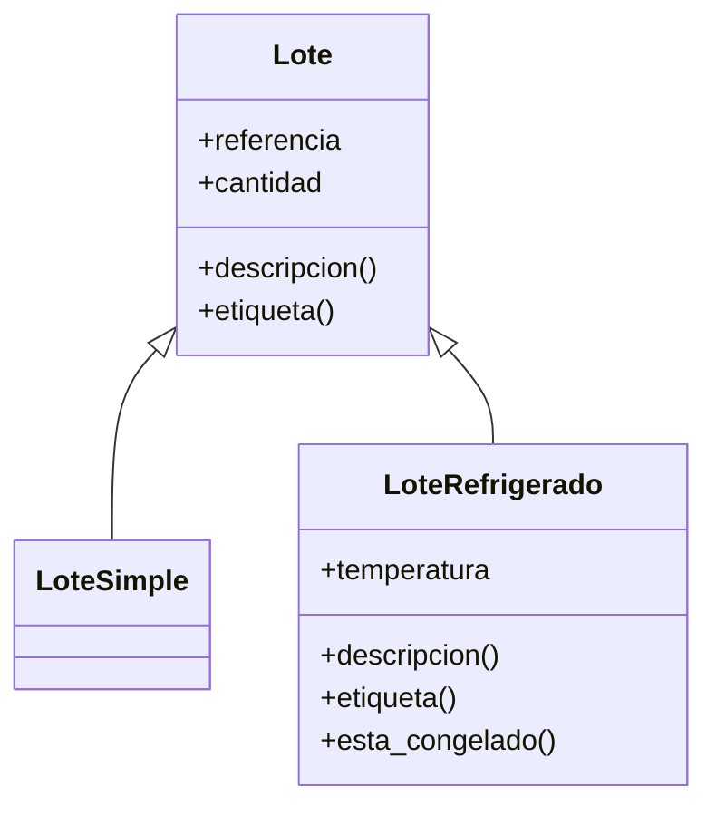
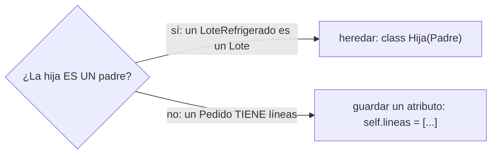

# Lección 10 — Herencia

> Fase 0 · POO · Formulario · Familia de concepto: **reutilizar y extender una clase** · Orden de estudio: **11 de 18**

⬅️ [Lección 09 · Encapsulación](../09-encapsulacion/) · 🏠 [Índice de lecciones](../README.md) · ➡️ [Lección 11 · Polimorfismo](../11-polimorfismo/)

---

## 🧭 Ruta de estudio · Lección 10 (≈ 2 h)

**Antes necesitas:** [Lección 09 · Encapsulación](../09-encapsulacion/) (y con ella, clases de la 06 y pytest de la 08).

| Paso | Qué haces | Dónde | ⏱ |
|:-:|---|---|:-:|
| **0** | Lee la teoría, las tablas de fórmulas, las propiedades y los errores | este README §0–§8 | 25 min |
| **1** | Ejecuta las fórmulas y compara cada línea con la tabla | [`paso1_formulas.py`](paso1_formulas.py) | 10 min |
| **2** | Sigue los ejemplos resueltos línea por línea | §9 + [`paso2_ejemplos_resueltos.py`](paso2_ejemplos_resueltos.py) | 20 min |
| **3** | Completa los `# TODO` y corre pytest hasta verlo en **verde** | [`paso3_tu_turno.py`](paso3_tu_turno.py) + [`test_paso3_tu_turno.py`](test_paso3_tu_turno.py) | 20 min |
| **4** | Compara con la solución de referencia | [`paso4_tu_turno_solucion.py`](paso4_tu_turno_solucion.py) | 5 min |
| **5** | Resuelve los 12 problemas **en un archivo tuyo**, luego revisa claves y solucionario | §10–§11 + [`paso5_solucionario/`](paso5_solucionario/) | 30 min |
| **6** | Compara solución mala vs buena | [`paso6_ejercicios/`](paso6_ejercicios/) | 10 min |
| **7** | Responde las preguntas de recuerdo **sin mirar** | §15 | 5 min |
| **🚦** | Evalúa si puedes pasar a la siguiente | §16 | 1 min |

---

## 0. 🧭 La pregunta
> *"Tengo `Lote`. Me piden un `LoteRefrigerado` casi igual, pero con temperatura.
> Copiar toda la clase es duplicar código. ¿Cómo reutilizo lo que ya existe y solo agrego lo nuevo?"*

## 1. Objetivos (al terminar podrás…)
1. Crear una clase **hija** que **hereda** de una clase **padre**: `class Hija(Padre):`.
2. Reutilizar el constructor del padre con `super().__init__(...)` y agregar datos nuevos.
3. **Sobrescribir** un método (reemplazarlo) y **extenderlo** (reutilizarlo con `super()` y sumar algo).
4. Preguntar por el tipo con `isinstance` e `issubclass`.
5. Reconocer cuándo **no** usar herencia ("es un" vs "tiene un").

## 2. Cita de la fuente
> *"class FakeRepository(AbstractRepository):"* — Cap. 2

> *"if not isinstance(other, Batch): return False"* — Cap. 1

> *"We do also have to remember to change the fakes in the service layer and make them call super() in the right places"* — Cap. 8

**Por qué importa:** en el cap. 2 el libro crea `FakeRepository` como **hija** de
`AbstractRepository` (el padre va entre paréntesis). En el cap. 1 usa `isinstance` para
preguntar si un objeto es un `Batch`. Y en el cap. 8 recuerda llamar a `super()` en las clases
hijas. Las tres ideas son el centro de esta lección.

## 3. El dolor
```python
class Lote:
    def __init__(self, referencia, cantidad):
        self.referencia = referencia
        self.cantidad = cantidad
    def descripcion(self):
        return f"Lote {self.referencia} con {self.cantidad} unidades"

class LoteRefrigerado:                      # ¡copia casi entera de Lote!
    def __init__(self, referencia, cantidad, temperatura):
        self.referencia = referencia        # repetido
        self.cantidad = cantidad            # repetido
        self.temperatura = temperatura
    def descripcion(self):                  # repetido + un detalle
        return f"Lote {self.referencia} con {self.cantidad} unidades (a {self.temperatura}°C)"
```
Si mañana cambia cómo se describe un lote, hay que acordarse de cambiarlo en **dos** lugares.
Con diez tipos de lote, en diez.

---

## 4. 📘 Teoría

> **🧬 Definición — Herencia**
> La **herencia** permite crear una clase nueva (**hija**) a partir de otra (**padre**). La hija
> **recibe todo** lo del padre (atributos y métodos) y puede **agregar** o **cambiar** cosas.
> `class LoteRefrigerado(Lote):` → *"LoteRefrigerado hereda de Lote"*.

> **🔁 Definición — `super()`**
> `super()` es **el padre visto desde la hija**. Sirve para **reutilizar** lo que el padre ya
> sabe hacer: `super().__init__(referencia, cantidad)` o `super().descripcion()`.

> **✏️ Definición — Sobrescribir vs extender**
> - **Sobrescribir:** la hija define un método **con el mismo nombre** y **reemplaza** al del padre.
> - **Extender:** la hija sobrescribe, pero **llama** a `super().metodo()` y le **suma** algo.

> **🔤 Vocabulario**
> - **Clase padre / madre / base / superclase:** la clase de la que se hereda.
> - **Clase hija / derivada / subclase:** la clase que hereda.
> - **"Es un":** la relación que justifica heredar (un `LoteRefrigerado` **es un** `Lote`).
> - **"Tiene un":** la relación que **no** se resuelve heredando, sino guardando un atributo (un `Pedido` **tiene** líneas; **no es** un `Lote`).
> - **`isinstance(objeto, Clase)`:** ¿este objeto es de esa clase (o de una hija suya)?

> **🧠 Regla de oro**
> Hereda **solo** si puedes decir *"la hija **es un** padre"* sin que suene raro.
> Lo que se repite va en el padre; lo que es distinto, en la hija.

---

## 5. 🧮 Formulario: crear una clase hija
Con `normal = Lote("L1", 10)`, `simple = LoteSimple("L0", 3)` y `frio = LoteRefrigerado("L2", 5, -18)`
(las clases están en [`paso1_formulas.py`](paso1_formulas.py)):

| # | Concepto | Sintaxis / plantilla | Ejemplo | Resultado |
|---|---|---|---|---|
| H1 | Clase padre | `class Padre:` | `normal.descripcion()` | `'Lote L1 con 10 unidades'` |
| H2 | Clase hija | `class Hija(Padre):` | `class LoteSimple(Lote): pass` | una clase nueva, `LoteSimple` |
| H3 | Hereda todo sin escribirlo | (nada) | `simple.descripcion()` | `'Lote L0 con 3 unidades'` |
| H4 | Reutilizar el constructor | `super().__init__(a, b)` | `frio.referencia` | `'L2'` |
| H5 | Agregar un atributo | `self.nuevo = valor` (después de `super`) | `frio.temperatura` | `-18` |
| H6 | Agregar un método nuevo | `def metodo(self):` solo en la hija | `frio.esta_congelado()` | `True` |
| H7 | Sobrescribir (reemplazar) | mismo nombre en la hija | `normal.etiqueta()` / `frio.etiqueta()` | `'NORMAL'` / `'FRÍO'` |
| H8 | Extender (reutilizar + sumar) | `return super().metodo() + …` | `frio.descripcion()` | `'Lote L2 con 5 unidades (a -18°C)'` |
| H9 | El padre no recibe lo de la hija | `padre.metodo_de_hija()` | `normal.esta_congelado()` | `AttributeError: 'Lote' object has no attribute 'esta_congelado'` |

## 6. 🧮 Formulario: preguntar por el tipo

| # | Concepto | Sintaxis | Ejemplo | Resultado |
|---|---|---|---|---|
| T1 | ¿Es de esta clase? | `isinstance(obj, Clase)` | `isinstance(frio, LoteRefrigerado)` | `True` |
| T2 | La hija **es** también el padre | `isinstance(hija, Padre)` | `isinstance(frio, Lote)` | `True` |
| T3 | El padre **no es** la hija | `isinstance(padre, Hija)` | `isinstance(normal, LoteRefrigerado)` | `False` |
| T4 | ¿Una clase hereda de otra? | `issubclass(Hija, Padre)` | `issubclass(LoteRefrigerado, Lote)` | `True` |
| T5 | Nombre de la clase de un objeto | `type(obj).__name__` | `type(frio).__name__` | `'LoteRefrigerado'` |
| T6 | Lista mixta: cada uno usa **su** versión | `for x in lista: x.metodo()` | `[normal, simple, frio]` → `etiqueta()` | `NORMAL`, `NORMAL`, `FRÍO` |

> 💡 Todas estas fórmulas están ejecutables en [`paso1_formulas.py`](paso1_formulas.py),
> con su código (H1, T1…) en cada línea de salida.

## 7. 📐 Propiedades
| Heredar | Tipos |
|---|---|
| **R1.** La hija tiene **todo** lo del padre aunque no lo escriba (H3). | **R5.** Un objeto hijo **es** también del tipo padre (T2). |
| **R2.** Si la hija define su propio `__init__`, el del padre **no** corre solo: hay que llamar `super().__init__(...)`. | **R6.** Un objeto padre **no** es del tipo hijo (T3). |
| **R3.** Si la hija define un método con el mismo nombre, **gana el de la hija** (H7). | **R7.** `isinstance` mira el objeto; `issubclass` mira las clases. |
| **R4.** El padre **no** se entera de lo que agregan sus hijas (H9). | **R8.** Se puede heredar en cadena: `AutoElectrico(Auto)`, `Auto(Vehiculo)`. |

## 8. ⚠️ Errores frecuentes
| # | ❌ Así no | Qué pasa | ✅ Así sí |
|---|---|---|---|
| X1 | `__init__` en la hija **sin** `super().__init__(...)` | `AttributeError: 'SinSuper' object has no attribute 'referencia'` (el padre nunca guardó sus datos) | primera línea del `__init__`: `super().__init__(referencia, cantidad)` |
| X2 | `super().__init__(referencia)` (falta un dato) | `TypeError: Lote.__init__() missing 1 required positional argument: 'cantidad'` | pasar **todo** lo que pide el `__init__` del padre |
| X3 | `super.__init__(...)` (sin paréntesis) | `TypeError: descriptor '__init__' requires a 'super' object but received a 'str'` | `super().__init__(...)` |
| X4 | `class Hija(Padre)` sin los dos puntos | `SyntaxError: expected ':'` | `class Hija(Padre):` |
| X5 | heredar por **"tiene un"**: `class Pedido(Lote):` | no hay error, pero el modelo **miente**: un pedido **no es** un lote | guardar un atributo: `self.lote = lote` |
| X6 | sobrescribir sin querer: redefinir `descripcion` sin `super()` | no hay error, pero se **pierde** el texto del padre | si quieres conservarlo: `super().descripcion() + …` |

> 🔬 Pruébalos: al final de [`paso1_formulas.py`](paso1_formulas.py) están X1, X2 y X3 como
> comentarios. Copia **una** clase a un archivo tuyo, ejecútala y lee el mensaje.

---

## 9. ✍️ Ejemplos resueltos (paso a paso)
> Todos están en [`paso2_ejemplos_resueltos.py`](paso2_ejemplos_resueltos.py).

**Ejemplo 1 — Una hija que hereda todo** *(fácil)*
> Enunciado: crea `LoteSimple`, que sea un `Lote` sin nada extra, y úsalo.
```python
class Lote:                                       # Paso 1: la clase padre
    def __init__(self, referencia, cantidad):
        self.referencia = referencia
        self.cantidad = cantidad
    def descripcion(self):
        return f"Lote {self.referencia} con {self.cantidad} unidades"

class LoteSimple(Lote):                           # Paso 2: la hija, con el padre entre ()
    pass                                          # Paso 3: no escribe nada propio

simple = LoteSimple("L0", 3)                      # Paso 4: usa el __init__ del padre
print(simple.descripcion())                       # Paso 5: y su método -> Lote L0 con 3 unidades
```

**Ejemplo 2 — Reutilizar el constructor y agregar un dato** *(fácil)*
> Enunciado: `LoteRefrigerado` es un `Lote` con `temperatura`.
```python
class LoteRefrigerado(Lote):
    def __init__(self, referencia, cantidad, temperatura):
        super().__init__(referencia, cantidad)    # Paso 1: el padre guarda referencia y cantidad
        self.temperatura = temperatura            # Paso 2: la hija guarda lo nuevo

frio = LoteRefrigerado("L2", 5, -18)
print(frio.referencia, frio.cantidad, frio.temperatura)   # Paso 3: -> L2 5 -18
```
Traza de `LoteRefrigerado("L2", 5, -18)`:

| orden | qué corre | qué guarda |
|---|---|---|
| 1 | `LoteRefrigerado.__init__` empieza | — |
| 2 | `super().__init__("L2", 5)` → corre `Lote.__init__` | `referencia = "L2"`, `cantidad = 5` |
| 3 | vuelve a la hija: `self.temperatura = -18` | `temperatura = -18` |

**Ejemplo 3 — Sobrescribir vs extender** *(intermedio)*
> Enunciado: la etiqueta del refrigerado **reemplaza** a la del padre; su descripción **amplía** la del padre.
```python
class Lote:
    ...
    def etiqueta(self):
        return "NORMAL"

class LoteRefrigerado(Lote):
    ...
    def etiqueta(self):                           # SOBRESCRIBIR: reemplaza
        return "FRÍO"
    def descripcion(self):                        # EXTENDER: reutiliza + suma
        return super().descripcion() + f" (a {self.temperatura}°C)"

normal = Lote("L1", 10)
print(normal.etiqueta(), "|", frio.etiqueta())    # -> NORMAL | FRÍO
print(frio.descripcion())                         # -> Lote L2 con 5 unidades (a -18°C)
```
| método | en `Lote` | en `LoteRefrigerado` | ¿qué hizo la hija? |
|---|---|---|---|
| `etiqueta()` | `'NORMAL'` | `'FRÍO'` | **sobrescribió** (no usa al padre) |
| `descripcion()` | `'Lote L2 con 5 unidades'` | `'Lote L2 con 5 unidades (a -18°C)'` | **extendió** (usa `super()` y suma) |

**Ejemplo 4 — Una lista mixta e `isinstance`** *(avanzado)*
> Enunciado: con varios lotes (normales y refrigerados), muestra cada descripción y cuenta los refrigerados.
```python
lotes = [Lote("L1", 10), LoteRefrigerado("L2", 5, -18), LoteRefrigerado("L3", 7, 4)]  # Paso 1
refrigerados = 0                                          # Paso 2: contador
for lote in lotes:                                        # Paso 3: recorrer
    print(lote.descripcion())                             # Paso 4: cada uno usa SU versión
    if isinstance(lote, LoteRefrigerado):                 # Paso 5: ¿es refrigerado?
        refrigerados = refrigerados + 1
print("refrigerados:", refrigerados)                      # -> 2
print("¿todos son Lote?", isinstance(lotes[1], Lote))     # -> True
```
Es la misma pregunta que hace el libro en `if not isinstance(other, Batch): return False`.

---

## 10. 📝 Problemas propuestos
> Resuélvelos **antes** de mirar las claves. Crea tu propio archivo, por ejemplo
> `mis_problemas.py`, en esta carpeta.

**🟢 Nivel básico**
1. Crea `Animal(nombre)` con `describir()` que devuelva `"Soy <nombre>"`. Crea `Perro(Animal)`
   **sin** escribir nada adentro (`pass`) e imprime `Perro("Toby").describir()`.
2. Crea `Gato(Animal)` con un método **nuevo** `maullar()` que devuelva `"Miau"`. Imprime
   `describir()` y `maullar()` de `Gato("Mishi")`.
3. Imprime `isinstance(Perro("Toby"), Animal)` e `isinstance(Animal("x"), Perro)`.
4. Imprime `issubclass(Gato, Animal)` y el nombre de la clase de `Gato("Mishi")`.

**🟡 Nivel intermedio**

5. Crea `Empleado(nombre, sueldo)` y `Gerente(Empleado)` con un dato extra `area`, usando
   `super().__init__`. Imprime nombre, sueldo y área de `Gerente("Ana", 3000, "Ventas")`.
6. `Empleado.saludo()` devuelve `"Hola, soy <nombre>"`. Haz que `Gerente.saludo()` lo
   **extienda** con `" y dirijo <area>"`.
7. `Pajaro.mover()` devuelve `"vuela"`. Crea `Pinguino(Pajaro)` que lo **sobrescriba** con `"nada"`.
8. Crea `GerenteMalo(Empleado)` cuyo `__init__` **olvide** `super().__init__` y llama a
   `saludo()`. Atrapa el error e imprime su mensaje.

**🔴 Nivel avanzado**

9. Con la lista `[Empleado("Luis", 2000), Gerente("Ana", 3000, "Ventas"), Empleado("Eva", 2500)]`,
   suma todos los sueldos y cuenta cuántos son gerentes usando `isinstance`.
10. Arma **tres niveles**: `Vehiculo(marca)` → `Auto(marca, puertas)` → `AutoElectrico(marca,
    puertas, bateria)`. Cada `describir()` **extiende** al anterior. Imprime los tres para
    `"Tesla"`, `4` y `75`, y comprueba que el eléctrico es un `Vehiculo`.
11. Agrega `sueldo_total()` a `Empleado` (devuelve el sueldo) y haz que el `Gerente` lo
    **extienda** sumando un bono de `500`. Recorre la lista del problema 9 imprimiendo nombre y sueldo total.
12. *(Puente al libro)* Como `class FakeRepository(AbstractRepository):` del cap. 2: crea
    `RepositorioBase` con un diccionario `_lotes`, `agregar(referencia, lote)` y
    `obtener(referencia)`. Crea `RepositorioConRegistro(RepositorioBase)` que además guarde en
    una lista `registro` las referencias agregadas, **extendiendo** `agregar` con `super()`.
    Agrega `"L1"` y `"L2"`, e imprime `obtener("L1")` y el registro.

## 11. 🔑 Claves (respuestas)
<details><summary>Ver claves (solo después de intentarlo)</summary>

| # | Salida esperada | Fórmula clave |
|---|---|---|
| 1 | `Soy Toby` | H2 + H3 |
| 2 | `Soy Mishi \| Miau` | H6 |
| 3 | `True \| False` | T2 + T3 |
| 4 | `True \| Gato` | T4 + T5 |
| 5 | `Ana 3000 Ventas` | H4 + H5 |
| 6 | `Hola, soy Luis` y `Hola, soy Ana y dirijo Ventas` | H8 |
| 7 | `vuela \| nada` | H7 |
| 8 | `'GerenteMalo' object has no attribute 'nombre'` | X1 |
| 9 | `total 7500 \| gerentes 1` | T1 + T6 |
| 10 | `Tesla` / `Tesla, 4 puertas` / `Tesla, 4 puertas, batería 75 kWh` / `True` | H8 en cadena + T2 |
| 11 | `Luis 2000` / `Ana 3500` / `Eva 2500` | H8 |
| 12 | `mesa x10 \| ['L1', 'L2']` | H4 + H8 |

El código completo de cada solución está en [`paso5_solucionario/`](paso5_solucionario/):
[`nivel_basico.py`](paso5_solucionario/nivel_basico.py) ·
[`nivel_intermedio.py`](paso5_solucionario/nivel_intermedio.py) ·
[`nivel_avanzado.py`](paso5_solucionario/nivel_avanzado.py).
</details>

---

## 12. 🗺️ Mapa mental y diagrama (Mermaid)

**Cómo leerlo:** `<|--` es *"hereda de"* (la punta del triángulo apunta al **padre**).
`LoteSimple` no agrega nada: tiene todo lo de `Lote`. `LoteRefrigerado` agrega `temperatura`
y `esta_congelado()`, **sobrescribe** `etiqueta()` y **extiende** `descripcion()`.


**Cómo leerlo:** antes de heredar, haz la pregunta *"¿es un?"*. Si la respuesta es *"tiene un"*,
no heredes: guarda el otro objeto como atributo.

## 13. 🌳 Árbol de archivos
```
lecciones/10-herencia/
├── README.md                    ← PASO 0 · EMPIEZA AQUÍ (este formulario)
├── paso1_formulas.py            ← PASO 1 · las fórmulas H1–H9 y T1–T6, ejecutables
├── paso2_ejemplos_resueltos.py  ← PASO 2 · los 4 ejemplos resueltos
├── paso3_tu_turno.py            ← PASO 3 · completa los # TODO
├── test_paso3_tu_turno.py       ← PASO 3 · las pruebas de tu paso3 (rojo → verde)
├── paso4_tu_turno_solucion.py   ← PASO 4 · solución de referencia
├── paso5_solucionario/          ← PASO 5 · soluciones de los 12 problemas
│   ├── nivel_basico.py
│   ├── nivel_intermedio.py
│   └── nivel_avanzado.py
└── paso6_ejercicios/            ← PASO 6 · solución mala vs buena
    ├── ejercicio-1/ … ejercicio-3/
    └── ejercicio-4-reto/
```

## 14. 🤝 Tu turno y ✅ comprobación con pytest
La comprobación es con **pytest**, al estilo **TDD: rojo → verde**.

1. Corre las pruebas **antes** de escribir nada. Verás **rojo**: 4 fallan y 1 pasa (la que
   comprueba que `LoteFragil` ya hereda de `Lote`, porque eso ya está escrito). Es a propósito.
   ```bash
   uv run pytest lecciones/10-herencia -q        # -> 4 failed, 1 passed
   ```
2. Completa los `# TODO` de [`paso3_tu_turno.py`](paso3_tu_turno.py) y vuelve a correr pytest.
3. Cuando todo esté bien:
   ```bash
   uv run pytest lecciones/10-herencia -q        # -> 5 passed
   ```
4. Compara con la referencia:
   ```bash
   git diff --no-index lecciones/10-herencia/paso3_tu_turno.py lecciones/10-herencia/paso4_tu_turno_solucion.py
   ```

## 15. ❓ Preguntas de recuerdo
> Respóndelas **sin mirar**; luego abre cada una para comprobar.

<details><summary>1. ¿Qué recibe una clase hija de su clase padre?</summary>

**Todo**: sus atributos y sus métodos, aunque la hija no los escriba.
</details>
<details><summary>2. ¿Para qué sirve <code>super().__init__(...)</code>?</summary>

Para que el `__init__` del **padre** guarde sus datos; si la hija tiene su propio `__init__`, el del padre no corre solo.
</details>
<details><summary>3. ¿Qué diferencia hay entre sobrescribir y extender un método?</summary>

Sobrescribir **reemplaza** al del padre; extender lo **reutiliza** con `super().metodo()` y le **suma** algo.
</details>
<details><summary>4. Si <code>frio</code> es un <code>LoteRefrigerado</code>, ¿qué da <code>isinstance(frio, Lote)</code>? ¿Por qué?</summary>

`True`, porque la hija **es** también del tipo padre.
</details>
<details><summary>5. ¿Por qué <code>class Pedido(Lote):</code> es mala idea?</summary>

Porque un pedido **no es** un lote: es una relación *"tiene un"*. Se resuelve guardando un atributo, no heredando.
</details>
<details><summary>6. En el libro, ¿de qué clase hereda <code>FakeRepository</code>?</summary>

De `AbstractRepository`: `class FakeRepository(AbstractRepository):` (cap. 2).
</details>

---

## 16. 🚦 ¿Puedo pasar a la siguiente lección?
| Indicador | Criterio |
|:-:|---|
| 🟢 **Sí, sigue** | `uv run pytest lecciones/10-herencia -q` da **5 passed** **y** aciertas **≥ 9 de 12** problemas **y** respondes las 6 preguntas sin mirar |
| 🟡 **Repasa** | aciertas **6 a 8** → vuelve a §8 (errores frecuentes) y §9 (ejemplos resueltos) y reintenta los que fallaste |
| 🔴 **Repite la lección** | aciertas **menos de 6** → empieza otra vez desde el Paso 0 |

Cuando estés en 🟢, marca la lección en
[`progreso/fase-0-python.md`](../../progreso/fase-0-python.md) (sección *"Mi avance"*) y haz
commit; así también practicas Git.

---

⬅️ [Lección 09 · Encapsulación](../09-encapsulacion/) · 🏠 [Índice de lecciones](../README.md) · ➡️ [Lección 11 · Polimorfismo](../11-polimorfismo/)
