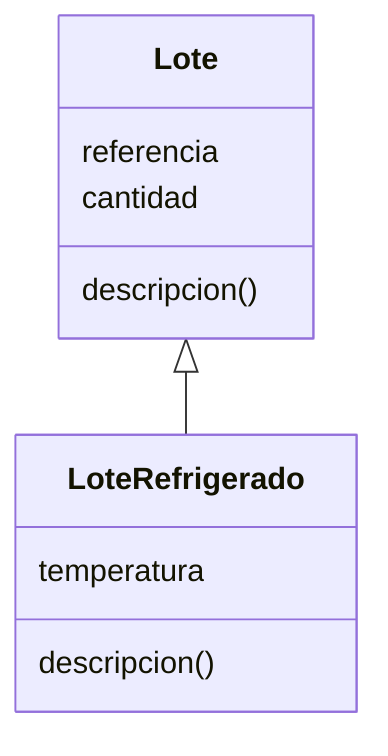

# Lección 10 — Herencia

> Fase 0 · POO · micro-paso · concepto nuevo: **reutilizar/extender** una clase.

## 0. 🧭 La pregunta
> *"Tengo `Lote`. Me piden un `LoteRefrigerado` casi igual pero con temperatura.
> Copiar toda la clase es duplicar. ¿Cómo reutilizo y solo agrego lo nuevo?"*

## 1. Objetivo
Crear una subclase que **hereda** de otra y **extiende** su comportamiento con `super()`.

## 2. Cita de la fuente
> *"class FakeRepository(AbstractRepository):"* — Cap. 2

El libro define clases que heredan de otra (clase padre entre paréntesis).

## 3. El dolor / necesidad
Copiar una clase para cambiar un detalle duplica código; la herencia reutiliza la base.

## 4. Explicación paso a paso
1. Clase padre `Lote` con datos y `descripcion()`.
2. `class LoteRefrigerado(Lote):` hereda todo lo del padre.
3. `super().__init__(...)` reutiliza el constructor; se agrega `temperatura`.
4. `descripcion()` llama a `super().descripcion()` y le suma lo nuevo.

Ver [`herencia.py`](herencia.py). Ejecutar:
```bash
uv run python lecciones/10-herencia/herencia.py
```

## 5. Diagrama (Mermaid)

`<|--` es "hereda de": `LoteRefrigerado` ES un `Lote` con algo extra.

## 6. Árbol de archivos
```
lecciones/10-herencia/
├── README.md
└── herencia.py
```

## 7. Tu turno
Crea `LoteFragil(Lote)` que agregue un aviso "⚠️ frágil" a la descripción.

## 8. Comprobación
Se comprueba ejecutando; opcionalmente una prueba pytest de `descripcion()`.

## 9. Preguntas de recuerdo
1. ¿Qué hereda una subclase de su clase padre?
2. ¿Para qué sirve `super()`?
3. ¿Cuándo conviene herencia en vez de copiar la clase?
