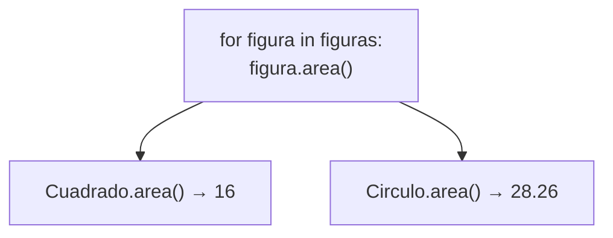

# Lección 11 — Polimorfismo

> Fase 0 · POO · micro-paso · concepto nuevo: **misma interfaz, distinto comportamiento**.

## 0. 🧭 La pregunta
> *"Tengo figuras distintas. Me piden mostrar el área de todas con un mismo código,
> sin un `if` por cada tipo. ¿Cómo las trato de forma uniforme?"*

## 1. Objetivo
Usar objetos distintos a través de un método común (`area()`), vía **duck typing**.

## 2. Cita de la fuente
> *"To a Pythonista, a repository is any object that has add(thing) and get(id) methods."*
> — Cap. 2

Importa que el objeto tenga los métodos, no de qué tipo sea.

## 3. El dolor / necesidad
Un `if tipo == ...` por cada clase no escala; queremos tratar a todos igual.

## 4. Explicación paso a paso
1. `Cuadrado` y `Circulo` son clases distintas, ambas con `area()`.
2. `mostrar_areas` llama `figura.area()` sin preguntar el tipo.
3. Cada objeto responde a su manera (16 y 28.26): mismo mensaje, distinto comportamiento.
4. En Python esto es duck typing: si tiene `area()`, sirve.

Ver [`polimorfismo.py`](polimorfismo.py). Ejecutar:
```bash
uv run python lecciones/11-polimorfismo/polimorfismo.py
```

## 5. Diagrama (Mermaid)

El mismo mensaje `area()` lo resuelve cada clase a su modo.

## 6. Árbol de archivos
```
lecciones/11-polimorfismo/
├── README.md
└── polimorfismo.py
```

## 7. Tu turno
Agrega una clase `Triangulo` con `area()` y pásala en la misma lista.

## 8. Comprobación
Se comprueba ejecutando; opcionalmente pytest sobre cada `area()`.

## 9. Preguntas de recuerdo
1. ¿Qué es polimorfismo en una frase?
2. ¿Qué es "duck typing"?
3. ¿Por qué `mostrar_areas` no necesita saber el tipo de cada figura?
