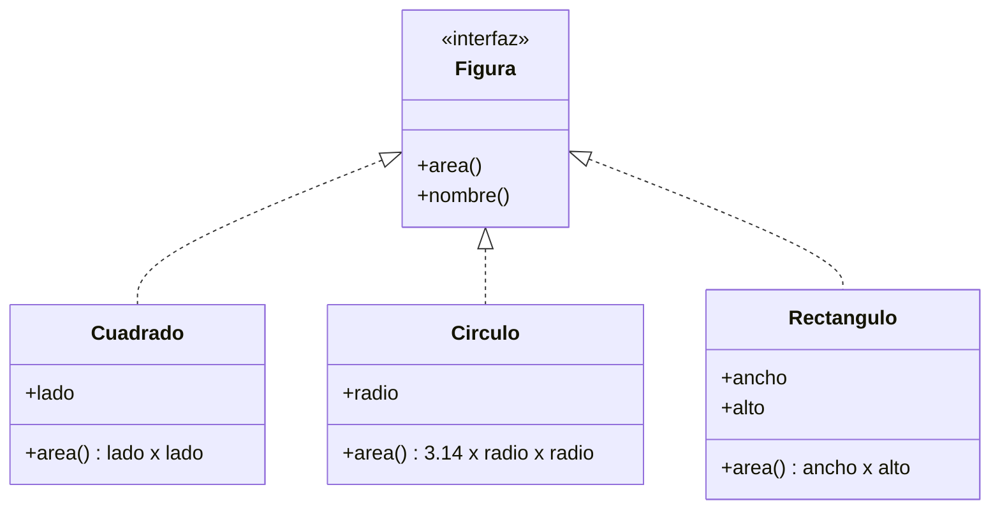
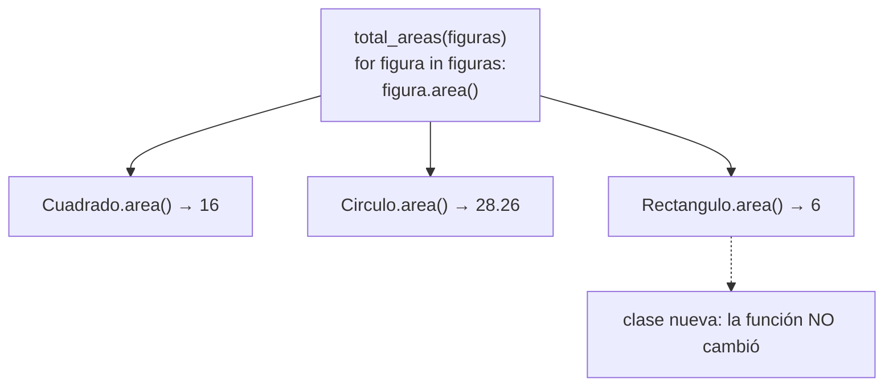

# Lección 11 — Polimorfismo

> Fase 0 · POO · Formulario · Familia de concepto: **misma interfaz, distinto comportamiento** · Orden de estudio: **12 de 18**

⬅️ [Lección 10 · Herencia](../10-herencia/) · 🏠 [Índice de lecciones](../README.md) · ➡️ [Lección 12 · Abstracción](../12-abstraccion/)

---

## 🧭 Ruta de estudio · Lección 11 (≈ 2 h)

**Antes necesitas:** [Lección 10 · Herencia](../10-herencia/) (sobrescribir métodos, `isinstance`).

| Paso | Qué haces | Dónde | ⏱ |
|:-:|---|---|:-:|
| **0** | Lee la teoría, las tablas de fórmulas, las propiedades y los errores | este README §0–§8 | 25 min |
| **1** | Ejecuta las fórmulas y compara cada línea con la tabla | [`paso1_formulas.py`](paso1_formulas.py) | 10 min |
| **2** | Sigue los ejemplos resueltos línea por línea | §9 + [`paso2_ejemplos_resueltos.py`](paso2_ejemplos_resueltos.py) | 20 min |
| **3** | Completa los `# TODO` y corre pytest hasta verlo en **verde** | [`paso3_tu_turno.py`](paso3_tu_turno.py) + [`test_paso3_tu_turno.py`](test_paso3_tu_turno.py) | 20 min |
| **4** | Compara con la solución de referencia | [`paso4_tu_turno_solucion.py`](paso4_tu_turno_solucion.py) | 5 min |
| **5** | Resuelve los 12 problemas **en un archivo tuyo**, luego revisa claves y solucionario | §10–§11 + [`paso5_solucionario/`](paso5_solucionario/) | 30 min |
| **6** | Compara solución mala vs buena | [`paso6_ejercicios/`](paso6_ejercicios/) | 10 min |
| **7** | Responde las preguntas de recuerdo **sin mirar** | §15 | 5 min |
| **🚦** | Evalúa si puedes pasar a la siguiente | §16 | 1 min |

---

## 0. 🧭 La pregunta
> *"Tengo figuras distintas (cuadrado, círculo…). Me piden mostrar el área de **todas** con un
> mismo código, **sin** un `if` por cada tipo. Y mañana llegará el rectángulo. ¿Cómo las trato
> de forma uniforme?"*

## 1. Objetivos (al terminar podrás…)
1. Explicar el polimorfismo: **el mismo mensaje** (`area()`) produce **respuestas distintas** según el objeto.
2. Escribir funciones que reciben **cualquier** objeto que cumpla un contrato, sin preguntar su tipo.
3. Agregar un tipo nuevo **sin tocar** la función que lo usa.
4. Distinguir polimorfismo **con herencia** del **duck typing** (sin parentesco).
5. Reconocer cuándo un objeto **no** cumple el contrato (nombre o argumentos distintos, sin `return`).

## 2. Cita de la fuente
> *"In practice we often just rely on Python's duck typing to enable abstractions. To a Pythonista, a repository is any object that has add(thing) and get(id) methods."* — Cap. 2

> *"In Python you can (and we sometimes do) use ABCs, but you can also happily rely on duck typing."* — Introducción

**Por qué importa:** para el libro, un repositorio es **cualquier** objeto con `add()` y
`get()`. No importa su clase: importa que **sepa** hacer esas dos cosas. Por eso más adelante
podrá cambiar un repositorio real por uno falso (`FakeRepository`) sin tocar a quien lo usa.

## 3. El dolor
```python
def area(figura):
    if isinstance(figura, Cuadrado):
        return figura.lado * figura.lado
    elif isinstance(figura, Circulo):
        return 3.14 * figura.radio * figura.radio
    # ¿Rectángulo? ¿Triángulo? ¿Hexágono? → un elif más cada vez...

print(area(Rectangulo(2, 3)))     # None: ¡la función no conocía el rectángulo!
```
Cada tipo nuevo obliga a **editar** la función, y si te olvidas, devuelve `None` en silencio.

---

## 4. 📘 Teoría

> **🎭 Definición — Polimorfismo**
> **Polimorfismo** ("muchas formas") significa que objetos de clases **distintas** responden al
> **mismo** mensaje, cada uno **a su manera**.
> `Cuadrado(4).area()` → `16` · `Circulo(3).area()` → `28.26`. Mismo mensaje, distinta respuesta.

> **🦆 Definición — Duck typing**
> *"Si camina como pato y hace cuac como pato, es un pato."* En Python no importa **de qué clase**
> es un objeto, sino **qué sabe hacer**. Si tiene `area()`, sirve como figura.

> **📜 Definición — Interfaz (contrato implícito)**
> El conjunto de métodos que el código **espera** que tenga un objeto: **mismo nombre** y
> **mismos argumentos**. Ej.: *"toda figura tiene `area()` sin argumentos y devuelve un número"*.

> **🔤 Vocabulario**
> - **Mensaje:** llamar a un método (`figura.area()` = "le mando el mensaje *area* a la figura").
> - **Interfaz / contrato:** qué métodos debe tener un objeto para poder usarse en un lugar.
> - **Duck typing:** polimorfismo **sin** herencia: basta con tener los métodos.
> - **`hasattr(obj, "nombre")`:** pregunta si el objeto tiene ese atributo o método (`True`/`False`).

> **🧠 Regla de oro**
> **No preguntes "¿qué eres?"; pide "haz tu parte".** Cada clase sabe su propia fórmula; la
> función solo manda el mensaje.

---

## 5. 🧮 Formulario: polimorfismo
Las clases `Cuadrado`, `Circulo`, `Rectangulo`, `Perro`, `Gato`, `Pato` y `Robot` y la función
`total_areas` están en [`paso1_formulas.py`](paso1_formulas.py):

| # | Concepto | Sintaxis / plantilla | Ejemplo | Resultado |
|---|---|---|---|---|
| P1 | Misma interfaz en clases distintas | `def area(self):` en cada clase | `Cuadrado(4).area()` / `Circulo(3).area()` | `16` / `28.26` |
| P2 | Llamar sin preguntar el tipo | `for x in lista: x.metodo()` | `for f in [Cuadrado(4), Circulo(3)]: f.area()` | `16`, `28.26` |
| P3 | Función que sirve para cualquiera | `def f(objetos): … obj.metodo() …` | `total_areas([Cuadrado(4), Circulo(3)])` | `44.26` |
| P4 | Tipo nuevo **sin** tocar la función | crear la clase con el mismo método | `total_areas([…, Rectangulo(2, 3)])` | `50.26` |
| P5 | Polimorfismo **con** herencia | cada hija sobrescribe (Lección 10) | `sonido()` de `Perro()`, `Gato()`, `Animal()` | `['Guau', 'Miau', '...']` |
| P6 | Duck typing (**sin** parentesco) | clases sueltas con el mismo método | `Pato().hablar()` / `Robot().hablar()` | `'Cuac'` / `'Bip'` |
| P7 | Python es polimórfico: `len` | `len(x)` | `len("mesa")`, `len([1, 2])`, `len({"a": 1})` | `4 2 1` |
| P8 | Python es polimórfico: `+` | `a + b` | `2 + 3`, `"a" + "b"`, `[1] + [2]` | `5 'ab' [1, 2]` |

## 6. 🧮 Formulario: el contrato implícito (duck typing)

| # | Concepto | Sintaxis | Ejemplo | Resultado |
|---|---|---|---|---|
| C1 | ¿Tiene el método? | `hasattr(obj, "nombre")` | `hasattr(Cuadrado(1), "area")` / `hasattr(Pato(), "area")` | `True` / `False` |
| C2 | Nombre distinto ⇒ no cumple | `def calcular_area(self):` | `total_areas([TrianguloMalo()])` | `AttributeError: 'TrianguloMalo' object has no attribute 'area'` |
| C3 | Argumentos distintos ⇒ no cumple | `def area(self, unidades):` | `total_areas([TrianguloConUnidades()])` | `TypeError: TrianguloConUnidades.area() missing 1 required positional argument: 'unidades'` |
| C4 | Sin `return` ⇒ devuelve `None` | `def area(self): 6 * 1` | `total_areas([TrianguloSinReturn()])` | `TypeError: unsupported operand type(s) for +: 'int' and 'NoneType'` |
| C5 | Saltar a quien no cumple | `if hasattr(x, "area"): … else: …` | `[Cuadrado(2), Pato(), Circulo(1)]` | `4` / `no sabe calcular su área` / `3.14` |

> 💡 Todas estas fórmulas están ejecutables en [`paso1_formulas.py`](paso1_formulas.py),
> con su código (P1, C1…) en cada línea de salida.

## 7. 📐 Propiedades
| Polimorfismo | Contrato |
|---|---|
| **R1.** La función que usa los objetos **no cambia** cuando aparece un tipo nuevo (P4). | **R5.** El contrato es **nombre + argumentos**: si cambia cualquiera, el objeto no cumple (C2, C3). |
| **R2.** Cada clase guarda **su propia** fórmula: el conocimiento vive donde corresponde. | **R6.** Python **no** revisa el contrato por adelantado: el error salta **al llamar** al método. |
| **R3.** Funciona **con** herencia (P5) y **sin** herencia (P6, duck typing). | **R7.** `hasattr` permite preguntar antes de llamar (C5). |
| **R4.** Python mismo es polimórfico: `len`, `+`, `print` sirven para muchos tipos (P7, P8). | **R8.** Los decimales no son exactos (`3.14 * 3 * 3` da `28.259999999999998`); por eso usamos `round(x, 2)`. |

## 8. ⚠️ Errores frecuentes
| # | ❌ Así no | Qué pasa | ✅ Así sí |
|---|---|---|---|
| X1 | `if isinstance(f, Cuadrado): … elif isinstance(f, Circulo): …` | funciona, pero un tipo nuevo devuelve **`None`** en silencio y obliga a editar la función | cada clase con su `area()`; la función solo llama `f.area()` |
| X2 | la clase nueva usa otro nombre: `calcular_area()` | `AttributeError: 'TrianguloMalo' object has no attribute 'area'` | el **mismo** nombre: `area()` |
| X3 | la clase nueva pide otro argumento: `area(self, unidades)` | `TypeError: TrianguloConUnidades.area() missing 1 required positional argument: 'unidades'` | los **mismos** argumentos: `area(self)` |
| X4 | olvidar el `return` en `area()` | `TypeError: unsupported operand type(s) for +: 'int' and 'NoneType'` | `return self.base * self.altura / 2` |
| X5 | pasar la **clase** en vez del **objeto**: `total_areas([Cuadrado])` | `TypeError: Cuadrado.area() missing 1 required positional argument: 'self'` | crear el objeto: `total_areas([Cuadrado(4)])` |
| X6 | olvidar los paréntesis: `total = total + figura.area` | `TypeError: unsupported operand type(s) for +: 'int' and 'method'` | `figura.area()` |

> 🔬 Pruébalos: X2, X3 y X4 se ven en vivo en [`paso1_formulas.py`](paso1_formulas.py) (líneas
> C2, C3 y C4), atrapados con `try/except` para que el programa siga.

---

## 9. ✍️ Ejemplos resueltos (paso a paso)
> Todos están en [`paso2_ejemplos_resueltos.py`](paso2_ejemplos_resueltos.py).

**Ejemplo 1 — El mismo mensaje, distintas respuestas** *(fácil)*
> Enunciado: muestra el área de un cuadrado de lado 4 y de un círculo de radio 3 con el mismo código.
```python
class Cuadrado:                                   # Paso 1: una clase con area()
    def __init__(self, lado):
        self.lado = lado
    def area(self):
        return self.lado * self.lado

class Circulo:                                    # Paso 2: OTRA clase, también con area()
    def __init__(self, radio):
        self.radio = radio
    def area(self):
        return round(3.14 * self.radio * self.radio, 2)

figuras = [Cuadrado(4), Circulo(3)]               # Paso 3: una lista con objetos distintos
for figura in figuras:                            # Paso 4: el mismo código para todos
    print(figura.area())                          # -> 16 / 28.26
```
| vuelta | `figura` es un… | `figura.area()` corre… | resultado |
|---|---|---|---|
| 1 | `Cuadrado(4)` | `Cuadrado.area` → `4 * 4` | `16` |
| 2 | `Circulo(3)` | `Circulo.area` → `round(3.14 * 3 * 3, 2)` | `28.26` |

**Ejemplo 2 — Una función que sirve para cualquier figura** *(fácil)*
> Enunciado: suma las áreas de una lista de figuras, sin importar de qué tipo son.
```python
def total_areas(figuras):                         # Paso 1: no pregunta el tipo
    total = 0                                     # Paso 2: acumulador
    for figura in figuras:
        total = total + figura.area()             # Paso 3: solo exige area()
    return round(total, 2)                        # Paso 4: redondea a 2 decimales

print(total_areas([Cuadrado(4), Circulo(3)]))     # -> 44.26
```

**Ejemplo 3 — De "if por tipo" a polimorfismo** *(intermedio)*
> Enunciado: llega el rectángulo. Compara qué pasa con la función de `if` y con la polimórfica.
```python
def area_con_ifs(figura):                         # ANTES: la función conoce cada tipo
    if isinstance(figura, Cuadrado):
        return figura.lado * figura.lado
    elif isinstance(figura, Circulo):
        return round(3.14 * figura.radio * figura.radio, 2)

class Rectangulo:                                 # DESPUÉS: el tipo nuevo trae su area()
    def __init__(self, ancho, alto):
        self.ancho = ancho
        self.alto = alto
    def area(self):
        return self.ancho * self.alto

print("con ifs, Rectangulo:", area_con_ifs(Rectangulo(2, 3)))       # -> None (¡lo olvidó!)
print("polimórfico:", total_areas([Cuadrado(4), Circulo(3), Rectangulo(2, 3)]))  # -> 50.26
```
| | con `if` por tipo | polimórfico |
|---|---|---|
| ¿dónde está la fórmula? | en la función, lejos de la clase | dentro de cada clase |
| llega el rectángulo | hay que agregar un `elif` | solo se crea la clase |
| si te olvidas de un tipo | devuelve `None` sin avisar | `AttributeError` claro |

**Ejemplo 4 — Duck typing con repositorios, como el libro** *(avanzado)*
> Enunciado: dos repositorios **sin parentesco** (uno con diccionario, otro con lista), con los
> mismos métodos `agregar()` y `obtener()`. Una sola función debe servir para ambos.
```python
class RepositorioDiccionario:                     # Paso 1: guarda en un diccionario
    def __init__(self):
        self._lotes = {}
    def agregar(self, referencia):
        self._lotes[referencia] = referencia
    def obtener(self, referencia):
        return self._lotes.get(referencia)

class RepositorioLista:                           # Paso 2: guarda en una lista (sin parentesco)
    def __init__(self):
        self._lotes = []
    def agregar(self, referencia):
        self._lotes.append(referencia)
    def obtener(self, referencia):
        for lote in self._lotes:
            if lote == referencia:
                return lote
        return None

def cargar_y_buscar(repo, referencias, buscada):  # Paso 3: solo usa agregar() y obtener()
    for referencia in referencias:
        repo.agregar(referencia)
    return repo.obtener(buscada)

for repo in [RepositorioDiccionario(), RepositorioLista()]:   # Paso 4: sirve con los dos
    print(type(repo).__name__, "->", cargar_y_buscar(repo, ["L1", "L2"], "L2"))
# -> RepositorioDiccionario -> L2
# -> RepositorioLista -> L2
```
Esto es literalmente *"a repository is any object that has add(thing) and get(id) methods"*.

---

## 10. 📝 Problemas propuestos
> Resuélvelos **antes** de mirar las claves. Crea tu propio archivo, por ejemplo
> `mis_problemas.py`, en esta carpeta.

**🟢 Nivel básico**
1. Crea `Perro` y `Gato` (**sin** herencia), cada uno con `sonido()` que devuelva `"Guau"` y
   `"Miau"`. Recórrelos en una lista imprimiendo el sonido.
2. Crea `Vaca` con `sonido()` = `"Muu"`, agrégala a la **misma** lista y repite el `for` **sin cambiarlo**.
3. Imprime `len("hola")`, `len([1, 2, 3])` y `len({"a": 1, "b": 2})`.
4. Imprime `10 + 5`, `"ab" + "cd"` y `[1] + [2, 3]`.

**🟡 Nivel intermedio**

5. Escribe `hacer_sonar(animales)` que devuelva una **lista** con el sonido de cada animal.
   Pruébala con perro, gato y vaca.
6. Crea `Efectivo`, `Tarjeta` y `Transferencia`, cada uno con `pagar(monto)` que devuelva un
   texto distinto (la tarjeta agrega `comisión` del 3 %). Escribe `procesar(metodo, monto)` y
   pruébala con `100` en los tres.
7. Crea `Libro(titulo)` y `Pelicula(titulo)`, sin parentesco, con `describir()`. Escribe
   `describir_todo(cosas)` que llame a `describir()` de cada una.
8. Recorre `[Libro("Rayuela"), 42, Pelicula("Up")]`: si el elemento tiene `describir`
   (usa `hasattr`), llámalo; si no, imprime `"<elemento> no sabe describirse"`.

**🔴 Nivel avanzado**

9. `Empleado(sueldo).pago()` devuelve el sueldo; `Freelance(horas, tarifa)` (hija) paga
   `horas * tarifa`; `Pasante()` (hija) paga `500` fijo. Suma la nómina de
   `[Empleado(2000), Freelance(10, 30), Pasante()]`.
10. Crea `Email`, `SMS` y `Chat`, cada uno con `enviar(mensaje)`. Escribe
    `avisar_a_todos(notificadores, mensaje)`. Agrega `Chat` **sin tocar** la función.
11. Escribe `total_con_ifs(figuras)` (con `isinstance`) y `total_polimorfico(figuras)` (con
    `area()`) y comprueba que dan lo mismo para `[Cuadrado(2), Circulo(1)]`.
12. *(Puente al libro)* Crea `RepositorioEnMemoria` y `RepositorioQueRegistra` (este último
    anota en una lista `registro` cada `agregar` y cada `obtener`), **sin** parentesco, ambos con
    `agregar(lote)` y `obtener(referencia)`. Escribe `guardar_lotes(repo, referencias)` que agregue
    todas y devuelva `obtener` de la última. Pruébala con los dos e imprime el registro.

## 11. 🔑 Claves (respuestas)
<details><summary>Ver claves (solo después de intentarlo)</summary>

| # | Salida esperada | Fórmula clave |
|---|---|---|
| 1 | `Guau` / `Miau` | P1 + P2 |
| 2 | `Guau` / `Miau` / `Muu` | P4 |
| 3 | `4 3 2` | P7 |
| 4 | `15 abcd [1, 2, 3]` | P8 |
| 5 | `['Guau', 'Miau', 'Muu']` | P3 |
| 6 | `Pagó 100 en efectivo` / `Pagó 100 con tarjeta (comisión 3.0)` / `Pagó 100 por transferencia` | P3 |
| 7 | `Libro: Cien años de soledad` / `Película: Coco` (con los títulos que elijas) | P6 |
| 8 | `Libro: Rayuela` / `42 no sabe describirse` / `Película: Up` | C5 |
| 9 | `total nómina 2800` | P5 |
| 10 | `EMAIL: …` / `SMS: …` / `CHAT: …` (una línea por notificador) | P4 |
| 11 | `con ifs 7.14 \| polimórfico 7.14` | X1 vs P3 |
| 12 | `L2`, `L2` y `['agregado L1', 'agregado L2', 'buscado L2']` | P6 (duck typing) |

El código completo de cada solución está en [`paso5_solucionario/`](paso5_solucionario/):
[`nivel_basico.py`](paso5_solucionario/nivel_basico.py) ·
[`nivel_intermedio.py`](paso5_solucionario/nivel_intermedio.py) ·
[`nivel_avanzado.py`](paso5_solucionario/nivel_avanzado.py).
</details>

---

## 12. 🗺️ Mapa mental y diagrama (Mermaid)

**Cómo leerlo:** `Figura` **no es una clase escrita** en el código: es el **contrato implícito**
("tener `area()` y `nombre()`"). La flecha punteada `<|..` significa *"cumple el contrato"*.
Cada clase lo cumple **con su propia fórmula**.


**Cómo leerlo:** la función manda **un solo mensaje** (`area()`), y cada objeto lo resuelve a su
modo. Agregar el rectángulo no tocó la función.

## 13. 🌳 Árbol de archivos
```
lecciones/11-polimorfismo/
├── README.md                    ← PASO 0 · EMPIEZA AQUÍ (este formulario)
├── paso1_formulas.py            ← PASO 1 · las fórmulas P1–P8 y C1–C5, ejecutables
├── paso2_ejemplos_resueltos.py  ← PASO 2 · los 4 ejemplos resueltos
├── paso3_tu_turno.py            ← PASO 3 · completa los # TODO
├── test_paso3_tu_turno.py       ← PASO 3 · las pruebas de tu paso3 (rojo → verde)
├── paso4_tu_turno_solucion.py   ← PASO 4 · solución de referencia
├── paso5_solucionario/          ← PASO 5 · soluciones de los 12 problemas
│   ├── nivel_basico.py
│   ├── nivel_intermedio.py
│   └── nivel_avanzado.py
└── paso6_ejercicios/            ← PASO 6 · solución mala vs buena
    ├── ejercicio-1/ … ejercicio-3/
    └── ejercicio-4-reto/
```

## 14. 🤝 Tu turno y ✅ comprobación con pytest
La comprobación es con **pytest**, al estilo **TDD: rojo → verde**.

1. Corre las pruebas **antes** de escribir nada. Verás **rojo** (5 fallan). Es a propósito.
   ```bash
   uv run pytest lecciones/11-polimorfismo -q        # -> 5 failed
   ```
2. Completa los `# TODO` de [`paso3_tu_turno.py`](paso3_tu_turno.py): un `Triangulo` que cumpla
   el mismo contrato, `total_areas` y `nombres`. Vuelve a correr pytest después de cada TODO.
3. Cuando todo esté bien:
   ```bash
   uv run pytest lecciones/11-polimorfismo -q        # -> 5 passed
   ```
4. Compara con la referencia:
   ```bash
   git diff --no-index lecciones/11-polimorfismo/paso3_tu_turno.py lecciones/11-polimorfismo/paso4_tu_turno_solucion.py
   ```

## 15. ❓ Preguntas de recuerdo
> Respóndelas **sin mirar**; luego abre cada una para comprobar.

<details><summary>1. ¿Qué es polimorfismo en una frase?</summary>

Que objetos de clases distintas responden al **mismo mensaje**, cada uno **a su manera**.
</details>
<details><summary>2. ¿Qué es <i>duck typing</i>?</summary>

Polimorfismo **sin** herencia: no importa la clase del objeto, sino que **tenga** los métodos que se le piden.
</details>
<details><summary>3. ¿Por qué <code>total_areas</code> no necesita saber el tipo de cada figura?</summary>

Porque solo manda el mensaje `area()`; cada figura sabe su propia fórmula.
</details>
<details><summary>4. ¿Qué dos cosas debe respetar una clase nueva para cumplir el contrato?</summary>

El **nombre** del método y sus **argumentos** (y devolver lo esperado).
</details>
<details><summary>5. ¿Qué problema tiene una función llena de <code>if isinstance(...)</code>?</summary>

Cada tipo nuevo obliga a editarla, y si te olvidas, devuelve `None` en silencio.
</details>
<details><summary>6. Según el libro, ¿qué es un repositorio "para un Pythonista"?</summary>

Cualquier objeto que tenga los métodos `add(thing)` y `get(id)`.
</details>

---

## 16. 🚦 ¿Puedo pasar a la siguiente lección?
| Indicador | Criterio |
|:-:|---|
| 🟢 **Sí, sigue** | `uv run pytest lecciones/11-polimorfismo -q` da **5 passed** **y** aciertas **≥ 9 de 12** problemas **y** respondes las 6 preguntas sin mirar |
| 🟡 **Repasa** | aciertas **6 a 8** → vuelve a §8 (errores frecuentes) y §9 (ejemplos resueltos) y reintenta los que fallaste |
| 🔴 **Repite la lección** | aciertas **menos de 6** → empieza otra vez desde el Paso 0 |

Cuando estés en 🟢, marca la lección en
[`progreso/fase-0-python.md`](../../progreso/fase-0-python.md) (sección *"Mi avance"*) y haz
commit; así también practicas Git.

---

⬅️ [Lección 10 · Herencia](../10-herencia/) · 🏠 [Índice de lecciones](../README.md) · ➡️ [Lección 12 · Abstracción](../12-abstraccion/)
