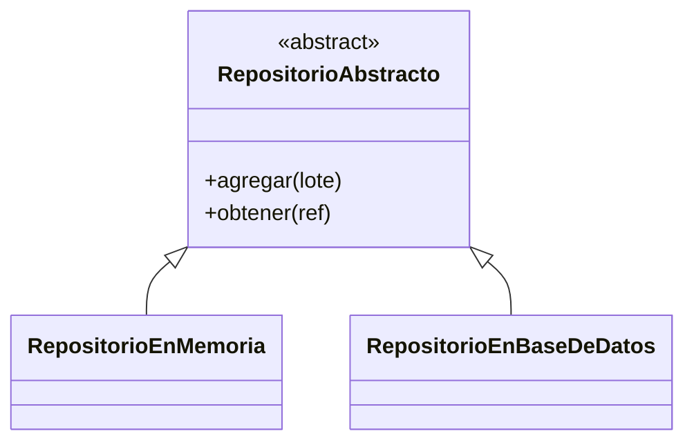

# Lección 12 — Abstracción (clases abstractas, `ABC`)

> Fase 0 · POO · micro-paso · concepto nuevo: definir un **contrato** con `ABC`.

## 0. 🧭 La pregunta
> *"Me piden guardar lotes en memoria hoy y en base de datos mañana, sin reescribir
> a quien los usa. ¿Cómo defino un contrato común que ambas versiones cumplan?"*

## 1. Objetivo
Definir una clase abstracta (`ABC` + `@abstractmethod`) como contrato, e implementarla.

## 2. Cita de la fuente
> *"class AbstractRepository(abc.ABC):"* / *"Python will refuse to let you instantiate
> a class that does not implement all the abstractmethods."* — Cap. 2

## 3. El dolor / necesidad
Sin un contrato común, cambiar de almacenamiento obliga a reescribir a quien lo usa.

## 4. Explicación paso a paso
1. `RepositorioAbstracto(ABC)` con `@abstractmethod` obliga a tener `agregar`/`obtener`.
2. `RepositorioEnMemoria` implementa ambos: cumple el contrato.
3. La abstracta no se puede instanciar (lanza `TypeError`).
4. Otra implementación (base de datos) cumpliría el mismo contrato y encajaría igual.

Ver [`abstraccion.py`](abstraccion.py). Ejecutar:
```bash
uv run python lecciones/12-abstraccion/abstraccion.py
```

## 5. Diagrama (Mermaid)

El contrato (abstracto) lo cumplen varias implementaciones concretas.

## 6. Árbol de archivos
```
lecciones/12-abstraccion/
├── README.md
└── abstraccion.py
```

## 7. Tu turno
Crea `RepositorioLista(RepositorioAbstracto)` que use una lista en vez de un dict.

## 8. Comprobación
Se comprueba ejecutando; opcionalmente pytest sobre `agregar`/`obtener`.

## 9. Preguntas de recuerdo
1. ¿Qué es una clase abstracta?
2. ¿Qué hace `@abstractmethod`?
3. ¿Por qué no se puede instanciar la clase abstracta?
