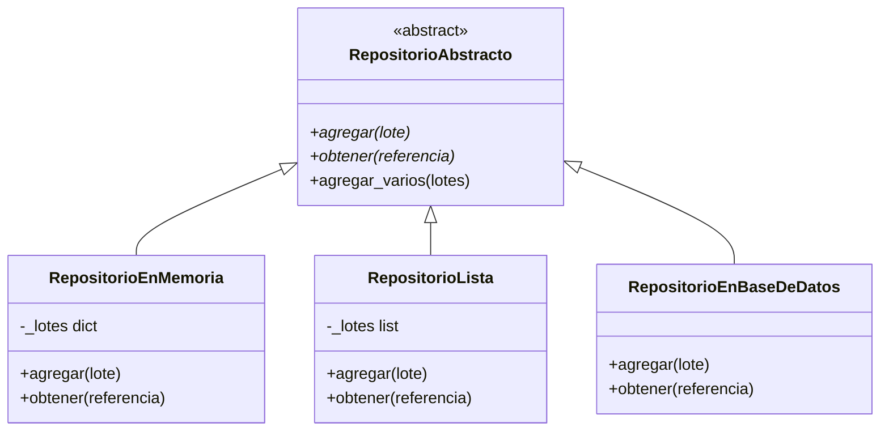
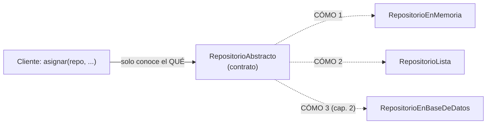

# Lección 12 — Abstracción (clases abstractas, `abc`)

> Fase 0 · POO · Formulario · Familia de concepto: **definir un contrato con `abc.ABC`** · Orden de estudio: **13 de 18**

⬅️ [Lección 11 · Polimorfismo](../11-polimorfismo/) · 🏠 [Índice de lecciones](../README.md) · ➡️ [Lección 13 · SOLID · SRP](../13-srp/)

---

## 🧭 Ruta de estudio · Lección 12 (≈ 2 h)

**Antes necesitas:** [Lección 11 · Polimorfismo](../11-polimorfismo/) (contrato implícito, duck typing) y, con ella, la herencia de la [Lección 10](../10-herencia/).

| Paso | Qué haces | Dónde | ⏱ |
|:-:|---|---|:-:|
| **0** | Lee la teoría, las tablas de fórmulas, las propiedades y los errores | este README §0–§8 | 25 min |
| **1** | Ejecuta las fórmulas y compara cada línea con la tabla | [`paso1_formulas.py`](paso1_formulas.py) | 10 min |
| **2** | Sigue los ejemplos resueltos línea por línea | §9 + [`paso2_ejemplos_resueltos.py`](paso2_ejemplos_resueltos.py) | 20 min |
| **3** | Completa los `# TODO` y corre pytest hasta verlo en **verde** | [`paso3_tu_turno.py`](paso3_tu_turno.py) + [`test_paso3_tu_turno.py`](test_paso3_tu_turno.py) | 20 min |
| **4** | Compara con la solución de referencia | [`paso4_tu_turno_solucion.py`](paso4_tu_turno_solucion.py) | 5 min |
| **5** | Resuelve los 12 problemas **en un archivo tuyo**, luego revisa claves y solucionario | §10–§11 + [`paso5_solucionario/`](paso5_solucionario/) | 30 min |
| **6** | Compara solución mala vs buena | [`paso6_ejercicios/`](paso6_ejercicios/) | 10 min |
| **7** | Responde las preguntas de recuerdo **sin mirar** | §15 | 5 min |
| **🚦** | Evalúa si puedes pasar a la siguiente | §16 | 1 min |

---

## 0. 🧭 La pregunta
> *"Hoy guardo los lotes en memoria y mañana en una base de datos. Me piden que quien los use
> **no** tenga que reescribirse. Con duck typing (Lección 11) nadie me avisa si a una versión le
> falta un método. ¿Cómo escribo un **contrato** que Python haga cumplir?"*

## 1. Objetivos (al terminar podrás…)
1. Escribir una **clase abstracta** con `abc.ABC` y `@abc.abstractmethod`.
2. Explicar por qué una clase abstracta **no se puede instanciar**.
3. Escribir **implementaciones concretas** que cumplan el contrato completo.
4. Agregar en la abstracta un **método concreto** que todas las hijas heredan.
5. Comparar duck typing y ABC: **cuándo** avisa Python que falta un método.

## 2. Cita de la fuente
> *"class AbstractRepository(abc.ABC):"* · *"@abc.abstractmethod def add(self, batch: model.Batch): raise NotImplementedError"* — Cap. 2

> *"Python will refuse to let you instantiate a class that does not implement all the abstractmethods defined in its parent class."* — Cap. 2

> *"We're using abstract base classes in this book for didactic reasons: we hope they help explain what the interface of the repository abstraction is."* — Cap. 2

**Por qué importa:** el `AbstractRepository` del cap. 2 es **exactamente** una clase abstracta:
dice **qué** debe saber hacer todo repositorio (`add`, `get`) sin decir **cómo**. Luego el libro
escribe un repositorio real (con base de datos) y uno falso (`FakeRepository`) que cumplen el mismo contrato.

## 3. El dolor
```python
class RepositorioEnMemoria:          # duck typing: nadie revisa el contrato
    def agregar(self, lote):
        ...
    # ¡olvidé obtener()!

repo = RepositorioEnMemoria()        # se crea sin ningún aviso...
repo.obtener("L1")                   # ...y explota recién aquí, quizá en producción:
# AttributeError: 'RepositorioEnMemoria' object has no attribute 'obtener'
```
Con duck typing el contrato vive solo **en tu cabeza**. Si a una versión le falta un método, te
enteras **tarde**: cuando alguien lo llama.

---

## 4. 📘 Teoría

> **📜 Definición — Clase abstracta**
> Una **clase abstracta** es un **molde incompleto a propósito**: declara **qué** métodos deben
> existir, pero **no** cómo se hacen. Sirve de **contrato**. En Python hereda de `abc.ABC`.
> `class RepositorioAbstracto(abc.ABC):`

> **🧩 Definición — Método abstracto**
> Un método marcado con `@abc.abstractmethod`. Dice *"toda hija **debe** escribir este método"*.
> Su cuerpo suele ser `raise NotImplementedError` ("todavía no implementado").

> **🏗️ Definición — Implementación concreta**
> Una clase hija que escribe **todos** los métodos abstractos. Solo entonces Python deja crear
> objetos de ella: `RepositorioEnMemoria(RepositorioAbstracto)`.

> **🔤 Vocabulario**
> - **ABC:** *Abstract Base Class*, "clase base abstracta". El módulo se llama `abc`.
> - **Abstracción:** quedarse con **lo esencial** (*qué* hace) y esconder el detalle (*cómo* lo hace).
> - **Contrato / interfaz:** la lista de métodos que toda implementación debe tener.
> - **Instanciar:** crear un objeto de una clase (`RepositorioEnMemoria()`).
> - **`NotImplementedError`:** el error que se lanza para decir *"esto lo tiene que escribir una hija"*.

> **🧠 Regla de oro**
> **La abstracta dice QUÉ; las concretas dicen CÓMO.** Quien usa un repositorio depende del
> **qué** (el contrato), así puedes cambiar el **cómo** sin tocarlo.

---

## 5. 🧮 Formulario: clases abstractas
Las clases `Lote`, `RepositorioAbstracto`, `RepositorioEnMemoria` y `RepositorioIncompleto`
están en [`paso1_formulas.py`](paso1_formulas.py):

| # | Concepto | Sintaxis / plantilla | Ejemplo | Resultado |
|---|---|---|---|---|
| A1 | Importar el módulo | `import abc` | `abc.ABC` | `<class 'abc.ABC'>` |
| A2 | Declarar la clase abstracta | `class Contrato(abc.ABC):` | `issubclass(RepositorioAbstracto, abc.ABC)` | `True` |
| A3 | Método abstracto | `@abc.abstractmethod` + `def m(self): raise NotImplementedError` | `agregar` y `obtener` | quedan marcados como **obligatorios** (se ven en el mensaje de A4) |
| A4 | La abstracta no se instancia | `Contrato()` | `RepositorioAbstracto()` | `TypeError: Can't instantiate abstract class RepositorioAbstracto without an implementation for abstract methods 'agregar', 'obtener'` |
| A5 | Implementación concreta | `class Concreta(Contrato):` + **todos** los métodos | `repo.obtener("L1").cantidad` | `10` |
| A6 | Implementación incompleta | falta un método | `RepositorioIncompleto()` | `TypeError: Can't instantiate abstract class RepositorioIncompleto without an implementation for abstract method 'obtener'` |
| A7 | La concreta **es** del tipo contrato | `isinstance(obj, Contrato)` | `isinstance(repo, RepositorioAbstracto)` | `True` |
| A8 | Método concreto en la abstracta | `def m(self): … self.metodo_abstracto() …` | `repo.agregar_varios([L2, L3])` → `obtener("L3").cantidad` | `7` |
| A9 | Forma corta equivalente | `from abc import ABC, abstractmethod` | `class FiguraAbstracta(ABC):` + `@abstractmethod` | mismo efecto: `TypeError` al instanciar |

## 6. 🧮 Formulario: duck typing (L11) vs ABC (L12) — ¿cuándo usar qué?

| # | Pregunta | Duck typing (Lección 11) | ABC (esta lección) |
|---|---|---|---|
| C1 | ¿Dónde está escrito el contrato? | solo en comentarios o en tu cabeza | en el código: la clase abstracta |
| C2 | Si falta un método, ¿cuándo te enteras? | **al llamarlo**: `AttributeError: 'RepoDuckIncompleto' object has no attribute 'obtener'` | **al crear el objeto**: `TypeError: Can't instantiate abstract class …` |
| C3 | ¿Hace falta heredar? | no | sí: `class Concreta(Contrato):` |
| C4 | ¿Se puede cambiar el "cómo" sin tocar al cliente? | sí | sí |
| C5 | ¿Qué hace el libro? | *"In practice we often just rely on Python's duck typing"* | usa ABC *"for didactic reasons"*, para que se **vea** la interfaz |

> 💡 Todas estas fórmulas están ejecutables en [`paso1_formulas.py`](paso1_formulas.py),
> con su código (A1, C2…) en cada línea de salida.

## 7. 📐 Propiedades
| Clase abstracta | Implementaciones |
|---|---|
| **R1.** Una clase con algún método abstracto pendiente **no** se puede instanciar (A4). | **R5.** Una hija se puede instanciar **solo** si implementa **todos** los abstractos (A5, A6). |
| **R2.** Python revisa el contrato **al crear** el objeto, no al definir la clase. | **R6.** El nombre debe ser **idéntico**: `añadir` no cuenta como `agregar`. |
| **R3.** `@abc.abstractmethod` **solo** protege si la clase hereda de `abc.ABC` (X4). | **R7.** Las hijas heredan los métodos **concretos** de la abstracta (A8). |
| **R4.** La abstracta puede tener métodos normales que usen a los abstractos (A8). | **R8.** El cliente puede recibir **cualquier** implementación (es polimorfismo, Lección 11). |

## 8. ⚠️ Errores frecuentes
| # | ❌ Así no | Qué pasa | ✅ Así sí |
|---|---|---|---|
| X1 | `RepositorioAbstracto()` | `TypeError: Can't instantiate abstract class RepositorioAbstracto without an implementation for abstract methods 'agregar', 'obtener'` | crear un objeto de una clase **concreta**: `RepositorioEnMemoria()` |
| X2 | olvidar implementar un método en la hija | `TypeError: Can't instantiate abstract class RepositorioIncompleto without an implementation for abstract method 'obtener'` | escribir **todos** los métodos del contrato |
| X3 | la hija usa otro nombre: `def añadir(self, lote):` | `TypeError: Can't instantiate abstract class NombreDistinto without an implementation for abstract method 'agregar'` | el **mismo** nombre del contrato: `agregar` |
| X4 | usar `@abc.abstractmethod` **sin** heredar de `abc.ABC` | **no hay error**: la clase se instancia y la protección **no funciona** | `class Contrato(abc.ABC):` |
| X5 | olvidar `@abc.abstractmethod` en un método del contrato | **no hay error**: una hija puede olvidar ese método y nadie avisa | decorar **cada** método obligatorio |
| X6 | escribir `@abstractmethod` después de `import abc` | `NameError: name 'abstractmethod' is not defined` | `@abc.abstractmethod`, o bien `from abc import abstractmethod` |

> 🔬 Pruébalos: al final de [`paso1_formulas.py`](paso1_formulas.py) están X1 y X2 comentados.
> Quita el `#` de **uno**, ejecuta, lee el mensaje y vuelve a ponerlo.

---

## 9. ✍️ Ejemplos resueltos (paso a paso)
> Todos están en [`paso2_ejemplos_resueltos.py`](paso2_ejemplos_resueltos.py).

**Ejemplo 1 — Escribir el contrato y comprobar que no se instancia** *(fácil)*
> Enunciado: define el contrato de un repositorio con `agregar` y `obtener`.
```python
import abc

class RepositorioAbstracto(abc.ABC):              # Paso 1: hereda de abc.ABC
    @abc.abstractmethod                           # Paso 2: marca cada método obligatorio
    def agregar(self, lote):
        raise NotImplementedError                 # Paso 3: sin "cómo": solo el "qué"

    @abc.abstractmethod
    def obtener(self, referencia):
        raise NotImplementedError

try:
    RepositorioAbstracto()                        # Paso 4: intentar crear un objeto
except TypeError as error:
    print("No se puede:", error)
# -> No se puede: Can't instantiate abstract class RepositorioAbstracto without an
#    implementation for abstract methods 'agregar', 'obtener'
```

**Ejemplo 2 — Una implementación concreta** *(fácil)*
> Enunciado: un repositorio que guarde los lotes en un diccionario.
```python
class Lote:
    def __init__(self, referencia, cantidad):
        self.referencia = referencia
        self.cantidad = cantidad

class RepositorioEnMemoria(RepositorioAbstracto):  # Paso 1: hereda del contrato
    def __init__(self):
        self._lotes = {}                           # Paso 2: elige CÓMO guardar
    def agregar(self, lote):                       # Paso 3: implementa agregar
        self._lotes[lote.referencia] = lote
    def obtener(self, referencia):                 # Paso 4: implementa obtener
        return self._lotes.get(referencia)

memoria = RepositorioEnMemoria()                   # Paso 5: ahora SÍ se puede crear
memoria.agregar(Lote("L1", 10))
print(memoria.obtener("L1").cantidad)              # -> 10
```
| clase | ¿le falta algún método abstracto? | ¿se puede instanciar? |
|---|---|---|
| `RepositorioAbstracto` | sí: `agregar`, `obtener` | ❌ `TypeError` |
| `RepositorioEnMemoria` | no | ✅ |

**Ejemplo 3 — Otra implementación y un cliente que no cambia** *(intermedio)*
> Enunciado: agrega un repositorio con **lista** y una función `asignar` que sirva para los dos.
```python
class RepositorioLista(RepositorioAbstracto):      # Paso 1: mismo contrato, otro CÓMO
    def __init__(self):
        self._lotes = []
    def agregar(self, lote):
        self._lotes.append(lote)
    def obtener(self, referencia):
        for lote in self._lotes:
            if lote.referencia == referencia:
                return lote
        return None

def asignar(repo, referencia, pedido):            # Paso 2: el cliente solo usa el contrato
    lote = repo.obtener(referencia)
    if pedido > lote.cantidad:
        raise ValueError("No hay stock suficiente")
    lote.cantidad = lote.cantidad - pedido
    return lote.cantidad

for repo in [RepositorioEnMemoria(), RepositorioLista()]:   # Paso 3: sirve con los dos
    repo.agregar(Lote("L1", 10))
    print(type(repo).__name__, "-> quedan", asignar(repo, "L1", 3))
# -> RepositorioEnMemoria -> quedan 7
# -> RepositorioLista -> quedan 7
```

**Ejemplo 4 — El repositorio del libro** *(avanzado)*
> Enunciado: un contrato con `agregar`, `obtener` y `listar`, un método concreto `contar()`, y un
> `RepositorioFalso` que arranca con una lista de lotes, como el `FakeRepository` del cap. 2.
```python
class RepositorioConListar(abc.ABC):               # Paso 1: contrato con 3 métodos
    @abc.abstractmethod
    def agregar(self, lote):
        raise NotImplementedError
    @abc.abstractmethod
    def obtener(self, referencia):
        raise NotImplementedError
    @abc.abstractmethod
    def listar(self):
        raise NotImplementedError

    def contar(self):                              # Paso 2: método CONCRETO que usa el contrato
        return len(self.listar())

class RepositorioFalso(RepositorioConListar):      # Paso 3: como el FakeRepository del cap. 2
    def __init__(self, lotes):
        self._lotes = list(lotes)
    def agregar(self, lote):
        self._lotes.append(lote)
    def obtener(self, referencia):
        for lote in self._lotes:
            if lote.referencia == referencia:
                return lote
        return None
    def listar(self):
        return self._lotes

falso = RepositorioFalso([Lote("L1", 10), Lote("L2", 5)])   # Paso 4: arranca con 2 lotes
falso.agregar(Lote("L3", 7))
print("contar:", falso.contar())                            # -> 3 (heredado de la abstracta)
print("obtener L2:", falso.obtener("L2").cantidad)          # -> 5
```
`contar()` está escrito **una sola vez**, en la abstracta, y sirve para **cualquier** hija porque
se apoya en `listar()`, que el contrato obliga a tener.

---

## 10. 📝 Problemas propuestos
> Resuélvelos **antes** de mirar las claves. Crea tu propio archivo, por ejemplo
> `mis_problemas.py`, en esta carpeta.

**🟢 Nivel básico**
1. Define `Figura(abc.ABC)` con un método abstracto `area()`. Intenta `Figura()`, atrapa el error e imprime su mensaje.
2. Crea `Cuadrado(Figura)` que implemente `area()`. Imprime `Cuadrado(3).area()`.
3. Imprime `isinstance(Cuadrado(3), Figura)` e `issubclass(Cuadrado, Figura)`.
4. Crea `FiguraIncompleta(Figura)` **sin** `area()`. Intenta crear un objeto e imprime el mensaje del error.

**🟡 Nivel intermedio**

5. Define `Notificador(abc.ABC)` con `enviar(mensaje)` abstracto, y `Email` y `SMS` concretos
   que devuelvan `"EMAIL: …"` y `"SMS: …"`. Recórrelos enviando `"hola"`.
6. Agrega a `Figura` un método **concreto** `describir()` que devuelva
   `"Figura con área <area>"` usando `self.area()`. Imprime `Cuadrado(3).describir()`.
7. Define `Almacen(abc.ABC)` con **dos** métodos abstractos, `guardar(clave, valor)` y
   `leer(clave)`, e impleméntalo con un diccionario. Guarda `"mesa": 10` y lee `"mesa"` y `"silla"`.
8. Demuestra el error X4: una clase con `@abc.abstractmethod` pero **sin** heredar de `abc.ABC`.
   Crea un objeto e imprime que se creó sin error.

**🔴 Nivel avanzado**

9. Define `MetodoPago(abc.ABC)` con `pagar(monto)` abstracto y `confirmar(monto)` concreto que
   devuelva `"OK: " + self.pagar(monto)`. Implementa `Efectivo` y `Tarjeta` y confirma `50` con cada uno.
10. Con un `RepositorioAbstracto` (`agregar`, `obtener`), escribe `RepositorioDiccionario` y
    `RepositorioLista`, y una función `buscar_cantidad(repo, referencia)` que sirva para los dos.
11. *Método plantilla:* `Reporte(abc.ABC)` tiene `generar()` **concreto** que devuelve
    `"<titulo> | <cuerpo>"`, y `titulo()` y `cuerpo()` **abstractos**. Implementa `ReporteVentas`
    (`"VENTAS"`, `"3 pedidos"`) y `ReporteStock` (`"STOCK"`, `"25 unidades"`).
12. *(Puente al libro)* Como el `AbstractRepository(abc.ABC)` del cap. 2: escribe un contrato con
    `agregar`, `obtener` y `listar`, un `RepositorioFalso(lotes)` que arranque con una lista, y
    una función `asignar(referencia, pedido, repo)` que reste stock o lance
    `ValueError("No hay stock suficiente")`. Con `[Lote("L1", 10), Lote("L2", 5)]`: asigna `3` a
    `L1`, intenta asignar `50` a `L2`, e imprime cuántos lotes hay.

## 11. 🔑 Claves (respuestas)
<details><summary>Ver claves (solo después de intentarlo)</summary>

| # | Salida esperada | Fórmula clave |
|---|---|---|
| 1 | `Can't instantiate abstract class Figura without an implementation for abstract method 'area'` | A2 + A3 + A4 |
| 2 | `9` | A5 |
| 3 | `True \| True` | A7 |
| 4 | `Can't instantiate abstract class FiguraIncompleta without an implementation for abstract method 'area'` | A6 |
| 5 | `EMAIL: hola` / `SMS: hola` | A5 |
| 6 | `Figura con área 9` | A8 |
| 7 | `10 \| None` | A5 (dos métodos) |
| 8 | `se creó SinABC sin error: la protección NO funciona` | X4 |
| 9 | `OK: pagó 50 en efectivo` / `OK: pagó 50 con tarjeta` | A8 |
| 10 | `RepositorioDiccionario 10` / `RepositorioLista 10` | A5 + C4 |
| 11 | `VENTAS \| 3 pedidos` / `STOCK \| 25 unidades` | A8 (método plantilla) |
| 12 | `L1 queda con 7`, luego `No hay stock suficiente`, luego `lotes en el repo: 2` | A5 + A8 |

El código completo de cada solución está en [`paso5_solucionario/`](paso5_solucionario/):
[`nivel_basico.py`](paso5_solucionario/nivel_basico.py) ·
[`nivel_intermedio.py`](paso5_solucionario/nivel_intermedio.py) ·
[`nivel_avanzado.py`](paso5_solucionario/nivel_avanzado.py).
</details>

---

## 12. 🗺️ Mapa mental y diagrama (Mermaid)

**Cómo leerlo:** `<<abstract>>` marca el **contrato**; el `*` señala los métodos **abstractos**
(obligatorios). `agregar_varios` es **concreto**: lo heredan todas. Las tres hijas implementan el
mismo contrato con un **cómo** distinto. La de base de datos la construirás en la Fase 1 (cap. 2).


**Cómo leerlo:** el cliente depende **solo** del contrato. Cambiar de memoria a base de datos es
cambiar **qué objeto le pasas**, no el código del cliente.

## 13. 🌳 Árbol de archivos
```
lecciones/12-abstraccion/
├── README.md                    ← PASO 0 · EMPIEZA AQUÍ (este formulario)
├── paso1_formulas.py            ← PASO 1 · las fórmulas A1–A9 y C2, ejecutables
├── paso2_ejemplos_resueltos.py  ← PASO 2 · los 4 ejemplos resueltos
├── paso3_tu_turno.py            ← PASO 3 · completa los # TODO
├── test_paso3_tu_turno.py       ← PASO 3 · las pruebas de tu paso3 (rojo → verde)
├── paso4_tu_turno_solucion.py   ← PASO 4 · solución de referencia
├── paso5_solucionario/          ← PASO 5 · soluciones de los 12 problemas
│   ├── nivel_basico.py
│   ├── nivel_intermedio.py
│   └── nivel_avanzado.py
└── paso6_ejercicios/            ← PASO 6 · solución mala vs buena
    ├── ejercicio-1/ … ejercicio-3/
    └── ejercicio-4-reto/
```

## 14. 🤝 Tu turno y ✅ comprobación con pytest
La comprobación es con **pytest**, al estilo **TDD: rojo → verde**.

1. Corre las pruebas **antes** de escribir nada. Verás **rojo**: 4 fallan y 1 pasa (la que
   comprueba que el contrato no se instancia, porque el contrato ya viene escrito). Es a propósito.
   ```bash
   uv run pytest lecciones/12-abstraccion -q        # -> 4 failed, 1 passed
   ```
2. Completa los `# TODO` de [`paso3_tu_turno.py`](paso3_tu_turno.py): que `RepositorioLista`
   herede del contrato e implemente `agregar`, `obtener` y `listar`.
3. Cuando todo esté bien:
   ```bash
   uv run pytest lecciones/12-abstraccion -q        # -> 5 passed
   ```
4. Compara con la referencia:
   ```bash
   git diff --no-index lecciones/12-abstraccion/paso3_tu_turno.py lecciones/12-abstraccion/paso4_tu_turno_solucion.py
   ```

> 🔎 La prueba `test_el_contrato_no_se_puede_instanciar` usa `with pytest.raises(TypeError):`.
> Se lee: *"crear `RepositorioAbstracto()` **debe** lanzar `TypeError`"*.

## 15. ❓ Preguntas de recuerdo
> Respóndelas **sin mirar**; luego abre cada una para comprobar.

<details><summary>1. ¿Qué es una clase abstracta?</summary>

Un molde incompleto a propósito que declara **qué** métodos debe tener toda hija (el contrato), sin decir **cómo**.
</details>
<details><summary>2. ¿Qué hace <code>@abc.abstractmethod</code>?</summary>

Marca un método como **obligatorio**: mientras una clase no lo implemente, no se pueden crear objetos de ella.
</details>
<details><summary>3. ¿Por qué no se puede instanciar la clase abstracta?</summary>

Porque tiene métodos abstractos sin implementar; Python lanza `TypeError: Can't instantiate abstract class …`.
</details>
<details><summary>4. Con duck typing, ¿cuándo te enteras de que falta un método? ¿Y con ABC?</summary>

Con duck typing, **al llamarlo** (`AttributeError`). Con ABC, **al crear el objeto** (`TypeError`).
</details>
<details><summary>5. ¿Qué pasa si usas <code>@abc.abstractmethod</code> pero la clase no hereda de <code>abc.ABC</code>?</summary>

Nada: la clase se instancia sin error y la protección **no funciona**.
</details>
<details><summary>6. ¿Por qué dice el libro que usa ABC?</summary>

*"For didactic reasons"*: para que se **vea** cuál es la interfaz del repositorio. En la práctica suelen usar duck typing.
</details>

---

## 16. 🚦 ¿Puedo pasar a la siguiente lección?
| Indicador | Criterio |
|:-:|---|
| 🟢 **Sí, sigue** | `uv run pytest lecciones/12-abstraccion -q` da **5 passed** **y** aciertas **≥ 9 de 12** problemas **y** respondes las 6 preguntas sin mirar |
| 🟡 **Repasa** | aciertas **6 a 8** → vuelve a §8 (errores frecuentes) y §9 (ejemplos resueltos) y reintenta los que fallaste |
| 🔴 **Repite la lección** | aciertas **menos de 6** → empieza otra vez desde el Paso 0 |

Cuando estés en 🟢, marca la lección en
[`progreso/fase-0-python.md`](../../progreso/fase-0-python.md) (sección *"Mi avance"*) y haz
commit; así también practicas Git.

---

⬅️ [Lección 11 · Polimorfismo](../11-polimorfismo/) · 🏠 [Índice de lecciones](../README.md) · ➡️ [Lección 13 · SOLID · SRP](../13-srp/)
