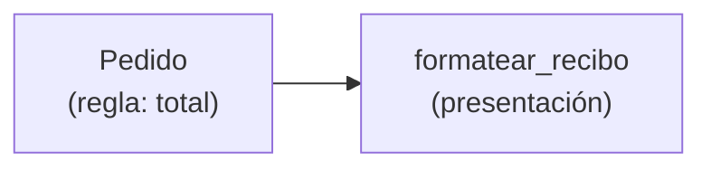

# Lección 13 — SRP (Single Responsibility Principle)

> Fase 0 · SOLID · micro-paso · concepto nuevo: **una responsabilidad por pieza**.

## 0. 🧭 La pregunta
> *"Mi clase hace de todo (calcular, mostrar, guardar). Cada cambio toca la misma
> clase y rompe lo demás. ¿Cómo la ordeno?"*

## 1. Objetivo
Separar responsabilidades: cada clase/función cambia por **una sola razón**.

## 2. Cita de la fuente
> *"SOLID ... single responsibility, open for extension but closed for modification,
> Liskov substitution, interface segregation, and dependency inversion."* — Cap. 1 (nota)

## 3. El dolor / necesidad
Una clase con varias responsabilidades es frágil: un cambio en una rompe las otras.

## 4. Explicación paso a paso
1. SRP = una responsabilidad = una razón para cambiar.
2. `Pedido` solo calcula `total()` (regla de negocio).
3. `formatear_recibo()` se encarga de la presentación (otra responsabilidad).
4. Cambiar el formato no toca `Pedido`, y viceversa.

Ver [`srp.py`](srp.py). Ejecutar:
```bash
uv run python lecciones/13-srp/srp.py
```

## 5. Diagrama (Mermaid)

Negocio y presentación separados: cada uno cambia sin arrastrar al otro.

## 6. Árbol de archivos
```
lecciones/13-srp/
├── README.md
└── srp.py
```

## 7. Tu turno
Agrega una función `guardar_pedido(pedido)` (simulada) como tercera responsabilidad aparte.

## 8. Comprobación
Se comprueba ejecutando; opcionalmente pytest sobre `total()`.

## 9. Preguntas de recuerdo
1. ¿Qué dice el SRP?
2. ¿Por qué separar la presentación de la regla de negocio?
3. ¿Qué significa "una sola razón para cambiar"?
